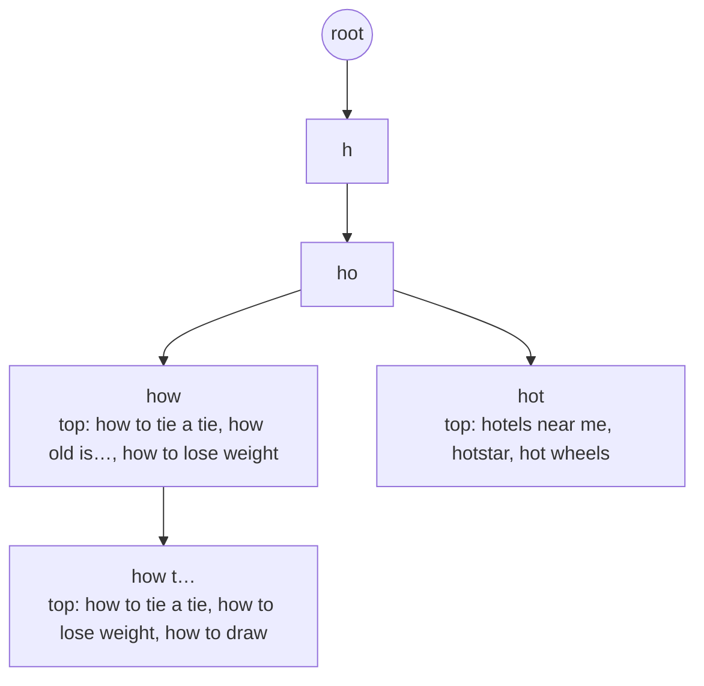
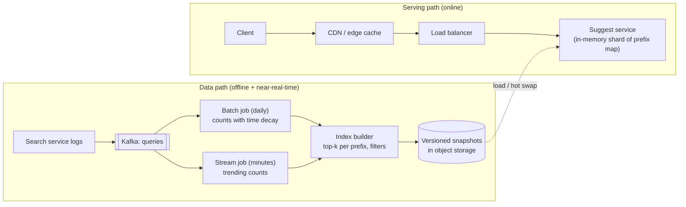

<Related ids={['caching', 'cdn', 'batch-and-stream-processing', 'probabilistic-data-structures', 'search-systems', 'sharding']} />

Design search autocomplete (typeahead): as a user types "how to", suggest the top completions — "how to tie a tie", "how to lose weight" — ranked by popularity, within the time between keystrokes. It's a classic because the latency budget is brutal, the read volume is enormous, and the elegant answer is **precomputation**.

## 1. Clarify the problem

| Question | Assumption |
| --- | --- |
| What do we suggest? | Popular complete queries matching the typed **prefix** |
| How many suggestions? | Top 10 |
| Ranking? | Popularity (search frequency), with recency weighting; personalisation optional |
| Freshness? | Trending queries should appear within ~15 minutes; the long tail can update daily |
| Scale? | 1B searches/day; average query ~4 words, ~20 characters |
| Languages? | English first; design shouldn't preclude others |
| Filtering? | Must remove offensive/unsafe suggestions |

## 2. Requirements

**Functional:** return top-k suggestions for a prefix; update rankings from search logs; support blocklisting.

**Non-functional:**

- **Latency** — suggestions should render within ~100 ms of a keystroke end to end, so the server budget is a few tens of milliseconds.
- **High availability** — degrade gracefully (show nothing) rather than error.
- **Scale** — very high read QPS.

## 3. Capacity estimation

```text
Searches: 1B/day. Each search triggers a request per keystroke after debounce — say ~10 requests/search
Autocomplete requests: 10B/day ÷ 10^5 ≈ 100K/s average, ~300K/s peak

Unique queries in the corpus: ~1B; keep the top ~100M by popularity for suggestions
Prefixes: each query of ~20 chars has ~20 prefixes, but they share heavily;
store top-10 completions per prefix for prefixes up to ~20 chars

Rough size: ~1B distinct prefixes × top-10 entries × ~30 B ≈ 300 GB (before compression/pruning)
→ prune rare prefixes (min count) and shard; hot prefixes (1–3 chars) are a tiny set served from cache/edge
```

**So:** reads dominate completely. Precompute top-k per prefix offline so serving is a single lookup; shard the long tail; cache short prefixes everywhere.

## 4. API

```text
GET /v1/suggest?q=how%20to&limit=10&locale=en-IN
→ 200 { "prefix": "how to", "suggestions": ["how to tie a tie", "how to lose weight", …] }
Cache-Control: public, max-age=300     (non-personalised)
```

## 5. Data model

The core structure is a **trie** (prefix tree), where each node represents a prefix:



Naively, getting the top 10 for a prefix means traversing every completion beneath the node — far too slow for short prefixes with millions of descendants. The key optimisation: **store the precomputed top-k completions at every node**. A lookup becomes "walk to the prefix node, return its list" — O(length of prefix).

**Why precompute?** Without it, a lookup costs O(p) to find the prefix node, O(c) to walk its c descendants, and O(c log c) to sort them — and c can be millions for a one-letter prefix. Capping prefix length (users rarely type more than ~50 characters) and storing the top-k at each node reduce both steps to effectively O(1), at the cost of memory.

For serving at scale, the trie is usually **flattened into a key-value map**: `prefix → [top 10 completions with scores]`, which shards and caches trivially.

## 6. High-level design

<FlowSteps title='Serving suggestions and keeping them fresh' steps={[
  { path: ['C', 'CDN'], text: 'Each (debounced) keystroke asks for suggestions; popular prefixes are answered from the edge cache.' },
  { path: ['CDN', 'LB', 'SS'], text: 'Misses go to the suggest service shard that owns the prefix, which reads its precomputed top-k from memory.' },
  { path: ['SL', 'K'], text: 'Meanwhile, the search service logs every query to Kafka.' },
  { path: ['K', 'B', 'BUILD'], text: 'A daily batch job counts queries with time decay, and the index builder computes the top-k for every prefix.' },
  { path: ['K', 'ST', 'BUILD'], text: 'A stream job adds trending queries within minutes.' },
  { path: ['BUILD', 'SNAP', 'SS'], text: 'New versioned snapshots are hot-swapped into the suggest servers.' },
]}>



</FlowSteps>

**Serving:** client debounces keystrokes (e.g., 100–150 ms), requests the prefix; the CDN serves popular prefixes; misses go to a suggest server that holds its shard of the prefix map **in memory** and returns the list.

**Building:** search events flow to Kafka. A daily batch job computes query frequencies over a window with **time decay** (recent searches count more), removes blocklisted and low-quality queries, and builds top-k per prefix. A streaming job counts recent queries per 5–15 minutes to detect **trending** queries and merges them in. The builder writes immutable, versioned snapshots; servers load the new version and atomically swap.

## 7. Deep dives

### Sharding the prefix map

- **By prefix range** (first characters): simple, but skewed — far more queries start with "s" than "x". Split ranges by observed **load**, not alphabet, using a shard map.
- **By hash of prefix**: even distribution; each request touches exactly one shard since lookup is by the full prefix string.
- Short prefixes (1–2 chars) are extremely hot but few — replicate them to **every** server and cache them at the edge.

Each shard is **replicated** for availability and read throughput.

### Freshness without rebuilding everything

Full rebuilds are batch (daily). For trending queries:

- The stream job maintains counts over a sliding window per query (Count-Min Sketch + heap for heavy hitters).
- Trending entries are pushed as **deltas** to suggest servers, which merge them into the top-k lists for affected prefixes (only the ~20 prefixes of each trending query).
- Or run a small, separate "trending index" and merge results at query time.

**Updating in place is expensive.** If one query's count changes, every ancestor node's top-k list may change too ("beer" rising affects "b", "be", "bee", "beer"). That's why most designs rebuild periodically and swap snapshots, applying in-place deltas only for a small trending set. The log pipeline can also **sample** queries (log 1 in N) to cut processing cost, since rankings only need relative frequencies.

### Ranking

Score = f(frequency with decay, freshness boost, click-through rate of the suggestion, language/locale match). **Personalisation** (the user's own recent searches) is merged client- or server-side from a small per-user store — and makes responses uncacheable at the CDN, so keep the global list cacheable and add personal entries separately.

### Client-side optimisations

- **Debounce** keystrokes and cancel in-flight requests when a new one starts.
- **Cache** results per prefix on the client; as the user types "how t" after "how", filter the cached list locally first.
- **Prefetch** for likely next prefixes.
- Show results only if they still match the current input (responses can arrive out of order).
- Use **HTTP caching** in the browser: Google, for example, has served suggestions with `Cache-Control: private, max-age=3600` — cached per user for an hour, never by shared caches. Non-personalised lists can additionally be edge-cached as `public`.

### Locale and language

Different countries search for different things — build **separate tries per locale/market** (and serve them from nearby regions or the edge). For non-English languages, store Unicode characters in the trie and apply locale-aware normalisation (case folding, diacritics, transliteration).

### Safety and quality filters

Apply blocklists (offensive, violent, adult terms), legal removals and spam detection at build time, plus a fast **real-time kill switch** that removes a suggestion from all servers within minutes. Require a minimum count/unique-user threshold so a single user can't inject a suggestion.

## 8. Failure modes

| Failure | Mitigation |
| --- | --- |
| Suggest shard down | Replicas behind the load balancer; client shows no suggestions rather than an error |
| Bad snapshot (corrupt or offensive) | Validate before publish; canary load on a few servers; instant rollback to previous version |
| Pipeline delayed | Serving continues with the last good snapshot; only freshness suffers |
| Traffic spike on a trending prefix | Edge caching + replicated hot prefixes |

## 9. Trade-offs summary

| Decision | Choice | Alternative | Why |
| --- | --- | --- | --- |
| Compute top-k | Precompute per prefix offline | Traverse trie at query time | Latency budget |
| Storage | In-memory prefix map, sharded | Database lookups | Sub-ms lookups |
| Updates | Versioned snapshots + streaming deltas | Mutate in place | Consistency, safe rollback |
| Caching | CDN for global lists | No edge cache | Removes most traffic |

## 10. What interviewers look for

- **Mid-level**: a trie, the idea of storing top-k at nodes, caching.
- **Senior**: offline build vs online serving separation, sharding with skew, freshness via streaming, client debouncing, filtering.
- **Staff**: ranking signals and personalisation vs cacheability, multi-language, safe deployment of index versions, cost of storage.

## Interview questions

<QA q="Why store the top-k at each trie node instead of computing it on the fly?">
For short prefixes the subtree can contain millions of completions; traversing and sorting them on every keystroke would take far too long. Precomputing the top-k at each node during the offline build turns a query into a walk of a few characters plus returning a stored list. The cost is extra memory and more work at build time, and updates must recompute lists along each affected query's prefixes.
</QA>

<QA q="How would you make a breaking-news query appear in suggestions within minutes?">
Run a streaming job over the query log that maintains short-window counts (e.g., 5–15 minutes) and detects queries whose rate spikes relative to their baseline. Push those as deltas to suggest servers, which update the top-k lists of the query's prefixes, or serve them from a small trending index merged at query time. Apply the same safety filters and minimum unique-user thresholds before promoting them.
</QA>

<QA q="Personalised suggestions break CDN caching. How do you handle that?">
Split the response: the global top-k for a prefix is identical for everyone and stays cacheable at the CDN; personal suggestions (the user's recent searches) come from a small per-user store, fetched once per session or kept on the device, and are merged on the client. This preserves cache hit rates while adding personalisation.
</QA>

## Practice

Write your answer before opening the suggested one. Anything you mark "Partly" or "Missed it" comes back in your review deck.

<Practice task="Suggestions must appear within 100 ms of each keystroke for 50M daily users who type about 10 searches a day with 8 keystrokes each. What is the request rate, and what makes the latency target achievable?">

50M × 10 × 8 = 4B requests/day ÷ 10^5 s ≈ 40K/s average, peak ~100–150K/s.

Making it fast:
1. Precompute the top suggestions for every prefix offline and store them in an in-memory trie (or a prefix → top-K map) on the serving nodes. A lookup is a few memory reads, so no ranking happens per keystroke.
2. Debounce in the client (wait ~100 ms of no typing) and cancel in-flight requests, which removes many requests.
3. Cache popular prefixes at the CDN/edge and in the browser — short prefixes are the most common and the most cacheable.
4. Shard the trie by prefix range if it does not fit in one machine's memory, and replicate each shard for read throughput.

The serving path then costs a network round trip plus a hash lookup, well under 100 ms.

</Practice>

<Practice task="A breaking news term goes from zero to millions of searches in ten minutes, but your suggestions are rebuilt once a day. How do you get trending terms into suggestions quickly?">

Add a fast path next to the daily batch.

1. Stream search events into a streaming job that counts terms over short windows (for example 5 minutes) using a Count-Min Sketch plus a top-K heap per window.
2. Detect terms whose recent rate is far above their usual rate.
3. Publish those trending terms (with a boost score) to the serving nodes every minute. At query time, merge the precomputed top-K for the prefix with any trending terms matching the prefix.
4. Apply safety filters (blocklists, spam detection) before anything trending is shown, because this path is easy to abuse.

The daily batch still produces the stable base; the stream only adds a small, fresh overlay.

</Practice>

<Takeaways>

- Autocomplete is extremely read-heavy with a tight latency budget: precompute, don't compute.
- Store top-k completions at each trie node, or flatten to a prefix → top-k map.
- Separate the offline build pipeline (batch + streaming) from the in-memory serving tier; swap versioned snapshots.
- Shard by load-aware prefix ranges or hash; replicate and edge-cache hot short prefixes.
- Debounce and cache on the client; filter unsafe suggestions at build time with a real-time kill switch.

</Takeaways>

## Further reading

- Alex Xu, *System Design Interview*, Vol. 1 — ch. 13, "Design a Search Autocomplete System".
- Bast and Weber, "Type Less, Find More: Fast Autocompletion Search with a Succinct Index" (SIGIR 2006).
- Related: [Search & Inverted Indexes](/system-design/hld/search-systems), [Probabilistic Data Structures](/system-design/hld/probabilistic-data-structures).
- Facebook Engineering, "The Life of a Typeahead Query" (2010).
- Ramabhadran et al., "Prefix Hash Tree: An Indexing Data Structure over Distributed Hash Tables" (PODC 2004).
