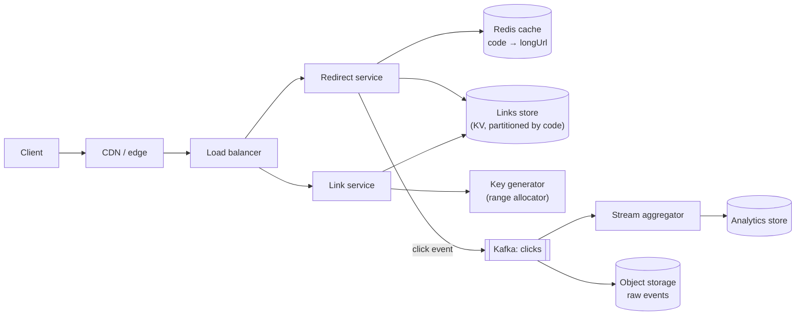

<Related ids={['back-of-the-envelope-estimation', 'unique-id-generation', 'caching', 'cdn', 'sql-vs-nosql', 'sharding', 'rate-limiting', 'batch-and-stream-processing']} />

A URL shortener (bit.ly, TinyURL) turns `https://example.com/blog/2026/10/a-very-long-article-title?utm_source=newsletter` into `https://sho.rt/x7Kp2Qa`, and redirects anyone who visits the short link. It's the most common warm-up design question because it's small enough to finish, yet touches ID generation, read-heavy scaling, caching, and data modelling.

## 1. Clarify the problem

Questions worth asking, and the answers we'll assume:

| Question | Assumption |
| --- | --- |
| Custom aliases (`sho.rt/my-sale`)? | Yes, optional |
| Do links expire? | Optional expiry set by the creator; default never |
| Can links be edited or deleted? | Deleted by the owner; not re-pointed (avoids abuse and cache issues) |
| Click analytics? | Yes — counts by day, country, referrer — but can be slightly delayed |
| Scale? | 100M new links per month; read:write ≈ 100:1 |
| Accounts? | Optional; anonymous creation allowed with rate limits |

## 2. Requirements

**Functional**

1. Create a short URL for a long URL (optionally with custom alias and expiry).
2. Redirect a short URL to its long URL.
3. Show click analytics for a link to its owner.

**Non-functional**

- **Very low redirect latency** — under ~50 ms at p99 server-side; redirects sit in front of someone else's page load.
- **High availability for redirects** — a broken short link is a broken link on thousands of websites. Target 99.99%.
- **Uniqueness and correctness** — a short code must never point to the wrong URL.
- **Unpredictable codes** — sequential codes would let anyone enumerate all links (some contain private documents).
- Durability — links last for years.

**Out of scope:** link previews, QR codes, A/B link rotation.

## 3. Capacity estimation

```text
Writes: 100M links/month ÷ (30 × 10^5 s) ≈ 40 writes/s   (peak ~200/s)
Reads:  100 × writes ≈ 4,000 redirects/s                  (peak ~20,000/s)

Storage per link: code 7 B + long URL ~100 B avg (allow up to 2 KB) + metadata ~100 B ≈ 250–500 B
5 years: 100M × 12 × 5 = 6B links × 500 B ≈ 3 TB  (× 3 replicas ≈ 9 TB)

Analytics events: 4,000 clicks/s × ~200 B ≈ 0.8 MB/s ≈ 70 GB/day raw
```

**So:** writes are tiny. Reads are moderate but must be fast → cache aggressively. 3 TB of link data fits comfortably in a horizontally scalable KV store (or a sharded relational DB). Analytics is the largest data stream and should be decoupled from the redirect path.

### How long should codes be?

Base62 (`a–z`, `A–Z`, `0–9`) gives 62 possibilities per character:

| Length | Combinations |
| --- | --- |
| 6 | 62^6 ≈ 56.8 billion |
| 7 | 62^7 ≈ 3.5 trillion |
| 8 | 62^8 ≈ 218 trillion |

We need ~6B codes over 5 years. 6 characters would be ~10% full (rising collision rates for random codes); **7 characters** keeps the space under 0.2% used and leaves room for decades.

<Callout type="note" title="Where sources differ">
Alex Xu's version of this problem assumes **100M new URLs per day** (vs our 100M per month) and a 10:1 read ratio — about 1,160 writes/s and 11,600 reads/s, and 365 billion URLs over 10 years. At that scale 6 characters (62^6 ≈ 56.8B) is too few and 7 (≈ 3.5T) is the minimum. Storage is 365B × ~100 B ≈ **36.5 TB** — the book prints 365 TB because it multiplies by 10 years a second time. Always sanity-check units twice; it's an easy slip under interview pressure.
</Callout>

## 4. API

```text
POST /v1/links
  { "longUrl": "https://…", "customAlias": "my-sale"?, "expiresAt": "2027-01-01T00:00:00Z"? }
  → 201 { "code": "x7Kp2Qa", "shortUrl": "https://sho.rt/x7Kp2Qa" }
  → 409 if the custom alias is taken

GET /{code}
  → 302 Found, Location: <longUrl>       (or 301 — see deep dive)
  → 404 if unknown, 410 Gone if expired or deleted

GET /v1/links/{code}/stats?from=…&to=…&groupBy=day|country|referrer
DELETE /v1/links/{code}
```

Rate-limit `POST /v1/links` per API key and per IP — URL shorteners are prime spam/phishing tools.

## 5. Data model

```text
links
  code        VARCHAR(16)  PRIMARY KEY      -- 7 chars generated, longer for custom aliases
  long_url    TEXT         NOT NULL
  owner_id    BIGINT       NULL
  created_at  TIMESTAMP
  expires_at  TIMESTAMP    NULL
  status      ENUM(active, deleted, blocked)

click_counts (aggregated, written by the analytics pipeline)
  code, bucket_date, dimension (country/referrer/device), value, count
```

The access pattern is a pure **key lookup by code**, with no joins on the hot path. Good choices: **DynamoDB/Cassandra** (partition key = `code`, scales horizontally, multi-region replication) or **PostgreSQL/MySQL sharded by code** (strong uniqueness, familiar). Either is defensible; we'll use a KV store for links and a separate analytics store.

## 6. High-level design

<FlowSteps title="Create and redirect, step by step" steps={[
  { path: ['C', 'CDN', 'LB', 'WS'], text: 'Create: POST /links passes through the edge (writes are not cached) and the load balancer to the link service.' },
  { path: ['WS', 'KG'], text: 'The link service takes the next code from a block of IDs it reserved earlier. It asks the key generator for a new block only when the current one runs out.' },
  { path: ['WS', 'DB'], text: 'It writes code → long URL to the links store and returns the short URL.' },
  { path: ['C', 'CDN'], text: 'Redirect: GET /x7Kp2Qa reaches the nearest CDN edge. Popular links are answered right there.' },
  { path: ['CDN', 'LB', 'RS', 'RC'], text: 'On an edge miss, the redirect service looks the code up in Redis, which holds the hot links.' },
  { path: ['RS', 'DB'], text: 'On a Redis miss it reads the store, fills the cache, checks status and expiry, and answers 302 with the Location header.' },
  { path: ['RS', 'K', 'SP', 'AN'], nodes: ['LAKE'], edges: [['K', 'LAKE']], text: 'Without waiting, it emits a click event to Kafka. A stream job aggregates clicks for analytics, and raw events land in object storage.' },
]}>



</FlowSteps>

**Create flow**

1. Link service validates the URL (scheme, length, malware/phishing check via a blocklist service).
2. Gets a unique code from its local block of IDs (see deep dive) — or checks the custom alias with a conditional insert.
3. Writes `code → longUrl` to the store and returns the short URL.

**Redirect flow**

1. Request for `sho.rt/x7Kp2Qa` hits the edge, then the redirect service.
2. Look up the code in Redis; on miss, read from the store and populate the cache.
3. Check status and expiry; return `302` with `Location`.
4. Asynchronously emit a click event (code, timestamp, IP-derived country, user agent, referrer) to Kafka — never block the redirect on analytics.

## 7. Deep dives

### Generating short codes

**Option A — hash the long URL** (e.g., first 7 Base62 characters of SHA-256 or MD5).

- Same URL → same code (natural dedup) — but different users may want separate links/analytics for the same URL.
- **Collisions** are inevitable at billions of links; you must check and retry (e.g., append a predefined salt and re-hash), adding a read per write.
- A **Bloom filter** of existing codes avoids most of those reads: "definitely not present" needs no database check; only "maybe present" does.
- Truncating a longer hash (CRC32 gives 8 hex characters, MD5 and SHA-1 far more) to 7 Base62 characters is what makes collisions likely in the first place.

**Option B — random codes**: generate 7 random Base62 characters, insert with "only if absent" (conditional put / unique constraint), retry on collision. With the space under 0.2% full, collisions are rare. Simple and unpredictable.

**Option C — counter + Base62 encoding**: take a unique 64-bit number and encode it in Base62.

- Unique by construction, no collision checks.
- Sequential numbers produce **predictable, enumerable codes** — fix by passing the counter through a **reversible permutation** (e.g., a keyed Feistel network or format-preserving encryption over the ID space; multiplying by a constant coprime with 62^7, modulo 62^7, also permutes but is easily reversed by anyone who learns the constant) so consecutive IDs map to scattered codes.
- Needs a distributed counter: use a **range allocator** — each link-service instance leases a block of 10,000 IDs from a small coordination store (a database row updated with compare-and-set, or ZooKeeper/etcd) and hands them out from memory. If an instance dies, its unused IDs are simply skipped.

| Approach | Uniqueness | Write cost | Predictability | Notes |
| --- | --- | --- | --- | --- |
| Hash of URL | Collisions to handle | Read + write | Unpredictable | Dedup per URL (sometimes unwanted) |
| Random | Collisions rare at low fill | Conditional write, rare retry | Unpredictable | Simplest; great default |
| Counter + permute + Base62 | Guaranteed | Single write | Unpredictable after permutation | Needs range allocator |

<Callout type="interview">
Either random codes with conditional insert, or a range-allocated counter passed through a permutation, is a strong answer. Mention the enumeration problem with plain sequential codes — interviewers often probe for it.
</Callout>

**Custom aliases** share the namespace: insert with a conditional write; return 409 on conflict. Reserve words (`api`, `login`, `admin`) and enforce a minimum length so aliases can't collide with the generated 7-character space — or keep generated codes exactly 7 characters and require aliases of a different length.

### Base62 encoding by hand

With the alphabet `0–9`, `a–z`, `A–Z` (values 0–61), repeatedly divide by 62 and read the remainders from last to first:

```text
1,000,000 ÷ 62 = 16,129  remainder 2   → "2"
   16,129 ÷ 62 =    260  remainder 9   → "9"
      260 ÷ 62 =      4  remainder 12  → "c"
        4 ÷ 62 =      0  remainder 4   → "4"
1,000,000 = 4·62³ + 12·62² + 9·62 + 2  →  "4c92"
```

Decoding multiplies back up. The code length grows only logarithmically: 7 characters cover IDs up to ~3.5 trillion.

### 301 vs 302 redirects

| | 301 Moved Permanently | 302 Found / 307 Temporary |
| --- | --- | --- |
| Browser caching | Browsers cache it — later clicks may never reach our servers | Not cached by default |
| Analytics | Undercounts clicks | Every click is seen |
| Load | Lower | Higher |
| Changing/deleting a link | Old browsers keep redirecting | Takes effect immediately |

Since analytics and deletion are requirements, use **302** (optionally with a short `Cache-Control: max-age` at the CDN). If analytics weren't needed, 301 would cut load.

### Making redirects fast

- **Cache**: the hot set is small — the 80/20 rule applies strongly (a viral link gets millions of clicks). With 20K peak reads/s and a 95%+ hit ratio, the store sees under 1,000 reads/s.
- **Edge caching**: cache redirect responses at the CDN for a short TTL (e.g., 60 s) — most traffic never reaches the origin. Trade-off: analytics must then come from CDN logs, and deletes take up to the TTL to propagate (purge on delete).
- **Negative caching**: cache "not found" briefly so bots probing random codes don't hammer the store.
- **Multi-region**: replicate links to every region (a write is visible globally within seconds — acceptable since a link is shared after creation) and serve redirects from the nearest region.

### Analytics without slowing redirects

Redirect servers publish click events to Kafka (fire-and-forget with a local buffer). A stream processor (Flink/Kafka Streams) aggregates counts per code per minute/day by country, referrer and device, writing to an OLAP store (ClickHouse, Druid) or counters in a wide-column store. Raw events go to object storage for reprocessing. Add bot filtering before counting.

### Expiry and deletion

- Check `expires_at` on read (cheap) and return 410.
- A background job (or TTL feature of the store, e.g., DynamoDB TTL) removes expired items later.
- On delete, invalidate the Redis entry and purge the CDN path.
- Don't recycle codes from deleted links quickly — old printed links would suddenly point somewhere new.

## 8. Failure modes and scaling

| Failure | Effect | Mitigation |
| --- | --- | --- |
| Redis node down | Higher latency, more store reads | Replicated cache; store sized to handle miss traffic; request coalescing for hot keys |
| Store partition unavailable | Redirects for some codes fail | Replication factor 3 across AZs; multi-region replicas for reads |
| Kafka unavailable | Clicks not recorded | Local buffering on redirect servers; analytics is best-effort — redirects continue |
| Key range allocator down | New links can't get IDs once blocks run out | Large blocks (hours of supply); allocator itself replicated |
| Abuse (phishing, spam) | Reputation damage, domain blocklisting | Rate limits, URL reputation checks at creation and periodically, takedown process |

## 9. Trade-offs summary

| Decision | Choice | Alternative | Why |
| --- | --- | --- | --- |
| Code generation | Range-allocated counter + permutation (or random + conditional put) | URL hash | No collision checks / no enumeration |
| Redirect status | 302 | 301 | Accurate analytics, deletable links |
| Store | KV store partitioned by code | Sharded SQL | Pure key lookups; easy horizontal scale |
| Analytics | Async via Kafka + stream aggregation | Increment counters inline | Keeps redirect path fast and available |

## 10. What interviewers look for

- **Mid-level**: correct API, Base62 code-length reasoning, a cache in front of the store, a working end-to-end design.
- **Senior**: compares code-generation strategies with collisions and enumeration in mind; 301 vs 302 trade-off; async analytics; handles hot links, expiry, abuse and caching at the edge.
- **Staff**: multi-region strategy and consistency of newly created links, capacity of the ID allocator, cost of analytics storage over years, abuse and trust-and-safety operations.

## Interview questions

<QA q="Two users shorten the same long URL. Should they get the same code?">
Usually no. Each user expects their own link with separate analytics, ownership, expiry and the ability to delete it without affecting others. Deduplicating by URL hash saves a little storage but couples unrelated users. If the product wants dedup for anonymous users, you can keep an index from (long URL hash, owner) to code and reuse only within the same owner.
</QA>

<QA q="A link goes viral and receives 500,000 requests per second. What breaks and how do you handle it?">
A single Redis key on one shard becomes hot and saturates that node's CPU/network. Mitigations: cache at the CDN edge with a short TTL so most requests never reach the origin; add an in-process cache on redirect servers for the hottest codes (a few seconds of TTL); replicate hot keys across cache nodes. The analytics pipeline must handle the burst too — Kafka absorbs it, and aggregation by code in the stream processor collapses it into a few counter updates.
</QA>

<QA q="How do you prevent people from guessing other users' short links?">
Don't use sequential codes directly. Use random codes from a large space, or pass sequential IDs through a reversible keyed permutation before Base62 encoding, so neighbouring IDs produce unrelated codes. Keep the space sparsely used (7+ characters), rate-limit lookups that return 404 per IP, and for sensitive links offer longer codes or authentication.
</QA>

<QA q="Your key range allocator is a single database row. Isn't that a bottleneck?">
No — each instance leases a block of, say, 10,000 IDs at once, so at 200 writes/s across the fleet the allocator sees about one request every 50 seconds. Unused IDs from crashed instances are skipped (gaps are fine). The allocator row should be on a replicated, strongly consistent store so two instances never receive the same block.
</QA>

## Practice

Write your answer before opening the suggested one. Anything you mark "Partly" or "Missed it" comes back in your review deck.

<Practice task="Estimate it again for a bigger product: 1 billion new links a month, a 50:1 read-to-write ratio, 10 years of retention. What are the average and peak read rates, the storage, and is a 7-character code still enough?">

Writes: 1B ÷ (30 × 10^5 s) ≈ 330 links/s, peak ~1,500/s. Reads: 50 × 330 ≈ 17,000 redirects/s, peak ~80,000/s.

Links over 10 years: 1B × 12 × 10 = 120B. At ~500 B each that is ~60 TB, about 180 TB with three replicas — a sharded KV store, not one database.

Codes: 62^7 ≈ 3.5 trillion, so 120B uses about 3.4% of the space. That is still fine for range-allocated (counter-based) codes, which never collide. With random codes, collisions on insert become noticeable, so either keep 7 characters with a retry on conflict or move to 8 characters (≈ 218 trillion).

The redirect path is now cache-heavy: 80,000/s at peak is a job for a CDN plus a Redis tier, with the store seeing only misses.

</Practice>

<Practice task="The marketing team wants an 'edit destination' feature: a link's long URL can be changed after it is shared, and changes must take effect within one minute everywhere. What in the current design blocks this, and how do you change it?">

Two things assume links never change: the `301`-style caching and the long cache TTLs.

1. Return `302` (temporary) for editable links so browsers do not cache the redirect forever. Keep `301` only for links marked immutable, if at all.
2. Bound the TTL at every layer to the one-minute budget: CDN `Cache-Control: max-age=60` (or `s-maxage`), Redis TTL 60 s.
3. Better than waiting for TTLs: on edit, write the store first, then delete the Redis key and issue a CDN purge for that path. Keep the short TTL as a safety net if a purge is lost.
4. Store a `version`/`updatedAt` on the link and write an audit record of who changed it, because changing a shared link is a phishing risk — re-run the malware check on the new destination.

Trade-off: shorter TTLs mean more cache misses, so watch the store's read load; hot links stay hot in Redis anyway.

</Practice>

<Takeaways>

- A URL shortener is read-heavy and latency-sensitive: cache in Redis and at the edge, keep analytics asynchronous.
- 7 Base62 characters give ~3.5 trillion codes — plenty for billions of links with a sparse, unguessable space.
- Generate codes with random + conditional insert, or range-allocated counters through a permutation; avoid enumerable sequences.
- Use 302 when analytics and deletion matter; 301 only to minimise load.
- Plan for viral links, expiry, abuse and multi-region reads.

</Takeaways>

## Further reading

- Alex Xu, *System Design Interview*, Vol. 1 — ch. 8, "Design a URL Shortener".
- RFC 9110, §15.4 — semantics of 301, 302, 307 and 308 redirects.
- Related: [Unique ID Generation](/system-design/hld/unique-id-generation), [Caching](/system-design/hld/caching).
