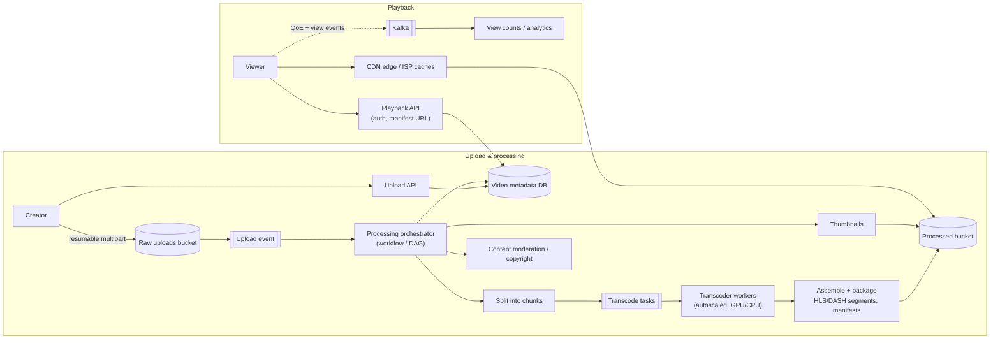
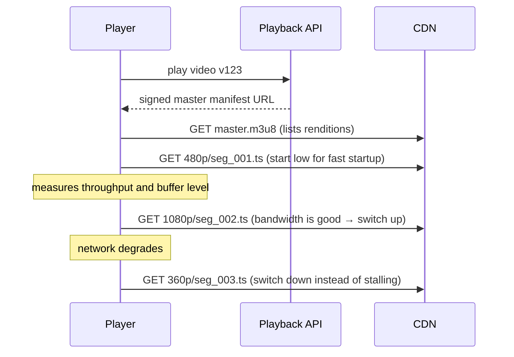

<Related ids={['blob-storage', 'cdn', 'message-queues', 'distributed-transactions', 'caching', 'sql-vs-nosql', 'batch-and-stream-processing', 'back-of-the-envelope-estimation']} />

Design a video platform like YouTube or Netflix: creators upload videos, the platform processes them into streamable formats, and hundreds of millions of viewers watch smoothly on every kind of device and network. Two very different halves: a **heavy asynchronous processing pipeline** for uploads, and a **bandwidth-dominated delivery system** for playback.

## 1. Clarify the problem

| Question | Assumption |
| --- | --- |
| User-generated (YouTube) or catalogue (Netflix)? | User-generated uploads, global viewing |
| Features? | Upload, process, watch with adaptive quality, view counts, basic metadata/search |
| Scale? | 500 hours of video uploaded per minute; 1B daily views; average view 6 min |
| Devices? | Web, mobile, TV — different codecs and resolutions |
| Live streaming? | Out of scope (follow-up) |

## 2. Requirements

**Functional:** upload videos (large files, resumable); transcode to multiple resolutions/codecs; play back with adaptive bitrate; show metadata, thumbnails, view counts.

**Non-functional:** smooth playback (fast start, minimal rebuffering), global low latency, high availability for viewing, durability of originals, cost efficiency (bandwidth and storage dominate the bill), processing within minutes for typical videos.

## 3. Capacity estimation

```text
Uploads: 500 hours/min = 30,000 hours of video per hour ≈ 720K hours/day
Original size at ~5 Mbps ≈ 2.25 GB/hour → ~1.6 PB/day of originals
Transcoded renditions (several resolutions × codecs) ≈ another 1–2× → ~3–5 PB/day total

Viewing: 1B views × 6 min = 6B minutes/day ≈ 100M hours/day
Average bitrate ~3 Mbps → 100M h × 3,600 s × 3 Mb = 1.08 × 10^18 bits/day ≈ 135 PB/day egress
Average egress ≈ 135 PB / 86,400 s ≈ 1.6 TB/s ≈ 12.5 Tbps (peaks several times higher)
```

**So:** egress is astronomical — only a CDN (including caches placed inside ISP networks) can serve it. Storage grows by petabytes per day, so storage tiering (hot/cold), codec efficiency and deleting unneeded renditions matter enormously. Processing needs a large, elastic worker fleet.

### What that costs

At large-volume CDN prices of a few cents per GB, even a much smaller platform pays heavily: 5M DAU watching 5 videos of ~300 MB each is 7.5 PB/day, ≈ **$150K per day** at $0.02/GB. Delivery cost is the dominant line item, which is why the cost levers below matter as much as the architecture.

## 4. High-level design



## 5. Deep dives

### Upload

Use **resumable multipart uploads** directly to object storage via presigned URLs (see [Object Storage](/system-design/hld/blob-storage)). The upload API creates a `video` record in `UPLOADING` state; the storage event moves it to `PROCESSING` and triggers the pipeline. Large uploads from mobile networks must survive disconnects.

**Making uploads fast**

- **Split on the client.** Modern clients cut the video into GOP-aligned chunks (see below) and upload them in parallel, so a failed chunk is retried alone; older clients upload the whole file and the server splits it.
- **Upload near the user.** Accept uploads at regional edges/upload centres (often the CDN's ingest points) and move them to central storage over the provider's backbone.
- **Metadata in parallel.** While bytes upload, the client separately sends title, description and settings to the API.
- **Completion events.** When processing finishes, workers publish to a completion queue; a completion handler updates the metadata database and cache and notifies the creator.

### Transcoding pipeline

A source video becomes many **renditions**: e.g., 240p, 360p, 480p, 720p, 1080p, 4K × codecs (H.264 for compatibility, VP9/AV1/HEVC for efficiency).

Two terms are worth getting right. A **container** (MP4, MOV, MKV, TS) wraps video, audio and metadata streams — you can usually tell it from the file extension. A **codec** (H.264, HEVC, VP9, AV1) is the compression algorithm used *inside* the container. Transcoding typically changes both. Video is split along **GOP (group of pictures)** boundaries — each GOP starts with a keyframe and can be decoded independently — which is what makes chunks safe to encode in parallel and to play as separate segments.

- **Split** the source into short chunks (e.g., at keyframes every few seconds) so encoding parallelises across many workers — a 2-hour video can be processed in minutes instead of hours.
- Each chunk × rendition is an independent task in a queue; workers are **stateless and autoscaled** (spot/preemptible instances are cheap, and tasks are idempotent and retryable).
- **Assemble** encoded chunks, then **package** into streaming formats: **HLS** and **DASH**, which split each rendition into small segments (2–6 s) plus **manifest** files listing them.
- Generate thumbnails, extract audio tracks, captions, and run **moderation** and **copyright matching** (fingerprinting) in parallel branches of the DAG.
- The orchestrator (a workflow engine) tracks the DAG, retries failed tasks, and marks the video `READY` when the minimum renditions exist — low resolutions first, so the video can go live quickly while higher ones finish.

**Inside the processing engine.** Facebook's SVE and similar systems run a **DAG** of tasks defined by configuration: a *preprocessor* splits the video and builds the DAG; a *DAG scheduler* breaks it into stages (e.g., split → encode video + extract audio + make thumbnails → package); a *resource manager* matches tasks to workers using a priority **task queue**, a **worker queue** ordered by utilisation and a **running queue** of in-flight assignments; *task workers* execute; intermediate chunks live in *temporary storage* so a failed step can be retried without starting over.

<Callout type="example">
Netflix uses **per-title** (and later per-shot) encoding: analysing each title's complexity to choose bitrate ladders, so a simple animation gets far lower bitrates than an action film at the same visual quality — saving huge amounts of bandwidth.
</Callout>

### Adaptive bitrate streaming (ABR)



- The **player** decides the quality of each segment based on measured throughput and buffer health — the server just serves files. This is what keeps playback smooth on fluctuating mobile networks.
- Segments are plain HTTP files, so they're **perfectly cacheable** by CDNs.
- Seeking = jump to the segment at that timestamp.

### Delivery: CDN strategy

- Popular videos are served from edge caches; a few percent of videos account for most views (long-tail distribution).
- **Pre-position** predicted-popular content (Netflix's Open Connect appliances inside ISPs are filled overnight); pull the long tail on demand through tiered caches with origin shielding.
- Playback URLs are **signed** (expiring tokens) for access control and to prevent hotlinking.
- Multi-CDN with real-time steering based on performance per region for large platforms.

### Protecting content

- **DRM** — Apple FairPlay, Google Widevine and Microsoft PlayReady encrypt streams and enforce licence policies in the player; premium services usually support all three.
- **Encryption without full DRM** — e.g., AES-128 encrypted HLS segments with keys served only to authorised players.
- **Watermarking** — visible logos, or forensic watermarks that identify the leaking account.
- **Signed, expiring URLs/cookies** for every manifest and segment.

### Metadata and views

- Video metadata (title, owner, status, renditions, durations) in a sharded database, heavily cached — the watch page is read-dominated.
- **View counts**: never `UPDATE views = views + 1` per view on a hot row. Stream view events to Kafka, aggregate per video per minute (with bot/fraud filtering), and update counts in batches; display approximate counts.

### Storage cost management

- Keep originals (in cold storage) to re-encode with future codecs.
- Generate expensive renditions (4K, AV1) only for videos that get enough views; delete or demote unwatched renditions.
- Lifecycle policies move old, rarely watched content to cheaper tiers.

- Serve only **popular** videos from the CDN; long-tail videos with few views can stream from high-capacity origin video servers, where per-GB cost is lower.
- **Encode on demand**: short or rarely watched videos don't need the full rendition ladder up front.
- **Distribute regionally**: a video popular in one country needn't be pushed to every edge worldwide.
- At very large scale, **build or partner for your own CDN** inside ISP networks (Netflix Open Connect).

## 6. Failure modes

| Failure | Mitigation |
| --- | --- |
| Transcoder worker dies mid-task | Task retried (idempotent output keys); spot interruptions expected |
| Corrupt or malicious upload | Validate container/codec; sandbox decoders; moderation pipeline |
| CDN region degraded | Multi-CDN steering; player retries segments from alternate hosts listed in the manifest |
| Viral video floods origin | Origin shield / tiered caching collapses misses; pre-warm when trending is detected |
| Pipeline backlog | Queue-based autoscaling; prioritise short videos and popular creators |

**Error-handling playbook.** Separate *recoverable* errors (a chunk failed to encode, a worker died, an upload timed out → retry, reschedule on another worker, use a replica queue) from *non-recoverable* ones (corrupt or unsupported source file → stop the job and return a clear error to the creator). And plan for **takedowns**: copyright fingerprinting and policy classifiers at upload, plus user flagging and review for what slips through.

## 7. Trade-offs summary

| Decision | Choice | Why |
| --- | --- | --- |
| Processing | Chunked, parallel, DAG-orchestrated | Minutes instead of hours; retries per chunk |
| Format | HLS/DASH segments + ABR | Smooth playback, cacheable files |
| Delivery | CDN + ISP-embedded caches | Only way to serve Tbps of egress |
| Encoding ladder | Per-title / popularity-aware | Cuts bandwidth and storage cost |
| Views | Streamed and batch-aggregated | Avoid hot-row writes |

## 8. What interviewers look for

- **Mid-level**: upload to object storage, transcoding to multiple resolutions, CDN for delivery, metadata DB.
- **Senior**: chunked parallel transcoding with an orchestrator, HLS/DASH and client-side ABR, presigned/resumable uploads, view-count aggregation, signed URLs.
- **Staff**: cost modelling (egress, storage tiers, codec choices), CDN placement strategy, popularity-driven encoding, live streaming extensions.

## Interview questions

<QA q="Why do players switch quality during playback, and who decides?">
Network throughput fluctuates, especially on mobile. Videos are encoded at several bitrates and split into small segments; the player measures download speed and buffer level and picks the quality of each next segment — switching down before the buffer empties to avoid stalls, and up when bandwidth allows. The decision is client-side, which keeps the server side simple (just files on a CDN) and lets the player react instantly to local conditions.
</QA>

<QA q="How would you transcode a 2-hour 4K video quickly?">
Split it into many short chunks at keyframe boundaries, enqueue a task per chunk per rendition, and process them in parallel on an autoscaled worker fleet. Then concatenate encoded chunks per rendition and package them into HLS/DASH segments with manifests. Publish low resolutions first so the video becomes watchable quickly, while high resolutions continue. Tasks are idempotent so failed or preempted workers are simply retried.
</QA>

<QA q="How would you extend this design to live streaming?">
The streamer pushes a continuous feed (e.g., RTMP or SRT) to an ingest server near them, which transcodes in real time into a few renditions and packages short segments (low-latency HLS/DASH or chunked CMAF, 1–2 s) continuously, updating the manifest. The CDN serves segments as they're produced, so latency is several seconds. For sub-second interactivity, use WebRTC-based delivery instead. Recording the stream produces a VOD asset through the normal pipeline.
</QA>

## Practice

Write your answer before opening the suggested one. Anything you mark "Partly" or "Missed it" comes back in your review deck.

<Practice task="Users upload 500 hours of video per minute. Each hour is stored as 5 renditions totalling about 3 GB. How much new storage is needed per day, and why does adaptive bitrate streaming store multiple renditions at all?">

500 hours/minute × 1,440 minutes = 720K hours/day. × 3 GB = 2.16 PB/day of new video, before replication. That is why video sits in object storage with lifecycle rules (rarely watched renditions can move to colder tiers or be deleted and regenerated on demand).

Why several renditions: viewers' bandwidth varies from moment to moment. With adaptive bitrate (HLS or DASH), each rendition is split into short segments (2–6 s), and the player picks the highest bitrate it can sustain for the next segment. It switches quality between segments instead of stalling, which matters more to viewers than peak quality.

</Practice>

<Practice task="A creator uploads a 2-hour 4K video and expects it to be watchable within 10 minutes. A single machine needs 3 hours to transcode it. How do you meet the target?">

Parallelise the transcoding.

1. Split the source into chunks at keyframes (for example 30-second chunks → 240 chunks).
2. Put one task per (chunk, rendition) on a work queue. Hundreds of workers transcode in parallel; each chunk takes well under a minute.
3. A final step stitches each rendition's chunks and writes the HLS/DASH manifests.
4. Publish progressively: make the low renditions (360p, 720p) available first so the video is watchable within minutes, while 4K finishes later.

Retries are per chunk (idempotent, same output name), so a failed worker costs one chunk, not the whole job.

</Practice>

<Takeaways>

- Upload directly and resumably to object storage; process asynchronously with a DAG orchestrator.
- Split videos into chunks to transcode in parallel into a bitrate ladder; package as HLS/DASH segments.
- The player performs adaptive bitrate selection; segments are plain cacheable HTTP files.
- Delivery is dominated by egress — CDNs, tiered caching and ISP-embedded caches are mandatory.
- Control cost with per-title encoding, popularity-based renditions and storage tiering; aggregate views by stream.

</Takeaways>

## Further reading

- Netflix Technology Blog, "Per-Title Encode Optimization" (2015) and "Dynamic optimizer — a perceptual video encoding optimization framework" (2018).
- [Netflix Open Connect](https://openconnect.netflix.com) — overview and partner documentation.
- RFC 8216, "HTTP Live Streaming"; ISO/IEC 23009-1 (MPEG-DASH).
- Huang et al., "A Buffer-Based Approach to Rate Adaptation: Evidence from a Large Video Streaming Service" (SIGCOMM 2014).
- Alex Xu, *System Design Interview*, Vol. 1 — ch. 14, "Design YouTube".
- Huang et al., "SVE: Distributed Video Processing at Facebook Scale" (SOSP 2017).
