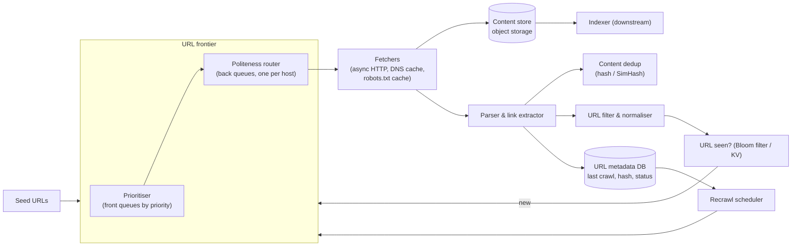
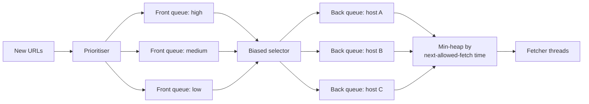

<Related ids={['message-queues', 'probabilistic-data-structures', 'blob-storage', 'consistent-hashing', 'rate-limiting', 'networking-essentials']} />

Design a web crawler that downloads billions of pages for a search engine: start from seed URLs, fetch pages, extract links, and keep going — politely, without crawling the same page twice, and while keeping important pages fresh. The hard parts are the **URL frontier** (what to crawl next), **politeness** toward websites, **deduplication** at enormous scale, and robustness against an adversarial, messy web.

## 1. Clarify the problem

| Question | Assumption |
| --- | --- |
| Purpose? | Building a search index (other uses: archiving, ML data, monitoring) |
| Scale? | 1B pages per month; store HTML for the indexer |
| Content types? | HTML only for now (no images/PDFs/JS rendering, though JS rendering is a follow-up) |
| Politeness? | Obey robots.txt; at most ~1 request/s per host by default |
| Freshness? | Re-crawl important/changing pages more often |
| Duplicates? | Skip exact and near-duplicate content |

## 2. Requirements

**Functional:** given seeds, crawl the web; extract and follow links; store page content and metadata; recrawl over time.

**Non-functional:**

- **Scalability** — billions of pages, thousands of fetches per second.
- **Politeness** — never overload a website; honour robots.txt and crawl-delay.
- **Robustness** — survive malformed HTML, slow servers, infinite URL spaces (spider traps), crashes.
- **Prioritisation** — fetch important pages first.
- **Extensibility** — add new content processors later.

## 3. Capacity estimation

```text
Pages: 1B/month ÷ (30 × 10^5 s) ≈ 400 pages/s average; plan for ~1,000/s peak
Average page: ~100 KB HTML (≈ 20–30 KB compressed)

Storage: 1B × 100 KB = 100 TB/month raw → ~25 TB/month compressed; 5 years ≈ 1.5 PB compressed
Bandwidth: 1,000 pages/s × 100 KB = 100 MB/s ≈ 800 Mbps

URLs discovered: ~50 links per page → 50B link observations/month; distinct URLs seen: tens of billions
URL dedup set: 10B URLs × 8-byte fingerprint ≈ 80 GB exact, or ~12 GB as a Bloom filter at 1% FP
```

**So:** the fetch rate per machine is limited by network latency, not CPU (thousands of concurrent connections per machine with async I/O). Content goes to object storage. URL dedup needs a compact, partitioned structure.

<Callout type="note" title="Where sources differ">
Our 100 KB average page is an assumption for HTML only. Alex Xu's crawler chapter assumes 500 KB per page, giving 500 TB per month and about 30 PB over five years. Both are defensible — HTML alone is typically tens of KB, while pages with inline resources run much larger — but the 5× difference flows straight into storage and bandwidth. State the assumption explicitly and tie it to what you store (HTML only vs full page).
</Callout>

## 4. High-level design

<FlowSteps title='One crawl cycle' steps={[
  { path: ['SEED'], nodes: ['PRI', 'POL'], edges: [['SEED', 'FR'], ['PRI', 'POL']], text: 'Seed URLs enter the frontier, which orders them by priority and routes them into one queue per host.' },
  { path: ['POL', 'F'], text: 'Fetchers take URLs from the host queues, respecting each host\'s crawl delay and robots.txt.' },
  { path: ['F', 'CS'], text: 'Fetched pages are stored in the content store.' },
  { path: ['F', 'P', 'CD'], text: 'The parser extracts links, and content dedup drops pages that were already seen.' },
  { path: ['P', 'UF', 'UD'], text: 'Extracted URLs are normalised and checked against the \'seen\' Bloom filter.' },
  { path: ['UD'], nodes: ['PRI'], edges: [['UD', 'FR']], text: 'New URLs go back into the frontier.' },
  { path: ['P', 'META', 'SCHED'], edges: [['SCHED', 'FR']], text: 'Crawl metadata drives the recrawl scheduler, which re-queues pages as they go stale.' },
  { path: ['CS', 'IDX'], text: 'Downstream, the indexer processes the stored content.' },
]}>



</FlowSteps>

**Crawl loop**

1. The **frontier** picks the next URL respecting priority and per-host politeness.
2. A **fetcher** resolves DNS (cached), checks robots.txt (cached per host), downloads the page with timeouts and size limits.
3. Raw content goes to object storage; metadata (status, content hash, timestamps) to the URL metadata DB.
4. The **parser** extracts links, normalises them, filters out unwanted ones, checks "seen before?", and adds new URLs to the frontier.
5. **Content dedup** detects pages identical or nearly identical to ones already stored.

## 5. Deep dives

### Choosing seed URLs

Seeds determine how quickly the crawl reaches the useful web. Good strategies: partition the URL space by **locality** (popular sites per country) or by **topic** (news, shopping, sports), start from high-quality hubs (major directories, sitemaps, sites with many outlinks), and keep adding seeds from new domain registrations and sitemaps. There's no single right answer — the point is to show you've thought about coverage.

### The URL frontier: priority and politeness together

The frontier must answer two different questions: *what's most important?* and *which host can I hit right now?*. The classic design (from the Mercator crawler) uses two layers of queues:



- **Front queues** by priority (PageRank-like importance, site quality, freshness need). A selector picks from them, biased toward high priority.
- **Back queues**: each holds URLs for **one host**. A heap keyed by "earliest time this host may be fetched again" tells workers which host is next. After fetching from a host, its next-allowed time is set to now + delay (e.g., 1 s, or 10× the last response time, or robots.txt `Crawl-delay`).
- This guarantees no host receives concurrent requests from us, while keeping all fetchers busy.

At scale the frontier is **partitioned by host** (hash of hostname → frontier node), so each host's queue and politeness state lives on exactly one node. Frontier queues are mostly on disk with in-memory buffers at the head and tail, since billions of URLs don't fit in RAM.

### URL normalisation and dedup

Normalise before checking "seen": lowercase scheme and host, remove default ports, resolve relative paths, remove fragments (`#section`), sort or strip tracking query parameters (`utm_*`, session IDs).

"Have we seen this URL?" for tens of billions of URLs:

- A **Bloom filter** per frontier partition: compact; a false positive means we skip a URL we never crawled — acceptable at a small rate.
- Or an exact set of 64-bit URL fingerprints in a sorted on-disk store (RocksDB) with an in-memory cache.

### Content dedup

Many URLs serve the same content (mirrors, `?sort=` variants, printer-friendly pages) — studies commonly cite that roughly 25–30% of the web is duplicate content.

- **Exact duplicates**: hash the normalised content (e.g., SHA-256 or a 64-bit fingerprint) and check a store of seen hashes.
- **Near duplicates** (same article, different ads/timestamps): **SimHash** — a 64-bit fingerprint where similar documents differ in few bits; documents within a small Hamming distance (e.g., 3 bits) are treated as duplicates. Google described using SimHash for this at web scale.

### Robots.txt and politeness

- Fetch and cache `robots.txt` per host (refresh daily); obey `Disallow` rules and `Crawl-delay`.
- Identify the crawler with a descriptive User-Agent and contact URL.
- Back off on 429/503 and on increasing response times; respect `Retry-After`.

### Spider traps and robustness

- **Infinite URL spaces**: calendars with "next month" forever, session IDs in URLs, `/a/a/a/a/…` loops. Limit URL length, path depth, pages per host per crawl cycle, and detect repeating path patterns.
- **Slow or huge responses**: connection and read timeouts; cap response size (e.g., 10 MB).
- **Malformed content**: tolerant parsers; never let one bad page crash a worker.
- **DNS**: lookups take ~10–200 ms and many resolver APIs are synchronous, so a fetcher thread blocks on every uncached lookup. Run a local caching resolver (refreshed periodically) — otherwise DNS becomes a major bottleneck.

### Freshness: recrawl scheduling

Pages change at very different rates (a news homepage every minute, an old blog post never). Track each URL's change history (did the content hash change on recent crawls?) and estimate a change rate; schedule recrawl intervals accordingly, weighted by importance. Use **conditional requests** (`If-Modified-Since`, `ETag`) so unchanged pages cost a 304 instead of a full download. Sitemaps with `lastmod` hints help too.

### Distribution and fault tolerance

- Partition the frontier and fetchers **by host hash** (consistent hashing, so adding nodes moves few hosts). Locality also helps DNS and robots.txt caching.
- Checkpoint frontier state; fetch work is idempotent (re-fetching a page is harmless), so crashes cost only a little duplicate work.
- Place fetchers in multiple regions to crawl hosts from nearby, reducing latency.

### Extensibility and content quality

Design the fetch–process pipeline as **pluggable modules**: adding PDF or image crawling means plugging in a new downloader/processor, not redesigning the system; a copyright-monitoring module can subscribe to the same content stream. Equally, filter out **low-value content** — spam farms, ad-only pages, auto-generated junk — with URL filters and quality classifiers, since every junk page costs bandwidth, storage and indexing time.

### JavaScript-heavy sites (follow-up)

Some content only exists after JavaScript runs. Render such pages with a headless browser fleet — 10–100× more expensive per page — so route only pages that need it (detected heuristically) to a separate rendering queue.

## 6. Data stores

| Data | Store |
| --- | --- |
| Raw page content | Object storage (compressed, batched into large files, e.g., WARC format) |
| URL metadata (last crawl, status, hash, change rate) | Wide-column store (Bigtable/HBase/Cassandra) keyed by URL fingerprint |
| Frontier queues | Disk-backed queues per partition (RocksDB or Kafka-like logs) |
| Seen URLs | Bloom filters + fingerprint store |
| robots.txt / DNS | In-memory caches with TTL |

## 7. Trade-offs summary

| Decision | Choice | Why |
| --- | --- | --- |
| Traversal | Priority-driven (not pure BFS/DFS) | Important pages first; avoid traps |
| Politeness | Per-host back queues + next-fetch heap | One connection per host, all workers busy |
| URL dedup | Bloom filter (or fingerprints on disk) | Memory at tens of billions of URLs |
| Content dedup | Exact hash + SimHash | Catch mirrors and near-duplicates |
| Partitioning | By host | Politeness state and caches stay local |

## 8. What interviewers look for

- **Mid-level**: the crawl loop, a queue of URLs, a seen-set, storing content.
- **Senior**: politeness with per-host queues, robots.txt, URL normalisation, Bloom filters, content dedup, spider traps, partitioning by host.
- **Staff**: prioritisation and recrawl scheduling based on change rates, cost of JS rendering, multi-region fetching, storage formats and the indexing handoff.

## Interview questions

<QA q="Why is a simple BFS queue not enough for a production crawler?">
BFS ignores page importance, so the crawl spends effort on low-value pages; it has no notion of politeness, so popular hosts with many links would be hammered with concurrent requests; and it falls into spider traps that generate infinite URLs. A production frontier combines priority queues with per-host queues and rate limits, plus trap detection.
</QA>

<QA q="How do you avoid hitting the same website with too many requests when you have 1,000 fetcher threads?">
Partition URLs by host so each host maps to one frontier node, and within it keep one back queue per host. A heap ordered by each host's next-allowed fetch time hands workers the next host that's eligible; after a fetch, the host's next-allowed time moves forward by its crawl delay. Workers never fetch from a host whose time hasn't arrived, so each host sees at most one request at a time at a controlled rate.
</QA>

<QA q="How would you detect that two pages are near-duplicates?">
Compute a SimHash fingerprint for each page: extract weighted features (e.g., shingles of words), hash each to 64 bits, and combine them so that similar feature sets produce fingerprints differing in few bits. Pages whose fingerprints are within a small Hamming distance (like 3 bits) are treated as near-duplicates. Finding such pairs at scale uses permuted, sorted tables of fingerprints so candidates can be looked up by matching blocks of bits.
</QA>

## Practice

Write your answer before opening the suggested one. Anything you mark "Partly" or "Missed it" comes back in your review deck.

<Practice task="You must crawl 2 billion pages a month with an average page size of 500 KB. What download rate and bandwidth do you need, and how much storage per month?">

2B ÷ (30 × 10^5 s) ≈ 670 pages/s average; plan for ~1,500/s peak.

Bandwidth: 670 × 500 KB ≈ 335 MB/s ≈ 2.7 Gbit/s average, more at peak.

Storage: 2B × 500 KB = 1 PB/month of raw HTML. Compress it (HTML compresses roughly 5×) and keep only what you need — often ~200 TB/month — in object storage.

Implications: hundreds of fetcher workers (each handling tens of concurrent connections), DNS caching (DNS lookups otherwise dominate latency), and a URL frontier that can hold billions of URLs on disk, not in memory.

</Practice>

<Practice task="A site serves an endless calendar ('next month' links forever) and your crawler keeps finding new URLs on it. How do you detect and stop crawler traps without missing legitimate large sites?">

Combine limits that a real site rarely hits:

1. Per-host budgets: cap pages crawled per host per day, and give larger budgets to hosts with high quality signals.
2. URL heuristics: maximum URL length and path depth, and a limit on repeated path segments.
3. Content fingerprints: compute a SimHash of each page; if a host keeps producing near-duplicate pages, lower its priority or stop.
4. Respect `robots.txt` and `rel=nofollow`; many calendars are disallowed.
5. Track the 'new unique content per page fetched' ratio per host and stop when it drops near zero.

Legitimate large sites keep producing distinct content, so they keep their budget; traps run out of novelty and get throttled.

</Practice>

<Takeaways>

- The frontier is the heart of the crawler: priority (front queues) plus politeness (per-host back queues and a next-fetch heap).
- Normalise URLs and dedup them with Bloom filters or fingerprint stores; dedup content with hashes and SimHash.
- Respect robots.txt and back off on slow or overloaded hosts.
- Defend against spider traps with depth, length and per-host limits.
- Partition by host, store content in object storage, and schedule recrawls by estimated change rate.

</Takeaways>

## Further reading

- Heydon and Najork, "Mercator: A Scalable, Extensible Web Crawler" (World Wide Web, 1999) — the front/back queue frontier.
- Manku, Jain and Das Sarma, "Detecting Near-Duplicates for Web Crawling" (WWW 2007) — SimHash at Google scale.
- Olston and Najork, "Web Crawling" (Foundations and Trends in Information Retrieval, 2010).
- RFC 9309, "Robots Exclusion Protocol" (2022).
- Alex Xu, *System Design Interview*, Vol. 1 — ch. 9, "Design a Web Crawler".
- Lee, Leonard, Wang and Loguinov, "IRLbot: Scaling to 6 Billion Pages and Beyond" (WWW 2008).
- Alex Xu, *System Design Interview*, Vol. 1 — ch. 9, discusses seed selection, frontier storage and extensibility.
