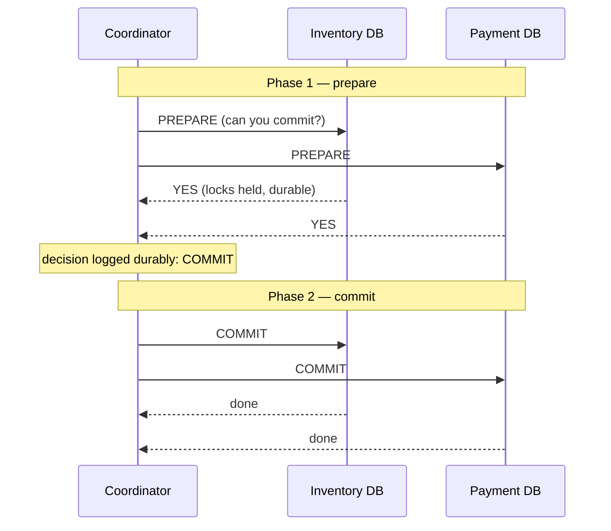
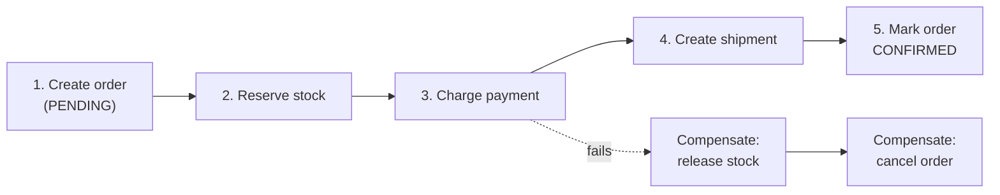
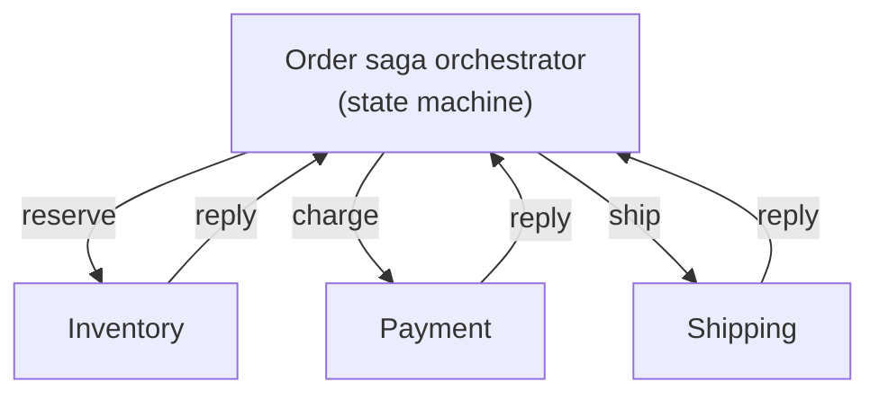

Inside one database, a transaction makes several writes atomic. But real business operations often span **several databases or services**: placing an order reserves inventory (inventory service), charges a card (payment service) and creates a shipment (shipping service). If the payment succeeds but the inventory reservation fails, you've charged a customer for something you can't ship.

There are two families of solutions: **atomic commit protocols** (two-phase commit), which make all participants commit or abort together, and **sagas**, which give up atomicity in exchange for availability and use compensating actions to undo partial work.

## Two-phase commit (2PC)

A **coordinator** drives the protocol across **participants** (databases or resource managers).



1. **Prepare** — the coordinator asks each participant to prepare. A participant that votes YES must have written everything durably and **promises** it can commit no matter what happens (holding its locks).
2. **Decide** — if all vote YES, the coordinator durably records COMMIT; if any votes NO (or times out), it records ABORT.
3. **Commit/abort** — the coordinator tells everyone the decision; participants apply it and release locks.

### Why 2PC is avoided at scale

- **Blocking.** A participant that voted YES can't decide on its own. If the coordinator crashes after prepare, participants are **stuck holding locks** ("in doubt") until the coordinator recovers. Other transactions touching those rows wait.
- **Latency.** At least two round trips plus durable writes at each step, across all participants.
- **Availability.** The transaction can only commit if *every* participant and the coordinator are up — availability is the product of all of them.
- **Heterogeneity.** It requires every participant to support the protocol (XA). Most modern services expose HTTP APIs, message brokers and third-party systems (payment providers) that don't.

**Where 2PC is fine:** inside a single distributed database that implements it carefully over consensus-replicated participants — Spanner, CockroachDB, YugabyteDB. Because each participant is itself a Raft/Paxos group, a single machine failure doesn't block the protocol. Between independent microservices, it's generally the wrong tool. (Three-phase commit tries to remove blocking but assumes bounded network delays, so it's rarely used in practice.)

## Sagas

A **saga** breaks a business transaction into a sequence of **local transactions**, each in one service's database. Each step publishes an event or triggers the next. If a step fails, the saga runs **compensating transactions** that semantically undo the steps already completed.



| Step | Action | Compensation |
| --- | --- | --- |
| 1 | Create order (PENDING) | Cancel order |
| 2 | Reserve stock | Release reservation |
| 3 | Charge payment | Refund |
| 4 | Create shipment | Cancel shipment |

Key properties:

- **No global locks** — each step commits locally, so services stay available and loosely coupled.
- **No isolation** — other transactions can see intermediate states (an order that's PENDING, stock that's reserved but not sold). Design for it: use explicit states (`PENDING`, `CONFIRMED`, `CANCELLED`), **semantic locks** (a reserved flag), and avoid acting on pending data.
- **Compensations are business actions, not rollbacks.** A refund isn't the same as never charging (the customer may see both on a statement); an email can't be unsent. Order the steps so that hard-to-compensate actions (sending email, shipping) happen **last**.
- **Every step and compensation must be idempotent and retryable**, since messages may be redelivered and steps retried.

### Choreography vs orchestration

**Choreography** — each service listens for events and decides what to do next.

```text
OrderCreated → Inventory reserves → StockReserved → Payment charges → PaymentCompleted → …
```

- ✅ Simple for short flows; no central component; services are decoupled.
- ❌ The overall flow is implicit and spread across services — hard to understand, monitor and change; risk of cyclic dependencies.

**Orchestration** — a central **orchestrator** (a workflow engine or a dedicated service) tells each participant what to do and tracks the saga's state.



- ✅ The flow is explicit in one place; easy to add steps, timeouts and compensation logic; easy to see where a saga is stuck.
- ❌ The orchestrator is another component to build and run; risk of putting too much business logic in it.

Durable workflow engines (Temporal, AWS Step Functions, Cadence, Camunda) persist each step's state, retry with backoff, and handle timers ("cancel the order if payment isn't completed within 15 minutes"), which makes orchestrated sagas much easier to build correctly.

<Callout type="tip">
A good default: **choreography for simple, 2–3 step flows; orchestration for anything longer, with timeouts or with complex compensation**. In an interview, picking orchestration for an order/payment flow and naming a workflow engine is a strong answer.
</Callout>

## Making each step reliable

Sagas only work if each step's local write and its outgoing message are themselves atomic. Two patterns cover this:

- **Transactional outbox** — write the state change and the outgoing event to the same database in one local transaction; a relay publishes the event. See [Message Queues](/system-design/hld/message-queues).
- **Idempotent consumers** — each step records processed message or request IDs so redelivery doesn't repeat the side effect.

And for calls to external systems (payment providers), pass **idempotency keys** so retries never double-charge.

## Avoiding distributed transactions altogether

The best distributed transaction is the one you don't need:

- **Redraw boundaries** — if two pieces of data must always change atomically, they probably belong in the **same service and database**.
- **Co-locate by key** — shard so that data changed together lives on the same shard (e.g., all of a user's wallet entries partitioned by user ID).
- **Reservations instead of transfers** — reserve, then confirm or expire (like a hotel hold), which naturally tolerates partial failure.
- **Accept eventual consistency with reconciliation** — periodic jobs compare systems (e.g., payments vs ledger) and fix or flag mismatches.

## Comparison

| | 2PC | Saga |
| --- | --- | --- |
| Atomicity | Yes — all or nothing | No — eventual, via compensation |
| Isolation | Yes (locks held) | No — intermediate states are visible |
| Availability | All participants must be up | Each step needs only its own service |
| Latency | Higher, with locks held across round trips | Each step is fast; whole saga takes longer |
| Failure handling | Coordinator recovery; in-doubt transactions block | Retries and compensations |
| Fits | Within one distributed database | Across microservices and external systems |

## Interview questions

<QA q="Why don't microservices typically use two-phase commit?">
2PC is blocking: participants that voted yes hold locks until the coordinator's decision arrives, so a coordinator failure can stall other transactions indefinitely. It adds latency, requires every participant to be available for every transaction (lowering overall availability), and requires all participants to support a common protocol, which HTTP services, message brokers and third-party APIs generally don't. Sagas with idempotent steps and compensations fit loosely coupled services far better.
</QA>

<QA q="Design the checkout flow for an e-commerce site across order, inventory and payment services.">
Use an orchestrated saga. The order service creates the order in PENDING state (with an outbox event). The orchestrator asks inventory to reserve stock (with an expiry), then asks payment to charge using an idempotency key. On success it confirms the reservation, marks the order CONFIRMED and triggers fulfilment and the confirmation email last. If payment fails, it releases the reservation and cancels the order. A timeout cancels orders whose payment never completes. All steps are idempotent; state transitions are persisted so the saga resumes after crashes; a reconciliation job catches anything that slipped through.
</QA>

<QA q="A saga's compensation step itself fails. What do you do?">
Compensations must be retryable and idempotent, so the first response is to retry with backoff — a durable workflow engine does this automatically. If retries are exhausted, the saga moves to a failed state that's surfaced to an operations queue or dead-letter queue for manual intervention, with alerting. Design compensations to be as unlikely to fail as possible (e.g., a refund through the same provider that charged) and run reconciliation jobs to detect inconsistent states.
</QA>

## Practice

Write your answer before opening the suggested one. Anything you mark "Partly" or "Missed it" comes back in your review deck.

<Practice task="Placing an order must reserve stock (inventory service), charge the card (payment service) and create a shipment (shipping service). Design it as a saga, including what happens if the charge fails after the stock was reserved.">

Run the steps in order, each a local transaction with its own compensation:

1. Reserve stock → compensation: release stock.
2. Charge card → compensation: refund.
3. Create shipment → compensation: cancel shipment.

If the charge fails, the saga runs the compensations for the steps already done in reverse: release the stock, then mark the order failed.

Make it reliable: an orchestrator (or a workflow engine) stores the saga state, so it can continue after a crash; each step and compensation is idempotent (they may be retried); and steps communicate through the outbox pattern so state changes and messages are not lost.

Note that a saga is not isolated: other orders may briefly see the reserved stock. That is usually acceptable.

</Practice>

<Practice task="Why do most microservice systems avoid two-phase commit (2PC) across services? Give two concrete failure scenarios.">

2PC makes every participant lock resources until the coordinator decides, so it is blocking.

1. The coordinator crashes after participants voted 'yes' but before sending the decision. Participants must keep their locks and wait — they cannot commit or abort on their own. Orders for those rows stall until the coordinator recovers.
2. One participant is slow or unreachable during the prepare phase: the whole transaction waits, and locks are held in every other service in the meantime, so one slow service reduces throughput everywhere.

Also, many systems (Kafka, many NoSQL databases, third-party APIs) do not support the XA protocol at all. Sagas with compensations trade isolation for availability and loose coupling.

</Practice>

<Takeaways>

- 2PC gives atomic commit across participants but blocks on coordinator failure, adds latency, and needs every participant up.
- 2PC is appropriate inside distributed databases built on consensus, not between microservices.
- Sagas chain local transactions with compensating actions: available and decoupled, but not isolated.
- Orchestration makes complex sagas explicit and manageable; choreography suits short flows.
- Make every step idempotent and atomic with its events (outbox), and prefer designs that avoid cross-service atomicity entirely.

</Takeaways>

## Further reading

- Garcia-Molina and Salem, "Sagas" (SIGMOD 1987) — the original paper.
- Pat Helland, "Life beyond Distributed Transactions: an Apostate's Opinion" (CIDR 2007).
- Chris Richardson, *Microservices Patterns* (Manning, 2018) — ch. 4, "Managing transactions with sagas"; and [microservices.io — Saga](https://microservices.io/patterns/data/saga.html).
- Martin Kleppmann, *Designing Data-Intensive Applications* — ch. 9, section "Distributed Transactions and Consensus".
- [Temporal documentation](https://docs.temporal.io) — durable execution for orchestrated workflows.
- Related: [Transactions, Isolation & MVCC](/system-design/hld/transactions-and-isolation), [Design a Payment System](/system-design/hld/design-payment-system).
