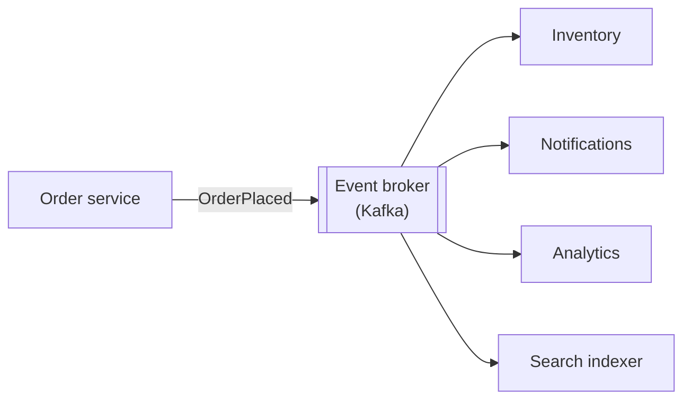
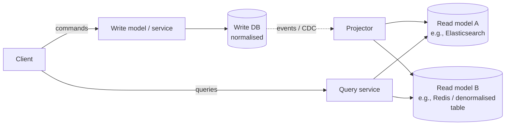
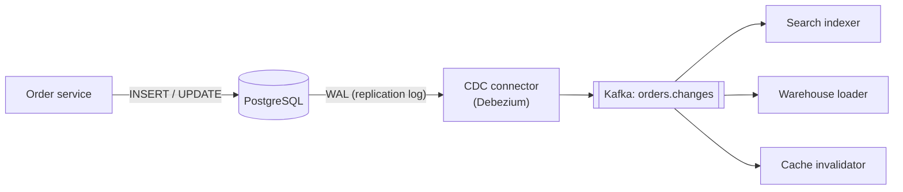

In an **event-driven architecture**, services communicate by publishing facts about what happened ("OrderPlaced", "PaymentFailed") rather than calling each other directly. Combined with two related patterns — **CQRS** (separate models for writes and reads) and **event sourcing** (store events as the source of truth) — it's the backbone of many large systems. These patterns are powerful and frequently over-applied; this lesson focuses on when each one earns its complexity.

## Commands, events and queries

| Message type | Meaning | Naming | Example |
| --- | --- | --- | --- |
| **Command** | A request to do something; may be rejected | Imperative | `PlaceOrder`, `ChargeCard` |
| **Event** | A fact that already happened; can't be rejected | Past tense | `OrderPlaced`, `CardCharged` |
| **Query** | A request for data; no side effects | Question | `GetOrderStatus` |

Commands have one intended handler. Events are broadcast — the publisher doesn't know or care who listens.

## Event-driven communication



**Benefits**

- **Loose coupling** — add a new consumer (fraud detection) without touching the order service.
- **Resilience** — consumers that are down catch up later from the log.
- **Scalability** — consumers scale independently; spikes are absorbed by the broker.
- **Auditability** — the event stream is a record of what happened.

**Costs**

- **Eventual consistency** — consumers see changes after a delay.
- **Harder to follow** — the flow isn't visible in one place; you need tracing and event catalogues.
- **Schema evolution** — events are contracts with unknown consumers; version them carefully (schema registry).
- **Ordering and duplicates** — consumers must be idempotent and handle per-key ordering. See [Message Queues](/system-design/hld/message-queues).

### Event payload styles

- **Event notification** — thin event (`OrderPlaced {orderId}`); consumers call back for details. Small, but creates load and coupling back to the source.
- **Event-carried state transfer** — the event carries the data consumers need (`OrderPlaced {orderId, items, total, userId}`). Consumers can keep local copies and work even if the source is down. Larger events; consumers hold replicated data.

| | Event notification (thin) | Event-carried state transfer (fat) |
| --- | --- | --- |
| Event size | Tiny: an ID and a type | Everything consumers need |
| Consumers need the source? | Yes, they call back for details | No, they work from the event |
| Load on the source | Grows with every new consumer | None after publishing |
| Data freshness | Consumers read the current state | Consumers see the state at publish time |
| Contract to maintain | Small | Every field is a promise to unknown consumers |

**Pick thin events when** consumers need the very latest state anyway, the data is sensitive (don't copy card or health details into every consumer), or there are only a couple of consumers. **Pick fat events when** many consumers react to the same change, the source must not become a bottleneck or a single point of failure, or consumers keep their own read models. Many teams settle in between: include the fields most consumers need, plus a version number so a consumer can tell when it should re-fetch.

### Choreography vs orchestration

When a business process spans services, either each service reacts to events (choreography) or a coordinator directs the steps (orchestration). Covered in detail in [Distributed Transactions](/system-design/hld/distributed-transactions).

| | Choreography | Orchestration |
| --- | --- | --- |
| Who decides the next step | Each service, by reacting to events | A central orchestrator or workflow engine |
| Where the flow is visible | Nowhere in one place; spread across services | In the orchestrator's definition |
| Coupling | Services know event types, not each other | The orchestrator knows every participant |
| Timeouts and compensation | Each service handles its own | Handled centrally |
| Fits | Short flows of 2–3 steps, loosely related reactions | Long flows, deadlines, complex rollback |

Choreography is the natural fit for **reactions** ("when an order is placed, send an email and update analytics"). Orchestration fits **processes** with a defined order and an outcome someone is waiting for ("reserve stock, then charge, then ship, and undo if any step fails").

### When events are the wrong tool

- **The caller needs an answer now.** Validating a coupon or checking stock during checkout is a query. Use a synchronous call.
- **Strong consistency is required** between two pieces of data. If they must always agree, keep them in one service and one database transaction rather than syncing them with events.
- **There is one consumer and it will stay that way.** A direct call or a simple job queue is easier to follow and debug than a topic.
- **The team can't yet support it.** Event-driven systems need schema management, idempotent consumers, dead-letter handling, consumer-lag monitoring and tracing across async hops. Without those, failures become silent: an event that nobody processed raises no error anywhere.

## CQRS — Command Query Responsibility Segregation

Most systems use one model for both writing and reading. **CQRS** separates them:

- The **write model** handles commands, enforces invariants, and is normalised for correctness.
- One or more **read models** are denormalised projections optimised for specific queries, updated from the write model's events.



**When CQRS is worth it**

- Read and write workloads differ massively in shape or scale (e.g., a product catalogue written by a few merchants and searched by millions).
- Reads need different storage engines (full-text search, graph queries, analytics) than writes.
- Many different views of the same data (dashboards, feeds, search).

**Costs**

- Read models lag behind writes (eventual consistency) — handle read-your-writes for the author explicitly.
- More infrastructure and code: projectors, rebuild tooling, monitoring of lag.

<Callout type="tip">
You're often already doing "CQRS-lite" without the label: a PostgreSQL write path with changes streamed (CDC) into Elasticsearch for search is CQRS. Saying so in an interview shows you understand the pattern rather than just its name.
</Callout>

## Event sourcing

In a conventional system, you store **current state** (`balance = 70`) and overwrite it. With **event sourcing**, you store the **sequence of events** that led to it, and current state is derived by replaying them.

```text
AccountOpened     { id: A1 }
MoneyDeposited    { amount: 100 }
MoneyWithdrawn    { amount: 50 }
MoneyDeposited    { amount: 20 }
→ current balance = 70
```

- The **event store** is append-only; events are immutable.
- Current state is computed by folding events, and cached in **snapshots** (e.g., every 100 events) so you don't replay from the beginning each time.
- Read models are built as projections of the event stream — event sourcing and CQRS usually go together.

**Benefits**

- **Complete audit trail** by construction — essential in finance, healthcare, compliance-heavy domains.
- **Temporal queries** — "what was the state on March 1st?"
- **Rebuild and add read models** at any time by replaying history; fix a projection bug by replaying.
- Natural fit for event-driven integration — the events already exist.

**Costs and pitfalls**

- **Schema evolution of events is hard** — old events live forever; you need upcasting/versioning strategies.
- **Querying current state** requires projections; ad-hoc queries are harder than in a relational table.
- **Deleting data** (e.g., GDPR erasure) conflicts with immutability — solved with techniques like crypto-shredding (encrypt per-user data and delete the key).
- **Learning curve and complexity** — significant for teams new to it.

| | State-based storage | Event sourcing |
| --- | --- | --- |
| Source of truth | Current state | Ordered event log |
| History | Lost unless separately logged | Complete, by design |
| Querying | Easy (SQL on current state) | Via projections |
| Fixing bad data | Update the row | Append a correcting event; rebuild projections |
| Complexity | Low | High |
| Good fit | Most CRUD domains | Ledgers, orders with rich lifecycles, audit-heavy domains, collaborative apps |

<Callout type="warning">
Don't event-source an entire system by default. Apply it to the specific aggregates where history is the point (a ledger, an order lifecycle) and keep ordinary CRUD for everything else.
</Callout>

## Change data capture as the bridge

**Change data capture (CDC)** reads the database's replication log (PostgreSQL WAL, MySQL binlog) and emits every committed change as an event — e.g., with Debezium into Kafka. It gives you event-driven integration and CQRS read models **without** changing the writing application and without the dual-write problem, because the database log is the single source of truth.



**Strengths:** no changes to application code, nothing is missed (every committed change is in the log, in commit order), and it works for legacy systems you can't modify.

**Watch out for:**

- **Leaking the internal schema.** Raw CDC events are table rows. If consumers depend on them, renaming a column breaks other teams. Either publish CDC events only to internal consumers you control, or combine CDC with an **outbox table**: the application writes deliberate, versioned events to the outbox, and CDC ships only that table.
- **Low-level events.** "Row 81 in `order_items` changed" is not the same as `OrderShipped`. Business meaning has to be reconstructed downstream unless you use the outbox.
- **Operational details.** Replication slots must be monitored: in PostgreSQL, a stalled connector makes the database keep WAL files until the disk fills. Initial snapshots of large tables also need planning.

## Interview questions

<QA q="What's the difference between event sourcing and simply publishing events?">
Publishing events (event-driven architecture) means services emit notifications about changes, while each service's source of truth is still its current-state database. Event sourcing means the event log itself is the source of truth: state is derived by replaying events, and nothing is overwritten. You can do event-driven architecture without event sourcing — most systems do — but event sourcing naturally produces events to publish.
</QA>

<QA q="A user updates their profile and the read model hasn't caught up. How do you handle it with CQRS?">
Options: return the updated data directly from the command response and have the client display it; route the author's subsequent reads to the write model for a short window; or have the client pass the version or sequence number of its write and make the query service wait until its projection has processed at least that version (or fall back to the write model). Other users can tolerate the brief lag.
</QA>

<QA q="When would you use event sourcing in a system design?">
When the history of changes is itself valuable or required: financial ledgers and wallets, order or claim lifecycles with many state transitions, audit-heavy regulated domains, or collaborative systems where operations are replayed. Also when you need to rebuild or add new read models from history. I'd apply it to those specific aggregates, use snapshots for fast loading, project read models for queries, and plan for event schema versioning — and avoid it for simple CRUD data.
</QA>

## Practice

Write your answer before opening the suggested one. Anything you mark "Partly" or "Missed it" comes back in your review deck.

<Practice task="The order service writes the order to its database and then publishes an OrderPlaced event. Sometimes the event is never published because the service crashes in between. How do you fix it?">

This is the dual-write problem: two separate systems (the database and the message broker) cannot be updated atomically.

Use the transactional outbox:
1. In the same database transaction that inserts the order, insert the event into an `outbox` table.
2. A relay process reads the outbox (polling or change data capture such as Debezium) and publishes the events to the broker, then marks them as sent.
3. If the relay crashes, it re-publishes from the outbox, so delivery is at least once. Consumers deduplicate by event ID.

Now an order exists if and only if its event will eventually be published.

</Practice>

<Practice task="A team proposes event sourcing for every service. Where does event sourcing pay off, and what are the costs they should expect?">

It pays off where the history itself matters: ledgers and payments, audit-heavy domains, workflows where you need to know how a state was reached, and cases where you want to rebuild new read models from past events.

Costs:
- Reads need projections (read models) built from events, which are eventually consistent.
- Event schemas live forever; changing them needs versioning and upcasting.
- Rebuilding state from long histories needs snapshots.
- Debugging and 'fix this one record' operations become harder, because you append correcting events instead of editing rows.

For simple CRUD services, a normal database plus an outbox for integration events is usually the better choice.

</Practice>

<Takeaways>

- Commands request, events announce, queries ask; events decouple publishers from consumers.
- Event-driven systems gain decoupling, resilience and extensibility at the cost of eventual consistency and harder tracing.
- CQRS separates write and read models; use it when read and write needs diverge.
- Event sourcing stores events as the source of truth — great for audit and history, costly in complexity and schema evolution.
- CDC turns database changes into events without dual writes.

</Takeaways>

## Further reading

- Martin Fowler, "What do you mean by 'Event-Driven'?" (2017), "CQRS" (2011) and "Event Sourcing" (2005) — martinfowler.com.
- Greg Young, "CQRS Documents" (2010).
- Martin Kleppmann, *Designing Data-Intensive Applications* — ch. 11, sections on change data capture and event sourcing.
- [Debezium documentation](https://debezium.io/documentation/) — change data capture.
- Related: [Message Queues & Event Streaming](/system-design/hld/message-queues), [Design a Payment System](/system-design/hld/design-payment-system).
