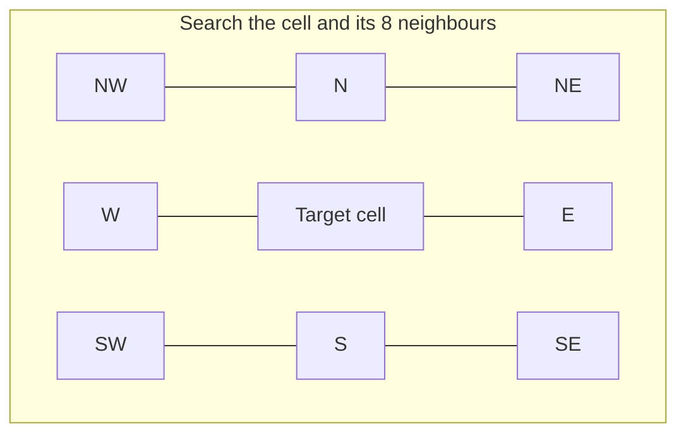
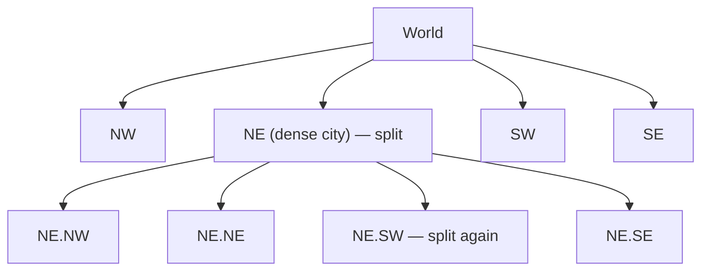

"Find drivers within 2 km", "restaurants near me", "which delivery zone is this address in?" — location queries power ride-hailing, food delivery, maps, dating apps and local search. A naive approach compares the user's position with every point in the database. Geospatial indexes make these queries fast by turning two-dimensional proximity into something a normal index can search.

## Why ordinary indexes aren't enough

Location is two numbers: latitude and longitude. You could index each separately and query a bounding box:

```sql
SELECT * FROM restaurants
WHERE lat BETWEEN 18.50 AND 18.54 AND lng BETWEEN 73.84 AND 73.88;
```

A B-Tree can use only one range efficiently: it finds all rows in the latitude band (a strip across the whole planet), then filters by longitude. At scale that's far too much data. We need an index where **nearby points are stored near each other**.

## Geohash

A **geohash** recursively halves the world: alternate between splitting longitude and latitude, emitting one bit per split, then encode the bits in Base32. Each additional character narrows the cell.

| Geohash length | Cell size (approx.) |
| --- | --- |
| 4 | 39 km × 20 km |
| 5 | 4.9 km × 4.9 km |
| 6 | 1.2 km × 0.6 km |
| 7 | 153 m × 153 m |
| 8 | 38 m × 19 m |

Key property: **points that share a prefix are in the same cell**. So "nearby" becomes "same prefix", which a B-Tree, a sorted key-value store or a Redis sorted set can search with a **prefix/range scan**.

```text
Shivajinagar, Pune (18.5308, 73.8475) → geohash tek92mq
Every point in the same ~1.2 km cell shares the 6-character prefix "tek92m"
Query: points whose geohash starts with 'tek92m'  → a range scan in any sorted index
```

### The edge problem

Two points can be metres apart but in different cells with completely different prefixes (on either side of a cell boundary — notably the equator or prime meridian). The standard fix: search the **target cell plus its 8 neighbours**, then filter by exact distance.



- ✅ Simple, works with any ordered key-value store; easy to shard by prefix.
- ❌ Fixed cell sizes — dense cities have thousands of points per cell while rural cells are empty; choosing precision is a trade-off.

Redis implements `GEOADD` / `GEOSEARCH` with geohash-encoded scores in a sorted set; Elasticsearch and MongoDB support geohash-based indexing too.

## Quadtree

A **quadtree** recursively divides space into four quadrants, but **only where there's data**: split a node when it holds more than *k* points (e.g., 100).



- ✅ **Adapts to density**: small cells in cities, large cells in the countryside, so each leaf has a similar number of points.
- ✅ Natural for "k nearest" — expand the search to neighbouring leaves until enough points are found.
- ❌ Usually an **in-memory** structure on a server; updates (moving points) require tree maintenance; sharding needs care.

A classic Yelp-style design builds a quadtree of businesses in memory on each search server (businesses rarely move) and rebuilds or updates it periodically.

## R-Tree

An **R-Tree** groups nearby objects into bounding rectangles, nested hierarchically — like a B-Tree for rectangles. It handles **shapes** (polygons, delivery zones, road segments), not just points. It's the index behind **PostGIS** (via GiST) and many spatial databases. Choose it when you need "which polygon contains this point?" or complex geometry queries.

## S2 and H3: cells on a sphere

Geohash distorts badly near the poles and cells aren't uniform in area. Large-scale systems use spherical cell systems:

- **Google S2** — projects the sphere onto a cube's six faces and subdivides each face with a quadtree; cells are numbered along a **Hilbert curve**, so nearby cells usually have nearby 64-bit IDs. Any region can be covered by a small set of cells (a "cell covering"), turning a geo query into a few **range scans over cell IDs**. Used by Google Maps, MongoDB, CockroachDB and others.
- **Uber H3** — tiles the world with **hexagons** at 16 resolutions. Hexagons have one kind of neighbour (all six at equal distance, unlike squares' edge vs corner neighbours), which makes "rings" of nearby cells and smoothing of supply/demand data clean. Uber uses H3 for surge pricing, dispatch and analytics.

| | Geohash | Quadtree | R-Tree | S2 | H3 |
| --- | --- | --- | --- | --- | --- |
| Cell shape | Rectangles | Rectangles (adaptive) | Bounding boxes | Quadrilaterals on a sphere | Hexagons |
| Adapts to density | No (fixed precision) | Yes | Yes | Via cell levels | Via resolutions |
| Storage | Any sorted KV / string index | In-memory tree | Database index (PostGIS) | 64-bit IDs in any sorted index | 64-bit IDs |
| Best for | Simple proximity in Redis/KV stores | In-memory search servers | Polygons, shapes, GIS | Global-scale indexing, coverings | Aggregation, rings, pricing zones |

## Moving objects: drivers and couriers

Static places (restaurants) change rarely. Drivers update their location every few seconds, which changes the design:

- Keep the **current location in memory** (Redis GEO or an in-memory grid service), not in a disk-based database row updated thousands of times per second.
- Index by cell: on each update, if the driver moved to a new cell, remove them from the old cell's set and add them to the new one.
- **Shard by region/cell** so each city's updates and queries hit a subset of servers.
- Persist location history asynchronously (Kafka → storage) for trips, analytics and disputes.
- Use **TTLs** so drivers who stop sending updates disappear from search.

See [Design a Ride-Hailing Service](/system-design/hld/design-ride-hailing).

## Distance calculations

After the index narrows candidates, compute exact distance — the **haversine** formula for great-circle distance — and sort. For "nearest by driving time" (what users actually care about), call a **routing engine** for the top few candidates only, since road-network ETA computation is far more expensive than straight-line distance.

<Callout type="interview">
When asked "how do you find nearby X?", give the full chain: "Index locations by geohash (or S2/H3 cell). For a query, compute the user's cell and its neighbours, fetch candidates from those cells, filter by exact haversine distance, and rank — expanding the radius if too few results. For moving drivers, keep locations in an in-memory geo index sharded by city with TTLs."
</Callout>

## Interview questions

<QA q="Why do geohash-based searches query the 8 neighbouring cells too?">
Geohash cells have hard boundaries: two points a few metres apart can fall in adjacent cells with different prefixes, so searching only the user's own cell misses close results across the boundary. Querying the cell plus its eight neighbours covers every point within at least one cell-width of the user; exact distance filtering then removes those outside the radius.
</QA>

<QA q="Geohash or quadtree for a Yelp-like 'nearby businesses' service?">
Both work. Geohash is simpler and fits a database or Redis directly with prefix queries, but fixed precision means dense areas return too many candidates and sparse areas too few (requiring radius expansion). A quadtree adapts cell size to density so each leaf holds a bounded number of businesses, which suits an in-memory index on search servers, since businesses change rarely and the tree can be rebuilt periodically. For a global-scale system, S2 cells stored in a sorted index combine the benefits.
</QA>

<QA q="How would you handle 1 million drivers sending location updates every 4 seconds?">
That's about 250,000 updates per second. Keep current locations in memory — Redis GEO or a custom grid service — sharded by city or cell so each shard handles a manageable slice. Ingest updates through a stateless gateway, update the driver's cell membership only when the cell changes, set TTLs so stale drivers expire, and stream updates asynchronously to Kafka for persistence and analytics rather than writing each to a disk database.
</QA>

## Practice

Write your answer before opening the suggested one. Anything you mark "Partly" or "Missed it" comes back in your review deck.

<Practice task="A user searches for restaurants within 2 km. Using geohash prefixes, why is searching only the user's own cell not enough, and how do you fix it?">

A geohash cell is a rectangle. A user near the edge of their cell has close restaurants just across the border in a neighbouring cell, with a completely different prefix. Searching only their own cell would miss them.

Fix:
1. Choose a precision whose cells are about the size of the search radius (geohash 6 is roughly 1.2 km × 0.6 km).
2. Search the user's cell plus its 8 neighbours.
3. Filter the candidates by the actual distance (haversine) and sort by distance.

If too few results come back, step to a coarser precision (bigger cells) and repeat.

</Practice>

<Practice task="Ten thousand delivery couriers update their location every 3 seconds. Would you index them with a quadtree in a database or with geohash cells in Redis? Explain.">

That is about 3,300 updates per second, and only the latest position matters. A disk-based spatial index (an R-tree in PostGIS) has to update its structure on every move, which is costly for constantly moving points.

Geohash or H3 cells in memory (Redis `GEOADD`, or a map from cell to the set of courier IDs) make an update cheap: compute the new cell and move the courier only if the cell changed. Queries read a few neighbouring cells.

A quadtree works well for mostly static points with uneven density (businesses in cities versus deserts). For high-churn moving objects, simple fixed cells in memory win. Keep the history of positions in a separate time-series store if you need it.

</Practice>

<Takeaways>

- Ordinary B-Tree indexes can't search two dimensions efficiently; geo indexes map nearby points to nearby keys.
- Geohash: prefix = cell; search the cell plus 8 neighbours, then filter by exact distance.
- Quadtrees adapt to density; R-Trees handle shapes; S2 and H3 provide uniform cells on a sphere with 64-bit IDs.
- Moving objects belong in a sharded in-memory geo index with TTLs, with history streamed asynchronously.
- Narrow with the index, filter with haversine, and use a routing engine only for the final few candidates.

</Takeaways>

## Further reading

- Gustavo Niemeyer, "Geohash" (2008) and the public-domain geohash specification.
- Google, [S2 Geometry library](https://s2geometry.io) — cells, Hilbert curves and region coverings.
- Uber Engineering, "H3: Uber's Hexagonal Hierarchical Spatial Index" (2018).
- Antonin Guttman, "R-Trees: A Dynamic Index Structure for Spatial Searching" (SIGMOD 1984).
- Redis documentation — Geospatial indexes (`GEOADD`, `GEOSEARCH`).
- Related case study: [Design a Ride-Hailing Service](/system-design/hld/design-ride-hailing).
