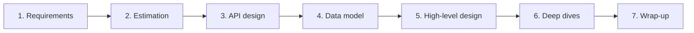
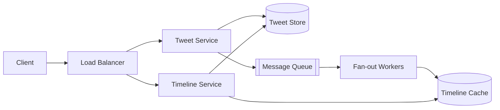

A system design interview is not a quiz with a correct answer. It is a 45–60 minute simulation of a design discussion with a senior colleague. The interviewer is evaluating **how you think**: whether you clarify ambiguity, make reasonable assumptions, choose sensible building blocks, and — most importantly — explain the trade-offs behind each choice.

Candidates rarely fail because they don't know what a cache is. They fail because they jump straight into drawing boxes, design for the wrong problem, run out of time before the interesting part, or can't justify their decisions. A framework fixes all four.

## What interviewers are actually scoring

Most companies use a rubric that looks roughly like this. Keep it in mind — every step of the framework maps to one of these signals.

| Signal | What it looks like when done well |
| --- | --- |
| **Problem navigation** | Asks clarifying questions, narrows scope, identifies what's hard about *this* problem |
| **Solution design** | Produces a working end-to-end design before optimising; components have clear responsibilities |
| **Technical depth** | Can go deep on 1–2 areas: data model, partitioning, consistency, failure handling |
| **Trade-off reasoning** | Names alternatives and explains why one was chosen *for these requirements* |
| **Communication** | Drives the conversation, checks in with the interviewer, keeps a clear diagram |

<Callout type="interview">
At senior levels, the bar shifts from "can you produce a design" to "can you lead the discussion". Interviewers expect you to drive — they should not have to pull each step out of you.
</Callout>

## The seven-step framework



A rough time budget for a 45-minute interview:

| Step | Time | Output |
| --- | --- | --- |
| Requirements | 5–7 min | A short list of functional + non-functional requirements written on the board |
| Estimation | 3–5 min | QPS, storage, bandwidth — only the numbers that influence design |
| API design | 3–5 min | 3–5 core endpoints with request/response shape |
| Data model | 3–5 min | Main entities, key fields, choice of store |
| High-level design | 10–12 min | Working end-to-end diagram for every functional requirement |
| Deep dives | 10–15 min | Scaling bottlenecks, failure modes, trade-offs |
| Wrap-up | 3–5 min | Bottlenecks, recap, what changes at the next 10× of scale |

<Callout type="note" title="Where sources differ">
Alex Xu's *System Design Interview* uses four steps — understand the problem and scope it (3–10 min), propose a high-level design and get buy-in (10–15 min), deep dive (10–25 min), wrap up (3–5 min). It's the same flow: our steps 1–5 split his first two into explicit checkpoints (estimation, API, data model) so none gets skipped. Use whichever you can run without thinking — and note his emphasis on getting the interviewer's **buy-in** on the high-level design before diving deep.
</Callout>

### Step 1 — Clarify requirements

Every design question is deliberately vague. "Design Twitter" could mean a dozen different systems. Your first job is to turn it into a concrete, scoped problem.

**Functional requirements** describe what the system does. Write them as user-facing capabilities and limit yourself to the 3–4 most important ones:

- Users can post a tweet (text up to 280 chars, optional media)
- Users can follow other users
- Users can view a home timeline of tweets from people they follow

Explicitly call out what you are **not** doing: "I'll leave out search, DMs, and ads unless you'd like me to include them." This shows judgment and protects your time.

**Non-functional requirements** describe qualities of the system. These drive the architecture far more than functional requirements do:

- **Scale** — how many users, daily active users (DAU), requests per second?
- **Latency** — what's acceptable for the critical path? (e.g., timeline loads in under 200 ms at p99)
- **Availability vs consistency** — is it acceptable for a user to see a slightly stale timeline? (Usually yes.) Is it acceptable for a payment to be double-charged? (Never.)
- **Durability** — can we ever lose data? Messages and payments: no. View counters: probably fine.
- **Read/write ratio** — timelines are heavily read-dominated (~100:1), which favours caching and precomputation.

Two context questions are easy to forget and often change the answer:

- **What can we build on?** "Can we use managed cloud services — object storage, a CDN, a managed queue?" Almost every real company does, and it lets you spend interview time on the interesting parts instead of re-inventing S3.
- **How fast will it grow?** Scale in 3, 6 and 12 months tells you whether to design for today's numbers or leave room for sharding later.

<Callout type="tip" title="Ask questions that change the design">
Every question should have an answer that would change what you build. "Should we support 1 million or 1 billion users?" changes everything. "What colour is the button?" changes nothing. If a question doesn't influence architecture, don't ask it.
</Callout>

### Step 2 — Back-of-the-envelope estimation

Estimate only what informs a decision: request rate (do we need many servers? a cache?), storage (does it fit on one machine? do we need sharding?), and bandwidth (do we need a CDN?).

```text
DAU = 200M, each user views timeline 10x/day, posts 0.5x/day

Read QPS  = 200M × 10 / 86,400 ≈ 23,000/s   (peak ≈ 2–3× → ~60K/s)
Write QPS = 200M × 0.5 / 86,400 ≈ 1,150/s

Storage per tweet ≈ 300 bytes text + metadata ≈ 1 KB
Per day: 100M tweets × 1 KB = 100 GB/day → ~36 TB/year (before media)
```

Then **say what the numbers mean**: "60K reads per second is too much for a single database, and reads dominate writes 20:1, so caching and precomputed timelines will be central to this design." Numbers without conclusions are wasted time. The next lesson covers estimation in depth.

### Step 3 — Define the API

The API is the contract between client and system. Defining it forces you to make the functional requirements concrete and reveals what data you need.

```text
POST /v1/tweets
  body: { text, mediaIds[] }
  → 201 { tweetId, createdAt }

GET  /v1/timeline?cursor=<opaque>&limit=20
  → 200 { tweets: [...], nextCursor }

POST /v1/users/{userId}/follow
  → 204
```

Small details here earn credit: cursor-based pagination instead of offsets, an idempotency key on writes that may be retried, and authentication via a token rather than a `userId` in the body.

### Step 4 — Sketch the data model

Name the core entities and their key fields, then pick a storage technology **with a reason**.

```text
User   (user_id PK, handle, name, created_at)
Tweet  (tweet_id PK, author_id, text, media_urls, created_at)
Follow (follower_id, followee_id, created_at)  PK = (follower_id, followee_id)
```

"Tweets are write-once and accessed by `tweet_id` or by `author_id` + time. A wide-column store like Cassandra, partitioned by `author_id`, fits this well. The social graph needs lookups in both directions, so I'd store two tables — followers and following."

### Step 5 — High-level design

Draw a diagram that satisfies **every functional requirement end to end**. Start simple and walk through a request: "A client posts a tweet, it hits the load balancer, goes to the Tweet Service, which writes to the Tweet store and publishes an event…"



Resist the urge to add every component you know. Each box should exist because a requirement needs it. An interviewer is far more impressed by a simple design you can fully justify than a crowded diagram you cannot.

### Step 6 — Deep dives

This is where senior candidates distinguish themselves. Either the interviewer will steer you, or you should proactively pick the 2–3 hardest parts of the problem. Good deep-dive targets:

- **The bottleneck your estimates revealed** — e.g., 60K timeline reads per second → precomputed timelines in a cache.
- **The hard edge case** — a celebrity with 100M followers makes fan-out-on-write explode. Use a hybrid: fan-out on write for normal users, fan-out on read for celebrities.
- **Failure modes** — what happens when the cache cluster goes down? When a fan-out worker crashes halfway?
- **Consistency questions** — can a user post a tweet and not see it in their own timeline? (Read-your-writes.)

For each, follow the same pattern: **state the problem → offer 2 options → pick one and explain why → mention what you're giving up**.

### Step 7 — Wrap up

The last few minutes are a chance to leave a strong final impression. Don't just stop talking when the diagram is done:

- **Name the bottlenecks yourself.** Never claim the design is perfect. "If I had more time, the fan-out workers and the hot-key handling on the feed cache are where I'd look next."
- **Recap** the design in three or four sentences, especially if you explored several alternatives along the way.
- **Failure and operations.** How you'd monitor it (key metrics, alerts), roll it out (canary, feature flags) and what happens when components fail.
- **The next scale curve.** "This handles 10 million users; at 100 million, the metadata store needs sharding and we'd move to multi-region."

Treat the interviewer as a teammate throughout: propose, ask for feedback, and adjust. You're not done until they say you're done.

## Communicating trade-offs

The single most important habit in a design interview is making trade-offs explicit. Compare:

> "I'll use Cassandra."

with

> "Tweets are written once, read often, and we need to scale writes horizontally across regions. I'd use Cassandra partitioned by `author_id`. We give up multi-row transactions and strong consistency, but we don't need either for tweets — a few seconds of staleness is fine."

The second answer demonstrates understanding of the requirement, the tool, and its cost. Use this template:

1. **Requirement** — what property do we need?
2. **Options** — two or three realistic choices.
3. **Decision** — which one, and why it fits.
4. **Cost** — what we give up, and why that's acceptable.

## Common mistakes

<Callout type="warning" title="Mistakes that cost offers">

- **Designing before clarifying.** You end up solving a different problem than the one the interviewer had in mind.
- **Estimation theatre.** Ten minutes of arithmetic that never influences a decision.
- **Buzzword architecture.** Adding Kafka, Kubernetes and microservices without a requirement that needs them.
- **Going deep too early.** Spending 20 minutes on database indexes before the end-to-end flow exists.
- **Going silent.** The interviewer can only grade what you say aloud. Think out loud.
- **Single points of failure.** One database, one load balancer, no mention of what happens when they fail.
- **Over-engineering.** Designing for 1,000× the stated scale, or adding components for elegance rather than need. Interviewers explicitly watch for this.
- **Stubbornness.** Defending a choice after the interviewer has shown a real problem with it.

</Callout>

## A worked opening

Here is what the first five minutes might sound like for "Design a URL shortener":

> "Before I start, let me make sure I understand the scope. The core features are: given a long URL, return a short one; and given a short URL, redirect to the original. Should users be able to choose custom aliases? Do links expire? Do we need click analytics?
>
> For scale — are we talking about something like bit.ly, roughly 100 million new URLs a month? And I assume reads massively outnumber writes, maybe 100:1, since a link is created once and clicked many times.
>
> For non-functional requirements: redirects must be fast — under 50 ms — and highly available, since a broken short link is a broken link on someone's website. It's fine if a newly created link takes a second to become available globally. And we can never map a short code to the wrong URL.
>
> I'll skip user accounts and analytics for now and come back to them if we have time. Does that sound right?"

In under a minute you have scoped the problem, surfaced the key non-functional requirements (latency, availability, read-heavy), and earned the interviewer's agreement.

## Interview questions

<QA q="The interviewer says 'Design Instagram' and nothing more. What do you do first?">
Don't draw anything. Ask scoping questions to pick the 3–4 core features (e.g., upload photo, follow users, view feed), and explicitly exclude others (stories, DMs, search). Then establish scale (DAU, uploads per day), latency targets for the feed, and consistency expectations (a slightly stale feed is acceptable; losing an uploaded photo is not). Summarise your understanding and confirm it with the interviewer before proceeding.
</QA>

<QA q="How do you decide which areas to deep-dive into?">
Pick the parts that are (1) bottlenecks revealed by your estimates — e.g., read QPS too high for a database; (2) inherently hard for this specific problem — e.g., fan-out for celebrities, ordering in chat, geo-queries for ride-hailing; or (3) failure-prone — e.g., what happens when a component crashes mid-operation. Avoid deep-diving into generic components (the load balancer) unless the interviewer asks. If unsure, offer two options and let the interviewer choose.
</QA>

<QA q="The interviewer challenges your database choice. How should you respond?">
Treat it as a discussion, not an attack. Restate the requirement that drove your choice, acknowledge the valid concern behind their question, and evaluate the alternative honestly. If the alternative is better given what they've raised, say so and adapt — changing your mind with clear reasoning is a positive signal. Defending a weak choice stubbornly is a negative one.
</QA>

<QA q="What's the difference between functional and non-functional requirements, and which matters more for architecture?">
Functional requirements describe *what* the system does (post a tweet, view a feed). Non-functional requirements describe *how well* it does it (latency, availability, scale, consistency, durability). Non-functional requirements drive architecture far more: a feed for 1,000 users and one for 500 million users have identical functional requirements but completely different designs.
</QA>

<Takeaways>

- The interview evaluates reasoning and communication, not memorised architectures.
- Follow a fixed sequence: requirements → estimation → API → data model → high-level design → deep dives.
- Non-functional requirements (scale, latency, consistency) shape the design more than features do.
- Build a simple working end-to-end design first, then optimise the parts that matter.
- For every decision: requirement → options → choice → cost.

</Takeaways>

## Further reading

- Alex Xu, *System Design Interview – An Insider's Guide*, Vol. 1 (2020) — ch. 3, "A Framework for System Design Interviews".
- Martin Kleppmann, *Designing Data-Intensive Applications* (O'Reilly, 2017) — ch. 1, "Reliable, Scalable, and Maintainable Applications".
- [The System Design Primer](https://github.com/donnemartin/system-design-primer) — a broad, community-maintained index of topics.
- Next: [Back-of-the-Envelope Estimation](/system-design/hld/back-of-the-envelope-estimation) and, once you've finished the concepts, [Recurring Design Patterns](/system-design/hld/hld-design-patterns).
