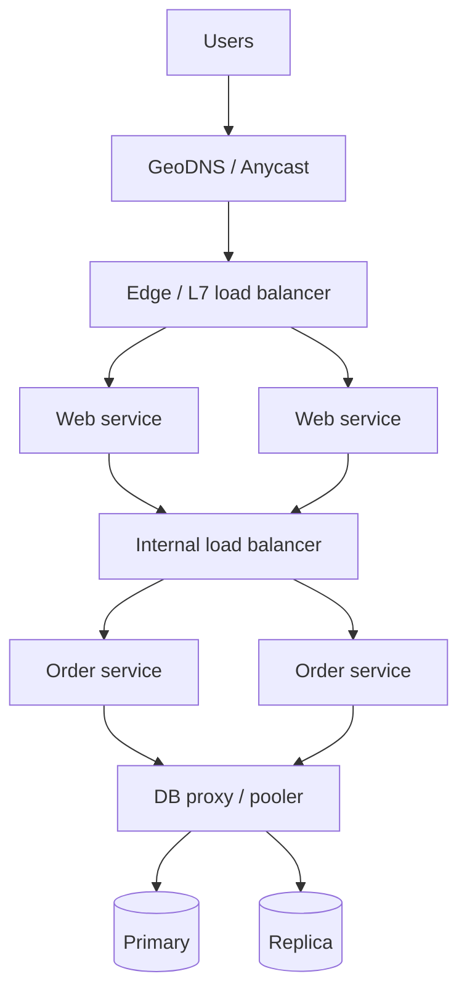
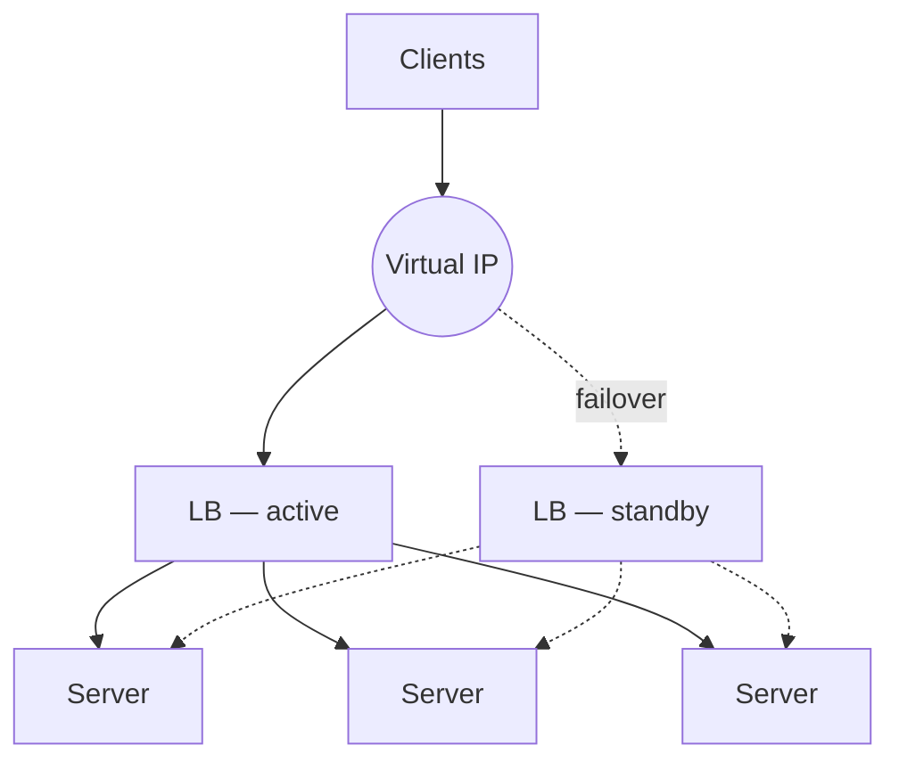

A **load balancer** sits between clients and a pool of servers and distributes incoming requests across them. It's the component that makes horizontal scaling work: clients talk to one address, while behind it any number of servers can be added, removed, or replaced.

A load balancer provides four things:

1. **Distribution** — spreads load so no single server is overwhelmed.
2. **Availability** — detects unhealthy servers and stops sending them traffic.
3. **Abstraction** — clients don't need to know how many servers exist or where they are.
4. **A control point** — a natural place for TLS termination, rate limiting, routing rules and observability.

## Where load balancers appear

Load balancers appear at several layers of a typical architecture:



- **Global**: DNS or anycast routes users to the nearest region.
- **Edge**: a public-facing L7 load balancer per region.
- **Internal**: between services (or a client-side load balancer / service mesh sidecar).
- **Data tier**: proxies that spread reads across replicas.

## L4 vs L7 load balancing

| | Layer 4 (Transport) | Layer 7 (Application) |
| --- | --- | --- |
| Sees | IPs, ports, TCP/UDP | Full HTTP request: method, path, headers, cookies, body |
| Routing decisions | Per connection | Per request |
| TLS | Passes it through (usually) | Typically terminates TLS |
| Performance | Very high, low latency, low CPU | Higher CPU per request; still very fast |
| Features | Simple forwarding | Path/host routing, header rewrites, retries, caching, compression, auth, rate limits |
| Protocol support | Any TCP/UDP protocol | HTTP/1.1, HTTP/2, gRPC, WebSocket |
| Examples | AWS NLB, LVS, HAProxy (TCP mode), Maglev | AWS ALB, NGINX, Envoy, HAProxy (HTTP mode), Traefik |

### Why L7 matters for modern systems

**Content-based routing** lets one entry point serve many services:

```text
api.example.com/users/*    → user-service
api.example.com/orders/*   → order-service
api.example.com/static/*   → object storage / CDN origin
```

**Per-request balancing** matters for HTTP/2 and gRPC. These protocols multiplex many requests over one long-lived connection. An L4 balancer assigns the *connection* to one server, so every request on it goes to that server — load becomes badly skewed. An L7 balancer can spread individual requests across backends.

<Callout type="example">
This is a frequent real-world gotcha with gRPC on Kubernetes: the default Service is L4, so long-lived gRPC connections pin to a few pods while others sit idle. Teams fix it with an L7 proxy (Envoy/Linkerd/Istio) or client-side load balancing.
</Callout>

## Load-balancing algorithms

### Static algorithms

These algorithms don't look at server state.

**Round robin** — send requests to servers in turn: A, B, C, A, B, C…
- Simple and fair when servers are identical and requests cost about the same.
- Breaks down when request costs vary widely or servers differ in capacity.

**Weighted round robin** — servers with higher weights receive proportionally more requests. Useful for mixed hardware or canary deployments (send 5% of traffic to a new version).

**Random** — pick any server at random. Statistically similar to round robin at scale, with no shared counter needed.

**Hash-based (IP hash / key hash)** — `server = hash(client IP or key) mod N`. The same client (or key) always reaches the same server — useful for cache locality or session affinity. Weakness: when N changes, almost every key remaps. **Consistent hashing** (covered in a later lesson) fixes this.

### Dynamic algorithms

These algorithms use live server state.

**Least connections** — send to the server with the fewest active connections. Good when requests have variable duration (e.g., some take 10 ms, some take 5 s), or for long-lived connections like WebSockets.

**Least response time** — prefer servers that are responding fastest and have few active connections. Adapts to slow or degraded instances.

**Power of two random choices** — pick two servers at random and send the request to the less loaded one. Surprisingly close to optimal, and it avoids the "herd" problem where every balancer simultaneously picks the same least-loaded server. Used by NGINX, Envoy and many distributed systems.

| Algorithm | Best when | Watch out for |
| --- | --- | --- |
| Round robin | Homogeneous servers, uniform requests | Uneven request costs |
| Weighted round robin | Mixed capacity, canary releases | Weights must be maintained |
| Least connections | Variable-duration or long-lived requests | Requires tracking connection state |
| IP / key hash | Need affinity (cache locality, sessions) | Remapping when pool changes; hot keys |
| Power of two choices | Many balancers, large fleets | Slightly more complex |

<Callout type="interview">
If asked "which algorithm would you use?", tie it to the workload: "For a stateless REST API with uniform requests, round robin is fine. For our WebSocket chat servers, connections live for hours and vary in activity, so least-connections gives a more even spread."
</Callout>


<LoadBalancerSim />

## Health checks

A load balancer must know which backends can serve traffic.

- **Active health checks** — the LB periodically calls an endpoint (e.g., `GET /health` every 5 s). After N consecutive failures the server is removed from rotation; after M successes it's added back.
- **Passive health checks** — the LB watches real traffic. If a server returns errors or times out repeatedly, it's ejected for a period (*outlier detection*).

### Designing a good health endpoint

There's a subtle trade-off in what `/health` should check:

- **Shallow (liveness)** — "the process is running and can respond". Fast and reliable, but can report healthy when the server can't actually do useful work.
- **Deep (readiness)** — "I can reach my database and cache". More accurate, but **dangerous**: if the shared database has a hiccup, *every* server fails its health check at once, the LB removes all of them, and a partial degradation becomes a total outage.

A common pattern is to separate **liveness** (restart me if this fails) from **readiness** (don't send me traffic right now), and to make readiness check only the dependencies that are truly local to the instance.

## Removing the load balancer as a single point of failure

A single load balancer is itself a single point of failure. Common solutions:

- **Active-passive pair** — two LB nodes share a virtual IP (VIP) via a protocol like VRRP (e.g., keepalived). If the active node dies, the passive one takes over the VIP within seconds.
- **Active-active** — multiple LB nodes all serve traffic, with DNS returning multiple IPs or an upstream L4 tier/ECMP routing distributing traffic among them.
- **Anycast** — the same IP is announced from many locations; the internet's routing delivers each user to the nearest healthy one. Used by CDNs and global load balancers (e.g., Google's front end, Cloudflare).
- **Managed cloud LBs** — AWS ALB/NLB, GCP Load Balancing etc. are internally distributed and redundant; you get high availability without managing it.



## Other responsibilities of load balancers

- **TLS termination** — decrypt once at the edge; backends handle plain HTTP (or re-encrypt for zero-trust).
- **Connection draining** — when removing a server (deploys, scale-in), stop sending it new requests but let in-flight ones finish.
- **Retries** — an L7 LB can retry a failed idempotent request on another backend. Beware of **retry storms** (see the Fault Tolerance lesson).
- **Rate limiting and WAF** — block abusive clients before they reach your services.
- **Observability** — a single point to measure request rate, latency and error rate per route.
- **Network isolation** — only the load balancer has a public address; application servers sit in private subnets reachable only from inside the network, which removes a large attack surface.

## Load balancer vs reverse proxy vs API gateway

These terms overlap heavily:

- A **reverse proxy** accepts client requests on behalf of servers (NGINX, Envoy). Most L7 load balancers are reverse proxies.
- A **load balancer** is a reverse proxy whose primary job is distributing traffic across many instances.
- An **API gateway** is a reverse proxy focused on API concerns: authentication, rate limits per API key, request transformation, versioning, and aggregation of multiple backend calls (e.g., Kong, AWS API Gateway, Apigee).

In interviews, it's fine to draw one box called "API Gateway / LB" at the edge and say what it's responsible for.

## Client-side load balancing

Instead of a central balancer, each client gets the list of healthy instances from a **service registry** (Consul, Eureka, etcd, Kubernetes endpoints) and picks one itself.

- **Pros:** no extra network hop, no central bottleneck, smart per-client algorithms.
- **Cons:** every client must implement the logic (often via a library or sidecar proxy), and health information can be inconsistent across clients.

Service meshes (Istio, Linkerd) implement this transparently with a sidecar proxy beside each service instance.

## Interview questions

<QA q="When would you choose an L4 load balancer over L7?">
When you need maximum throughput and minimum latency with no need to inspect requests — e.g., non-HTTP protocols (databases, custom TCP, game servers over UDP), very high packet rates, or as a first tier in front of L7 proxies. L4 is also preferred when TLS must pass through unterminated to the backend. Choose L7 when you need path- or header-based routing, per-request balancing for HTTP/2 or gRPC, retries, or TLS termination.
</QA>

<QA q="All of your servers suddenly fail health checks at the same time. What could cause this and how would you prevent the outage?">
A deep health check that depends on a shared component (database, cache, downstream service). When that dependency degrades, every instance reports unhealthy and the LB removes the whole fleet. Prevention: keep health checks shallow or only check instance-local readiness; implement "fail open" behaviour (many LBs keep routing to all backends if all are unhealthy); and handle dependency failures inside the application with graceful degradation rather than via the health check.
</QA>

<QA q="How does a load balancer support zero-downtime deployments?">
Via connection draining and gradual rollout. To deploy an instance: mark it as draining (no new requests), wait for in-flight requests to complete, deploy, wait for readiness checks to pass, then return it to rotation. Repeat in batches (rolling deploy). Weighted routing also enables canary releases (send 1–5% to the new version, then increase) and blue-green deployments (switch all traffic from one fleet to another and keep the old fleet for instant rollback).
</QA>

<QA q="What's the problem with using hash(client_ip) mod N for session affinity?">
When N changes — a server is added, removed or fails — most clients map to a different server, breaking affinity for almost everyone at once. Also, many users behind one corporate NAT or mobile carrier share an IP, creating hot spots. Consistent hashing reduces remapping to about 1/N of keys, and cookie-based affinity avoids the shared-IP problem.
</QA>

## Practice

Write your answer before opening the suggested one. Anything you mark "Partly" or "Missed it" comes back in your review deck.

<Practice task="Your load balancer uses round robin. Some requests take 10 ms and others take 5 seconds, and one server keeps getting overloaded. Which algorithm would do better, and why?">

Round robin assumes every request costs the same. With mixed durations, a server that happened to receive several slow requests keeps getting its share of new ones while it is still busy.

Least connections (or least outstanding requests) sends each new request to the server with the fewest requests in progress, which naturally steers work away from busy servers. 'Power of two choices' — pick two servers at random and send to the less loaded one — gets most of the benefit with very little coordination, which is useful with many load balancer instances.

Also consider separating slow endpoints into their own pool so they do not affect fast ones.

</Practice>

<Practice task="Should a WebSocket chat service sit behind an L4 or an L7 load balancer? What changes compared with a normal HTTP API?">

Either works, but the concerns differ from a stateless API.

- WebSockets are long-lived, so balancing happens once per connection, not per request. Least connections is a good algorithm; round robin can leave servers unbalanced after restarts.
- An L7 balancer can terminate TLS, route the upgrade request by path, and do health checks, and most support WebSockets. An L4 balancer passes TCP through, which is simpler and handles huge connection counts cheaply.
- Plan for draining: when deploying, stop sending new connections to a server and let clients reconnect gradually with jittered backoff, or you get a reconnect storm.
- Idle timeouts on the balancer must be longer than your heartbeat interval, or it will cut idle connections.

</Practice>

<Takeaways>

- Load balancers enable horizontal scaling, provide failover via health checks, and act as a control point.
- L4 balances connections and is fast and protocol-agnostic; L7 balances requests and can route on content.
- Choose the algorithm based on the workload: round robin for uniform requests, least connections for long-lived ones, hashing for affinity.
- Health checks must not depend on shared dependencies, or a partial failure becomes a total outage.
- The load balancer itself must be redundant: active-passive with a VIP, active-active, anycast, or a managed service.

</Takeaways>

## Further reading

- Eisenbud et al., "Maglev: A Fast and Reliable Software Network Load Balancer" (NSDI 2016).
- Michael Mitzenmacher, "The Power of Two Choices in Randomized Load Balancing" (IEEE TPDS, 2001).
- *Site Reliability Engineering* (Google, 2016) — ch. 19 "Load Balancing at the Frontend" and ch. 20 "Load Balancing in the Datacenter".
- Related: [Consistent Hashing](/system-design/hld/consistent-hashing), [Monoliths, Microservices & Service Discovery](/system-design/hld/microservices-architecture).
