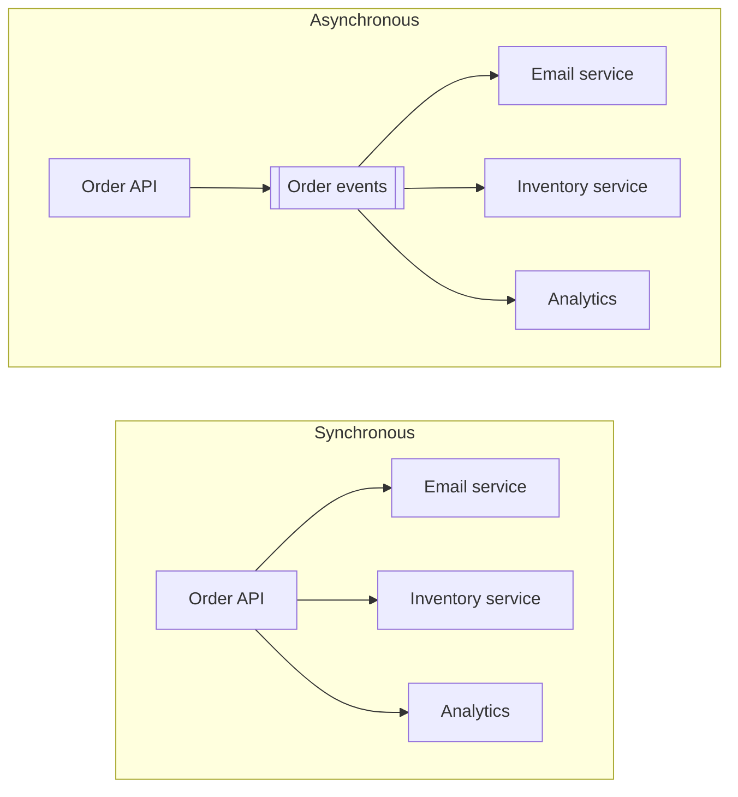
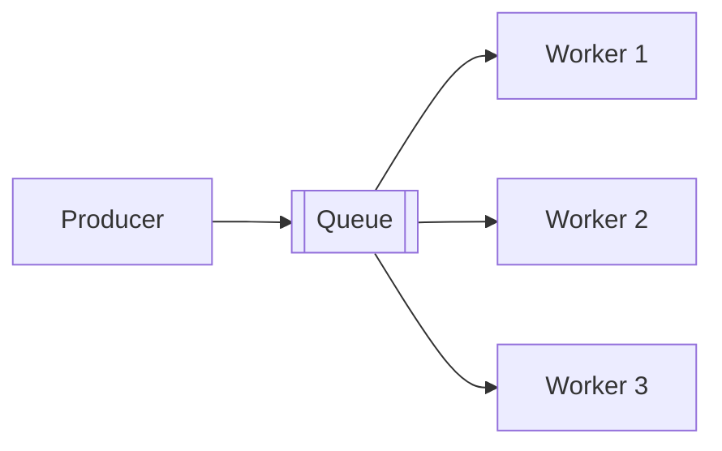
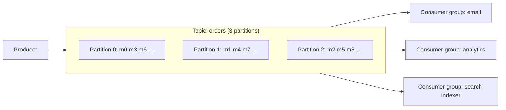
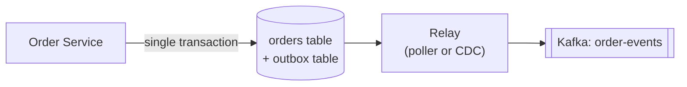

So far, communication has been **synchronous**: a caller sends a request and waits for the response. That couples the caller to the callee's availability and speed. **Asynchronous messaging** inserts a durable intermediary — a queue or log — so producers hand off work and move on, and consumers process it at their own pace.

Message queues and event streams are among the most frequently used building blocks in HLD interviews.

## Why go asynchronous

In the synchronous version, the order API's latency is the sum of all downstream calls, and if the email service is down, placing an order fails. The asynchronous version fixes both:

1. **Decoupling** — producers don't know or care who consumes; new consumers are added without changing the producer.
2. **Resilience** — if a consumer is down, messages wait in the queue instead of failing the user's request.
3. **Load levelling** — a traffic spike fills the queue; consumers drain it at a steady rate instead of being overwhelmed.
4. **Lower user-facing latency** — slow work (sending email, generating thumbnails, video transcoding) moves off the request path.
5. **Independent scaling** — add consumers when the backlog grows.

The cost: **eventual consistency** (work happens "soon", not "now"), more infrastructure, and harder debugging and ordering.

## Two models: queues and logs

### Message queue (point-to-point)

Messages are delivered to **one** consumer among a pool of competing consumers, and are **deleted once acknowledged**.

- Each message is processed by exactly one worker — natural **work distribution**.
- Per-message acknowledgement, retries, delays and dead-letter queues.
- Examples: **RabbitMQ**, **Amazon SQS**, ActiveMQ, Redis-based queues (Sidekiq, BullMQ).
- Use for: background jobs and task queues — send this email, resize this image, process this payment.

### Event log / stream (publish-subscribe)

Messages are appended to an **ordered, durable, replayable log**. Multiple independent **consumer groups** each read the full stream at their own pace, tracking their position with an **offset**. Messages are retained for a configured period regardless of consumption.

- Examples: **Apache Kafka**, Amazon Kinesis, Apache Pulsar, Redpanda.
- Use for: event-driven architectures, change data capture, activity tracking, metrics pipelines, stream processing, and anywhere multiple systems react to the same events.

| | Message queue | Event log |
| --- | --- | --- |
| Consumption | One consumer per message | Every consumer group sees every message |
| After consumption | Message deleted | Retained (time/size-based); replayable |
| Ordering | Usually best-effort (FIFO queues available) | Strict order **within a partition** |
| Consumer state | Broker tracks per-message acks | Consumer tracks its offset |
| Throughput | High | Very high (sequential disk I/O, batching) |
| Typical tools | RabbitMQ, SQS | Kafka, Kinesis, Pulsar |
| Mental model | To-do list for workers | Shared, durable history of events |

<Callout type="note" title="Where sources differ">
Introductory texts sometimes describe a message queue as "durable, stored in memory". Those pull in opposite directions: a broker that keeps messages only in memory loses them when it crashes. **Durability** means messages are persisted to disk and/or replicated to other brokers before the producer's write is acknowledged (Kafka `acks=all`, RabbitMQ persistent messages on quorum queues, SQS's replicated storage). Ask what guarantee a queue gives before relying on it.
</Callout>

## How Kafka achieves scale and ordering

- A **topic** is split into **partitions**. Each partition is an append-only log stored on disk and replicated across brokers (leader + followers).
- Producers choose a partition by **message key** (`hash(key) mod partitions`). All messages with the same key (e.g., the same `order_id` or `user_id`) go to the same partition, so they're **ordered relative to each other**.
- Within a **consumer group**, each partition is assigned to exactly one consumer. So the **number of partitions caps the group's parallelism** — 12 partitions means at most 12 active consumers in that group.
- Consumers commit **offsets** to record progress; on restart they resume from the last committed offset, and a new group can start from the beginning to replay history.
- Speed comes from sequential disk writes, OS page cache, batching, compression and zero-copy transfers.

<Callout type="tip" title="Ordering is per key, not global">
If you need events for one entity processed in order (e.g., "order created" before "order paid"), use that entity's ID as the message key. Global ordering across all messages requires a single partition — which caps throughput — and is rarely necessary.
</Callout>

<PartitionSim />

## Delivery semantics

Failures can happen at any point: a producer may not receive the broker's ack, or a consumer may crash after processing but before acknowledging.

| Guarantee | Meaning | How | Risk |
| --- | --- | --- | --- |
| **At-most-once** | Each message is delivered 0 or 1 times | Ack/commit *before* processing | Messages lost on crash |
| **At-least-once** | Delivered 1 or more times | Ack/commit *after* processing; retry on failure | **Duplicates** |
| **Exactly-once** | Effect happens once | Idempotent/transactional producers + transactional processing, or at-least-once + idempotent consumers | Complexity; scope-limited |

In practice, **at-least-once delivery with idempotent consumers** is the standard design. Kafka offers exactly-once semantics *within* Kafka (read-process-write across topics using transactions), but as soon as a consumer has external side effects — sending an email, charging a card, calling an API — you need idempotency anyway.

### Making consumers idempotent

- **Deduplication table** — record processed message IDs (with a unique constraint), in the same database transaction as the side effect.
- **Natural idempotency** — design operations so repeating them is harmless: `SET status = 'SHIPPED'` instead of `INCREMENT shipped_count`; upserts instead of inserts.
- **Conditional writes** — apply an update only if the current version matches (`WHERE version = 7`).
- **Idempotency keys** on downstream API calls (e.g., the payment provider).

## Handling failures

- **Retries with backoff** — transient failures (a downstream timeout) are retried with exponential backoff.
- **Dead-letter queue (DLQ)** — after N failed attempts, move the message aside so a "poison message" doesn't block the queue forever. Alert on DLQ growth and provide tooling to inspect and replay.
- **Visibility timeout** (SQS) — a received message is hidden from other consumers for a period; if not deleted (acked) in time, it reappears for another consumer. Set it longer than the worst-case processing time.
- **Ordering vs retries** — in an ordered partition, retrying one message in place blocks everything behind it. Common pattern: send failures to a separate retry topic with delays, accepting that ordering for that key is relaxed — or pause the key.

## Back-pressure and consumer lag

If producers outpace consumers, the backlog grows. **Consumer lag** (how far behind the latest offset a consumer group is) is the key metric to monitor and to auto-scale on.

Responses to growing lag:

- Add consumers (up to the partition count) or increase partitions.
- Speed up processing (batching, fewer synchronous calls).
- Shed or sample low-priority work.
- Apply **back-pressure** upstream — slow down or reject producers when queues exceed a limit, rather than letting memory or disk fill up.

## The dual-write problem and the outbox pattern

A service often needs to **update its database and publish an event** — e.g., save an order and emit `OrderCreated`. Doing these as two separate steps is unsafe:

- DB commit succeeds, publish fails → downstream systems never learn about the order.
- Publish succeeds, DB commit fails → downstream systems react to an order that doesn't exist.

The **transactional outbox pattern** solves this:

1. In the **same database transaction**, insert the order *and* an event row into an `outbox` table.
2. A relay process reads new outbox rows (by polling or via CDC such as Debezium) and publishes them to the broker, marking them sent.
3. The relay may publish an event more than once on failure, so consumers must be idempotent — at-least-once again.

<Callout type="interview">
When your design writes to a database and then emits an event, an interviewer may ask "what if the publish fails?". The outbox pattern (or CDC from the database log) is the expected answer.
</Callout>

## Common use cases in designs

| Use case | Pattern |
| --- | --- |
| Send emails/SMS/push after an action | Task queue with retries and DLQ |
| Image/video processing after upload | Queue of jobs; workers auto-scale on backlog |
| Fan-out of a post to followers' timelines | Event → fan-out workers |
| Keeping search index / cache / warehouse in sync | CDC → Kafka → consumers |
| Order processing saga across services | Events per step; compensating events on failure |
| Activity tracking, clickstream, logs, metrics | High-throughput log (Kafka/Kinesis) → stream processing |
| Smoothing traffic spikes (ticket sales, flash sales) | Queue in front of the bottleneck; process at a steady rate |

## Interview questions

<QA q="How do you guarantee a message is processed exactly once?">
In general you can't guarantee exactly-once delivery across failures; you guarantee exactly-once *effects*. Use at-least-once delivery (ack after processing) and make the consumer idempotent: record processed message IDs in a dedup table within the same transaction as the side effect, use upserts or conditional updates, and pass idempotency keys to external APIs. Kafka transactions give exactly-once for Kafka-to-Kafka processing, but external side effects still need idempotency.
</QA>

<QA q="You need all events for the same order processed in order, but you also need high throughput. How?">
Partition the topic and use order_id as the message key. All events for one order go to the same partition and are consumed in order by a single consumer, while different orders are spread across many partitions and processed in parallel. Choose enough partitions for the target parallelism, and avoid retrying a failed message in a way that lets later events for the same key overtake it.
</QA>

<QA q="When would you use RabbitMQ/SQS instead of Kafka?">
For task queues where each job should be done once by one worker, with per-message acknowledgement, retries, delays, priorities and dead-lettering — such as sending emails or processing uploads — and when you don't need replay or multiple independent consumers of the same events. Kafka fits event streaming: high throughput, ordered partitions, multiple consumer groups, long retention and replay.
</QA>

<QA q="What is a poison message and how do you handle it?">
A message that always fails processing — malformed data, or one that triggers a bug. With naive retries it is redelivered forever, blocking or wasting consumers (and in ordered partitions, blocking everything behind it). Handle it by limiting retry attempts, then moving the message to a dead-letter queue with error details, alerting on it, fixing the cause, and replaying it from the DLQ.
</QA>

## Practice

Write your answer before opening the suggested one. Anything you mark "Partly" or "Missed it" comes back in your review deck.

<Practice task="Orders for the same customer must be processed in order, but you need 50 consumers working in parallel. How do you set up Kafka?">

Kafka guarantees order only within a partition. Use the customer ID as the message key, so all events for one customer go to the same partition and stay in order.

Create at least 50 partitions (more gives room to grow, since adding partitions later changes which partition a key maps to). A consumer group of 50 consumers then gets one partition each. Each consumer processes its partition sequentially, so each customer's events are handled in order, while different customers are processed in parallel.

Watch for hot keys: one very active customer can make one partition (and one consumer) the bottleneck.

</Practice>

<Practice task="A consumer keeps failing on one malformed message, retrying forever, and the queue behind it grows to millions. How do you handle 'poison' messages?">

1. Retry a limited number of times with backoff, for errors that may be temporary (a timeout, a downstream outage).
2. After the limit, or straight away for errors that will never succeed (cannot parse, validation failure), move the message to a dead-letter queue (DLQ) with the error reason, and continue with the next message.
3. Alert on DLQ growth, and provide a tool to inspect messages and replay them once the bug is fixed.
4. For log-based systems like Kafka, where you cannot skip a message individually, the consumer writes the bad message to a DLQ topic and commits the offset to move on.

This keeps one bad message from blocking all the good ones behind it.

</Practice>

<Takeaways>

- Async messaging decouples services, absorbs spikes, and moves slow work off the request path — at the cost of eventual consistency.
- Queues distribute tasks to competing workers and delete messages once acknowledged; logs retain ordered, replayable events for many consumer groups.
- Kafka orders messages per partition; use the entity ID as the key, and remember that partitions cap consumer parallelism.
- Design for at-least-once delivery with idempotent consumers; use retries, backoff and dead-letter queues.
- Use the transactional outbox (or CDC) to update a database and publish events reliably.

</Takeaways>

## Further reading

- Kreps, Narkhede and Rao, "Kafka: a Distributed Messaging System for Log Processing" (NetDB 2011).
- Jay Kreps, "The Log: What every software engineer should know about real-time data's unifying abstraction" (2013).
- Martin Kleppmann, *Designing Data-Intensive Applications* — ch. 11, "Stream Processing".
- Chris Richardson, [microservices.io — Transactional outbox](https://microservices.io/patterns/data/transactional-outbox.html).
- Related: [Event-Driven Architecture](/system-design/hld/event-driven-architecture), [Distributed Transactions](/system-design/hld/distributed-transactions), [Batch & Stream Processing](/system-design/hld/batch-and-stream-processing).
