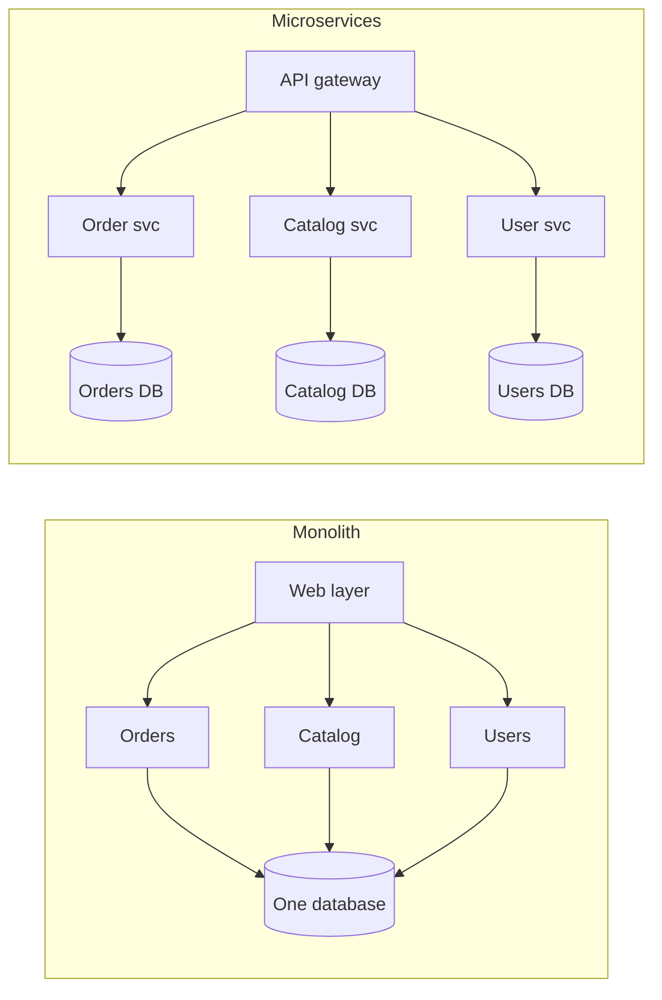
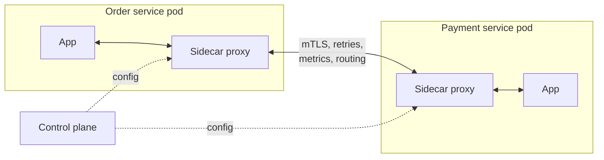

How you split a system into deployable units shapes almost everything else: how teams work, how failures spread, how data stays consistent, and how fast you can ship. Interviewers rarely ask "monolith or microservices?" directly, but every design with more than one box implies an answer — and senior candidates are expected to justify their service boundaries.

## Three architectures

### Monolith

One deployable application containing all features, usually with one database.

- ✅ Simple to develop, test, deploy and debug; function calls instead of network calls; ACID transactions across all data.
- ✅ Excellent for small teams and early products.
- ❌ As the codebase and team grow, changes become risky and deploys slow; one bug or memory leak can take everything down.
- ❌ Scales only as a whole — you can't scale the hot path independently.

### Modular monolith

A single deployable, but internally divided into modules with **strict boundaries** (separate packages, owned schemas or tables, no reaching into another module's internals). Shopify famously runs a very large modular Rails monolith.

- ✅ Most of the organisational benefits of services without distributed-systems costs.
- ✅ A natural stepping stone: well-bounded modules can later be extracted into services.

### Microservices

Many small services, each **owning its data**, deployed independently, communicating over the network (HTTP/gRPC or messaging).

- ✅ Independent deployment and scaling; teams own services end to end; fault isolation; freedom to choose technology per service.
- ❌ Every call can fail or be slow; you need timeouts, retries, circuit breakers and observability.
- ❌ No cross-service transactions — you need sagas and eventual consistency.
- ❌ Operational overhead: CI/CD per service, service discovery, tracing, versioned APIs, on-call per team.

<Callout type="interview">
Microservices are primarily a solution to an **organisational** problem — many teams needing to ship independently — not a performance technique. A credible answer: "Given a small team, I'd start with a modular monolith. At this design's scale and team size, I'd split along domain boundaries where scaling or ownership differs: the upload/transcoding pipeline, the feed service and the user service."
</Callout>

## Drawing service boundaries

Bad boundaries are worse than no boundaries — a **distributed monolith** where every change touches five services and they must deploy together.

Good boundaries follow **business capabilities** (Domain-Driven Design's *bounded contexts*):

- A service owns a coherent business capability (payments, catalogue, notifications) and the data behind it.
- Things that change together and need transactional consistency stay together.
- Services communicate through well-defined APIs or events — **never by sharing a database**.
- Split where **scaling profiles differ** (video transcoding vs user profiles), where **reliability needs differ** (payments vs recommendations), or where **ownership differs** (separate teams).

Warning signs of bad boundaries: chatty synchronous call chains for one user request, shared tables, lockstep deployments, and a single change requiring PRs in many services.

## Database per service

Each service owns its schema; other services access that data only through its API or events.

- Enables independent schema changes and technology choice (polyglot persistence).
- Makes **joins across services impossible** — handled by API composition (call both services and merge), by **replicating read models** via events (CQRS), or by rethinking boundaries.
- Makes **cross-service transactions** a saga problem. See [Distributed Transactions](/system-design/hld/distributed-transactions).

## Service discovery

In dynamic environments, instances come and go with auto-scaling and deploys. Callers need current addresses.

- **Client-side discovery** — instances register in a **service registry** (Consul, Eureka, etcd); clients query it and load-balance themselves (often via a library). Fewer hops; logic in every client.
- **Server-side discovery** — clients call a stable address (a load balancer or DNS name); the platform routes to healthy instances. Kubernetes Services do this: a stable virtual IP and DNS name, backed by an endpoint list updated as pods change.
- **Health checks** keep the registry accurate; registrations use TTLs or heartbeats so crashed instances disappear.

## API gateway and backend-for-frontend

An **API gateway** is the single entry point for external clients:

- Routing to the right service; TLS termination.
- Cross-cutting concerns: authentication, rate limiting, request validation, CORS, logging.
- **Aggregation** — combine several service calls into one response for the client.

A **Backend-for-Frontend (BFF)** is a gateway per client type (mobile, web, partner API), each shaping responses for its client. It keeps mobile payloads small and lets client teams evolve their APIs independently. GraphQL often plays this role.

Keep business logic **out** of the gateway; it should stay a thin, highly available routing and policy layer.

## Service mesh

As service counts grow, every service needs retries, timeouts, mTLS, metrics and traffic shifting. A **service mesh** (Istio, Linkerd, Consul Connect) moves this into infrastructure:

- A **sidecar proxy** (typically Envoy) runs next to each instance and handles all its network traffic.
- A **control plane** pushes routing rules, security policy and certificates to the proxies.
- Benefits: uniform mTLS, retries, timeouts, circuit breaking, canary traffic splitting and golden-signal metrics — without changing application code.
- Costs: extra latency per hop (typically small), more moving parts, and operational expertise. Worth it at tens to hundreds of services, overkill for five.

## Communication styles between services

| Style | When | Watch out for |
| --- | --- | --- |
| Synchronous request/response (REST/gRPC) | The caller needs the answer now (e.g., price lookup during checkout) | Latency adds up along call chains; availability multiplies down. Keep chains short. |
| Asynchronous messaging/events | Work can happen later; multiple consumers care (e.g., "order placed") | Eventual consistency, ordering, idempotency |

A useful rule: **synchronous for queries on the critical path, asynchronous for propagating state changes**. Avoid long synchronous chains (A → B → C → D) — they multiply latency and failure probability. See [Availability & Fault Tolerance](/system-design/hld/availability-and-fault-tolerance).

## Migrating from a monolith: the strangler fig

Don't rewrite from scratch. Put a routing layer in front of the monolith, extract one capability at a time into a service, route its traffic to the new service, and repeat until the monolith shrinks away (or what's left is fine as it is).

## Interview questions

<QA q="When would you choose a monolith over microservices?">
For a small team, an early-stage product, or a domain that isn't yet well understood. A monolith — ideally a modular one — is faster to build and change, simpler to operate and debug, and gives transactions across all data. Microservices pay off when many teams need to deploy independently, when components have very different scaling or reliability needs, or when the codebase has grown too large for one team to change safely. Starting modular keeps the option to extract services later.
</QA>

<QA q="Why shouldn't two services share a database?">
Sharing a database couples them through the schema: one team's migration can break the other, neither can change technology independently, and the database becomes a shared bottleneck and failure point. It also hides dependencies, since data flows through tables rather than explicit APIs. Each service should own its data and expose it via APIs or events; other services keep their own read-optimised copies if needed.
</QA>

<QA q="What does a service mesh give you, and when is it not worth it?">
It moves cross-cutting networking concerns — mutual TLS, retries, timeouts, circuit breaking, traffic splitting for canaries, and uniform metrics and traces — into sidecar proxies managed by a control plane, so every service gets them consistently without code changes. It's not worth it for a handful of services or a team without platform expertise: it adds latency, resource overhead, and a complex system to operate and debug. Libraries or a simple gateway may suffice.
</QA>

<Takeaways>

- Monoliths are simplest; modular monoliths add strong internal boundaries; microservices add independent deployment and scaling at a high operational cost.
- Draw boundaries around business capabilities, and give each service ownership of its data.
- Use service discovery (registry or platform DNS), an API gateway (or BFF) at the edge, and a service mesh only when the service count justifies it.
- Prefer synchronous calls for critical-path queries and events for state propagation; avoid long call chains.
- Migrate incrementally with the strangler fig pattern.

</Takeaways>

## Further reading

- Sam Newman, *Building Microservices* (2nd ed., O'Reilly, 2021) and *Monolith to Microservices* (O'Reilly, 2019).
- Martin Fowler, "Microservices" (with James Lewis, 2014), "MonolithFirst" (2015) and "StranglerFigApplication" (2004) — martinfowler.com.
- Eric Evans, *Domain-Driven Design* (Addison-Wesley, 2003) — bounded contexts.
- Shopify Engineering, "Deconstructing the Monolith: Designing Software that Maximizes Developer Productivity" (2019).
- Related: [Event-Driven Architecture, CQRS & Event Sourcing](/system-design/hld/event-driven-architecture), [Load Balancing](/system-design/hld/load-balancing).
