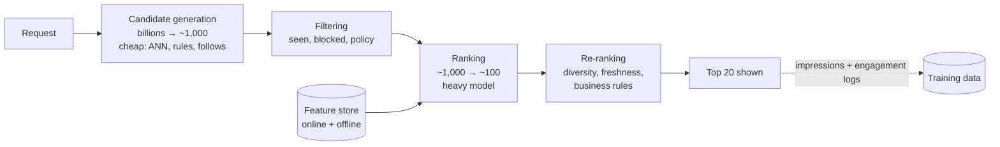

<Related ids={['hld-interview-framework', 'batch-and-stream-processing', 'caching', 'observability', 'design-recommendation-system', 'design-ad-click-prediction']} />

An ML system design round asks you to design a product feature whose core is a learned model: "design the Instagram feed", "design YouTube recommendations", "detect harmful content", "predict which ad a user will click". It looks like a system design interview, and the architecture still matters, but what the interviewer mostly scores is whether you can **turn a vague product goal into a well-posed learning problem**, choose data and metrics that won't fool you, and get the model into production without it quietly getting worse.

Many candidates fail this round in one of two ways. Strong backend engineers draw a beautiful serving architecture around a box labelled "model" and never say what it predicts. Strong ML engineers talk about transformer variants for 30 minutes and never mention where the labels come from or how the system meets a 200 ms budget. This lesson is the method that avoids both.

## How this round differs from system design

| | System design round | ML system design round |
| --- | --- | --- |
| The hard part | Scale, consistency, failure | Framing, data, labels, metrics, feedback loops |
| "Correct" means | Requests succeed, data isn't lost | The model improves a business metric without side effects |
| Typical deep dives | Sharding, caching, queues | Label quality, features, model choice, evaluation, serving latency |
| What breaks silently | Rarely anything; failures are loud | Almost everything: skew, drift, leakage and feedback loops produce no errors |
| Numbers that matter | QPS, storage, latency | Candidates per request, latency per stage, training data size, label delay |

The last two rows explain why this round exists. A bug in a web service throws exceptions; a bug in an ML system returns plausible-looking results that are slightly worse every day, and nobody notices for months.

## The framework

Spend roughly this much of a 45-minute round on each step. The order matters, because each step constrains the next.

| Step | Time | The question it answers |
| --- | --- | --- |
| 1. Clarify the product goal | 3–5 min | What is the business trying to improve, for whom, at what scale? |
| 2. Frame it as an ML task | 3–5 min | What exactly does the model predict, from what input? |
| 3. Choose metrics | 3–5 min | How do we know it works, offline and online? |
| 4. Data and labels | 5 min | Where do training examples come from, and how wrong are they? |
| 5. Features | 5 min | What signals does the model see? |
| 6. Model | 5 min | Baseline first, then what and why |
| 7. Serving architecture | 8–10 min | How does a request get a prediction within the latency budget? |
| 8. Evaluation and launch | 3–5 min | How do we decide to ship? |
| 9. Monitoring and iteration | 3 min | How do we notice it getting worse? |

### Step 1 — Clarify the product goal

Ask what the business wants to move, not what the model should do. "Improve the feed" could mean more time spent, more meaningful interactions, more creator uploads, or fewer users leaving. These lead to different models.

Questions worth asking:

- **Objective:** what is the north-star metric (daily active users, watch time, revenue, reports of harmful content)?
- **Scale:** how many users, items and requests per second? How many candidate items exist (thousands or billions)?
- **Latency:** is the prediction made while a user waits (feed load, search) or offline (weekly email)?
- **Constraints:** cold start (new users and items), freshness (do items expire within hours, like news?), fairness, regulation, explainability.

### Step 2 — Frame it as an ML task

This is the most important step and the one most often skipped. Say precisely:

- **Input:** for example, a (user, item, context) triple.
- **Output:** for example, the probability that this user watches this video for more than 30 seconds.
- **Task type:** binary classification, regression, ranking, multi-class, retrieval.
- **How the output is used:** sort candidates by it, threshold it, feed it into an auction.

Two framing choices come up in almost every interview:

**The proxy problem.** The business wants long-term satisfaction, which you can't observe per impression. You train on something you *can* observe right away, a click, a like, a 30-second watch, and hope it correlates. Clicks are the classic bad proxy: optimise them and you get clickbait. Say this out loud and choose better proxies: watch time, completion, explicit likes and shares, and negative signals such as "hide" and "report".

**Single objective or several.** Real feeds predict several outcomes at once (click, watch time, like, share, comment, hide) and combine them into one score with weights the product team tunes:

```text
score = w1·P(click) + w2·E[watch seconds] + w3·P(like) + w4·P(share) − w5·P(hide) − w6·P(report)
```

This "value model" lets the product trade engagement against quality without retraining. Mentioning it signals real experience.

### Step 3 — Choose metrics

You need two layers of metrics, and you must say how they connect.

**Offline metrics** are computed on held-out data before launch:

| Task | Metric | What it tells you |
| --- | --- | --- |
| Binary classification | ROC-AUC, PR-AUC, log loss | Can it separate positives from negatives? PR-AUC is more informative when positives are rare |
| Probability used downstream (ads) | Calibration (predicted vs observed rate), log loss | Are the probabilities themselves right, not only their order? |
| Ranking | NDCG@k, MAP, recall@k | Are the best items near the top? |
| Retrieval | Recall@k | Did the right items survive into the candidate set at all? |

**Online metrics** are measured in an A/B test on real users: click-through rate, watch time per user, sessions per user, retention after 7 or 28 days, revenue. Add **guardrail metrics** that must not get worse: latency, crash rate, reports, unsubscribes, diversity of content shown.

Offline gains often don't translate online. A model can improve AUC and lose watch time, because offline evaluation only scores items the old system chose to show. That's why the online A/B test, not the offline number, makes the launch decision.

### Step 4 — Data and labels

Where do labelled examples come from? Three sources, with very different costs:

| Source | Example | Strength | Weakness |
| --- | --- | --- | --- |
| **Implicit feedback** | Clicks, watch time, purchases logged from the product | Huge volume, free, fresh | Noisy, biased by what was shown and where |
| **Explicit feedback** | Ratings, likes, "not interested" | Clearer intent | Sparse; few users give it |
| **Human labels** | Raters judging relevance or policy violations | Precise, can target rare cases | Slow, expensive, raters disagree |

The biases that interviewers expect you to name:

- **Position bias.** Items at the top get clicked more because they're at the top. Training on raw clicks teaches the model to repeat the old ranking. Fixes: log the position and use it as a feature during training (set to a constant at serving time), or weight examples by estimated position effects, or randomise a small slice of traffic to measure them.
- **Selection bias and feedback loops.** You only observe outcomes for items you showed. An item the model never shows never gets a chance to prove itself. Fix: keep a small exploration budget (show some items the model is unsure about) and log the probability each item was shown with.
- **Label delay.** A purchase may follow an ad click by days. If you build training data an hour after the impression, late conversions are labelled negative. Fix: wait an attribution window before finalising labels, or model the delay explicitly.
- **Leakage.** A feature that contains information from after the prediction moment, such as "number of likes" computed at training time rather than at impression time. The offline metrics look superb and the model fails in production. Fix: compute features **as of the impression time** (point-in-time joins) and split train and test data **by time**, never randomly.
- **Class imbalance.** Ads have click rates around 1%; fraud far less. Downsample negatives for training efficiency, then correct the predicted probabilities (see the ad click prediction case study for the formula).

### Step 5 — Features

Group them so the interviewer can follow:

- **User features:** demographics where allowed, language, long-term interests, recent activity (last 50 items engaged with), account age.
- **Item features:** category, creator, text and image embeddings, age of the item, historical engagement rates.
- **Context features:** time of day, device, network, location, the surface (home feed, search, notification).
- **User–item interaction features:** has the user engaged with this creator before, similarity between the user's interest embedding and the item embedding, counts of past interactions in windows (1 hour, 1 day, 30 days).

Some practical points that separate experienced answers:

- **Embeddings** turn IDs (users, items, creators) into dense vectors learned from interactions, so the model generalises across similar items.
- **High-cardinality categoricals** (user ID, ad ID) are handled with embeddings or the **hashing trick** (hash into a fixed number of buckets, accepting some collisions).
- **Real-time features** such as "clicks in the last 10 minutes" need a streaming pipeline. They often give a large gain for fast-moving content, but they're the hardest to keep consistent between training and serving.

### Step 6 — Model

Start with a baseline and justify each step up:

1. **Heuristic:** most popular in the user's region, or most recent from accounts they follow. It ships today, and every model has to beat it.
2. **Logistic regression** on hand-crafted features and crosses: fast, explainable, well calibrated. Still used at the largest ad systems as a strong baseline.
3. **Gradient-boosted trees** (XGBoost, LightGBM): excellent on tabular features with little tuning, but awkward with very high-cardinality IDs and costly to retrain continuously.
4. **Deep models:** two-tower networks for retrieval; wide-and-deep, DCN or DLRM-style models for ranking; multi-task heads for several objectives; sequence models over recent user activity.

The interviewer is not looking for the most sophisticated model. They want you to pick one that fits the data size, the latency budget and the team, and say what you'd try next.

### Step 7 — Serving architecture

Most large-scale ML systems are **funnels**, because scoring billions of items with a heavy model per request is impossible:



Points to cover:

- **Latency budget per stage.** For a 200 ms feed request: maybe 30 ms for candidate generation, 10 ms for filtering, 80 ms for ranking, 10 ms for re-ranking, the rest for network and hydration.
- **Batch vs online prediction.** Precompute predictions offline when inputs change slowly (a weekly "you might like" email). Predict online when context matters (the current session, the query).
- **Feature store.** One definition of each feature, materialised into an offline store for training and an online store (Redis, Cassandra) for serving. It is the main defence against **training–serving skew**: a feature computed differently in the two places, which silently degrades the model.
- **Logging.** Log the features exactly as served, with the impression, so training data is built from what the model actually saw.

### Step 8 — Evaluation and launch

1. Offline evaluation on a **time-based** holdout (train on weeks 1–4, test on week 5).
2. **Shadow mode:** run the new model alongside the old one on live traffic without showing its results; compare latency and score distributions.
3. **A/B test** on a small percentage of users. Decide in advance the primary metric, the guardrails and the duration (at least a full week, to cover weekly cycles; beware novelty effects that fade).
4. Ramp up gradually, keeping the ability to roll back.

### Step 9 — Monitoring and iteration

ML systems fail without errors, so monitor the things that drift:

- **Data quality:** missing features, null rates, value ranges, upstream schema changes.
- **Drift:** the distribution of input features and of predictions compared with training.
- **Online metrics** sliced by country, device and new vs returning users, since an average can hide a broken segment.
- **Retraining cadence:** daily or continuous for fast-moving content, weekly or monthly for stable problems. Every retrained model goes through the same offline checks before it replaces the old one.

## The mistakes interviewers see most

- Jumping to the model before defining what it predicts.
- Using clicks as the objective without discussing what that rewards.
- Random train/test splits on time-ordered data, which leaks the future.
- Ignoring the cold-start case (new users, new items).
- No baseline, so there's no way to know the model is worth its cost.
- Treating offline AUC as the launch decision.
- No mention of how labels are produced or how wrong they are.

## Levels

- **Mid-level:** a sensible framing, standard features, a reasonable model, offline and online metrics.
- **Senior:** biases in the labels and how to correct them, multi-objective ranking, the funnel with latency per stage, training–serving skew, a credible A/B plan.
- **Staff:** feedback loops and long-term effects, exploration strategy, platform-level concerns (shared feature store, model registry, cost per prediction), and how the system evolves over a year.

## Interview questions

<QA q="Why is click-through rate often a poor objective for a feed?">
Clicks reward whatever makes people click, which includes misleading thumbnails and sensational headlines, and say nothing about whether the user was satisfied afterwards. A model trained only on clicks learns to promote clickbait, and long-term retention can fall even while CTR rises. Better objectives combine several signals, such as watch time or completion, explicit likes and shares, and negative signals like hiding or reporting, weighted into one score and validated against long-term metrics like 28-day retention.
</QA>

<QA q="Your new model improves offline AUC by 2% but the A/B test shows no change in engagement. What could explain it?">
Several common causes. The offline evaluation only covers items the old system chose to show, so it can't judge the new model on items it would surface instead. The AUC gain may be concentrated among items that are rarely shown at the top, where it doesn't affect what users see. There may be training–serving skew, so the served model sees different feature values than in training. Ranking order near the top matters more than global AUC, so NDCG at the shown positions might not have moved. Finally, the experiment may be underpowered or too short. Check skew first by logging served features, then compare top-k overlap between the old and new rankings.
</QA>

<QA q="What is training–serving skew and how do you prevent it?">
It is any difference between the data a model was trained on and the data it receives in production: a feature computed by different code in the batch pipeline and the online service, a default value for missing data that differs, or a feature that was available at training time but arrives late at serving time. It degrades the model without raising errors. Prevent it by defining features once in a feature store that serves both training and inference, logging the features actually used at serving time and training on those logs, and continuously comparing the distribution of served features with training data.
</QA>

<QA q="How do you handle a brand-new user with no history?">
Fall back on signals that don't need history: context (country, language, device, time of day, the referring link) and popularity within similar cohorts. Ask a few onboarding questions about interests if the product allows it. Use content-based features of items rather than collaborative ones. Then learn fast: weight the first few interactions heavily and explore more for new users, since every interaction tells you much more about them than it would about a long-time user.
</QA>

## Practice

Write your answer before opening the suggested one. Anything you mark "Partly" or "Missed it" comes back in your review deck.

<Practice task="An interviewer says: 'Design a system that suggests people you may know on a social network.' Spend five minutes on steps 1 to 3 only: the product goal, the ML framing and the metrics.">

**Goal:** grow meaningful connections, because users with more friends stay active. Scale: hundreds of millions of users; suggestions shown on a dedicated page and in the feed.

**Framing:** for a (user, candidate) pair, predict the probability that the user sends a friend request **and it is accepted**. Acceptance matters: optimising requests alone rewards spammy suggestions. Candidates come from the friends-of-friends graph, shared schools or workplaces and contact uploads; a model ranks them.

**Metrics:**
- Offline: ROC-AUC and recall@k on a time-based holdout of accepted requests.
- Online: accepted connections per user per week (primary); guardrails: requests that are declined or ignored, "don't show again" clicks, reports, and suggestion-page latency.
- Long-term: 28-day retention of users who gained connections.

</Practice>

<Practice task="A fraud model for card payments shows 99.5% accuracy offline. The fraud team says it's useless. Why might both be true, and what metrics should you use instead?">

If only 0.5% of transactions are fraud, a model that predicts "not fraud" for everything is 99.5% accurate and catches nothing. Accuracy is meaningless under heavy class imbalance.

Use precision and recall on the fraud class, and the precision-recall curve (PR-AUC). Then pick the operating threshold from the business costs: missed fraud costs the transaction amount and chargeback fees, while a false alarm costs a declined good customer and support time. Also check that labels are complete (chargebacks can arrive weeks later, so recent "negatives" may be undiscovered fraud) and evaluate on a time-based split.

</Practice>

<Takeaways>

- Frame the problem before choosing a model: input, output, task type, and how the prediction is used.
- Choose proxies deliberately; clicks alone reward clickbait. Combine several predicted outcomes in a tunable value model.
- Use offline metrics to filter models and online A/B tests to decide launches, with guardrails.
- Name the label problems: position bias, selection bias, label delay, leakage and imbalance.
- Large systems are funnels: cheap candidate generation, a heavier ranker, then re-ranking for diversity and rules.
- A feature store and logged serving features are the main defence against training–serving skew.
- ML systems degrade silently, so monitor data, drift and sliced online metrics, and retrain on a schedule.

</Takeaways>

## Further reading

- Chip Huyen, *Designing Machine Learning Systems* (O'Reilly, 2022) — framing, data, features, deployment and monitoring.
- D. Sculley et al., "Hidden Technical Debt in Machine Learning Systems" (NeurIPS 2015).
- Martin Zinkevich, "Rules of Machine Learning: Best Practices for ML Engineering" (Google).
- Ron Kohavi, Diane Tang and Ya Xu, *Trustworthy Online Controlled Experiments* (Cambridge, 2020) — A/B testing done right.
