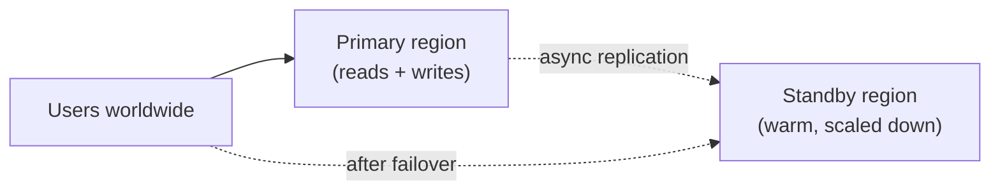
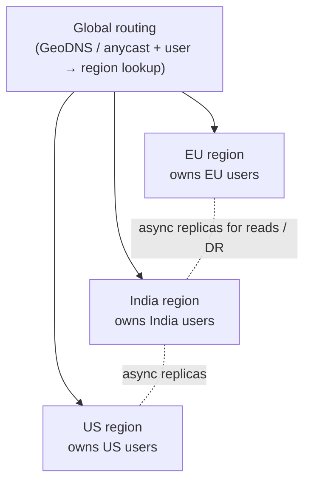

Running in several availability zones protects you from a data-centre failure. Running in several **regions** — hundreds or thousands of kilometres apart — protects you from a regional outage, natural disaster or major network event, and puts your service closer to users worldwide. It's also one of the most complex architectural steps a company takes, because the speed of light makes cross-region coordination slow. Interviewers raise it with "how would this work globally?" or "what if the whole region goes down?".

## Why go multi-region

1. **Latency** — a user in Mumbai talking to Virginia pays ~200+ ms per round trip. A nearby region cuts that dramatically.
2. **Availability / disaster recovery** — survive the loss of an entire region.
3. **Data residency** — laws may require certain users' data to stay in a jurisdiction (EU, India, etc.).
4. **Capacity** — spread load beyond one region's limits.

Be clear which of these you're solving; the architecture differs.

## The core problem: data

Stateless services are easy to run everywhere. **Data** is the hard part, because cross-region round trips cost 50–250 ms.

- **Synchronous** cross-region replication → strong consistency and zero data loss, but every write pays cross-region latency.
- **Asynchronous** cross-region replication → fast local writes, but a regional failure loses the not-yet-replicated writes (RPO above zero), and replicas lag.

This is PACELC in practice: across regions, you trade latency for consistency on every request, not just during failures.

## Deployment patterns

### 1. Active-passive (warm standby)

One **primary region** serves all traffic and writes; a secondary region receives asynchronous replication and runs scaled-down infrastructure.

- ✅ Simple data model — a single writer, no conflicts.
- ❌ All users pay latency to the primary; failover takes minutes and loses recent writes; the standby must be tested regularly or it won't work when needed.
- Variants by readiness and cost: **backup & restore** (hours), **pilot light** (core data replicated, compute off), **warm standby** (scaled-down, running), **hot standby**.

### 2. Active-active with read-local, write-global

All regions serve **reads** from local replicas; **writes** go to a single primary region.

- ✅ Fast reads everywhere; no write conflicts.
- ❌ Writes from far regions are slow; replica lag means users may not see their own writes immediately (route their reads to the primary briefly).
- Good for read-heavy products (content, catalogues, social profiles).

### 3. Active-active with partitioned ownership ("home region")

Each user (or tenant, or entity) has a **home region** where their data is written; all regions can serve traffic, routing each request to the owner's home region for writes.

- ✅ Writes are local for most users; no conflicts (one writer per entity); natural fit for data residency.
- ❌ Cross-region interactions (an EU user messaging an Indian user) need careful design; moving a user's home region is a migration; a regional outage makes its users' data read-only or unavailable until failover.
- Common in large SaaS and social products.

### 4. Active-active multi-writer

Every region accepts writes for any data, replicating asynchronously to the others.

- ✅ Lowest write latency everywhere; survives region loss without failover.
- ❌ **Write conflicts** must be resolved — last-write-wins (lossy), CRDTs, or application merges. See [Replication](/system-design/hld/replication).
- Suits data that merges naturally (counters, carts, presence, collaborative docs with CRDTs). Avoid for money and inventory.

### 5. Globally consistent database

Distributed SQL (Spanner, CockroachDB, YugabyteDB) with consensus groups spanning regions provides serializable transactions everywhere.

- ✅ Strong consistency and automatic failover with zero data loss.
- ❌ Write latency includes a cross-region quorum round trip; cost and operational complexity. Placement options (e.g., pin a row's leaders to its home region) reduce latency for local data.

| Pattern | Write latency | Consistency | RPO on region loss | Complexity |
| --- | --- | --- | --- | --- |
| Active-passive | High for distant users | Strong (single writer) | Seconds–minutes (async) | Low |
| Read-local, write-global | High for distant writers | Strong writes, lagging reads | Seconds (async) | Medium |
| Home-region partitioning | Low for most | Strong per entity | Seconds for that region's data | Medium–high |
| Multi-writer | Low | Eventual + conflict resolution | Near zero | High |
| Global consensus DB | Medium–high | Strong | Zero | High (often managed) |

## Global traffic routing

- **GeoDNS / latency-based DNS** — return the nearest healthy region's address. Simple; failover limited by DNS TTLs.
- **Anycast** — the same IP announced from many locations; routing delivers users to the nearest point of presence. Used by CDNs and global load balancers; fast failover.
- **Global load balancers / edge proxies** — terminate connections at the edge and forward to the best region based on health, latency and capacity.
- **Application-level routing** — the edge looks up the user's home region (from a token claim or a global directory) and forwards accordingly.

## Failover done right

- **Detect** regional failure with external health checks from multiple vantage points, not just from inside the failing region.
- **Decide** — automatic failover is fast but risks flapping and split brain; many companies use automated detection plus a human "big red button", especially for data-tier failover.
- **Fence** the old primary so it can't accept writes after failover.
- **Capacity** — the surviving regions must absorb the failed region's traffic: run each region at most at (N−1)/N utilisation, or have scaling ready.
- **Practise** — regular region-evacuation drills (game days). Untested failover is the most common reason DR plans fail.

<Callout type="warning" title="Hidden global dependencies">
A multi-region deployment is only as strong as its single-region dependencies: a global auth service, a config store, a DNS provider, a CI/CD system or a third-party API hosted in one region. Audit for these — "static stability" means each region can keep serving even if the control plane or other regions are unreachable.
</Callout>

## Interview questions

<QA q="How would you make a social network's write path fast for users in India, Europe and the US?">
Assign each user a home region near them and store their data (posts, profile) there, so their writes are local. Replicate asynchronously to other regions so followers elsewhere read local copies with small lag. Route requests at the edge using the user's home region from their auth token. Cross-region interactions, like commenting on a post homed elsewhere, are written to the post's home region (or appended locally and asynchronously forwarded). This avoids write conflicts while keeping most writes local.
</QA>

<QA q="What's the difference between RPO and RTO in a multi-region context?">
RPO is how much recent data you may lose when a region fails — with asynchronous cross-region replication, roughly the replication lag (seconds). RTO is how long until service is restored elsewhere — the time to detect the failure, decide, promote the standby data stores and shift traffic (minutes, if automated and practised). Synchronous replication or global consensus brings RPO to zero at the cost of write latency; hot standbys and automation reduce RTO.
</QA>

<QA q="Why is active-active multi-writer a poor choice for an inventory system?">
Two regions can concurrently accept orders against the same stock, each believing units are available, and conflicts are only discovered after replication — leading to overselling. Inventory needs a single authority per item at commit time: a home region per warehouse or SKU, or a globally consistent database. Multi-writer works for data that merges safely, like counters or carts, not for invariants like "stock ≥ 0".
</QA>

## Practice

Write your answer before opening the suggested one. Anything you mark "Partly" or "Missed it" comes back in your review deck.

<Practice task="Your app runs in one region and leadership wants 'multi-region'. Users write their own data (profiles, orders) and rarely see other users' data. Which deployment pattern fits, and how do you route users?">

Partition users by home region (geo-partitioning): each user's data lives in one region, chosen by where they signed up or where they usually are. Each region is active for its own users.

Routing: a global layer (GeoDNS or an anycast load balancer) sends requests to the nearest region; if the user's home region is different, that region forwards the request (or redirects the client) to the home region. A small global directory maps user → home region.

Benefits: writes stay local and consistent, without multi-region write conflicts. For disaster recovery, replicate each region's data asynchronously to a second region and fail over users from a lost region, accepting a small amount of data loss (the RPO) and a failover time (the RTO).

</Practice>

<Practice task="Region A goes down. Your runbook says 'promote the replica in region B'. What can go wrong, and how do you make failover safe?">

1. Data loss: asynchronous replication means the last few seconds of writes in A never reached B. Decide this in advance (the RPO) and reconcile afterwards.
2. Split brain: A may not be fully down — just unreachable. If A comes back and keeps accepting writes, both regions think they are the leader. Prevent it by fencing A (revoke its write access, or require a majority of three sites to grant leadership).
3. Capacity: B must absorb A's traffic. If B is sized only for its own users, it falls over too. Keep spare capacity or scale before shifting traffic.
4. Hidden dependencies: a service in B may still call something only in A (an auth service, a config store).

Practise failovers regularly; an untested runbook usually fails on the day.

</Practice>

<Takeaways>

- Go multi-region for latency, disaster recovery, data residency or capacity — and say which.
- Data is the hard part: synchronous cross-region replication costs latency; asynchronous costs RPO and freshness.
- Patterns range from active-passive to home-region partitioning to multi-writer and global consensus databases.
- Route with GeoDNS, anycast or edge proxies; fence old primaries and keep spare capacity for failover.
- Eliminate hidden single-region dependencies and rehearse failover regularly.

</Takeaways>

## Further reading

- AWS whitepaper, "Disaster Recovery of Workloads on AWS: Recovery in the Cloud" — backup & restore, pilot light, warm standby, multi-site.
- Amazon Builders' Library, "Static stability using Availability Zones".
- Corbett et al., "Spanner: Google's Globally-Distributed Database" (OSDI 2012).
- Netflix Technology Blog, "Active-Active for Multi-Regional Resiliency" (2013).
- Related: [Replication](/system-design/hld/replication), [CAP Theorem & PACELC](/system-design/hld/cap-and-pacelc), [Availability & Fault Tolerance](/system-design/hld/availability-and-fault-tolerance).
