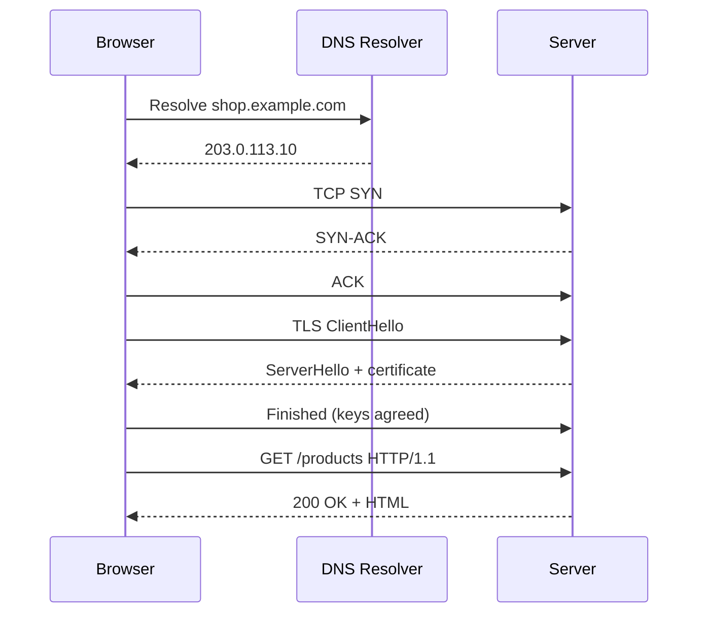
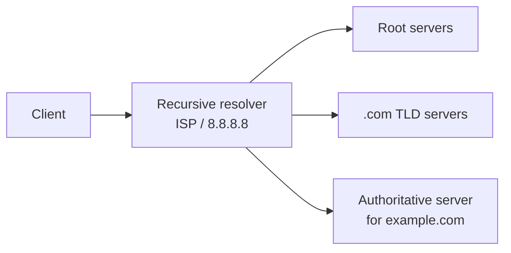

Every distributed system is, at its core, programs exchanging messages over a network. You don't need to be a network engineer for a design interview, but you do need to know what happens between a client and a server well enough to reason about **latency**, **reliability**, and the protocol choices that follow from them.

## The layers that matter

The OSI model has seven layers; in practice you need four mental buckets:

| Layer | Examples | What it gives you |
| --- | --- | --- |
| **Application (L7)** | HTTP, gRPC, WebSocket, DNS, SMTP | Meaningful messages: requests, responses, headers, paths |
| **Transport (L4)** | TCP, UDP, QUIC | Process-to-process delivery via ports; reliability (TCP) or not (UDP) |
| **Network (L3)** | IP | Routing packets between machines by IP address |
| **Link/Physical (L1–2)** | Ethernet, Wi-Fi | Moving bits across a single hop |

The distinction between **L4** and **L7** reappears constantly — load balancers, firewalls, and proxies are described as operating at one or the other. An L4 device sees only IP addresses and ports; an L7 device can read the HTTP request — the path, headers, and cookies — and make decisions based on them.

## What happens when you type a URL

This classic question is a good tour of everything in this lesson.



1. **DNS resolution** turns the hostname into an IP address.
2. **TCP handshake** establishes a reliable connection (1 round trip).
3. **TLS handshake** agrees on encryption keys and verifies the server's identity (1 round trip in TLS 1.3, 2 in TLS 1.2).
4. **HTTP request/response** exchanges the actual data (1 round trip).
5. The browser parses HTML and repeats steps for CSS, JS, images — usually reusing connections.

Before the first byte of content arrives, a fresh HTTPS connection costs **~3 round trips**. With a 100 ms round-trip time (RTT) to a distant server, that's 300 ms of pure protocol overhead. This is the core argument for **CDNs** and **edge termination**: terminate TCP and TLS close to the user, where the RTT is 10 ms instead of 100 ms.

## DNS

The Domain Name System is a globally distributed, hierarchical, heavily cached key-value store mapping names to records.



- The **recursive resolver** does the legwork, querying root → TLD → authoritative servers, then caches the answer.
- Each record has a **TTL** (time to live) controlling how long it may be cached.
- Common record types: **A** (IPv4), **AAAA** (IPv6), **CNAME** (alias to another name), **NS** (delegation), **MX** (mail).

### DNS in system design

- **DNS-based load balancing**: return different IPs for the same name (round-robin) — cheap but coarse, because clients and resolvers cache answers.
- **GeoDNS / latency-based routing**: return the IP of the nearest region. This is how global services route users to the closest data centre.
- **Failover**: health-checked DNS can stop returning an unhealthy region's IP — but only as fast as the TTL allows. A 1-hour TTL means up to an hour of traffic to a dead region. Production systems use short TTLs (30–60 s) for records that must fail over.

<Callout type="note">
DNS caching is not fully under your control. Some resolvers and clients ignore TTLs and hold records longer. That's why DNS alone is rarely the only failover mechanism — a load balancer or anycast address in front gives faster, more reliable failover.
</Callout>

## TCP vs UDP

| | TCP | UDP |
| --- | --- | --- |
| Connection | Connection-oriented (handshake) | Connectionless |
| Reliability | Guaranteed delivery with retransmission | Best effort — packets may be lost |
| Ordering | In-order byte stream | No ordering guarantee |
| Flow/congestion control | Yes — adapts to receiver and network | No — application must handle it |
| Header overhead | 20+ bytes | 8 bytes |
| Typical uses | HTTP/1.1, HTTP/2, databases, SSH, email | DNS, video calls, online games, live streaming, QUIC |

### How TCP provides reliability

- **Sequence numbers** let the receiver reorder segments and detect gaps.
- **Acknowledgements** confirm receipt; unacknowledged data is retransmitted after a timeout.
- **Flow control** (receive window) prevents a fast sender from overwhelming a slow receiver.
- **Congestion control** (slow start, congestion avoidance) backs off when the network shows signs of overload.

The cost: a handshake before data can flow, and **head-of-line blocking** — if one segment is lost, everything after it waits for the retransmission, even if it has already arrived.

### When to choose UDP

Choose UDP when **timeliness beats completeness**. In a video call, a frame that arrives 300 ms late is useless — better to skip it than wait. Games send frequent state updates; a lost update is soon superseded by the next. DNS queries are small enough to fit in one packet and simply retry on loss.

<Callout type="interview">
If a design involves real-time audio/video or multiplayer gaming, mention that media typically flows over UDP (e.g., WebRTC uses UDP via SRTP), while signalling, chat and control messages use TCP-based protocols. This shows you understand that one product may use both.
</Callout>

## HTTP and its versions

HTTP is a request/response protocol: a client sends a **method** (GET, POST, PUT, PATCH, DELETE), a **path**, **headers**, and an optional **body**; the server replies with a **status code**, headers and a body.

### Status codes worth knowing

| Range | Meaning | Examples |
| --- | --- | --- |
| 2xx | Success | 200 OK, 201 Created, 204 No Content |
| 3xx | Redirect | 301 Moved Permanently, 302 Found, 304 Not Modified |
| 4xx | Client error | 400 Bad Request, 401 Unauthorized, 403 Forbidden, 404 Not Found, 409 Conflict, 429 Too Many Requests |
| 5xx | Server error | 500 Internal Error, 502 Bad Gateway, 503 Service Unavailable, 504 Gateway Timeout |

The distinction between 4xx and 5xx matters for retries: **5xx and 429 may be retried** (with backoff); most 4xx should not, because retrying a bad request won't fix it. The 301 vs 302 distinction matters for URL shorteners (more on that in the case study).

### HTTP/1.1 → HTTP/2 → HTTP/3

| | HTTP/1.1 | HTTP/2 | HTTP/3 |
| --- | --- | --- | --- |
| Transport | TCP | TCP | **QUIC over UDP** |
| Format | Text | Binary frames | Binary frames |
| Concurrency | One outstanding request per connection in practice — pipelining exists in the spec but is disabled in browsers; browsers open ~6 connections per host instead | **Multiplexed** streams over one connection | Multiplexed streams, independent at transport level |
| Header compression | None | HPACK | QPACK |
| Head-of-line blocking | At HTTP level | Fixed at HTTP level, but still at TCP level | **Eliminated** — a lost packet only blocks its own stream |
| Connection setup | TCP + TLS (2–3 RTT) | TCP + TLS (2–3 RTT) | 1 RTT, or 0-RTT on resumption |

**Why HTTP/3 exists:** HTTP/2 multiplexes many streams over one TCP connection — but TCP sees a single byte stream, so one lost packet stalls *every* stream. QUIC moves reliability into user space on top of UDP and tracks each stream independently. It also merges the transport and TLS handshakes, and allows connections to survive network changes (e.g., Wi-Fi → mobile) via connection IDs instead of IP/port pairs.

### Keep-alive and connection pooling

Opening a new TCP + TLS connection for every request wastes multiple round trips. **Persistent connections** (keep-alive) let many requests reuse one connection. Services do the same internally with **connection pools** — a fixed set of open connections to a database or downstream service, reused across requests.

<Callout type="warning" title="A classic production issue">
Database connections are expensive (each PostgreSQL connection is a process with its own memory). If 200 app servers each open a pool of 50 connections, the database receives 10,000 connections and falls over. This is why connection poolers like **PgBouncer** exist, and why "just add more app servers" can break the database tier.
</Callout>

## TLS in one paragraph

TLS provides **encryption** (no eavesdropping), **integrity** (no tampering), and **authentication** (you're talking to the real server, verified via a certificate chain signed by a trusted Certificate Authority). The handshake uses asymmetric cryptography to agree on a shared symmetric key, which then encrypts the session efficiently. In system design, the key decision is **where TLS terminates**: at the load balancer or edge (simpler certificate management, lets the LB inspect L7 traffic) versus end-to-end to each service (stronger security, required in zero-trust or compliance-heavy environments, often handled by a service mesh with mutual TLS).

## Putting it together: latency budget

Consider a user in Mumbai calling an API hosted in Virginia (RTT ≈ 220 ms):

```text
DNS lookup (cached)              0 ms
TCP handshake                  220 ms
TLS 1.3 handshake              220 ms
HTTP request + response        220 ms
Server processing               30 ms
--------------------------------------
Total                         ~690 ms
```

Now put a CDN/edge node in Mumbai (RTT ≈ 10 ms) that keeps a warm, persistent connection to Virginia:

```text
TCP + TLS to edge               20 ms
Request edge → origin          220 ms  (connection already open)
Server processing               30 ms
Response edge → user            10 ms
--------------------------------------
Total                         ~280 ms   (and ~30 ms if the response is cached at the edge)
```

The speed of light didn't change. The architecture eliminated round trips on the long path.

## Interview questions

<QA q="Why would you choose UDP over TCP? Give a concrete example.">
When late data is worthless and the application can tolerate loss. In a video call, retransmitting a lost frame causes it to arrive after it should have been displayed, and TCP's head-of-line blocking would also delay all following frames. With UDP, the app skips the lost frame and uses forward error correction or interpolation. Similarly, multiplayer games send frequent position updates where the next update supersedes a lost one.
</QA>

<QA q="What problem does HTTP/2 solve and what problem does it leave unsolved?">
HTTP/2 solves HTTP-level head-of-line blocking by multiplexing many concurrent requests as independent streams over a single connection, and adds header compression. It leaves TCP-level head-of-line blocking unsolved: since all streams share one TCP connection, one lost packet stalls every stream until it is retransmitted. HTTP/3 solves this by running over QUIC (UDP), which handles loss per stream.
</QA>

<QA q="How does DNS-based failover work and what are its limitations?">
A health-checking DNS provider stops returning the IP of an unhealthy endpoint, so new lookups go to healthy ones. Limitations: clients and resolvers cache records for the TTL (and sometimes longer than the TTL), so failover is slow and not instant; long-lived connections to the old IP aren't affected by DNS changes at all; and DNS has no awareness of per-request load. It's best combined with load balancers or anycast for fast failover.
</QA>

<QA q="What's the difference between an L4 and an L7 load balancer, in networking terms?">
An L4 load balancer works with TCP/UDP: it sees source/destination IPs and ports and forwards connections without understanding their contents — fast and protocol-agnostic. An L7 load balancer terminates the connection, parses the application protocol (HTTP), and can route based on path, headers or cookies, rewrite requests, terminate TLS, and retry failed requests. This is covered fully in the Load Balancing lesson.
</QA>

<Takeaways>

- A new HTTPS connection costs ~3 round trips before data flows; reducing round trips on long paths is the main lever for latency.
- DNS is a cached, distributed lookup; TTLs make DNS-based failover slow.
- TCP gives reliable ordered delivery at the cost of handshakes and head-of-line blocking; UDP trades reliability for timeliness.
- HTTP/2 multiplexes over one TCP connection; HTTP/3 moves to QUIC to remove transport-level head-of-line blocking.
- Reuse connections — via keep-alive and connection pools — and watch connection counts on databases.

</Takeaways>

## Further reading

- Ilya Grigorik, [*High Performance Browser Networking*](https://hpbn.co) (O'Reilly, free online) — TCP, TLS, HTTP/2, WebSocket and SSE in depth.
- RFC 9110 (HTTP Semantics), RFC 9114 (HTTP/3), RFC 9000 (QUIC), RFC 8446 (TLS 1.3).
- Related: [Load Balancing](/system-design/hld/load-balancing), [Content Delivery Networks](/system-design/hld/cdn), [Security Fundamentals](/system-design/hld/security-fundamentals).
