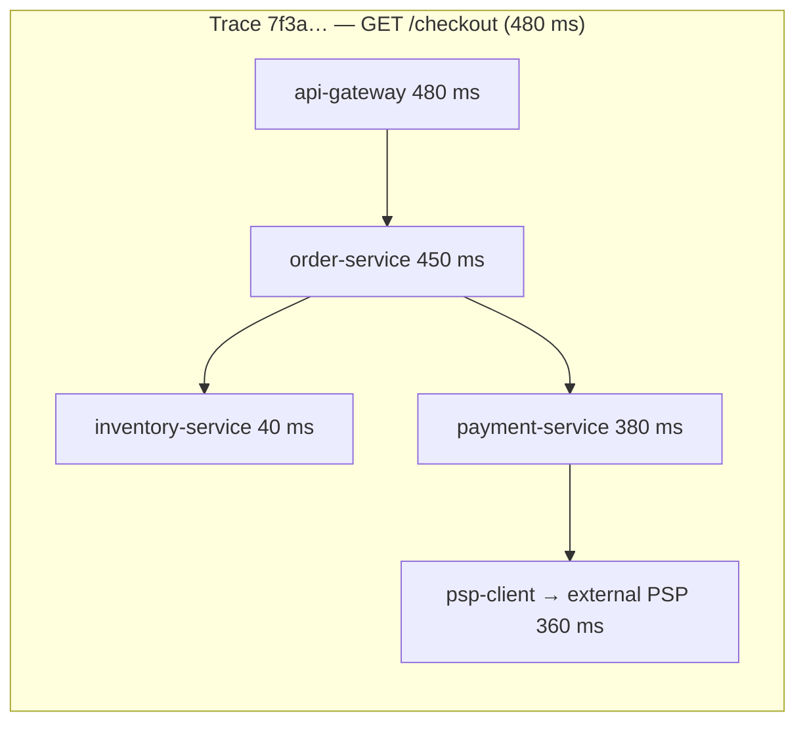

A distributed system you can't see into is a system you can't operate. When checkout latency doubles at 2 AM, you need to know *which* of 40 services is responsible, *for which* users, and *why* — in minutes. **Observability** is the ability to answer such questions from the telemetry a system emits. In interviews, mentioning how you'd monitor and alert on your design — especially in terms of SLOs — is a clear senior-level signal.

## The three pillars

| Signal | What it is | Strengths | Limits |
| --- | --- | --- | --- |
| **Metrics** | Numeric time series, aggregated (request rate, error count, p99 latency, CPU) | Cheap to store and query; ideal for dashboards and alerts | Low cardinality; tells you *that* something is wrong, rarely *why* |
| **Logs** | Timestamped records of discrete events, ideally structured (JSON) | Rich detail for debugging specific requests | Expensive at volume; hard to correlate across services without IDs |
| **Traces** | The path of one request through all services, as a tree of timed **spans** | Shows where time is spent and where errors originate across services | Usually sampled; requires instrumentation and context propagation |

They work best **linked together**: an alert fires on a metric → a dashboard narrows it to one service and endpoint → an exemplar trace shows the slow span → logs for that trace ID show the error.

## Metrics

### What to measure

**The four golden signals** (Google SRE) for every service:

1. **Latency** — distribution of request durations, separating successes from failures.
2. **Traffic** — demand, e.g., requests per second.
3. **Errors** — rate of failed requests (explicit 5xx, and wrong-content or policy failures).
4. **Saturation** — how full the most constrained resource is (CPU, memory, connection pool, queue depth).

Related frameworks: **RED** (Rate, Errors, Duration) for request-driven services, and **USE** (Utilisation, Saturation, Errors) for resources like disks and CPUs.

Plus **business metrics**: orders per minute, sign-ups, payment success rate. These often detect problems that technical metrics miss.

### Percentiles, not averages

Averages hide tail latency. If 99 requests take 50 ms and one takes 5 s, the mean is ~100 ms — which describes nobody. Track **p50, p95, p99 and p99.9**.

The tail matters more than it seems: if a page makes 100 backend calls, the chance that *at least one* hits that service's p99 latency is 1 − 0.99^100 ≈ 63%. Tail latency of components becomes typical latency of the whole page ("The Tail at Scale").

Compute percentiles from **histograms** (bucketed counts), which can be aggregated across instances — you can't correctly average per-instance percentiles.

### Cardinality

Each unique combination of metric labels is a separate time series. Labels like `endpoint` and `status_code` are fine; labels like `user_id` or `request_id` create millions of series and overwhelm the metrics system. High-cardinality detail belongs in logs and traces.

Typical stack: **Prometheus** (pull-based scraping) or OpenTelemetry metrics → long-term storage (Thanos, Cortex/Mimir, or a managed service) → **Grafana** dashboards.

## Logs

- Use **structured logs** (JSON with consistent fields: timestamp, level, service, trace ID, user ID, message) so they can be filtered and aggregated.
- Include a **correlation/trace ID** in every log line so you can see all logs for one request across services.
- Control volume: sample debug logs, log errors and state changes rather than every successful step, and set retention per log type.
- Never log secrets, passwords, tokens or unnecessary personal data.

Pipeline: services write to stdout → an agent (Fluent Bit, Vector) ships logs → a buffer (Kafka) → storage and search (Elasticsearch/OpenSearch, Loki, ClickHouse, or a managed service).

## Distributed tracing

- A **trace** is a tree of **spans**; each span records a service, operation, start time, duration, status and attributes.
- **Context propagation**: the trace ID and parent span ID travel in request headers (the W3C `traceparent` header) and message metadata, so every service attaches its spans to the same trace.
- **Sampling** controls cost: **head-based** (decide at the start, e.g., keep 1%) is cheap but may miss rare errors; **tail-based** (decide after the trace completes) keeps all slow or failed traces, at the cost of buffering.
- **OpenTelemetry** is the vendor-neutral standard for instrumenting metrics, logs and traces; backends include Jaeger, Tempo, Zipkin and commercial APM tools.

## Alerting on SLOs

Alerting on raw symptoms ("CPU above 80%") produces noisy pages that often don't affect users. Better: **alert when users are being hurt**, as measured against your SLO.

- Define an SLI (e.g., fraction of checkout requests that succeed in under 500 ms) and an SLO (99.9% over 30 days). The remaining 0.1% is the **error budget**.
- **Burn rate** = how fast the error budget is being consumed relative to plan. A burn rate of 1 uses exactly the budget over 30 days; a burn rate of 14.4 would exhaust a 30-day budget in about 2 days.
- **Multi-window, multi-burn-rate alerts**: page when the burn rate is high over both a short and a long window (e.g., 14.4× over 1 hour *and* 5 minutes) — fast detection of serious incidents without paging on brief blips; open a ticket for slow burns.

| Alert on | Page a human? |
| --- | --- |
| SLO burn rate high (users affected now) | Yes |
| Slow SLO burn | Ticket, next business day |
| Resource saturation trending toward exhaustion (disk full in 4 h) | Yes, if it will cause user impact before morning |
| Single instance unhealthy but redundancy covers it | No — dashboard or ticket |

Every page should be **actionable**, with a **runbook**.

## Observability in a design interview

When you finish a design, a short observability paragraph goes a long way:

> "Each service exports RED metrics and propagates OpenTelemetry trace context, including through Kafka message headers. We define SLOs on the user-facing paths — e.g., 99.9% of redirects under 100 ms — and alert on burn rate. We also monitor the pipeline-specific signals that matter here: consumer lag on the fan-out topic, cache hit ratio, and replication lag on the database."

Naming **system-specific** health signals (queue lag, cache hit ratio, replication lag, WebSocket connection counts, reconciliation mismatches) is what makes it convincing.

## Interview questions

<QA q="Why monitor p99 latency rather than average latency?">
Averages hide the tail: a small fraction of very slow requests barely moves the mean but represents many unhappy users at scale. And in fan-out architectures, one user request may touch many services, so a component's rare slowness becomes common at the request level — with 100 calls, about 63% of requests hit at least one call at p99. Percentiles from histograms show the experience of the slowest users and can be aggregated across instances.
</QA>

<QA q="How does distributed tracing work across services and message queues?">
The first service creates a trace ID and a root span. When it calls another service, it propagates the trace context (trace ID and current span ID) in headers — the W3C traceparent standard; for asynchronous messages, it's put in message headers. Each downstream service creates child spans linked to that context and exports them to a tracing backend, which reassembles the tree. Sampling (head- or tail-based) controls cost.
</QA>

<QA q="What is a burn-rate alert and why is it better than a threshold alert?">
A burn-rate alert measures how fast the error budget implied by an SLO is being consumed — e.g., errors at 14.4 times the sustainable rate. It pages only when user-facing reliability is genuinely at risk, scales sensitivity to severity (fast burns page, slow burns create tickets), and ignores brief blips via multiple windows. Threshold alerts on causes like CPU often fire without user impact or miss problems that don't show up in that metric.
</QA>

## Practice

Write your answer before opening the suggested one. If you mark it "Partly" or "Missed it", it comes back in your review deck.

<Practice task="Users report that checkout is 'sometimes slow'. Average latency looks fine. Which observability tools do you use, and in what order, to find the cause?">

1. Metrics first: look at the latency percentiles (p95 and p99), not the average — averages hide slow tails. Break them down by endpoint, region and version to see when and where the tail grows.
2. Distributed tracing: pull traces of slow checkout requests and see which span (service call, database query, external API) takes the time. Compare them with fast traces.
3. Logs: for the slow span, read the logs with the same trace ID to see the details (query parameters, retries, errors, timeouts).

Typical findings: a dependency's p99 latency, lock contention, a slow query for some customers, or retries that hide failures. Then add an SLO on checkout latency so it is caught automatically next time.

</Practice>

<Takeaways>

- Metrics detect, traces locate, logs explain — link them with trace IDs.
- Monitor the four golden signals plus business metrics; use percentiles from histograms.
- Keep metric labels low-cardinality; put per-request detail in logs and traces.
- Propagate trace context through every hop, including queues; sample sensibly.
- Alert on SLO burn rate with actionable, runbook-backed pages.

</Takeaways>

## Further reading

- *Site Reliability Engineering* (Google, 2016) — ch. 6, "Monitoring Distributed Systems" (the four golden signals).
- *The Site Reliability Workbook* (Google, 2018) — ch. 5, "Alerting on SLOs" (multi-window burn-rate alerts).
- Dean and Barroso, "The Tail at Scale" (CACM, 2013).
- Sigelman et al., "Dapper, a Large-Scale Distributed Systems Tracing Infrastructure" (Google, 2010).
- Charity Majors, Liz Fong-Jones and George Miranda, *Observability Engineering* (O'Reilly, 2022).
- [OpenTelemetry documentation](https://opentelemetry.io/docs/) and the W3C Trace Context specification.
