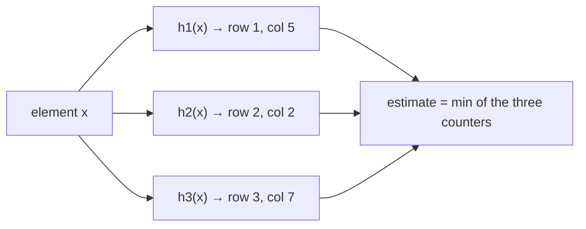

Some questions are expensive to answer exactly at scale: *Has this user already seen this URL?* *How many unique visitors did we get today?* *Which hashtags are trending right now?* Exact answers need memory proportional to the data — billions of entries. **Probabilistic data structures** answer them with a small, fixed amount of memory by accepting a tiny, **bounded** error. They appear in caches, databases, crawlers, analytics and top-K problems — and in interviews when an exact solution doesn't fit in memory.

## Bloom filter — "have I seen this before?"

A Bloom filter tests **set membership**. It answers either **"definitely not in the set"** or **"probably in the set"**.

**How it works**

- A bit array of *m* bits, all initially 0, and *k* independent hash functions.
- **Add(x)**: compute the *k* hashes of x and set those *k* bits to 1.
- **Query(x)**: if any of the *k* bits is 0 → x is definitely not present. If all are 1 → x is probably present (the bits may have been set by other elements).

```text
m = 16 bits, k = 3

add("apple")  → bits 2, 7, 11 set
add("banana") → bits 4, 7, 14 set
query("cherry") → bits 2, 9, 14 → bit 9 is 0 → definitely not present
query("grape")  → bits 4, 11, 14 → all 1 → "probably present" (false positive!)
```

**Properties**

- **No false negatives**; false positives at a tunable rate.
- With about **10 bits per element** and 7 hash functions, the false-positive rate is roughly **1%**; each additional ~4.8 bits per element cuts it by 10×.
- Can't list elements and can't delete (a **counting Bloom filter** or **cuckoo filter** supports deletion).

**Where they're used**

- **LSM-tree databases** (Cassandra, RocksDB, HBase): skip SSTables that definitely don't contain a key, avoiding disk reads.
- **Cache penetration protection**: reject lookups for keys that definitely don't exist before they hit the cache or database.
- **Web crawlers**: "have we already crawled this URL?" over billions of URLs.
- **Recommendations / feeds**: avoid showing items a user has already seen.
- **CDNs**: Akamai uses Bloom filters to avoid caching "one-hit wonders" — objects requested only once.

## HyperLogLog — "how many distinct?"

**Cardinality estimation**: count unique elements (unique visitors, distinct search queries, unique IPs) without storing them.

**Intuition**: hash every element to a uniformly random bit string. Seeing a hash that starts with many leading zeros is rare — a run of *n* leading zeros happens about once every 2^n elements — so the longest run observed hints at how many distinct elements you've seen. HyperLogLog splits elements into many buckets (registers) by their first bits, tracks the maximum run per bucket, and combines the buckets with a harmonic mean to reduce variance.

**Properties**

- Fixed, tiny memory: Redis's HyperLogLog uses **12 KB per counter** to count up to billions of distinct items with a **standard error of about 0.81%**.
- Duplicates don't change the result (adding the same element twice is a no-op).
- **Mergeable**: union two HLLs by taking the max of each register — so you can count daily uniques per server and merge, or compute weekly uniques from 7 daily sketches. (Intersections are not directly supported.)

**Where used**: unique visitors/users per page or day, distinct counts in analytics engines (BigQuery's `APPROX_COUNT_DISTINCT`, Redis `PFADD`/`PFCOUNT`, Druid, Presto/Trino).

## Count-Min Sketch — "how often has X occurred?"

Estimates the **frequency** of each element in a stream.

**How it works**

- A 2D array of counters with *d* rows and *w* columns, one hash function per row.
- **Add(x)**: for each row *i*, increment `counter[i][hash_i(x)]`.
- **Query(x)**: return the **minimum** of `counter[i][hash_i(x)]` across rows.



**Properties**

- Collisions only **add** to counters, so the estimate **never undercounts** — it may **overcount**. Taking the minimum across rows picks the least-collided counter.
- Error is bounded relative to the total stream size: width controls error size, depth controls the probability of exceeding it.
- Memory is fixed regardless of how many distinct elements appear.
- Works best for **heavy hitters** (frequent items); estimates for rare items are dominated by noise.

## Top-K / heavy hitters

"Top 10 trending hashtags in the last hour" over millions of events per second combines structures:

- **Count-Min Sketch + min-heap**: for each event, update the sketch, read the estimated count, and keep a size-K heap of the highest estimates.
- **Space-Saving / Misra-Gries**: keep a fixed number of counters; when a new element arrives and the table is full, replace the smallest counter. Deterministic error bounds; simple and widely used.
- Make it **windowed**: keep one sketch per time bucket (e.g., per minute) and combine the last 60 for the trailing hour.
- **Distribute it**: each node computes a local top-K or sketch; a merger combines them (Count-Min sketches merge by adding counters). Note that merging local top-K lists can miss items that are moderately frequent everywhere — merging sketches avoids that.

For results that must be exact (billing), run a batch job that computes exact counts and treat the streaming answer as a fast approximation. See [Batch & Stream Processing](/system-design/hld/batch-and-stream-processing).

## Comparison

| Structure | Question | Error type | Memory | Mergeable |
| --- | --- | --- | --- | --- |
| Bloom filter | Is x in the set? | False positives only | ~10 bits/element for 1% | Yes (bitwise OR, same parameters) |
| Cuckoo filter | Is x in the set? (with delete) | False positives only | Similar to Bloom | Limited |
| HyperLogLog | How many distinct elements? | ~0.8–2% relative error | Fixed (e.g., 12 KB) | Yes (register max) |
| Count-Min Sketch | How often did x occur? | Overestimates only | Fixed (w × d counters) | Yes (add counters) |
| Space-Saving | What are the top-K? | Bounded overestimate | Fixed (K counters) | Approximately |

<Callout type="interview">
These structures are a strong signal when memory is the bottleneck. For example: "Storing every crawled URL exactly would take hundreds of GB; a Bloom filter at 1% false-positive rate needs about 10 bits per URL — roughly 1.2 GB for a billion URLs. A false positive just means we skip a URL we haven't actually crawled, which is acceptable."
</Callout>

## Interview questions

<QA q="A Bloom filter says an item is present. Can you trust it? What if it says absent?">
"Absent" is always correct — Bloom filters have no false negatives, because an added element always sets all its bits. "Present" may be a false positive, since other elements could have set all the same bits. So use it as a fast pre-check: if absent, skip the expensive lookup; if present, confirm with the authoritative store when correctness matters, or accept the small error when it doesn't.
</QA>

<QA q="How would you count daily unique visitors for millions of pages?">
Keep a HyperLogLog per page per day (e.g., Redis PFADD with the visitor ID). Each uses about 12 KB and estimates the distinct count within about 1% regardless of traffic. Weekly or monthly uniques come from merging daily HLLs (PFMERGE) rather than re-scanning raw data. If an exact number is ever required (e.g., for billing), compute it in a batch job from raw logs.
</QA>

<QA q="Why does a Count-Min Sketch overestimate but never underestimate?">
Each element increments one counter per row, and counters are shared between elements through hash collisions, so a counter holds the element's true count plus the counts of everything that collided with it. Collisions can only add. Taking the minimum across rows picks the counter with the least collision noise, but it's still at least the true count.
</QA>

<Takeaways>

- Probabilistic structures trade a small, bounded error for fixed, tiny memory.
- Bloom filters answer membership with no false negatives; used in LSM stores, caches and crawlers.
- HyperLogLog counts distinct elements in ~12 KB with ~1% error and merges across time and servers.
- Count-Min Sketch estimates frequencies (overestimates only); combine with a heap for top-K.
- Use them for fast approximate answers, and batch jobs where exact answers are required.

</Takeaways>

## Further reading

- Burton Bloom, "Space/Time Trade-offs in Hash Coding with Allowable Errors" (CACM, 1970).
- Flajolet, Fusy, Gandouet and Meunier, "HyperLogLog: the analysis of a near-optimal cardinality estimation algorithm" (AofA 2007).
- Heule, Nunkesser and Hall, "HyperLogLog in Practice" (EDBT 2013) — Google's HLL++.
- Cormode and Muthukrishnan, "An Improved Data Stream Summary: The Count-Min Sketch and its Applications" (J. Algorithms, 2005).
- Metwally, Agrawal and El Abbadi, "Efficient Computation of Frequent and Top-k Elements in Data Streams" (ICDT 2005) — Space-Saving.
- Fan et al., "Cuckoo Filter: Practically Better Than Bloom" (CoNEXT 2014).
- Related case studies: [Design a Web Crawler](/system-design/hld/design-web-crawler), [Design an Ad Click Aggregator](/system-design/hld/design-ad-click-aggregator).
