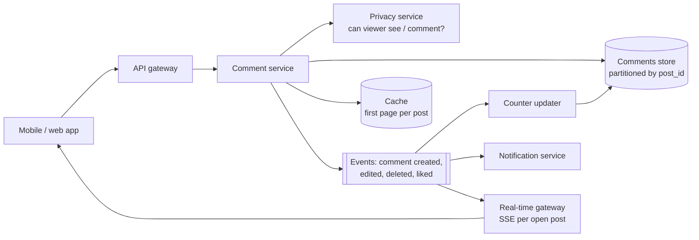

<Related ids={['hld-interview-framework', 'api-design', 'design-news-feed', 'real-time-communication', 'caching', 'design-chat-system']} />

Meta runs two kinds of design interview for software engineers: **System Design** and **Product Architecture**. Candidates applying for product-focused roles are usually steered to Product Architecture, infrastructure roles to System Design, and some candidates are offered a choice. The prompts can look identical ("design Instagram"), which is why people prepare for the wrong one. This lesson explains how the Product Architecture round differs and walks through a full example.

<Callout type="note" title="How sure is this?">
Meta doesn't publish a detailed rubric. What follows is consistent across many candidates' reports and coaching guides: the round centres on the product's API, data model and client–server interactions, with less weight on infrastructure scaling. Details vary by team and level, so ask your recruiter which round you have and what it emphasises.
</Callout>

## What changes compared with System Design

| | System Design | Product Architecture |
| --- | --- | --- |
| Point of view | The backend at scale | The product as the user and the app experience it |
| Centre of gravity | Storage, partitioning, replication, queues, throughput | **API design**, data model, client–server flows, product behaviour |
| Typical deep dives | Sharding a hot table, fan-out at scale, consistency of replicas | Pagination, real-time updates, privacy, counts and ordering, edits and deletes, offline clients |
| What "scale" means | QPS, storage, cross-region | Enough to make sensible choices; rarely the main event |
| What sinks candidates | A design that falls over at load | A vague API, a data model that can't answer the product's queries, ignoring user-visible edge cases |

The same question can go either way. "Design Instagram" in System Design means feed fan-out, media storage and CDN. In Product Architecture it means the endpoints the app calls, how a post, its likes and comments are modelled, how the feed pages, how a new comment appears for someone already viewing the post, and who can see what.

## The framework, adjusted

| Step | Time | What to produce |
| --- | --- | --- |
| 1. Product requirements | ~5 min | The user-facing features in scope, as user stories; what's out of scope |
| 2. Non-functional requirements | ~3 min | Latency, consistency the user notices, privacy, offline behaviour, rough scale |
| 3. Entities and data model | ~8 min | Tables or documents, keys, the indexes the product's queries need |
| 4. API | ~10 min | Every endpoint with request, response, pagination and errors |
| 5. High-level design | ~7 min | Services, storage, caches, real-time channel, notifications |
| 6. Product deep dives | ~10 min | The user-visible hard parts the interviewer picks |

Two habits help a lot here:

- **Walk through user actions.** "The user opens a post → the app calls `GET /posts/{id}` and `GET /posts/{id}/comments?limit=20` → …". It keeps the design tied to the product and exposes missing endpoints.
- **Write the API concretely.** Field names, types, pagination cursors, status codes. Hand-waving "an endpoint to get comments" is the most common reason candidates get a weak score in this round.

## Worked example: comments on posts

> Design commenting for a photo-sharing app: users comment on posts, reply to comments, like comments, and mention other users. Viewers of a post see new comments appear without refreshing.

### 1. Product requirements

- Post a comment on a post; reply to a comment (one level of replies, like Instagram).
- List a post's comments, newest or "most relevant" first; expand replies.
- Like and unlike a comment; show like counts.
- Mention users with `@name`; mentioned users get a notification.
- Edit and delete your own comment; the post's owner can delete any comment on their post.
- New comments appear live for people viewing the post.
- **Out of scope:** moderation models, translation, reactions other than like.

### 2. Non-functional requirements

- Reading comments is far more frequent than writing; first page in under ~200 ms.
- A user sees **their own** comment immediately (read-your-writes); others can see it within a few seconds.
- Respect privacy: comments on a private account's posts are visible only to approved followers; blocked users can't see or mention each other.
- Counts (likes, comment totals) can be approximate for a few seconds but should never go negative or jump wildly.
- Scale for sizing: 500M daily users, a few billion comments per day at peak; viral posts with millions of comments.

### 3. Data model

```text
comments
  comment_id     (time-sortable ID, e.g. Snowflake)
  post_id
  parent_id      (null for top-level; the top-level comment's ID for replies)
  author_id
  body           (text, with mention spans stored separately)
  created_at, edited_at
  status         (visible | deleted | hidden_by_owner)
  like_count, reply_count      (denormalised counters)
  primary key: (post_id, comment_id)          ← list a post's comments newest first
  index:       (parent_id, comment_id)        ← list replies to a comment

comment_likes
  primary key: (comment_id, user_id)          ← "has this user liked it?", idempotent like
  created_at

mentions
  (comment_id, mentioned_user_id)             ← drives notifications and the "mentions" tab
```

Choices to say out loud:

- **Partition by post.** Every read is "comments of this post", so `post_id` is the partition key and comments within a post are ordered by time-sortable IDs. A wide-column store (Cassandra-style) or a sharded relational database both work.
- **Counters are denormalised** onto the comment row, so listing comments doesn't count likes each time. They're updated asynchronously from like events (see deep dives).
- **Deletes are soft** (`status = deleted`): replies under a deleted comment still need their parent, and the UI shows "comment deleted".
- **Likes are a set keyed by (comment, user)**, which makes "like" naturally idempotent: liking twice is a no-op.

### 4. API

```text
POST   /v1/posts/{postId}/comments
       body: { text, parentId?, clientRequestId }
       → 201 { comment }                       (Idempotency via clientRequestId)
       → 403 if the viewer can't comment (blocked, private, comments turned off)

GET    /v1/posts/{postId}/comments?sort=newest|relevant&cursor=…&limit=20
       → { comments: [ { id, author: {id, name, avatarUrl}, text, mentions,
                         likeCount, viewerHasLiked, replyCount, createdAt, edited } ],
           nextCursor }

GET    /v1/comments/{commentId}/replies?cursor=…&limit=10
       → { replies: […], nextCursor }

PATCH  /v1/comments/{commentId}        body: { text }      → 200 { comment }   (author only)
DELETE /v1/comments/{commentId}                            → 204   (author or post owner)

PUT    /v1/comments/{commentId}/like                       → 204   (idempotent)
DELETE /v1/comments/{commentId}/like                       → 204

GET    /v1/posts/{postId}/comments/stream     (SSE: new, edited, deleted comments)
```

Details that earn credit:

- **Cursor pagination**, never offsets: new comments arrive constantly, so offsets would skip or repeat items. The cursor encodes the last comment ID (and, for "relevant", the score and ID).
- **`viewerHasLiked`** is computed per viewer, so the like button renders correctly without a second call.
- **Like and unlike are `PUT` and `DELETE` on the same resource**, so retries are safe.
- **`clientRequestId`** makes posting a comment safe to retry on a flaky mobile connection.
- The response embeds **author name and avatar**, because the app would otherwise need one profile call per comment.

### 5. High-level design



- **Writes:** the comment service checks privacy, writes the comment, returns it to the author immediately, and publishes an event.
- **Reads:** the first page of popular posts' comments is cached; deeper pages read the store directly. The privacy check filters out comments from users the viewer has blocked (or who blocked them).
- **Events** drive like and reply counters, notifications for mentions and replies, and live updates.

### 6. Product deep dives

**New comments appearing live.** Viewers of a post open an SSE stream for that post (see [Real-Time Communication](/system-design/hld/real-time-communication)). Gateways subscribe to a pub/sub channel per post that has viewers. For a viral post with millions of viewers and hundreds of comments per second, don't push every comment: send batches every second or two, or just an indicator "52 new comments, tap to load", which is better for the user anyway.

**The author sees their comment instantly.** The app inserts the comment into the list **optimistically** before the server responds, marked as pending; on success it swaps in the server's version (real ID, timestamp). If the request fails, it shows "tap to retry". On reload, the author's own recent comments are read from the primary or merged in, so a lagging replica can't make it disappear.

**Like counts under heavy load.** A viral comment can receive thousands of likes per second; incrementing one row for each would make it a hot spot. The like itself is written to `comment_likes` (idempotent), and the counter updater **aggregates** like events for a few seconds and applies one increment per batch. Counts shown are slightly behind, which users don't notice. A periodic job recounts from `comment_likes` to correct drift.

**"Most relevant" ordering.** Rank by a score combining likes and replies with time decay, plus boosts for comments from people the viewer knows and from the post's author. Compute scores asynchronously and keep the top few hundred per popular post precomputed; small posts can sort on the fly.

**Mentions.** On write, parse `@handles`, resolve them to user IDs, and **check privacy**: you can't notify, or link to, a user who blocked you or can't see the post. Store mentions as spans (offset, length, user ID) so the app can render links even if the user later changes their handle.

**Edits and deletes.** Edits keep the comment's ID and position and show "edited". Deletes are soft so replies keep their context; counters decrement through the same event pipeline; notifications already sent for a deleted comment are withdrawn if possible. A post owner deleting someone else's comment is an authorisation rule the comment service enforces, not the client.

**Privacy changes after the fact.** If a user blocks another, their existing comments become invisible to each other: privacy is evaluated **at read time** (filter by the viewer's block list), not just when the comment was written. Cache entries hold comments for everyone and are filtered per viewer.

## What interviewers look for

- **Mid-level:** clear requirements, a data model that answers the product's queries, a concrete API with pagination, a reasonable service layout.
- **Senior:** idempotent writes, cursor pagination and why, optimistic UI with read-your-writes, counters at scale, privacy at read time, real-time updates and their limits.
- **Staff:** product judgement (when *not* to stream every update), consistency trade-offs users can feel, evolution of the API, and how teams would own these pieces.

## Common Product Architecture prompts

Practise by applying the same steps: requirements, entities, API, flows, deep dives.

| Prompt | Product deep dives to expect |
| --- | --- |
| Comments, likes and mentions | Pagination, counters, live updates, privacy (above) |
| Instagram Stories | 24-hour expiry, "seen by" lists, ordering stories in the tray, prefetching media |
| Facebook Events / invitations | RSVPs and counts, invite fan-out, reminders, time zones, visibility rules |
| Messenger / group chat | Message ordering, delivery and read receipts, offline sync, typing indicators |
| News feed (product view) | Feed API and pagination, ranking signals exposed to the client, inserting new posts |
| Marketplace listings | Search filters, listing lifecycle, messaging buyers, location privacy |
| Ticket or seat booking | Holds, checkout flow, waiting room, double-booking |

## Interview questions

<QA q="Why is cursor pagination the right default for a comment list?">
Comments are added and deleted constantly. With offsets, a new comment inserted at the top shifts every item, so the next page repeats one comment or skips one, and deep offsets are slow because the database scans and discards earlier rows. A cursor encodes where the last page ended, such as the last comment's time-sortable ID, and the next query continues from there using the index. Results stay stable and each page costs the same. Making the cursor opaque lets you change its contents later.
</QA>

<QA q="A user posts a comment but doesn't see it after refreshing. What's happening and how do you fix it?">
The write went to the primary, and the refresh read from a replica that hasn't caught up yet, or from a cached first page built before the write. The fix is read-your-writes for the author: show the comment optimistically in the app as soon as it's posted, and on reads, either route the author's requests for that post to the primary for a short window after writing, or merge the author's own recent comments into the results. Invalidate or update the cached first page when a comment is written.
</QA>

<QA q="How would you show like counts on a comment that's receiving thousands of likes per second?">
Store each like as a row keyed by comment and user, which makes liking idempotent and lets you answer "did I like this?". Don't increment a counter on every like: publish like events, aggregate them over a few seconds per comment, and apply one increment per batch to a denormalised count. The displayed count lags slightly, which users don't notice. A periodic job recounts from the like rows to fix any drift from failures.
</QA>

## Practice

Write your answer before opening the suggested one. Anything you mark "Partly" or "Missed it" comes back in your review deck.

<Practice task="Write the API for Instagram Stories: posting a story, viewing the story tray, viewing one user's stories, and seeing who viewed your story. Include pagination and what each response contains.">

```text
POST /v1/stories                      body: { mediaId, caption?, audience: everyone|close_friends, clientRequestId }
     → 201 { storyId, expiresAt }     (media uploaded first via a pre-signed URL)

GET  /v1/stories/tray?cursor=…        → { users: [ { userId, name, avatarUrl, hasUnseen, latestAt } ], nextCursor }
     ordered: unseen first, then by affinity/recency

GET  /v1/users/{userId}/stories       → { stories: [ { storyId, mediaUrl (signed CDN), createdAt, expiresAt, viewerHasSeen } ] }
     (at most ~100 per user in 24 h, so no pagination needed)

POST /v1/stories/{storyId}/views      → 204   (idempotent per viewer; batched by the app)

GET  /v1/stories/{storyId}/viewers?cursor=…   (owner only)
     → { viewers: [ { userId, name, avatarUrl, viewedAt } ], total, nextCursor }
```

Points worth mentioning: expiry enforced on the server (expired stories never returned), audience checks at read time, view events batched and deduplicated, media served from a CDN with signed URLs.

</Practice>

<Takeaways>

- Product Architecture centres on the user-facing product: requirements, data model, a concrete API and client–server flows.
- Write endpoints precisely: fields, pagination cursors, status codes and idempotency.
- Walk through user actions to drive out every call the app needs.
- Expected deep dives are user-visible: live updates, read-your-writes, counts, ordering, edits, deletes and privacy at read time.
- Scale still matters, but as a constraint on choices, not the main topic.

</Takeaways>

## Further reading

- Meta Careers, "Software Engineer interview preparation" pages (check the current version for your role).
- Google Cloud API Design Guide — resources, pagination, errors.
- Related lessons: [API Design](/system-design/hld/api-design), [Design a News Feed](/system-design/hld/design-news-feed).
