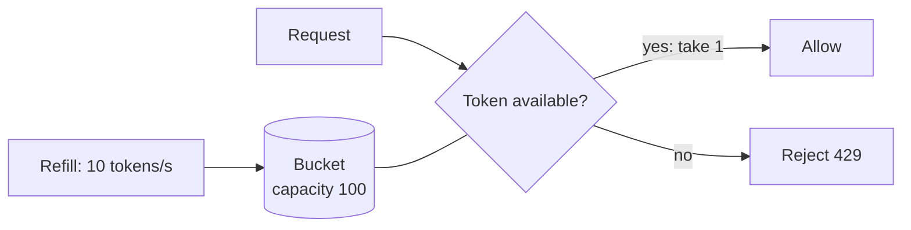
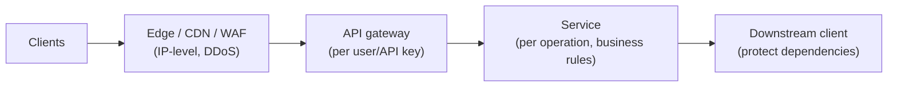

A **rate limiter** controls how many requests a client can make in a given time window. Requests beyond the limit are rejected (usually with HTTP **429 Too Many Requests**), delayed, or queued.

Rate limiting is both a standalone interview question ("Design a rate limiter") and a component you should mention in almost every public-facing design.

## Why rate limit

- **Protect availability** — stop a single client, bug or bot from overwhelming shared resources (and turning one bad actor into an outage for everyone).
- **Prevent abuse** — brute-force login attempts, credential stuffing, scraping, spam, and some DoS traffic.
- **Fairness** — ensure one tenant can't starve others in a multi-tenant system.
- **Cost control** — cap calls to expensive downstream resources (paid third-party APIs, GPU inference).
- **Business tiers** — free plan: 100 requests/min; paid plan: 10,000 requests/min.

## What to limit by

The **key** you count against determines who gets limited:

| Key | Good for | Watch out for |
| --- | --- | --- |
| User ID / account | Authenticated APIs, per-plan quotas | Doesn't cover unauthenticated endpoints |
| API key / client ID | Public developer APIs | Leaked keys |
| IP address | Login pages, unauthenticated traffic | Many users behind one NAT/corporate proxy; attackers rotate IPs |
| Endpoint / operation | Expensive operations (search, exports) | Combine with a user key |
| Global | Protect a fragile downstream dependency | Doesn't distinguish good from bad clients |

Real systems combine several: e.g., 1,000 requests/min per user, 20 login attempts/hour per IP, and 5 password resets/day per account.

## The algorithms

### Token bucket

A bucket holds up to **capacity** tokens and is refilled at a fixed **rate** (e.g., 10 tokens/second). Each request takes one token; if the bucket is empty, the request is rejected.



Implementation needs only two values per key: the token count and the last refill timestamp. On each request, add `elapsed × rate` tokens (capped at capacity), then try to take one.

```js
function allow(bucket, now) {
  const elapsed = (now - bucket.lastRefill) / 1000;
  bucket.tokens = Math.min(bucket.capacity, bucket.tokens + elapsed * bucket.rate);
  bucket.lastRefill = now;
  if (bucket.tokens >= 1) {
    bucket.tokens -= 1;
    return true;
  }
  return false;
}
```

- ✅ **Allows bursts** up to the capacity while enforcing an average rate — matches real client behaviour (a page load fires 10 requests at once).
- ✅ Memory-efficient; simple.
- ❌ Two parameters to tune.
- Used by: AWS API Gateway, Stripe, many API platforms.

**How many buckets?** One per rule per key. If a user may post once per second, like five posts per second and add 150 friends per day, that's three buckets per user; IP-based rules need a bucket per IP; and a global ceiling ("10,000 requests/s to this service") is a single shared bucket.

### Leaky bucket

Requests enter a FIFO queue (the bucket) and are processed — "leak" out — at a **constant rate**. If the queue is full, new requests are dropped.

- ✅ **Smooth, constant output rate** — ideal for protecting a downstream that can only handle a steady flow.
- ❌ Bursts are queued (adding latency) or dropped, even if the system has spare capacity; old requests can starve newer ones.
- Used by: traffic shaping (NGINX's `limit_req` is a leaky-bucket variant); Shopify has documented a leaky-bucket model for its API limits.

### Fixed window counter

Divide time into fixed windows (e.g., each minute) and count requests per key per window. Reject once the count exceeds the limit.

```text
key = "rl:user42:2026-10-14T10:05"   INCR → if > 100, reject; EXPIRE 60s
```

- ✅ Very simple and cheap: one counter per key per window.
- ❌ **Boundary burst problem**: a client can send 100 requests at 10:05:59 and another 100 at 10:06:00 — 200 requests in two seconds while never exceeding "100 per minute".

### Sliding window log

Store the timestamp of every request (e.g., in a Redis sorted set). On each request, remove timestamps older than the window, count the rest, and allow if under the limit.

- ✅ **Exact** — no boundary problem.
- ❌ **Memory-heavy** — stores one entry per request; at a 10,000/min limit that's up to 10,000 entries per key.

A common Redis implementation uses a **sorted set** per key, scored by timestamp, in one atomic transaction or script:

```text
ZREMRANGEBYSCORE key 0 (now - window)    # drop entries older than the window
ZADD key now request_id                  # record this request
ZCARD key                                # count requests in the window
EXPIRE key window
```

Note that a rejected request may still be recorded (depending on order of operations), which counts against the client — decide whether that's intended.

### Sliding window counter

Approximate a sliding window using the current and previous fixed-window counts, weighted by how far into the current window you are:

```text
estimated = current_count + previous_count × (1 − elapsed_fraction_of_current_window)

Limit 100/min. Previous minute: 80 requests. Current minute: 30 requests, 25% elapsed.
estimated = 30 + 80 × 0.75 = 90  → allow
```

- ✅ Smooths out the boundary burst with only two counters per key.
- ❌ Approximate (assumes requests were evenly spread in the previous window) — accurate enough for nearly all use cases.
- Used by: Cloudflare, which reported that across 400 million requests only 0.003% were wrongly allowed or limited by this approximation.
- Watch the arithmetic: the previous window's weight is a **fraction** (e.g., 0.75), not a percentage — at least one well-known book prints it as "0.7%", which would make the formula meaningless.

### Comparison

| Algorithm | Bursts | Accuracy | Memory per key | Best for |
| --- | --- | --- | --- | --- |
| Token bucket | Allowed up to capacity | Good | 2 values | General API rate limiting |
| Leaky bucket | Smoothed (queued) | Good | Queue | Shaping traffic to a steady downstream |
| Fixed window | Up to 2× at boundaries | Low | 1 counter | Simple quotas, coarse limits |
| Sliding log | No | Exact | 1 entry per request | Low-volume, strict limits |
| Sliding window counter | Mostly smoothed | High (approximate) | 2 counters | High-scale APIs |

<Callout type="interview">
If asked to pick one, **token bucket** is the safest general answer: it enforces an average rate while tolerating natural bursts, and needs only two numbers per key. Mention sliding window counter if the interviewer cares about strict per-window accuracy at scale.
</Callout>

## Where to enforce limits



- **Edge/WAF** — coarse IP-based limits and bot/DDoS protection before traffic reaches your infrastructure.
- **API gateway** — the usual home for per-user/per-key limits: central, consistent, and keeps logic out of services.
- **In the service** — business-specific limits ("5 password reset emails per day").
- **Client-side** — well-behaved SDKs throttle themselves, but never rely on it — clients can't be trusted.

## Distributed rate limiting

With many gateway instances, each sees only part of a client's traffic. A per-instance in-memory counter lets a client send N × limit by spreading requests across N instances.

### Centralised counter store (Redis)

All instances share counters in Redis. The read-modify-write must be **atomic**, or concurrent requests will both read "99" and both be allowed.

- For fixed windows: `INCR` + `EXPIRE` (atomic increment).
- For token bucket or sliding window: a **Lua script** that reads, computes and writes in one atomic step on the Redis server.

```lua
-- KEYS[1] = bucket key; ARGV = capacity, refill_rate (tokens/s)
-- Time comes from the Redis server, not the caller: gateway clocks skew,
-- and a client-supplied timestamp would corrupt the refill calculation.
local t = redis.call('TIME')
local now = tonumber(t[1]) * 1000 + math.floor(tonumber(t[2]) / 1000)
local b = redis.call('HMGET', KEYS[1], 'tokens', 'ts')
local capacity, rate = tonumber(ARGV[1]), tonumber(ARGV[2])
local tokens = tonumber(b[1]) or capacity
local ts = tonumber(b[2]) or now
tokens = math.min(capacity, tokens + (now - ts) / 1000 * rate)
local allowed = tokens >= 1
if allowed then tokens = tokens - 1 end
redis.call('HSET', KEYS[1], 'tokens', tokens, 'ts', now)
redis.call('PEXPIRE', KEYS[1], math.ceil(capacity / rate * 1000))
return allowed and 1 or 0
```

Concerns:

- **Clock source** — compute time inside Redis (`TIME`) or on one authoritative clock. If each gateway passes its own timestamp, clock skew between gateways adds or removes tokens incorrectly.
- **Latency** — a Redis round trip (~0.5–1 ms) on every request. Acceptable for most APIs.
- **Availability** — if Redis is down, decide whether to **fail open** (allow traffic; protects user experience, risks overload) or **fail closed** (reject; protects backends, causes an outage). Most systems fail open for general limits and fail closed for security-critical ones (login attempts).
- **Hot keys and scale** — shard counters across a Redis Cluster by key.

### Local counters with periodic sync

Each instance enforces an approximate local share (e.g., limit ÷ number of instances) or keeps local counters and periodically syncs to a global store. Much faster, slightly inaccurate. Good enough when limits are generous and approximate fairness is acceptable.

### Multi-region

Synchronous global counters across regions are slow. Common approach: enforce limits per region with a share of the global quota, and asynchronously reconcile.

## Communicating limits to clients

Good APIs tell clients where they stand:

```text
HTTP/1.1 429 Too Many Requests
Retry-After: 30
RateLimit-Limit: 100
RateLimit-Remaining: 0
RateLimit-Reset: 30
```

Clients should respect `Retry-After` and retry with **exponential backoff and jitter**. Without jitter, all throttled clients retry at the same instant and get throttled again.

## Design choices around the limiter

- **Build or buy?** If you already run an API gateway (Kong, Envoy, AWS API Gateway, Apigee), use its rate limiting; build your own only when you need algorithms or rules it can't express. Building a correct distributed limiter takes real engineering time.
- **Hard vs soft limits.** A hard limit never lets requests exceed the threshold; a soft limit tolerates short overshoots (e.g., a burst allowance, or briefly allowing while a shared counter is unreachable).
- **What happens to rejected requests?** Usually dropped with 429. For valuable work — orders during an overload — enqueue them for later processing instead of losing them.
- **Lower layers.** Rate limiting can also happen at L3/L4 (iptables/nftables, connection limits, SYN cookies) — cheap protection against floods before traffic reaches application code.
- **Monitor the limiter itself.** Track how many valid requests are rejected (rules too strict) and whether bursty events like flash sales get through (algorithm too strict or too loose) — and tune.
- **Be a good client.** On the consuming side: cache responses, respect `Retry-After`, back off with jitter, and handle 429 gracefully.

## Rate limiting vs related techniques

- **Throttling** — often used interchangeably; sometimes means slowing requests (delaying) rather than rejecting them.
- **Load shedding** — the *server* drops low-priority work when it's overloaded, regardless of who sent it. Rate limiting is per client; load shedding is about protecting the server's own capacity.
- **Quotas** — long-period limits (requests per day or month), often tied to billing.
- **Concurrency limits** — limit simultaneous in-flight requests rather than rate; protects against slow, expensive requests piling up.

## Interview questions

<QA q="Why is the fixed window algorithm problematic, and how do you fix it?">
Requests can cluster around window boundaries: a client may send the full limit at the end of one window and again at the start of the next, achieving up to twice the intended rate over a short span. Fix it with a sliding window — either an exact sliding log (more memory) or the sliding window counter, which weights the previous window's count by how much of it still overlaps the sliding window — or use a token bucket, which enforces an average rate with a bounded burst.
</QA>

<QA q="How do you make a distributed rate limiter correct under concurrency?">
Store counters in a shared store like Redis and make the check-and-update atomic: use INCR with EXPIRE for fixed windows, or a Lua script that reads state, computes the decision, and writes back in one server-side step for token bucket/sliding window. Without atomicity, two gateways can both read a count of 99 and both allow a request. Shard keys across a Redis cluster for scale, and decide fail-open vs fail-closed behaviour if Redis is unavailable.
</QA>

<QA q="Your rate limiter's Redis cluster goes down. What should happen?">
It depends on what the limit protects. For general API fairness, fail open — allow traffic, perhaps with a conservative local in-memory limiter as a fallback — so a limiter outage doesn't become a full API outage. For security-sensitive limits like login attempts or OTP verification, fail closed or fall back to strict local limits, because allowing unlimited attempts is a security risk. Alert immediately either way.
</QA>

<QA q="Token bucket or leaky bucket — when would you choose each?">
Token bucket when you want to enforce an average rate but allow short bursts — typical of user-facing APIs, where a page load sends many requests at once. Leaky bucket when you need a smooth, constant output rate to protect a downstream that can't handle bursts — e.g., sending to a third-party API with a strict per-second limit, or a job queue feeding a fixed-capacity worker.
</QA>

## Practice

Write your answer before opening the suggested one. If you mark it "Partly" or "Missed it", it comes back in your review deck.

<Practice task="An API allows 100 requests per minute per key using a fixed window. A client sends 100 requests at 12:00:59 and another 100 at 12:01:00. What is the problem, and which algorithm fixes it?">

A fixed window resets at the minute boundary, so both bursts are allowed: 200 requests in two seconds, twice the intended rate.

Fixes:
- A sliding window log keeps the timestamps of recent requests and counts those within the last 60 s — exact, but memory grows with the limit.
- A sliding window counter estimates the rolling count from the current and previous window, weighted by how far into the current window you are — cheap and accurate enough for most APIs.
- A token bucket refills at 100 tokens per minute with a capacity of, say, 100. It allows a burst of up to 100 but never a sustained rate above 100 per minute; it is the most common choice because it allows short bursts in a controlled way.

</Practice>

<Takeaways>

- Rate limiting protects availability, prevents abuse, enforces fairness, and implements pricing tiers.
- Token bucket allows bursts with an average rate; leaky bucket smooths output; fixed windows are simple but allow boundary bursts; sliding windows fix that.
- Enforce limits in layers: edge (IP), gateway (user/key), service (business rules).
- Distributed limiters need a shared store with atomic operations (Redis + Lua) and a clear fail-open/fail-closed policy.
- Return 429 with Retry-After and rate-limit headers; clients should back off with jitter.

</Takeaways>

## Further reading

- Cloudflare blog, "How we built rate limiting capable of scaling to millions of domains" (2017) — the sliding window counter in production.
- Stripe blog, "Scaling your API with rate limiters" (2017).
- Marc Brooker, "Exponential Backoff And Jitter" (AWS Architecture Blog, 2015).
- IETF HTTPAPI working group draft, "RateLimit header fields for HTTP".
- Related case study: [Design a Distributed Rate Limiter](/system-design/hld/design-rate-limiter).
