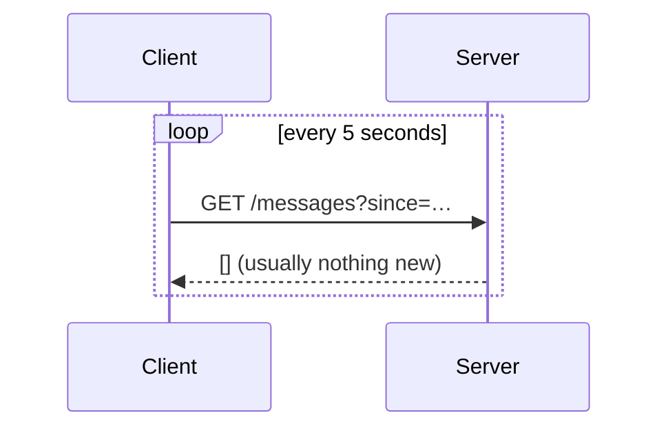
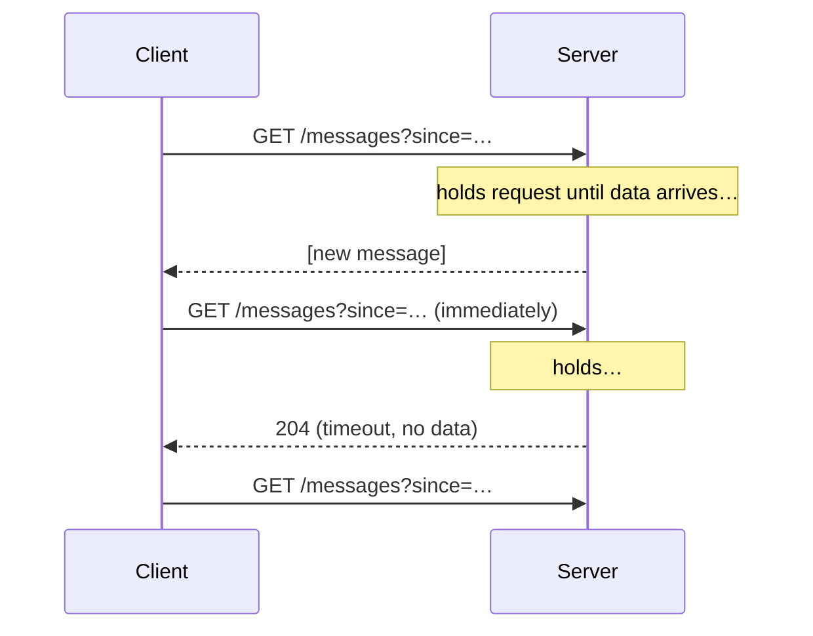
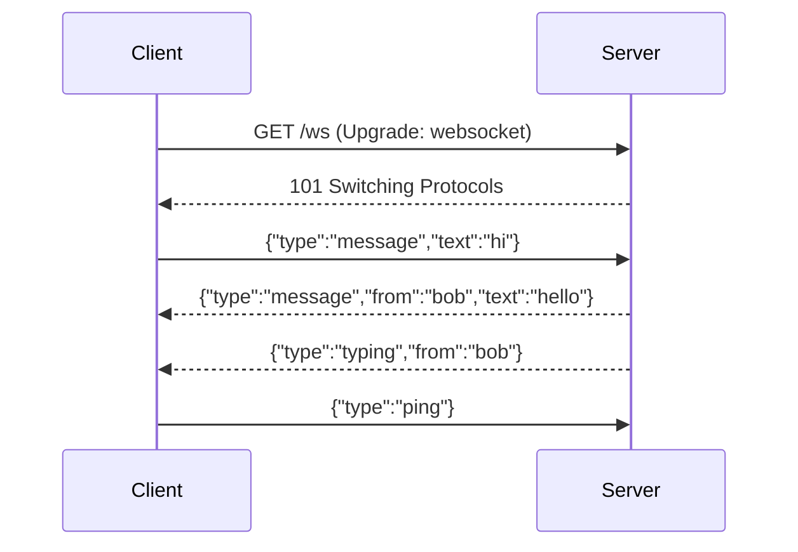
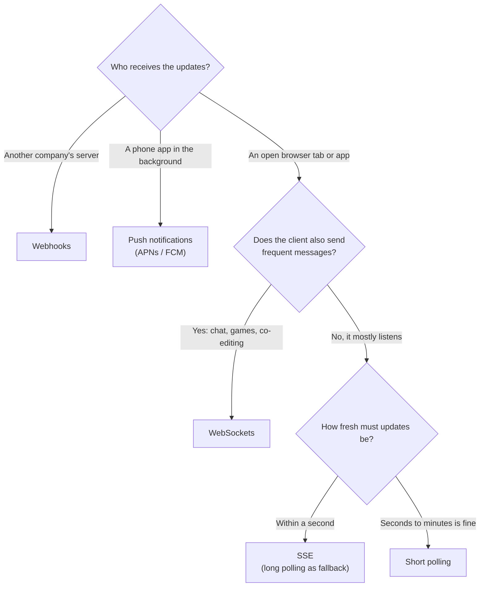
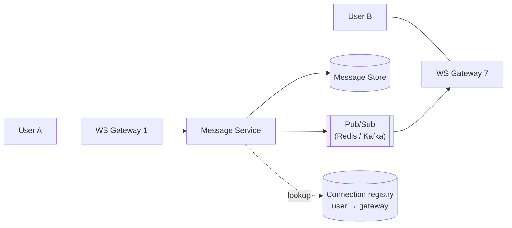
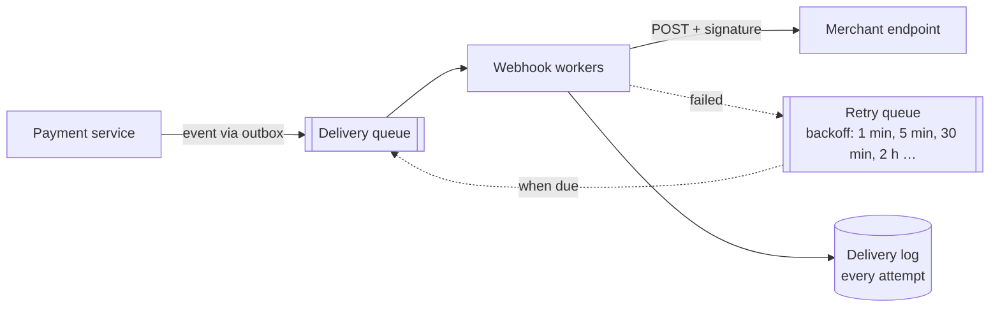

HTTP is fundamentally **client-initiated**: the client asks, the server answers. But many features need the server to push data the moment something happens — a new chat message, a ride's live location, a stock price, a notification, collaborative edits. This lesson covers the four main techniques, their trade-offs, and how to scale systems that hold millions of open connections.

## Short polling

The client asks for updates at a fixed interval.



- ✅ Trivial to implement; works everywhere; stateless servers.
- ❌ **Wasteful** — most requests return nothing, yet each carries full HTTP overhead.
- ❌ **Latency up to the polling interval** — a 5-second interval means updates can be up to 5 s late. Shortening the interval multiplies the load.

**Use when:** updates are infrequent and a delay is acceptable — e.g., checking an export job's status every 10 seconds.

**Avoid when:** updates must arrive within a second, or when many clients poll at once. A million open apps polling every 5 seconds is 200,000 requests per second, almost all of them answered with "nothing new".

## Long polling

The client sends a request; the server **holds it open** until there's new data (or a timeout, e.g., 30 s), then responds. The client immediately sends another request.



- ✅ Near-real-time delivery with plain HTTP; works through almost any proxy or firewall.
- ✅ No wasted responses when idle (beyond periodic timeouts).
- ❌ Each message still costs a full request/response cycle; bursts of messages cause many reconnects.
- ❌ Servers hold many open requests — need an async/event-driven server model.
- ❌ Ordering and missed messages between requests must be handled (use a `since` cursor).

**Use when:** you need moderate real-time behaviour and must work in restrictive network environments, or as a fallback for WebSockets.

**Avoid when:** messages arrive in bursts or at high rates, because every message costs a full reconnect. Where SSE or WebSockets are available, long polling is mainly a fallback today.

## Server-Sent Events (SSE)

A standard browser API (`EventSource`) for a **one-way stream from server to client** over a single long-lived HTTP response.

```text
GET /stream/notifications
Accept: text/event-stream

HTTP/1.1 200 OK
Content-Type: text/event-stream

id: 101
event: notification
data: {"type":"like","postId":"p_9"}

id: 102
event: notification
data: {"type":"comment","postId":"p_9"}
```

- ✅ Simple text protocol over standard HTTP — works with existing load balancers, auth and HTTP/2.
- ✅ **Automatic reconnection** built into browsers, with `Last-Event-ID` so the server can resume where it left off.
- ❌ **Server → client only.** Client-to-server messages need separate HTTP requests.
- ❌ Text only (binary must be encoded); browsers limit concurrent connections per domain over HTTP/1.1 (not an issue with HTTP/2).

**Use when:** the server pushes and the client mostly listens — live feeds, notifications, dashboards, progress updates, and streaming LLM responses (token-by-token output is commonly delivered via SSE).

**Avoid when:** the client also sends frequent messages (chat typing, game input), you need binary frames, or a proxy in the path buffers responses. A buffering reverse proxy holds the events back until the response ends, so streaming must be switched off for that route (for example `proxy_buffering off` in nginx).

**Where SSE beats WebSockets:** it is plain HTTP, so existing auth cookies, load balancers, HTTP/2 multiplexing and monitoring just work; reconnection and resume-from-last-event come free; and there is no custom protocol to design.

## WebSockets

A **full-duplex, persistent** connection. It starts as an HTTP request with an `Upgrade` header, then switches to a lightweight framed protocol where either side can send messages at any time.



- ✅ True bidirectional, low-latency messaging with tiny per-message overhead (2–14 bytes of framing).
- ✅ Supports binary and text.
- ❌ **Stateful connections** — complicate load balancing, deployments and horizontal scaling.
- ❌ No built-in reconnection, message acknowledgement, or resumption — you must build these.
- ❌ Some corporate proxies interfere; need heartbeats to keep idle connections alive through NATs and load balancers.

**Use when:** both sides send frequent messages with low latency — chat, multiplayer games, collaborative editing, live trading.

**Avoid when:** only the server pushes (SSE is simpler), updates are rare (polling is cheaper to run), or your infrastructure can't handle long-lived stateful connections through every proxy and load balancer. Remember that you design the message protocol yourself: message types, acknowledgements, resume after reconnect and heartbeats.

**Where WebSockets beat SSE:** one connection carries traffic both ways with tiny framing, binary is native, and the per-message cost is lower, which matters at dozens of messages per second per user.

## Comparison

| | Short polling | Long polling | SSE | WebSocket |
| --- | --- | --- | --- | --- |
| Direction | Client pull | Client pull (server-held) | Server → client | Bidirectional |
| Latency | Up to interval | Near real-time | Real-time | Real-time |
| Overhead per message | Full HTTP request | Full HTTP request | Small | Very small |
| Connection | Short-lived | Repeated long requests | One long-lived HTTP response | One persistent upgraded connection |
| Reconnection | N/A | Client loop | Built in (`Last-Event-ID`) | Manual |
| Infrastructure friendliness | Excellent | Good | Good | Requires LB/proxy support |
| Typical uses | Job status | Fallback, legacy | Notifications, feeds, LLM streaming | Chat, games, collaboration |

### Choosing

Start from who receives the updates and whether they talk back:



Real products mix them. A chat app uses WebSockets while the app is open, push notifications when it is in the background, and an HTTP sync endpoint to catch up after reconnecting.

<Callout type="interview">
Don't default to WebSockets. Ask: does the client need to send frequent messages too? If not, **SSE is simpler**. For a notification system or live scores, SSE (or even long polling) is often the better answer. Choose WebSockets for chat, games and collaborative editing — and then talk about how you'll scale the connections.
</Callout>

## Scaling persistent connections

A single well-tuned server can hold hundreds of thousands of idle connections (memory per connection is the main limit — often a few KB to tens of KB). The hard part isn't holding connections — it's **routing a message to the server that holds the recipient's connection**.

### The routing problem

User A is connected to Gateway 1; user B to Gateway 7. When A sends B a message, how does it reach Gateway 7?



Two common approaches:

1. **Connection registry** — when a user connects, record `user_id → gateway_id` in a fast store (Redis). To deliver a message, look up the gateway and send it there directly (via RPC or a per-gateway queue).
2. **Pub/sub fan-out** — each gateway subscribes to channels for its connected users (or for rooms/conversations). Publishers send to the channel; whichever gateway holds the subscriber delivers it. Simpler routing, but broadcasting to many gateways costs more.

Large systems like WhatsApp, Slack and Discord use variations of these patterns.

### Other scaling concerns

- **Separate connection gateways from business logic.** Gateways only hold sockets and forward messages; stateless services behind them do the work. Gateways can then scale on connection count, services on CPU.
- **Load balancing** — use L4 or L7 balancers that support long-lived connections, balance with **least connections**, and set generous idle timeouts. Sticky sessions are unnecessary if the registry handles routing.
- **Heartbeats** — ping/pong every 20–60 s to detect dead connections and keep NAT mappings alive; update presence based on heartbeats.
- **Reconnection storms** — when a gateway restarts or deploys, all its clients reconnect at once. Use **exponential backoff with jitter** on clients and drain gateways gradually.
- **Delivery guarantees** — a message sent while the recipient is offline or reconnecting must not be lost. Persist messages first, deliver via the socket as an optimisation, and let clients **sync from the last acknowledged sequence number** on reconnect.
- **Mobile clients** — apps in the background lose their sockets; fall back to push notifications (APNs/FCM) for delivery.

## Webhooks: server-to-server push

When the receiver is **another company's server**, not a browser, there is no open connection to push over. Instead the receiver registers a URL, and your system sends it an HTTP POST whenever something happens: Stripe telling a merchant a payment succeeded, GitHub telling a CI system that code was pushed.

```text
POST https://shop.example/hooks/payments
Content-Type: application/json
Webhook-Id: evt_7Hq2
Webhook-Timestamp: 1767225600
Webhook-Signature: v1,K5oZfzN95Z9UVu1EsfQmfVNQhnkZ2pj9o9NDN/H/pI4=

{ "id": "evt_7Hq2", "type": "payment.succeeded", "data": { "paymentId": "pay_88", "amount": 4999 } }
```

Without webhooks, every merchant would poll `GET /payments?updated_since=…` every few seconds, which is slow for them and wasteful for you.

**Sending webhooks reliably**



- **Never send from the request path.** Record the event (with the outbox pattern), and let a pool of delivery workers send it. A slow or broken merchant endpoint must never slow down payments.
- **Retry with exponential backoff over hours or days.** After the last attempt, mark the event failed, alert the endpoint's owner, and eventually disable endpoints that keep failing.
- **Use short timeouts** (5–10 s) so slow receivers don't tie up workers, and isolate noisy endpoints so one merchant's outage doesn't delay everyone else's deliveries.
- **Sign every payload** with HMAC-SHA256 and a per-endpoint secret, and include a timestamp in what you sign. Receivers verify the signature and reject old timestamps (say, more than 5 minutes), which blocks forged and replayed requests.
- **Guard against SSRF.** Customers choose the URL, so an attacker could register `http://169.254.169.254/…` or an internal hostname. Allow only HTTPS to public addresses, resolve DNS before connecting and check the IP, and don't follow redirects blindly.
- **Offer recovery:** an events API (`GET /events?since=…`), a delivery log in the dashboard and a "resend" button.

**Receiving webhooks correctly**

- **Respond 2xx quickly** and do the real work asynchronously. A receiver that takes 30 s to respond gets retried as if the delivery failed.
- **Expect duplicates.** Delivery is at-least-once, so deduplicate by event ID.
- **Don't rely on order.** A retried `payment.pending` can arrive after `payment.succeeded`. Treat the event as a prompt and fetch the current state (`GET /payments/pay_88`) when order matters, or compare version numbers or timestamps.

**Pick webhooks when** you need to notify other organisations' systems about events at a moderate rate. **Avoid them when** the receiver is a browser or phone (use SSE, WebSockets or push notifications), when receivers sit behind firewalls with no public endpoint (offer an events API to poll), or at very high event rates, where a stream the receiver reads at its own pace, or batched deliveries, work better.

## Interview questions

<QA q="You're designing live notifications for a social app. WebSockets or SSE?">
SSE is usually the better fit. Notifications flow server → client; the client's own actions (liking, commenting) are ordinary HTTP requests. SSE runs over standard HTTP, works with existing load balancers and HTTP/2, and has built-in reconnection with Last-Event-ID for resumption. WebSockets would add stateful bidirectional infrastructure that the feature doesn't need. On mobile in the background, use push notifications instead.
</QA>

<QA q="How do you deliver a chat message to a user connected to a different WebSocket server?">
Maintain a connection registry (user ID → gateway server) in Redis, updated on connect/disconnect, or have gateways subscribe to pub/sub channels for their connected users or conversations. The message service persists the message, then looks up the recipient's gateway (or publishes to the channel), and that gateway pushes it down the socket. If the user is offline, the message stays stored and a push notification is sent; on reconnect, the client syncs from its last acknowledged message ID.
</QA>

<QA q="What happens when a WebSocket gateway with 200,000 connections crashes, and how do you handle it?">
All 200K clients disconnect and attempt to reconnect at about the same moment, hitting the remaining gateways and the auth/session services with a spike. Clients should reconnect with exponential backoff plus random jitter to spread the load; the load balancer distributes them across healthy gateways; the registry entries for the dead gateway are cleaned up via heartbeats/TTLs. Because messages are persisted before delivery, clients resync missed messages from their last acknowledged sequence number — nothing is lost.
</QA>

<QA q="Why might long polling still be used today?">
It works over plain HTTP request/response through virtually any proxy, firewall or legacy infrastructure, requires no special server or load-balancer support, and is easy to reason about. It's used as a fallback when WebSockets are blocked (libraries like Socket.IO fall back to it) and for moderate-frequency updates where per-message overhead doesn't matter.
</QA>

## Practice

Write your answer before opening the suggested one. If you mark it "Partly" or "Missed it", it comes back in your review deck.

<Practice task="Choose a technique for each: (a) a dashboard showing a live stock price, updated by the server only; (b) a multiplayer drawing board; (c) a payment provider telling your backend a payment succeeded.">

(a) Server-Sent Events. Data flows only from server to client, SSE runs over plain HTTP, reconnects automatically and passes through most proxies. WebSockets would work but are more than needed.

(b) WebSockets. Both sides send frequent, low-latency messages (strokes and cursors), so a persistent two-way connection fits.

(c) Webhooks. It is server-to-server and event-driven: the provider sends an HTTP POST to your endpoint. Verify the signature, respond quickly, process asynchronously and handle duplicates (providers retry), and still poll or reconcile occasionally in case a webhook is lost.

</Practice>

<Takeaways>

- Short polling is simple but wasteful; long polling gives near-real-time over plain HTTP.
- SSE is the simplest option for server-to-client streams, with built-in reconnection.
- WebSockets provide full-duplex, low-overhead messaging but make connections stateful.
- Scaling persistent connections is about routing: a connection registry or pub/sub between gateways.
- Persist first, push second: clients must be able to resync after disconnects.

</Takeaways>

## Further reading

- RFC 6455, "The WebSocket Protocol"; WHATWG HTML Standard — "Server-sent events".
- Ilya Grigorik, [*High Performance Browser Networking*](https://hpbn.co) — chapters on XHR polling, SSE and WebSocket.
- Discord Engineering, "How Discord Scaled Elixir to 5,000,000 Concurrent Users" (2017).
- Related case studies: [Design a Chat System](/system-design/hld/design-chat-system), [Design a Collaborative Editor](/system-design/hld/design-collaborative-editor).
