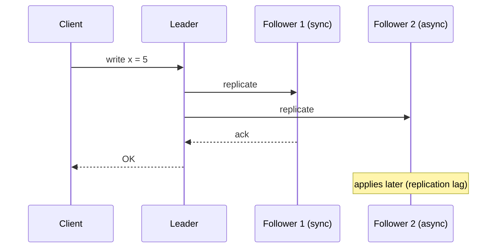
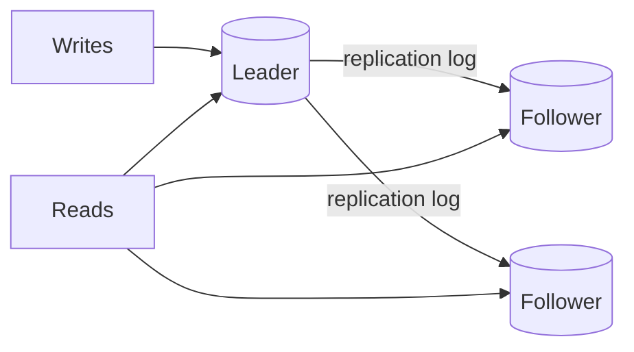
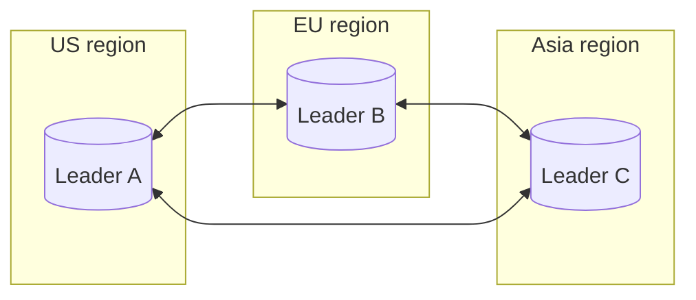
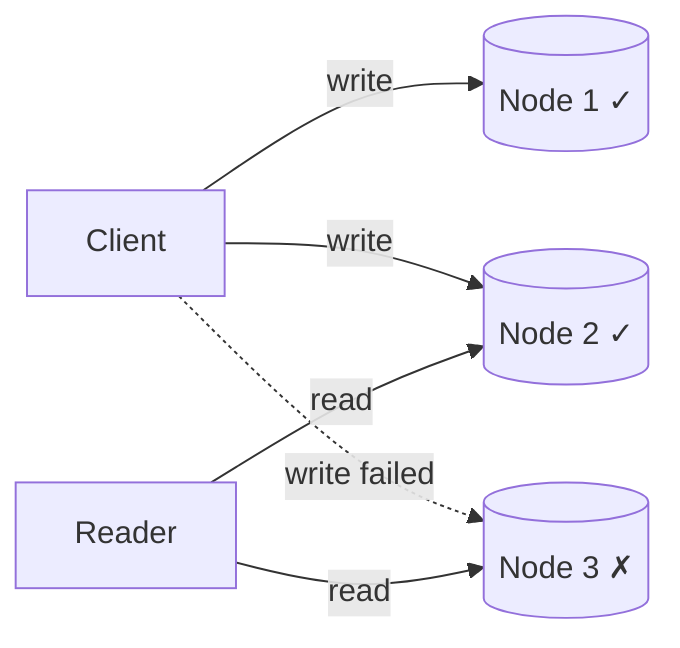

**Replication** means keeping copies of the same data on multiple machines. It's one of the two fundamental ways to distribute data (the other is partitioning, covered next), and nearly every production database uses it.

Replication serves three purposes:

1. **High availability** — if one node dies, another has the data and can take over.
2. **Read scalability** — spread read queries across many copies.
3. **Lower latency** — place copies geographically closer to users.

If data never changed, replication would be trivial: copy it once. All the difficulty comes from **handling changes** — and the core trade-off is between *how quickly* a write is acknowledged and *how safely* it has been copied.

## Synchronous vs asynchronous replication



| | Synchronous | Asynchronous |
| --- | --- | --- |
| Write acknowledged when | Followers confirm they have it | Leader has it |
| Durability on leader failure | No data loss | Recent writes may be lost |
| Write latency | Higher — waits for slowest sync follower | Low |
| Availability | A slow/dead sync follower blocks writes | Followers can't block the leader |

Fully synchronous replication to every follower is impractical — any single slow node stalls all writes. The common compromise is **semi-synchronous**: one follower is synchronous, the rest asynchronous. That guarantees the data exists on at least two nodes while keeping latency reasonable. If the sync follower fails, another is promoted to sync.

## Single-leader replication

The most common model (PostgreSQL, MySQL, MongoDB replica sets, Redis, Kafka partitions).



- **All writes go to the leader**, which records them in a replication log (e.g., PostgreSQL's WAL, MySQL's binlog).
- Followers apply the log in the same order, so they converge to the same state.
- Reads can go to the leader (fresh) or any follower (possibly stale).

**Strengths:** simple, no write conflicts (one node orders all writes), well understood.
**Weaknesses:** write throughput is limited to one node; the leader is a failover risk; cross-region writes pay a round trip to the leader's region.

### Replication lag and its anomalies

With asynchronous followers, a follower may be milliseconds — or under load, seconds to minutes — behind. This causes user-visible anomalies:

**1. Reading your own writes fails.** A user updates their profile, the page reloads from a follower that hasn't received the update, and the change appears to be lost.

*Fixes:* read the user's own data from the leader; or read from the leader for a short window (e.g., 1 minute) after the user writes; or track the write's log position and only read from followers that have caught up to it.

**2. Monotonic reads are violated.** A user refreshes twice, hits a fresh follower then a stale one, and sees a comment appear and then disappear.

*Fix:* pin each user to one follower (e.g., by hashing the user ID).

**3. Consistent prefix reads are violated.** In a partitioned system, a reader sees an answer before the question it responds to, because different partitions lag by different amounts.

*Fix:* write causally related data to the same partition, or track causal dependencies.

<Callout type="interview">
Whenever you add read replicas in a design, proactively mention replication lag: "Reads go to replicas, which may be slightly stale. For a user's own profile, I'll read from the primary to guarantee read-your-writes." This is a small sentence that signals real experience.
</Callout>

### Failover

When the leader fails, a follower must be promoted:

1. **Detect** the failure — usually via heartbeats and a timeout. Too short a timeout causes unnecessary failovers during load spikes; too long means longer outages.
2. **Elect** a new leader — ideally the most up-to-date follower, chosen via consensus (e.g., etcd/ZooKeeper, Patroni for PostgreSQL, Raft-based systems) or by an orchestrator.
3. **Reconfigure** — clients and remaining followers start using the new leader.

Failover is full of pitfalls:

- **Lost writes.** With async replication, writes the old leader acknowledged but hadn't replicated are lost. If other systems (caches, other databases) already saw them, the data becomes inconsistent across systems.
- **Split brain.** If the old leader didn't actually die (just a network partition), two nodes may both believe they're the leader and accept conflicting writes. Systems use **fencing** — e.g., epoch numbers or STONITH ("shoot the other node in the head") — to ensure the old leader can't continue writing.
- **Reused IDs.** A newly promoted leader that missed some auto-increment values may hand out IDs that the old leader already used.

## Multi-leader replication

Multiple nodes accept writes, and each replicates its changes to the others.



**When it's useful:**

- **Multi-region deployments** — users write to their local region with low latency; regions replicate asynchronously and survive the loss of a whole region.
- **Offline-capable clients** — each device is effectively a leader (e.g., calendar apps, notes apps) that syncs later.
- **Collaborative editing** — Google Docs-style real-time editing.

**The big problem: write conflicts.** Two leaders can modify the same record concurrently:

```text
Leader A (US):  title = "Q3 Plan"    at 10:00:00.120
Leader B (EU):  title = "Q3 Roadmap" at 10:00:00.130
```

Conflict-resolution strategies:

| Strategy | How | Cost |
| --- | --- | --- |
| **Last write wins (LWW)** | Keep the write with the highest timestamp | Simple, but silently discards data; clock skew can choose the "wrong" winner |
| **Conflict avoidance** | Route all writes for a record to the same leader (e.g., by user's home region) | Most practical; breaks down if the home region fails |
| **Merge** | Combine values (e.g., union of sets) | Only works for some data types |
| **CRDTs** | Data types designed to merge automatically (counters, sets, sequences) | Limited data models; used in collaborative tools and Riak/Redis Enterprise |
| **Application resolution** | Store all versions; let the app or user resolve | Most correct; most complex |

<Callout type="warning">
Multi-leader replication is often presented as "just add more leaders for write scaling". It's really a tool for **geographic distribution and availability**, and conflict handling is a serious design effort. Avoid it unless the requirements genuinely call for multi-region writes.
</Callout>

## Leaderless replication

There is no leader: clients (or a coordinator node) send writes to several replicas directly and read from several replicas. Popularised by Amazon's Dynamo paper and used in Cassandra, ScyllaDB and Riak.

### Quorums

With **N** replicas, a write must be acknowledged by **W** nodes and a read must query **R** nodes. If

```text
W + R > N
```

then every read set overlaps with every write set in at least one node, so a read sees at least one copy of the latest write (the one with the newest version wins).



In the diagram, N = 3, W = 2, R = 2. The write reached nodes 1 and 2; the reader queried nodes 2 and 3; node 2 overlaps and returns the latest value.

Common configurations:

| Setting | Effect |
| --- | --- |
| N=3, W=2, R=2 | Balanced; tolerates 1 node down for both reads and writes |
| N=3, W=3, R=1 | Fast reads; writes fail if any node is down |
| N=3, W=1, R=3 | Fast writes; reads fail if any node is down |
| W + R ≤ N | Faster and more available, but reads may be stale (eventual consistency) |

### Keeping replicas in sync

Replicas that missed writes must catch up:

- **Read repair** — when a read sees stale values on some replicas, the coordinator writes the newest value back to them.
- **Anti-entropy** — a background process compares replicas (using **Merkle trees** to find differing ranges efficiently) and copies missing data.
- **Hinted handoff** — if a target replica is down, another node temporarily stores the write (a "hint") and forwards it once the replica returns. Combined with a **sloppy quorum**, this keeps writes available during failures at the cost of weaker guarantees.

<Callout type="note">
Even with W + R > N, quorums don't guarantee linearizability: concurrent writes, sloppy quorums, partial write failures, and clock-based conflict resolution can still produce anomalies. Quorums give "usually up to date", not "strictly consistent". The Consistency Models lesson explores this.
</Callout>

## Comparing the three models

| | Single-leader | Multi-leader | Leaderless |
| --- | --- | --- | --- |
| Writes accepted by | One node | Several leaders | Any replica (quorum) |
| Write conflicts | None | Yes — must resolve | Yes — resolved via versions/LWW |
| Write scalability | Limited by leader | Better (per region) | Good |
| Failover | Needed; can be risky | Other leaders continue | No failover needed |
| Consistency | Strong on leader; lag on followers | Eventual | Tunable via quorums |
| Examples | PostgreSQL, MySQL, MongoDB | Multi-region MySQL, CouchDB, collaborative apps | Cassandra, ScyllaDB, Riak, DynamoDB internals |

## How replication logs are shipped

- **Statement-based** — ship the SQL statements. Breaks with nondeterministic functions like `NOW()` or `RAND()`.
- **Physical log (WAL) shipping** — ship low-level disk changes. Exact, but ties followers to the same storage engine version.
- **Logical (row-based) log** — ship row-level changes ("row X: column Y changed to Z"). Decoupled from storage internals, enabling **change data capture (CDC)** — streaming database changes into Kafka, search indexes, caches or warehouses (e.g., Debezium).

## Interview questions

<QA q="A user updates their profile photo and immediately sees the old one. Why, and how would you fix it?">
The update went to the primary, but the subsequent read was served by an asynchronous replica that hadn't applied it yet (replication lag). Fixes: route reads of the user's own profile to the primary; or route all of a user's reads to the primary for a short window after they write; or have the client remember the write's log position/timestamp and only read from replicas caught up to it. Also check any caching layer, which may serve stale data independently.
</QA>

<QA q="What is split brain and how do systems prevent it?">
Split brain occurs when two nodes both believe they're the leader — typically when a network partition makes the old leader look dead, a new one is promoted, but the old one is still alive and accepting writes. Both sides diverge. Prevention: require a majority quorum to elect a leader (a minority partition can't elect one), use leases that expire, and use fencing tokens/epoch numbers so storage rejects writes from a stale leader; in some systems, forcibly power off the old node (STONITH).
</QA>

<QA q="With N=3, W=2, R=2, can a read ever return stale data?">
Yes, in edge cases. If a write succeeded on only one node (and the client saw it as failed), it isn't rolled back on that node, so later reads may or may not see it. Concurrent writes resolved by last-write-wins with skewed clocks can drop the "real" latest write. Sloppy quorums during failures may place writes on nodes outside the usual replica set. And a node holding the latest value may fail and be restored from a stale replica. Quorums reduce staleness but don't guarantee linearizability.
</QA>

<QA q="When would you choose multi-leader replication?">
When users in multiple regions need low-latency writes and the system must keep accepting writes even if a whole region or the inter-region link fails, or for offline-first clients that sync later. It requires a clear conflict strategy — ideally conflict avoidance by routing each record's writes to a home region, or CRDTs for data that merges naturally. For a single-region system, single-leader is simpler and better.
</QA>

## Practice

Write your answer before opening the suggested one. If you mark it "Partly" or "Missed it", it comes back in your review deck.

<Practice task="Your database has one leader and two asynchronous followers. The leader crashes and a follower is promoted. What data can be lost, and how could you reduce that risk?">

With asynchronous replication, the leader acknowledges writes before the followers have them. Writes acknowledged in the last moments before the crash may never have reached the new leader, so they are lost even though clients were told they succeeded.

Reducing it:
1. Semi-synchronous replication: the leader waits for at least one follower to confirm before acknowledging. One follower is always up to date, at the cost of write latency.
2. Promote the follower with the most recent log position.
3. Quorum-based systems (Raft-based databases) only acknowledge writes once a majority has them, so a new leader always has every acknowledged write.

Also fence the old leader so it cannot keep accepting writes if it comes back (split brain).

</Practice>

<Takeaways>

- Replication provides availability, read scaling and geographic locality.
- Synchronous replication protects data but adds latency; asynchronous is fast but can lose recent writes on failover. Semi-sync is a common compromise.
- Single-leader is the default; plan for replication lag (read-your-writes, monotonic reads) and careful failover (split brain, fencing).
- Multi-leader suits multi-region and offline writes but requires conflict resolution.
- Leaderless systems use quorums (W + R > N), read repair and anti-entropy to converge.

</Takeaways>

## Further reading

- Martin Kleppmann, *Designing Data-Intensive Applications* — ch. 5, "Replication".
- DeCandia et al., "Dynamo: Amazon's Highly Available Key-value Store" (SOSP 2007) — quorums, hinted handoff, Merkle-tree anti-entropy.
- PostgreSQL documentation — "High Availability, Load Balancing, and Replication".
- Related: [Consensus, Leader Election & Locks](/system-design/hld/consensus), [Consistency Models](/system-design/hld/consistency-models), [Multi-Region Architecture](/system-design/hld/multi-region-architecture).
