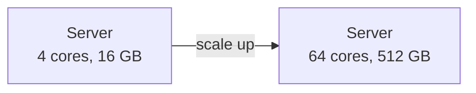
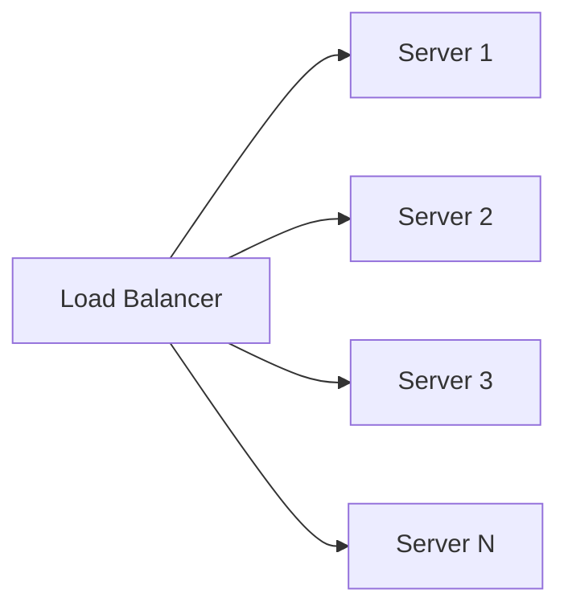
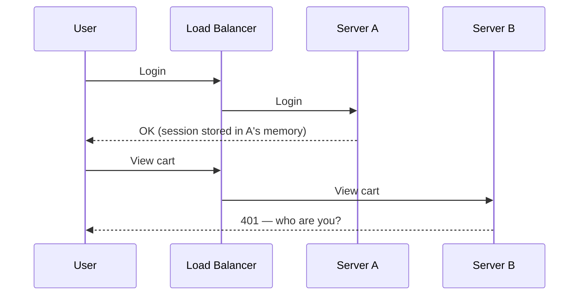
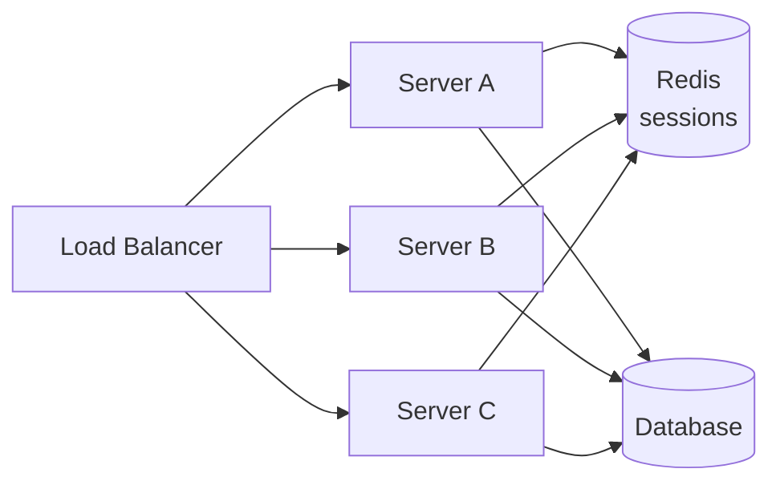

**Scalability** is a system's ability to handle increased load by adding resources — while keeping performance acceptable. A system that serves 100 users well but falls over at 10,000 is not scalable. A system that handles 10,000 users only because someone rewrote it from scratch is not scalable either. We want to grow by *adding* capacity, not redesigning.

Load can mean many things, and you should be specific about which one you're scaling:

- Requests per second to the API
- Concurrent connections (e.g., chat users online)
- Read vs write ratio on the database
- Data volume stored
- Fan-out (e.g., one post delivered to 10 million followers)

## Performance vs scalability

These are related but different:

- A **performance problem** means the system is slow for a single user.
- A **scalability problem** means the system is fast for a single user but slow under load.

Throwing hardware at a performance problem (an N+1 query, an O(n²) loop) rarely helps. Throwing hardware at a scalability problem works only if the architecture allows it — which is what this lesson is about.

## Vertical scaling (scale up)

Add more power to a single machine: more CPU cores, more RAM, faster disks.

**Advantages**

- **No code changes.** The application doesn't know it's on a bigger machine.
- **No distributed systems problems.** No network partitions between nodes, no consistency questions, transactions stay simple.
- **Surprisingly far.** Modern servers offer hundreds of cores and terabytes of RAM. Stack Overflow famously served enormous traffic from a handful of large SQL Server machines.

**Disadvantages**

- **Hard ceiling.** There is a largest machine you can buy.
- **Cost grows non-linearly.** The top-end machines cost disproportionately more per unit of capacity.
- **Single point of failure.** One machine means one failure takes everything down.
- **Downtime to upgrade.** Resizing usually means a restart.

## Horizontal scaling (scale out)

Add more machines and distribute the load among them.

**Advantages**

- **Near-unlimited capacity** in principle — add nodes as load grows.
- **Fault tolerance.** Losing one of ten servers loses 10% of capacity, not 100%.
- **Commodity hardware** with linear cost.
- **Elasticity.** Add nodes during peaks and remove them afterwards (auto-scaling).

**Disadvantages**

- **Complexity.** You now need load balancing, service discovery, and distributed data.
- **Statelessness is required** for the scaled tier (explained below).
- **Data consistency becomes hard** once the *data* tier is distributed.
- **More moving parts** to monitor and operate.

## Comparison

| | Vertical | Horizontal |
| --- | --- | --- |
| How | Bigger machine | More machines |
| Limit | Hardware ceiling | Practically unbounded (for the stateless tier) |
| Fault tolerance | None by itself | Built in with redundancy |
| Complexity | Low | High |
| Cost curve | Super-linear at the top end | Roughly linear |
| Best for | Databases early on, stateful systems, quick wins | Stateless web/app tiers, large data with partitioning |

<Callout type="interview">
The mature answer is rarely "always scale horizontally". Say: "I'll scale the stateless application tier horizontally behind a load balancer. For the database, I'll start with a vertically scaled primary plus read replicas, and only shard when write volume or data size requires it — sharding adds significant operational complexity." This shows you scale where it's cheap and defer complexity where it's expensive.
</Callout>

## Stateless services: the key to scaling out

A service is **stateless** if any instance can handle any request because no instance holds data that other instances need. All durable state lives in external stores (databases, caches, object storage).

Consider a server that keeps user sessions in local memory:

Server B has no idea who the user is. There are three ways to fix this:

1. **Sticky sessions** — the load balancer always routes a user to the same server (via a cookie). Simple, but load becomes uneven, and if Server A dies, its users lose their sessions.
2. **Externalised session store** — store sessions in Redis or a database. Every server reads from the shared store. This is the standard approach.
3. **Client-side state** — put the session in a signed token (e.g., a JWT) carried by the client. No server-side lookup needed, but tokens are hard to revoke before expiry and add bytes to every request.

Once the application tier is stateless:

- Any instance can serve any request → the load balancer can use simple algorithms.
- Instances can be added or removed freely → **auto-scaling** works.
- A crashed instance loses nothing → just replace it.
- Deployments become easy → rolling updates instance by instance.

<Callout type="note" title="State doesn't disappear — it moves">
Making services stateless pushes state into the data tier. That's the right trade, because databases and caches are built to manage state (replication, durability, consistency). But it also means the **data tier becomes the scaling bottleneck** — which is why the next module is entirely about storing data.
</Callout>

## Where systems typically bottleneck

A typical evolution as a system grows:

| Stage | Users | Architecture | Next bottleneck |
| --- | --- | --- | --- |
| 1 | ~1K | One server running app + DB | Single machine CPU/RAM |
| 2 | ~10K | Separate app server and DB server | App server CPU |
| 3 | ~100K | Load balancer + multiple stateless app servers | Database reads |
| 4 | ~1M | Add cache (Redis) + DB read replicas + CDN for static files | Database writes / data size |
| 5 | ~10M | Shard the database; move slow work to queues | Cross-shard queries, operational complexity |
| 6 | 100M+ | Split into services by domain; multi-region | Organisational and consistency challenges |

These numbers are illustrative, not rules — a simple read-mostly app can reach millions of users at stage 4. The point is the **order**: each step solves the current bottleneck, and the bottleneck moves.

## Auto-scaling

In cloud environments, horizontally scaled tiers can grow and shrink automatically:

- **Reactive scaling** adds instances when a metric (CPU above 70%, request queue depth, p99 latency) crosses a threshold.
- **Scheduled scaling** pre-provisions for known peaks (e.g., a daily 9 AM spike or a planned sale).
- **Predictive scaling** uses historical patterns to scale before demand arrives.

Things to watch:

- **Warm-up time.** New instances may take minutes to boot, load caches, and JIT-compile. Scale before you're saturated.
- **Downstream capacity.** Doubling app servers doubles the load on the database. Auto-scaling the front tier can overload the back tier.
- **Flapping.** Use cooldown periods so the system doesn't add and remove instances in rapid oscillation.

## Scaling dimensions beyond "more servers"

The *Scale Cube* (from *The Art of Scalability*) names three axes:

- **X-axis — cloning.** Run identical copies behind a load balancer. (Horizontal scaling of stateless services.)
- **Y-axis — functional decomposition.** Split by responsibility: user service, order service, payment service. Each scales independently.
- **Z-axis — data partitioning.** Each instance handles a subset of the data, e.g., users A–M vs N–Z. (Sharding.)

Large systems use all three: many clones (X) of each service (Y), each service owning partitioned data (Z).

## Interview questions

<QA q="Why is horizontal scaling preferred for web servers but often delayed for databases?">
Web servers can be made stateless, so adding instances is trivial: put them behind a load balancer and any instance serves any request. Databases are inherently stateful. Scaling them horizontally means replication (with lag and consistency issues) or sharding (with cross-shard queries, rebalancing and loss of easy transactions). A vertically scaled primary with read replicas is simpler and goes a long way, so teams defer sharding until write volume or data size forces it.
</QA>

<QA q="What are the problems with sticky sessions?">
(1) Uneven load — some servers accumulate heavy users while others sit idle, and new servers get no existing traffic. (2) Fragility — if a server dies, every session pinned to it is lost. (3) They complicate auto-scaling and deployments, because removing an instance disrupts its users. They're acceptable as a performance optimisation (e.g., local cache affinity) but shouldn't be relied on for correctness.
</QA>

<QA q="Your auto-scaling group doubled app servers during a spike, and the site still went down. What might have happened?">
Likely a downstream bottleneck. More app servers meant more concurrent queries and connections to the database (possibly exhausting its connection limit), or more calls to a dependency that couldn't scale. Other causes: instances took too long to warm up, so they arrived after the spike had already caused cascading timeouts; or a shared resource like a cache or lock became a hot spot. The fix involves connection pooling, caching, rate limiting, and capacity planning for the whole request path, not just the front tier.
</QA>

<QA q="When would you choose vertical scaling in a modern design?">
When the component is stateful and hard to distribute (a relational database that needs transactions), when load is predictable and within a single machine's limits, when the team is small and operational simplicity matters, or as a quick fix to buy time. It's also a valid first step: a single large primary with replicas can serve many products for years.
</QA>

## Practice

Write your answer before opening the suggested one. If you mark it "Partly" or "Missed it", it comes back in your review deck.

<Practice task="Your web servers store user sessions in memory, so you cannot add servers without users being logged out, and the load balancer needs sticky sessions. How do you make the tier scale horizontally?">

Make the servers stateless by moving session state out of them.

Options:
1. A shared session store (Redis) keyed by a session ID in a cookie. Any server can handle any request.
2. Signed tokens (for example JWTs) that carry the session data, so no lookup is needed — but they are hard to revoke before they expire, so keep them short-lived with refresh tokens.

Then remove sticky sessions, put the servers in an auto-scaling group behind the load balancer, and scale on CPU or request rate. Do the same for anything else kept on local disk (uploads go to object storage, caches to a shared cache).

</Practice>

<Takeaways>

- Vertical scaling is simple but capped and creates a single point of failure; horizontal scaling is unbounded but adds complexity.
- Make services stateless — move sessions and data to shared stores — so any instance can serve any request.
- State doesn't vanish; it moves to the data tier, which then becomes the bottleneck.
- Scale the cheap tier (stateless compute) first; add data-tier complexity (replicas, then sharding) only when needed.
- Auto-scaling must account for warm-up time and downstream capacity.

</Takeaways>

## Further reading

- Martin Abbott and Michael Fisher, *The Art of Scalability* (2nd ed., 2015) — the Scale Cube.
- Alex Xu, *System Design Interview*, Vol. 1 — ch. 1, "Scale from Zero to Millions of Users".
- [The Twelve-Factor App — VI. Processes](https://12factor.net/processes) — the case for stateless processes.
- Related: [Load Balancing](/system-design/hld/load-balancing), [Monoliths, Microservices & Service Discovery](/system-design/hld/microservices-architecture).
