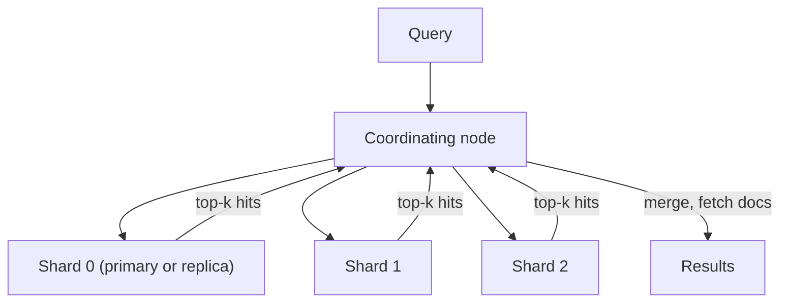
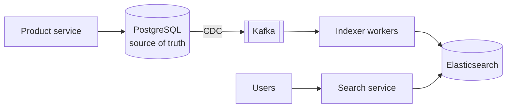

"Find products matching *wireless noise cancelling headphones*, ranked by relevance, filtered by price and brand, with typo tolerance, in 100 ms." A relational database's `LIKE '%headphones%'` can't do this: it scans every row, ignores relevance, and doesn't understand language. Search engines are built on a different data structure — the **inverted index** — and almost every product needs one somewhere.

## The inverted index

A normal (forward) index maps documents to their words. An **inverted index** maps each **term** to the list of documents containing it — a **postings list**.

```text
Documents
  1: "wireless headphones with noise cancelling"
  2: "wired headphones"
  3: "wireless earbuds noise isolation"

Inverted index
  wireless   → [1, 3]
  headphone  → [1, 2]
  noise      → [1, 3]
  cancel     → [1]
  wire       → [2]
  earbud     → [3]
  isolation  → [3]
```

A query for `wireless noise` intersects the postings lists `[1, 3] ∩ [1, 3] = [1, 3]`. Postings are kept sorted by document ID and compressed, so intersections are fast even across billions of documents. Postings can also store **positions** (for phrase queries like `"noise cancelling"`) and **term frequencies** (for scoring).

## Text analysis

Before indexing — and identically at query time — text goes through an **analyzer**:

1. **Character filtering** — strip HTML, normalise Unicode.
2. **Tokenisation** — split into tokens (`"noise-cancelling"` → `noise`, `cancelling`).
3. **Lowercasing**.
4. **Stop-word removal** (optional) — drop very common words like *the*, *a*.
5. **Stemming or lemmatisation** — reduce words to a root: *cancelling*, *cancelled* → *cancel*; *headphones* → *headphone*.
6. **Synonyms** — *earbuds* ↔ *earphones*.

Different fields need different analyzers: product titles get stemming and synonyms; SKUs and email addresses must be matched exactly (keyword fields).

### Fuzzy matching and prefixes

- **Typo tolerance** — match terms within an edit distance (Levenshtein) of 1–2: *headphnes* → *headphones*. Engines use automata over the term dictionary to do this efficiently.
- **Prefix/autocomplete** — edge n-grams at index time (`hea`, `head`, `headp`…) or specialised completion structures. See [Design Search Autocomplete](/system-design/hld/design-typeahead).

## Relevance ranking

Matching documents must be ordered. Classic scoring is based on:

- **Term frequency (TF)** — a term appearing more often in a document suggests relevance.
- **Inverse document frequency (IDF)** — rare terms (*cancelling*) matter more than common ones (*headphones* in an electronics store).
- **Field length normalisation** — a match in a short title counts more than in a long description.

**BM25** combines these with saturation (the tenth occurrence of a word adds less than the second) and is the default in Lucene, Elasticsearch and OpenSearch.

Real products then **re-rank** with business and behavioural signals: popularity, click-through rate, conversion, freshness, personalisation, and increasingly **learning-to-rank** models or **vector (semantic) search** — embeddings that match meaning rather than exact words ("cheap laptop" ↔ "budget notebook"). Many systems combine both (**hybrid search**).

## Architecture of a search cluster

Elasticsearch/OpenSearch (built on Apache Lucene) is the common reference:



- An **index** is split into **shards** (each a self-contained Lucene index); each shard has **replicas** for availability and read throughput.
- Documents are routed to shards by hashing the document ID (document-partitioned — a **local index** per shard).
- A query is **scattered to one copy of every shard**; each returns its top-k; the coordinator **merges** them and fetches the documents. Query latency is set by the slowest shard, so shards should be balanced and not too numerous.
- Lucene writes new documents into small immutable **segments**, refreshed periodically (default about 1 second) to become searchable — search is **near-real-time**, not immediate. Segments are merged in the background, much like LSM compaction.

### Sizing heuristics

- Shard sizes of roughly 10–50 GB are a common guideline; too many tiny shards waste overhead, too few huge ones limit parallelism and slow recovery.
- The primary shard count is fixed at index creation (changing it requires reindexing or split/shrink operations); use **index aliases** so you can reindex into a new index and switch atomically.
- Time-based data (logs) uses **one index per day/week** with rollover, so old data can be deleted by dropping whole indexes.

## Keeping the index in sync

The search engine is a **secondary, derived store** — never the source of truth.



- Use **CDC or events** from the source database (not dual writes from the application) to update the index asynchronously.
- Make indexing **idempotent** (index by document ID with a version, so older updates can't overwrite newer ones).
- Support **full reindexing** from the source of truth into a new index behind an alias, for mapping changes or recovery.
- Accept a second or two of staleness; for the author's own changes, show the result from the primary store.

## Search vs other options

| Need | Use |
| --- | --- |
| Exact lookups, filters on structured columns | Database indexes |
| Simple text search on modest data | PostgreSQL full-text search (`tsvector`, GIN index) |
| Relevance-ranked full-text, facets, typo tolerance at scale | Elasticsearch / OpenSearch / Solr |
| Log search and analytics | Elasticsearch/OpenSearch, Loki, ClickHouse |
| Semantic similarity | Vector index (HNSW) in a vector DB or the search engine's vector support |

## Interview questions

<QA q="Why can't you just use SQL LIKE for product search?">
A leading-wildcard LIKE can't use a B-Tree index, so it scans every row — too slow at scale. It also has no notion of relevance ranking, stemming, synonyms, typo tolerance or multi-word matching in any order. An inverted index maps analysed terms to sorted postings lists, so queries intersect small lists instead of scanning, and scoring like BM25 ranks results.
</QA>

<QA q="How do you keep Elasticsearch consistent with your primary database?">
Treat the database as the source of truth and update the index asynchronously from its change stream (CDC via Debezium into Kafka, or an outbox), with idempotent, version-aware indexing so out-of-order updates can't overwrite newer data. Monitor indexing lag, and support full reindexing into a fresh index behind an alias. Avoid dual writes from the application, which leave the two stores inconsistent when one write fails.
</QA>

<QA q="Why is search 'near real-time' rather than immediate?">
Lucene buffers new documents in memory and makes them searchable only when it writes them into a new immutable segment during a refresh, which by default happens about every second. Refreshing more often makes documents visible sooner but creates many small segments, increasing merge work and reducing indexing throughput. For bulk loads, refresh is often disabled temporarily.
</QA>

<Takeaways>

- Search engines use inverted indexes: term → sorted postings list of documents.
- Analyzers tokenise, normalise, stem and add synonyms — identically at index and query time.
- BM25 ranks by term frequency, rarity and field length; products add behavioural signals, learning-to-rank or vector search.
- Clusters shard documents and scatter-gather queries; segments make search near-real-time.
- The index is a derived store: feed it via CDC/events, index idempotently, and keep reindexing possible.

</Takeaways>

## Further reading

- Manning, Raghavan and Schütze, *Introduction to Information Retrieval* (Cambridge, 2008; free online) — inverted indexes and scoring.
- Robertson and Zaragoza, "The Probabilistic Relevance Framework: BM25 and Beyond" (2009).
- Elastic documentation — "Near real-time search" and "Size your shards".
- Malkov and Yashunin, "Efficient and Robust Approximate Nearest Neighbor Search Using Hierarchical Navigable Small World Graphs" (2016) — HNSW for vector search.
- Related: [Indexing & Storage Engines](/system-design/hld/database-indexing), [Design Search Autocomplete](/system-design/hld/design-typeahead).
