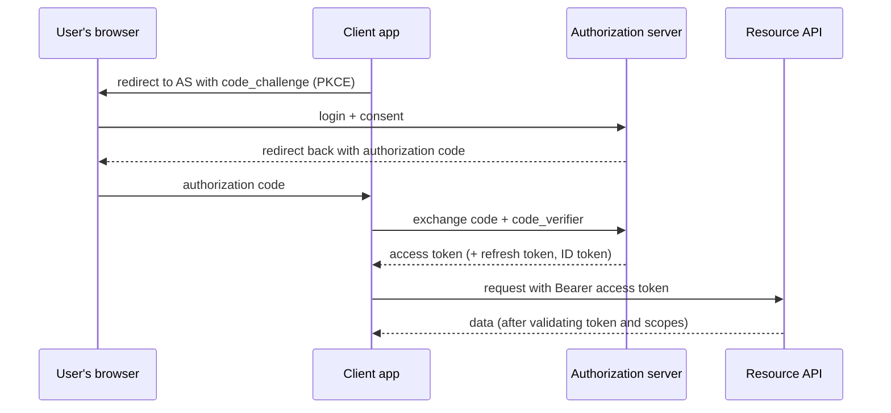

Security is rarely the headline of a design interview, but gaps are noticed: an API that trusts a `userId` from the request body, tokens that can't be revoked, data stored unencrypted, secrets in config files. This lesson covers the security building blocks every system design should include, and how to talk about them concisely.

## Authentication vs authorization

- **Authentication (AuthN)** — *who are you?* Verifying identity: passwords, passkeys, OTPs, SSO, client certificates.
- **Authorization (AuthZ)** — *what are you allowed to do?* Checking permissions for a specific action on a specific resource.

A request can be perfectly authenticated and still unauthorised (a logged-in user trying to read someone else's invoice). Most real-world breaches of APIs are **authorization** bugs — *Broken Object Level Authorization* tops the OWASP API Security Top 10.

## Sessions vs tokens

### Server-side sessions

After login, the server creates a session record (in Redis or a database) and gives the browser an opaque **session ID** in a cookie.

- ✅ Easy revocation (delete the session); small cookie; no sensitive data on the client.
- ❌ Every request needs a session-store lookup (fast with Redis).
- Cookies should be `HttpOnly` (not readable by JavaScript), `Secure` (HTTPS only) and `SameSite` (CSRF protection).

### Tokens (JWT)

A **JSON Web Token** is a signed (and optionally encrypted) set of claims: user ID, roles, expiry, issuer.

```text
header.payload.signature
eyJhbGciOiJSUzI1NiJ9.eyJzdWIiOiJ1XzQyIiwicm9sZSI6InVzZXIiLCJleHAiOjE3NjA0NTAwMDB9.MEUCIQ…
payload → { "sub": "u_42", "role": "user", "exp": 1760450000 }
```

- ✅ **Stateless verification**: any service can verify the signature with the issuer's public key, no lookup needed — convenient across microservices.
- ❌ **Hard to revoke** before expiry: a stolen token works until it expires.
- ❌ Claims become stale (a role change isn't reflected until a new token is issued).

The standard compromise: **short-lived access tokens** (5–15 minutes) plus **long-lived refresh tokens** stored securely and checked against a server-side store (so they *can* be revoked). For immediate revocation, keep a small deny-list of revoked token IDs until they expire.

<Callout type="warning">
JWT payloads are only **encoded**, not encrypted, by default — anyone can read them. Never put secrets or sensitive personal data in a JWT. Always verify the signature and the `exp`, `iss` and `aud` claims, and pin the expected algorithm.
</Callout>

## OAuth 2.0 and OpenID Connect

- **OAuth 2.0** is a framework for **delegated authorization**: letting an app access a user's resources on another service without sharing the password ("Allow Canva to read your Google Drive files"). It issues **access tokens** with limited **scopes**.
- **OpenID Connect (OIDC)** adds **authentication** on top of OAuth 2.0, returning an **ID token** (a JWT about the user). "Sign in with Google" is OIDC.

### Authorization Code flow with PKCE

The recommended flow for web, mobile and single-page apps:



PKCE (Proof Key for Code Exchange) prevents an intercepted authorization code from being used by an attacker, because exchanging it requires the secret `code_verifier` known only to the app. The older **implicit flow** is deprecated.

For **service-to-service** calls with no user involved, OAuth's **client credentials** flow issues tokens to the service itself; inside a mesh, **mutual TLS** authenticates services to each other.

## Authorization models

| Model | How it decides | Good for |
| --- | --- | --- |
| **RBAC** (role-based) | User has roles; roles have permissions | Admin consoles, internal tools, most SaaS |
| **ABAC** (attribute-based) | Policies over attributes of user, resource and context ("managers can approve expenses under ₹50,000 in their own department") | Fine-grained enterprise rules |
| **ReBAC** (relationship-based) | Permissions follow relationships in a graph ("viewers of a folder can view its documents") | Sharing models like Google Drive; Google's **Zanzibar** system |

Whatever the model: **check authorization on the server for every request, at the object level** ("does this user own invoice 1001?"), not just "is the user logged in?". Centralise policy logic (a library or policy engine such as OPA) so it's applied consistently.

## Protecting data

- **Encryption in transit** — TLS everywhere: client to edge, and service to service (mTLS) in zero-trust environments.
- **Encryption at rest** — disks, databases, backups and object storage encrypted, with keys managed by a **KMS** (AWS KMS, Cloud KMS, HashiCorp Vault). **Envelope encryption**: data is encrypted with a data key, and the data key is encrypted with a master key held in the KMS.
- **Application-level encryption** for especially sensitive fields (national IDs, card data), so even database administrators can't read them; **tokenisation** replaces card numbers with tokens (PCI DSS scope reduction).
- **Passwords** are never stored encrypted — they're **hashed** with a slow, salted algorithm designed for passwords: **Argon2id**, **scrypt** or **bcrypt**. Never plain SHA-256.
- **Data minimisation** — don't collect or retain what you don't need; define retention periods; support deletion requests.

## Secrets management

- Never hard-code secrets or commit them to repositories.
- Store them in a secrets manager (Vault, AWS Secrets Manager, Kubernetes secrets backed by a KMS), inject them at runtime, and **rotate** them.
- Prefer short-lived, automatically issued credentials (workload identity, IAM roles) over long-lived keys.
- Apply **least privilege**: each service gets only the permissions it needs.

## Common attacks and defences

| Attack | Defence |
| --- | --- |
| SQL / NoSQL injection | Parameterised queries; never build queries from strings |
| Cross-site scripting (XSS) | Output encoding, Content Security Policy, HttpOnly cookies |
| Cross-site request forgery (CSRF) | SameSite cookies, CSRF tokens, checking Origin |
| Broken object-level authorization (IDOR) | Server-side ownership checks on every object access |
| Credential stuffing / brute force | Rate limiting per account and IP, MFA, breached-password checks |
| Server-side request forgery (SSRF) | Allow-lists for outbound URLs; block internal metadata addresses |
| DDoS | CDN/anycast absorption, WAF, rate limiting, autoscaling, load shedding |
| Replay of webhooks | HMAC signatures with timestamps; reject old or repeated deliveries |

## Security in a design interview

A concise paragraph covers what interviewers look for:

> "Clients authenticate via OIDC; the gateway validates short-lived JWT access tokens and passes the user identity downstream — services never trust identity fields from request bodies. Each service enforces object-level authorization. All traffic uses TLS, with mTLS between services. Data at rest is encrypted with KMS-managed keys; passwords are hashed with Argon2id; secrets live in Vault and rotate. Login and OTP endpoints have strict rate limits."

## Interview questions

<QA q="JWT or server-side sessions — which would you choose?">
For a browser-based web app with one backend, server-side sessions in Redis with secure HttpOnly cookies are simple and easy to revoke. For APIs consumed by mobile apps and many microservices, short-lived JWT access tokens let each service verify identity without a central lookup; pair them with revocable refresh tokens stored server-side, and keep access-token lifetimes short (minutes) because they can't easily be revoked. Many systems combine both: a session at the edge exchanged for internal tokens.
</QA>

<QA q="What is PKCE and why is it needed?">
Proof Key for Code Exchange protects the OAuth authorization code flow for public clients (mobile and single-page apps) that can't keep a client secret. The app generates a random code_verifier and sends its hash (code_challenge) in the authorization request. To exchange the returned authorization code for tokens, it must present the original code_verifier. An attacker who intercepts the code — e.g., via a malicious app registered for the same redirect URI — can't redeem it without the verifier.
</QA>

<QA q="How should passwords be stored?">
Never in plain text or with reversible encryption, and not with fast hashes like SHA-256. Use a slow, memory-hard password-hashing function — Argon2id (preferred), scrypt or bcrypt — with a unique random salt per password and a work factor tuned so hashing takes tens to hundreds of milliseconds. Add rate limiting and MFA to resist online guessing, and check new passwords against known breached-password lists.
</QA>

## Practice

Write your answer before opening the suggested one. If you mark it "Partly" or "Missed it", it comes back in your review deck.

<Practice task="Your single-page app stores a long-lived JWT in localStorage. A security review flags it. What are the risks, and what would you do instead?">

Risks: any XSS bug (or a compromised third-party script) can read `localStorage` and steal the token. Because it is long-lived and stateless, the attacker can use it until it expires, and you cannot easily revoke it.

Better:
1. Keep the session in an `HttpOnly`, `Secure`, `SameSite` cookie, which JavaScript cannot read. Add CSRF protection if `SameSite` alone is not enough.
2. If you use JWTs, make access tokens short-lived (minutes) and use a refresh token stored in an `HttpOnly` cookie, rotated on use, which can be revoked on the server.
3. Reduce XSS: a strict Content Security Policy, output encoding, and no inline scripts.

Tokens are never perfectly safe in the browser; the goal is to limit how much a stolen one can do.

</Practice>

<Takeaways>

- Authentication proves identity; authorization checks each action — most API breaches are authorization bugs.
- Sessions are easy to revoke; JWTs are stateless but hard to revoke — use short-lived access tokens with revocable refresh tokens.
- Use OAuth 2.0 Authorization Code with PKCE for delegated access and OIDC for login; client credentials or mTLS for services.
- Encrypt in transit and at rest with KMS-managed keys; hash passwords with Argon2id, scrypt or bcrypt.
- Manage secrets centrally, rotate them, and apply least privilege.

</Takeaways>

## Further reading

- [OWASP API Security Top 10](https://owasp.org/API-Security/) and the [OWASP Cheat Sheet Series](https://cheatsheetseries.owasp.org) (Password Storage, Session Management, JWT).
- RFC 6749 (OAuth 2.0), RFC 7636 (PKCE), RFC 7519 (JWT), and the OAuth 2.0 Security Best Current Practice (RFC 9700).
- OpenID Connect Core 1.0 specification.
- Pang et al., "Zanzibar: Google's Consistent, Global Authorization System" (USENIX ATC 2019).
- Related: [API Design](/system-design/hld/api-design), [Rate Limiting](/system-design/hld/rate-limiting).
