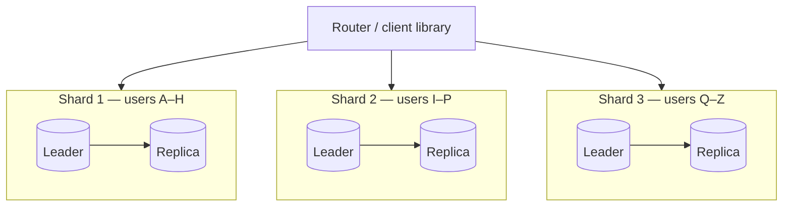
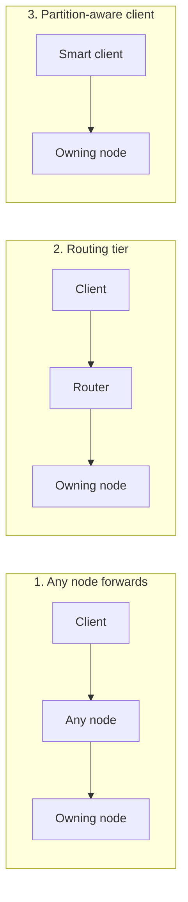

Replication copies the *same* data to many machines. **Partitioning** — called **sharding** in most databases — splits *different* data across machines so each holds only a subset. It's the tool for scaling beyond what one machine can store or write.

You need partitioning when:

- The dataset no longer fits on one machine (or its working set no longer fits in memory).
- Write throughput exceeds what one leader can handle.
- You want to isolate failures — losing one shard affects only a fraction of users.

In practice, partitioning and replication are combined: each partition is replicated for availability.



## Vertical vs horizontal partitioning

- **Vertical partitioning** splits a table by **columns** or splits the database by **feature**: e.g., large rarely used `bio` and `preferences` columns move to a separate table, or the `orders` tables move to their own database. This is often the first, easiest step.
- **Horizontal partitioning (sharding)** splits a table by **rows**: users 1–1M on shard 1, 1M–2M on shard 2. This is what "sharding" usually means.

## Choosing a partitioning strategy

The **partition key** (shard key) decides which shard a row lives on. The goal: spread data *and load* evenly, and keep common queries on a single shard.

### Range partitioning

Assign contiguous key ranges to each shard.

```text
Shard 1: user_id      1 – 10,000,000
Shard 2: user_id 10,000,001 – 20,000,000
Shard 3: user_id 20,000,001 – 30,000,000
```

- ✅ **Efficient range queries** — `WHERE created_at BETWEEN …` touches one or few shards.
- ✅ Keys stay sorted within a shard.
- ❌ **Hot spots** with monotonically increasing keys: if the key is a timestamp or auto-increment ID, *all* new writes hit the last shard.
- Used by: HBase, Bigtable, MongoDB (range sharding), CockroachDB, TiKV.

### Hash partitioning

Apply a hash function to the key and assign hash ranges to shards.

```text
shard = hash(user_id) mod number_of_shards
```

- ✅ **Even distribution** — even sequential keys spread uniformly.
- ❌ **Range queries scatter** across all shards, since adjacent keys land on different shards.
- ❌ Naive `mod N` remaps almost every key when N changes — solved by consistent hashing or fixed partition counts (below).
- Used by: Cassandra, DynamoDB, Redis Cluster (hash slots), MongoDB (hashed sharding).

### Compound keys: getting both

Cassandra-style keys combine both: hash the **partition key** to choose a node, and sort rows within the partition by a **clustering key**.

```text
PRIMARY KEY ((user_id), created_at)
  → user_id is hashed for distribution
  → rows for one user are sorted by created_at, so "latest 20 posts by user X" is one sequential read
```

### Directory-based (lookup) partitioning

A lookup service maps each key (or tenant) to a shard.

- ✅ Maximum flexibility — move a single big tenant to its own shard.
- ❌ The directory is an extra hop and a critical dependency; must itself be highly available and cached.
- Common in multi-tenant SaaS: `tenant_id → shard` mapping.

### Geographic partitioning

Partition by region: EU users' data in EU shards. Reduces latency and helps with data residency laws (e.g., GDPR). Users who travel or interact across regions complicate it.

| Strategy | Distribution | Range queries | Rebalancing | Typical use |
| --- | --- | --- | --- | --- |
| Range | Risk of hot spots | Efficient | Split ranges | Time series, ordered data |
| Hash | Even | Scatter-gather | Needs consistent hashing / fixed partitions | User data, KV workloads |
| Directory | Flexible | Depends | Update directory | Multi-tenant SaaS |
| Geographic | By region | Within region | Rare | Data residency, global apps |

## Choosing a good shard key

A good shard key has:

1. **High cardinality** — many distinct values, so data can spread across many shards. (`country` is a poor key: a handful of values, wildly uneven sizes.)
2. **Even load distribution** — not just even *data*, but even *traffic*.
3. **Query alignment** — the most frequent queries include the key, so they hit a single shard.

<Callout type="example" title="Worked example: a chat application">
Messages are queried as "latest messages in conversation X".

- Shard by `message_id` → even distribution, but fetching a conversation hits every shard. ❌
- Shard by `user_id` → a conversation between two users is split across two shards. ❌
- Shard by `conversation_id` → one shard per conversation read. ✅ But a huge group chat becomes a hot partition, so add a time bucket for very large conversations: `(conversation_id, month)`.

</Callout>

## Hot spots and skew

Even with hashing, a single hot key can overwhelm one shard: a celebrity's profile, a viral post, a flash-sale product.

Mitigations:

- **Key salting / splitting** — append a random suffix (`post_123#0` … `post_123#9`) to spread writes over 10 partitions; reads must query all 10 and merge. Apply only to known hot keys.
- **Caching** — absorb hot reads in a cache in front of the shard.
- **Dedicated shard** — move a known whale tenant to its own hardware (directory-based partitioning makes this easy).
- **Write aggregation** — for counters (likes, views), buffer increments and apply them in batches.

## Rebalancing

As data grows or nodes are added, partitions must move. Goals: keep load fair, move as little data as possible, and keep serving traffic throughout.

**Don't use hash mod N.** Going from 4 to 5 nodes with `hash mod N` moves roughly 80% of keys.

Better approaches:

- **Fixed number of partitions.** Create many more partitions than nodes up front (e.g., 1,024 partitions on 8 nodes). Adding a node moves whole partitions to it; keys never change partition. Used by Riak, Elasticsearch (fixed primary shard count), Couchbase, and Redis Cluster's 16,384 hash slots.
- **Dynamic partitioning.** Split a partition when it grows past a size threshold; merge when small. Adapts to data volume. Used by HBase, MongoDB, and many range-partitioned stores.
- **Consistent hashing.** Each node owns segments of a hash ring; adding a node takes over only neighbouring segments (~1/N of keys). Used by Cassandra and DynamoDB. Covered in the next lesson.

<Callout type="tip">
Automatic rebalancing is convenient but risky: combined with automatic failure detection, a slow node can be declared dead, triggering a massive data movement that overloads the cluster further. Many operators prefer the system to *propose* a rebalance and a human to approve it.
</Callout>

## Request routing

How does a request find the right shard?



1. **Any node forwards** — the client contacts any node, which forwards if needed (Cassandra coordinators, gossip-based).
2. **Routing tier** — a proxy layer knows the mapping (MongoDB `mongos`, Vitess `vtgate`).
3. **Partition-aware client** — the client library knows the mapping directly (Redis Cluster clients, Kafka clients).

The mapping itself is often kept in a coordination service such as **ZooKeeper** or **etcd**, which notifies routers when partitions move.

## The costs of sharding

Sharding is powerful, but it removes conveniences you had on a single database:

- **Cross-shard queries** must scatter to all shards and gather results — slow, and its latency is dictated by the slowest shard.
- **Cross-shard joins** generally aren't supported; denormalise, or join in the application.
- **Cross-shard transactions** require distributed transactions (two-phase commit) or sagas — slower and more complex.
- **Global uniqueness** (e.g., unique emails) needs a separate lookup table or a globally unique ID generator.
- **Global secondary indexes** must be maintained across shards (see the Indexing lesson).
- **Operational burden**: backups, schema migrations and monitoring multiply by the number of shards.

<Callout type="interview">
Sharding is a big hammer. In interviews, show restraint: "Our estimates show 30 TB growing to 100 TB with 50K writes/sec, which exceeds a single primary. I'll shard by `user_id` using hash partitioning with a fixed number of logical partitions, so we can add nodes without remapping keys. Most queries are per-user, so they stay on one shard."
</Callout>

## Interview questions

<QA q="You shard an orders table by order_id. What problem will you hit?">
The most common queries — "all orders for user X" and "this user's recent orders" — don't include order_id, so they scatter across every shard. Better: shard by user_id (or customer_id) so a user's orders live together. Look up an individual order by encoding the shard in the order ID or maintaining an order_id → user_id mapping.
</QA>

<QA q="How would you handle a hot partition caused by a celebrity account?">
Identify hot keys via monitoring. For reads, cache the celebrity's data aggressively (including replicated caches or local in-process caches). For writes (e.g., likes on a viral post), split the key across sub-partitions with a suffix and aggregate on read, or buffer and batch counter updates. For the fan-out problem (pushing posts to millions of followers), switch celebrities to a pull model where followers fetch their posts at read time.
</QA>

<QA q="Why create more partitions than nodes?">
It decouples keys from nodes. Keys map to partitions permanently (e.g., hash mod 1024), and partitions map to nodes via a small table. Adding a node simply moves a few whole partitions to it — no key ever changes partition, and data moves in large efficient chunks. It also allows uneven nodes (bigger machines take more partitions). The trade-off is choosing the number up front: too few limits future scale; too many adds overhead.
</QA>

<QA q="How do you enforce a unique email address across a database sharded by user_id?">
Emails don't map to user shards, so a per-shard unique constraint isn't enough. Options: maintain a separate table (or service) keyed by email — itself sharded by email — and insert into it first as a reservation, then create the user (with cleanup if the second step fails); or use a distributed SQL database that supports global unique indexes; or route all sign-ups through a single uniqueness service. The reservation-table approach is the most common.
</QA>

<Takeaways>

- Sharding splits rows across machines to scale storage and writes; combine it with replication for availability.
- Range partitioning favours range queries but risks hot spots; hash partitioning distributes evenly but scatters ranges.
- Pick a shard key with high cardinality, even load, and alignment with your main queries.
- Avoid hash mod N; use fixed logical partitions, dynamic splitting, or consistent hashing for rebalancing.
- Sharding costs cross-shard queries, joins, transactions and global constraints — defer it until required.

</Takeaways>

## Further reading

- Martin Kleppmann, *Designing Data-Intensive Applications* — ch. 6, "Partitioning".
- Instagram Engineering, "Sharding & IDs at Instagram" (2012).
- Notion Engineering, "Herding elephants: lessons learned from sharding Postgres at Notion" (2021).
- [Vitess documentation](https://vitess.io/docs/) — sharding MySQL at YouTube scale.
- Related: [Consistent Hashing](/system-design/hld/consistent-hashing), [Unique ID Generation](/system-design/hld/unique-id-generation), [Distributed Transactions](/system-design/hld/distributed-transactions).
