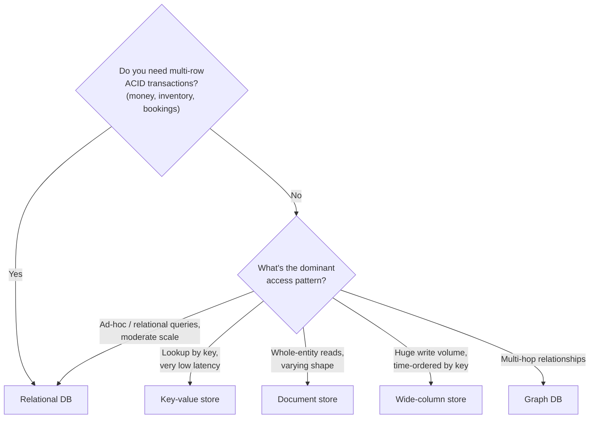
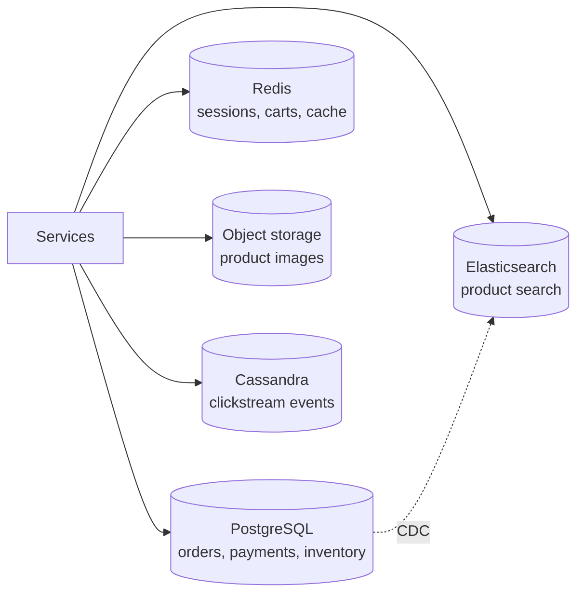

Choosing a database is one of the most consequential decisions in a design — data outlives code, and migrating stores later is painful. In interviews, "SQL or NoSQL?" is less a question about technology than about whether you understand your **data model**, **access patterns**, and **consistency needs**.

The right way to frame it is not "SQL vs NoSQL", but: *what are the queries, how much data, how fast does it grow, and what guarantees do I need?*

## Relational databases (SQL)

Relational databases (PostgreSQL, MySQL, Oracle, SQL Server) store data in **tables** of rows and columns with a fixed **schema**. Relationships are expressed via **foreign keys** and combined at query time with **joins**.

```sql
SELECT o.id, o.total, u.email
FROM orders o
JOIN users u ON u.id = o.user_id
WHERE o.created_at > now() - interval '7 days'
  AND o.status = 'PAID';
```

### What makes them powerful

**ACID transactions**

| Property | Meaning | Example |
| --- | --- | --- |
| **Atomicity** | All operations in a transaction succeed, or none do | Debit account A *and* credit account B — never just one |
| **Consistency** | Transactions move the database between valid states (constraints hold) | Balance can't go negative if a CHECK constraint forbids it |
| **Isolation** | Concurrent transactions don't see each other's partial work | Two people buying the last ticket don't both succeed |
| **Durability** | Committed data survives crashes | Write-ahead log flushed to disk before commit returns |

**Flexible querying.** Because data is normalised and SQL is declarative, you can answer questions you didn't anticipate when designing the schema — ad-hoc reports, new features, analytics.

**Integrity.** Foreign keys, unique constraints and types prevent bad data at the storage layer.

**Maturity.** Decades of tooling, operational knowledge, and battle-tested replication.

### Where they struggle

- **Horizontal write scaling.** A single primary handles writes; sharding a relational database is possible (Vitess, Citus, application-level sharding) but cross-shard joins and transactions become hard.
- **Schema changes on huge tables** can be slow and need careful online-migration tooling.
- **Rigid structure** for highly variable or deeply nested data.

<Callout type="note" title="Isolation levels — a quick reference">
Most databases default to a weaker level than *serializable* for performance. **Read Committed** (PostgreSQL default) prevents dirty reads. **Repeatable Read** (MySQL InnoDB default) also prevents non-repeatable reads. **Serializable** prevents all anomalies, including write skew, at the cost of more aborts/locking. If a design relies on "two users can't both book the last seat", say how — a unique constraint, `SELECT … FOR UPDATE`, optimistic locking with a version column, or serializable isolation.
</Callout>

## NoSQL families

"NoSQL" is an umbrella for non-relational stores. They are not one thing — each family optimises for a different access pattern.

### Key-value stores

The simplest model: `get(key)`, `put(key, value)`, `delete(key)`. The value is opaque to the database.

- **Examples:** Redis, Memcached (in-memory), DynamoDB (also document-ish), RocksDB (embedded), etcd.
- **Strengths:** extremely fast, trivially partitionable by key, predictable latency.
- **Weaknesses:** no queries by value; no relationships.
- **Use for:** caching, sessions, feature flags, rate-limit counters, shopping carts, leaderboards (Redis sorted sets).

### Document stores

Store semi-structured documents (JSON/BSON), queryable by fields inside them.

```json
{
  "_id": "order_812",
  "userId": "u_42",
  "status": "PAID",
  "items": [
    { "sku": "BK-101", "qty": 2, "price": 450 },
    { "sku": "PN-007", "qty": 1, "price": 120 }
  ],
  "shipping": { "city": "Pune", "pin": "411001" }
}
```

- **Examples:** MongoDB, Couchbase, Firestore, DynamoDB.
- **Strengths:** flexible schema; data that's read together is stored together (no joins for the common case); maps naturally to objects in code.
- **Weaknesses:** many-to-many relationships are awkward; duplicating data across documents means updates must touch many places.
- **Use for:** product catalogues, content management, user profiles, any entity that's mostly read and written as a whole.

### Wide-column stores

Rows are identified by a **partition key**, and within a partition data is sorted by a **clustering key**. Designed for massive write throughput and scale across many nodes.

```text
Table: messages_by_channel
  Partition key:  channel_id
  Clustering key: message_id (time-ordered, descending)

channel_id=42 → [msg_9001, msg_9000, msg_8999, ...]   ← one partition, sorted
```

- **Examples:** Apache Cassandra, ScyllaDB, HBase, Google Bigtable.
- **Strengths:** linear horizontal scalability, very high write throughput (LSM-tree storage), tunable consistency, multi-datacenter replication.
- **Weaknesses:** you must **design tables around queries** — queries that don't use the partition key are expensive or impossible; no joins; limited transactions.
- **Use for:** time-series data, messaging, activity feeds, IoT telemetry, event logs.

<Callout type="example">
Discord stores trillions of messages in a wide-column store (moving from Cassandra to ScyllaDB), partitioned by channel and time bucket, because the dominant query is "the most recent messages in this channel".
</Callout>

### Graph databases

Store **nodes** and **edges** as first-class entities, optimised for traversing relationships.

- **Examples:** Neo4j, Amazon Neptune, JanusGraph.
- **Strengths:** queries like "friends of friends who like X" or "shortest path" are efficient regardless of graph size.
- **Weaknesses:** harder to shard; niche operational expertise.
- **Use for:** social graphs, recommendation engines, fraud detection rings, knowledge graphs.

Note: many large social networks (e.g., Facebook's TAO) store graph data in sharded MySQL with a caching layer rather than in a graph database — because the hot queries are simple one-hop lookups at enormous scale.

### Other specialised stores

| Need | Store type | Examples |
| --- | --- | --- |
| Full-text search, relevance ranking | Search engine (inverted index) | Elasticsearch, OpenSearch, Solr |
| Metrics over time | Time-series database | Prometheus, InfluxDB, TimescaleDB |
| Large files (images, video, backups) | Object/blob storage | Amazon S3, GCS, Azure Blob |
| Analytical queries over huge datasets | Columnar data warehouse | BigQuery, Snowflake, Redshift, ClickHouse |
| Geospatial queries | Spatial index | PostGIS, Redis GEO, Elasticsearch geo |

## Side-by-side comparison

| | Relational | Key-value | Document | Wide-column | Graph |
| --- | --- | --- | --- | --- | --- |
| Data model | Tables, rows | Key → blob | JSON documents | Partitioned, sorted rows | Nodes + edges |
| Schema | Strict | None | Flexible | Per table, flexible columns | Flexible |
| Query power | Very high (SQL, joins) | Lookup by key | Rich within a document | By partition key (+ range on clustering key) | Traversals |
| Transactions | Full ACID | Single key | Usually single-document; some multi-document | Limited (lightweight transactions) | Varies |
| Horizontal scaling | Hard (sharding) | Easy | Moderate–easy | Easy | Hard |
| Typical consistency | Strong | Varies | Tunable | Tunable (often eventual) | Strong (single node) |

## How to choose

Ask these questions in order:



1. **What are the access patterns?** List the top queries. If they're "get X by ID" and "list Y for Z ordered by time", many stores work. If they're unpredictable or involve joins across entities, prefer relational.
2. **What consistency is required?** Money, inventory and bookings need transactions → relational (or a NewSQL store).
3. **What's the scale?** Most systems fit comfortably in PostgreSQL with replicas. If you need hundreds of thousands of writes per second or petabytes, look at wide-column or sharded stores.
4. **How does the schema evolve?** Highly variable attributes (e.g., product specs differ per category) suit document stores — though PostgreSQL's `JSONB` covers many such cases.
5. **What does the team know?** Operational familiarity is a legitimate factor in the real world.

<Callout type="tip" title="Default to relational, deviate with a reason">
A strong default in interviews: "I'll start with PostgreSQL because the data is relational and we need transactions for X. If we hit write-scaling limits on Y, that specific dataset could move to Cassandra." Choosing NoSQL "because it scales" without naming the access pattern is a red flag.
</Callout>

## Polyglot persistence

Large systems usually use several stores, each for what it does best. An e-commerce platform might use:



The cost: data must be kept in sync between stores — typically via **change data capture (CDC)** or events from the source of truth — and each store adds operational burden.

## NewSQL: the middle ground

**Distributed SQL** databases — Google Spanner, CockroachDB, YugabyteDB, TiDB — offer SQL, ACID transactions, *and* horizontal scaling, by combining sharding with consensus replication (Raft/Paxos). The trade-offs: higher write latency (each write needs a quorum, possibly across regions), operational complexity, and cost. They're a good answer when an interviewer pushes on "you need transactions *and* global scale".

## Interview questions

<QA q="Design a banking ledger. SQL or NoSQL?">
Relational. A ledger needs atomic multi-row updates (a transfer debits one account and credits another), strong consistency (no double-spending), constraints, and auditability. Use double-entry bookkeeping with an append-only entries table, transactions with appropriate isolation, and idempotency keys for retries. At very large scale, shard by account ID and handle cross-shard transfers with a saga or a distributed SQL database.
</QA>

<QA q="Why do wide-column stores require you to design tables around queries?">
Data is distributed across nodes by partition key and sorted within each partition by clustering key. A query that specifies the partition key goes to a single node and reads a contiguous range — fast. A query that doesn't would have to scan every partition on every node. With no joins, each query pattern typically gets its own denormalised table (e.g., `messages_by_channel` and `messages_by_user`), and writes go to all relevant tables.
</QA>

<QA q="What are the downsides of denormalisation in a document store?">
Duplicated data must be updated in many places: if a user's name is embedded in every comment they wrote, renaming the user means updating thousands of documents, and without multi-document transactions some may be stale for a while. Documents can also grow unboundedly (e.g., embedding all comments in a post), hurting performance. The rule of thumb: embed data that's read together and owned by the parent; reference data that's shared or unbounded.
</QA>

<QA q="Can you get transactions in NoSQL databases?">
Increasingly yes, but with limits. MongoDB supports multi-document ACID transactions (with performance cost). DynamoDB has transactional APIs across up to 100 items. Cassandra has lightweight transactions (compare-and-set via Paxos) on a single partition. None of these are as general or cheap as relational transactions, so designs still minimise cross-entity atomicity in NoSQL.
</QA>

## Practice

Write your answer before opening the suggested one. If you mark it "Partly" or "Missed it", it comes back in your review deck.

<Practice task="Pick a database for each and justify it in one sentence: (a) a bank's account balances, (b) a session store with 500K reads/s, (c) IoT sensor readings at 1M writes/s, (d) a social graph queried for friends of friends.">

(a) A relational database (PostgreSQL): ACID transactions, constraints and strong consistency matter more than anything else for money.

(b) A key-value store (Redis): simple get and set by key from memory, with a TTL, at very high throughput.

(c) A wide-column or time-series store (Cassandra, or a time-series database): designed for huge, append-heavy write rates, partitioned by sensor and time.

(d) A graph database (Neo4j), or a relational database with careful indexes if the graph is small: multi-hop traversals are what graph databases are built for.

Saying why in terms of access patterns and guarantees is what the interviewer wants to hear.

</Practice>

<Takeaways>

- Choose a store based on access patterns, consistency needs and scale — not on labels.
- Relational databases give ACID transactions, joins and flexible querying; they're harder to scale for writes.
- Key-value for fast lookups, document for whole-entity access, wide-column for massive time-ordered writes, graph for multi-hop relationships.
- Default to relational and justify any deviation with a specific requirement.
- Real systems are polyglot; keep stores in sync via CDC or events from a single source of truth.

</Takeaways>

## Further reading

- Martin Kleppmann, *Designing Data-Intensive Applications* — ch. 2, "Data Models and Query Languages".
- DeCandia et al., "Dynamo: Amazon's Highly Available Key-value Store" (SOSP 2007).
- Chang et al., "Bigtable: A Distributed Storage System for Structured Data" (OSDI 2006).
- Bronson et al., "TAO: Facebook's Distributed Data Store for the Social Graph" (USENIX ATC 2013).
- Corbett et al., "Spanner: Google's Globally-Distributed Database" (OSDI 2012).
- Discord Engineering, "How Discord Stores Trillions of Messages" (2023).
