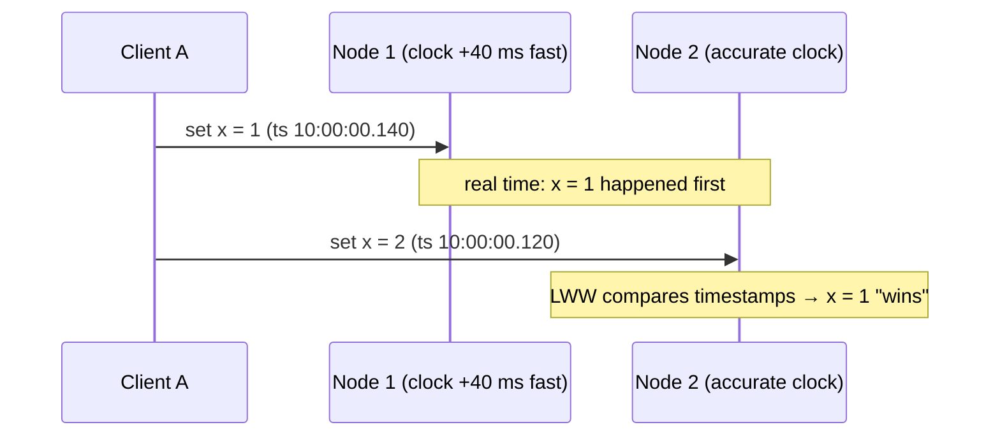

"Which happened first?" is a trivial question on one machine and a surprisingly hard one across many. Clocks on different machines disagree, messages are delayed unpredictably, and a timestamp from one server can't be blindly compared with a timestamp from another. Many subtle bugs — lost writes under last-write-wins, broken lock expiry, out-of-order events — come from trusting clocks too much.

## Two kinds of clocks

- **Time-of-day (wall) clock** — returns the current date and time (`System.currentTimeMillis()`, `clock_gettime(CLOCK_REALTIME)`). Synchronised with NTP, so it can **jump backwards or forwards** when corrected, and repeats or skips during leap-second handling.
- **Monotonic clock** — only ever moves forward (`System.nanoTime()`, `CLOCK_MONOTONIC`). Meaningless as an absolute time and not comparable across machines, but correct for **measuring durations** on one machine.

<Callout type="tip">
Use the monotonic clock for timeouts, latency measurement and lease durations on a single machine. Use wall-clock time only for displaying times to humans or coarse ordering where small errors are acceptable.
</Callout>

## Why physical clocks can't be trusted for ordering

- **Clock skew** — machines' clocks drift (quartz oscillators drift on the order of tens of parts per million — seconds per day if never corrected). NTP typically keeps servers within a few milliseconds of each other on a good network, but can be much worse on congested networks, VMs, or after misconfiguration.
- **Jumps** — NTP corrections can move a clock backwards, so "later" events can get earlier timestamps.
- **Pauses** — a process can be paused for seconds (GC, VM migration, CPU starvation) between reading the clock and acting on it.

### The last-write-wins hazard



The write that really happened later is discarded because it got a smaller timestamp from a slower clock. Systems that use LWW with wall-clock timestamps (Cassandra by default) can silently lose writes under skew.

## Logical clocks

Logical clocks capture **causality** — "could event A have influenced event B?" — without relying on physical time.

### Happens-before

Leslie Lamport's 1978 definition: A **happens before** B (A → B) if A and B are on the same process and A came first, or A is sending a message and B is receiving it, or there's a chain of such relations. If neither A → B nor B → A, the events are **concurrent** — neither could have known about the other.

### Lamport timestamps

Each node keeps a counter:

1. Increment the counter before each local event.
2. Attach the counter to every message sent.
3. On receiving a message, set `counter = max(local, received) + 1`.

Order events by `(counter, node_id)` to get a **total order consistent with causality**: if A → B then `L(A) < L(B)`.

The limitation: the converse isn't true. `L(A) < L(B)` doesn't tell you whether A caused B or they were concurrent. Lamport timestamps can order events, but **can't detect concurrency**.

### Vector clocks

Each node keeps a vector with one counter per node. A node increments its own entry on each event and, on receive, takes the element-wise maximum of its vector and the incoming one (then increments its own entry).

Compare two vectors V and W:

- V ≤ W in every position (and V ≠ W) → V **happened before** W.
- Neither dominates → the events are **concurrent** — a genuine conflict.

```text
Node A writes x:          [A:1, B:0]
Node B writes x (unaware): [A:0, B:1]
Neither dominates → concurrent writes → keep both as siblings, or merge
```

Vector clocks (and the related **version vectors** used per key in data stores) let systems like Dynamo and Riak **detect** concurrent writes instead of silently dropping one. The cost: vector size grows with the number of writers, so systems prune or bound them.

| | Lamport timestamp | Vector clock |
| --- | --- | --- |
| Size | One integer | One integer per node/writer |
| Captures causality (A → B implies smaller) | Yes | Yes |
| Detects concurrency | No | Yes |
| Typical use | Total ordering, log sequencing, Raft-style terms | Conflict detection in multi-writer replication |

## Hybrid logical clocks (HLC)

HLCs combine a physical timestamp with a logical counter: they stay close to wall-clock time (useful for humans and for "as of time T" queries) but never go backwards and always respect causality. They fit in 64 bits. Used by CockroachDB, YugabyteDB and MongoDB for ordering transactions across nodes.

## Bounded uncertainty: TrueTime

Google Spanner takes a different route: **TrueTime** uses GPS receivers and atomic clocks in every data centre to expose time as an interval `[earliest, latest]`, with uncertainty typically under a few milliseconds. To commit a transaction with timestamp *t*, Spanner **waits out the uncertainty** ("commit wait") so that *t* is guaranteed to be in the past on every node before the commit becomes visible. That gives globally consistent (externally consistent) ordering, paid for with a few milliseconds of latency per write and specialised hardware.

## Practical ordering techniques in designs

| Need | Technique |
| --- | --- |
| Order of messages within a conversation/entity | A **single sequencer per entity**: a per-conversation counter or a partition leader assigning increasing sequence numbers (Kafka offsets per partition) |
| Unique, roughly time-ordered IDs | **Snowflake / ULID / UUIDv7** — timestamp prefix + node ID + sequence. Sortable by time, but only *approximately* ordered across nodes. See [Unique ID Generation](/system-design/hld/unique-id-generation). |
| Detect conflicting concurrent updates | **Version vectors**, or a version column with compare-and-set |
| Avoid lost updates from stale holders | **Fencing tokens** — monotonically increasing numbers issued by a lock service. See [Consensus](/system-design/hld/consensus). |
| Global total order of all operations | **Consensus** (Raft/Paxos) — expensive; use only where required |

<Callout type="interview">
In a chat design, if asked "how do you order messages?", don't say "by timestamp". Say: "Each conversation's messages are sequenced by the server — a per-conversation sequence number assigned by the partition owning that conversation. Client timestamps are only used for display." That shows you understand clock skew.
</Callout>

## Interview questions

<QA q="Why is it dangerous to order events across servers by wall-clock timestamps?">
Server clocks drift and are corrected by NTP, so they can be skewed by milliseconds or more and can even jump backwards. Two events on different machines can therefore get timestamps in the opposite order from reality. With last-write-wins conflict resolution this silently discards the genuinely later write; for ordered logs it produces impossible sequences (a reply before the message). Use sequence numbers from a single authority per entity, logical clocks, or bounded-uncertainty clocks.
</QA>

<QA q="What's the difference between Lamport clocks and vector clocks?">
Both respect causality: if A happened before B, A's clock value is less than B's. A Lamport clock is a single counter, so it produces a total order but can't tell whether two events were causally related or concurrent. A vector clock keeps a counter per node; by comparing vectors you can tell that A happened before B, B before A, or that they're concurrent — enabling conflict detection, at the cost of larger metadata.
</QA>

<QA q="How does Spanner achieve externally consistent transactions across the globe?">
TrueTime gives every node the current time as an interval with bounded uncertainty, backed by GPS and atomic clocks. A transaction picks a commit timestamp and then waits until that timestamp is definitely in the past everywhere (commit wait, roughly the uncertainty bound) before making the commit visible. Combined with Paxos-replicated shards and two-phase commit across shards, this means if transaction T1 commits before T2 starts in real time, T1's timestamp is smaller — globally.
</QA>

## Practice

Write your answer before opening the suggested one. If you mark it "Partly" or "Missed it", it comes back in your review deck.

<Practice task="Two servers record events with their local clocks. Server B's clock is 300 ms behind A's. A user's 'delete post' on B has a timestamp earlier than their 'edit post' on A, even though the delete came later. What goes wrong with last-write-wins, and what can you use instead?">

With last-write-wins by timestamp, the edit (later timestamp) wins over the delete, so a deleted post comes back. Physical clocks drift and NTP corrections can even move them backwards, so timestamps from different machines cannot order events reliably.

Alternatives:
1. Route all writes for one post through one place (the post's partition leader) and use its sequence numbers.
2. Logical clocks: Lamport timestamps give an order consistent with causality; vector clocks also detect truly concurrent edits so you can resolve them deliberately.
3. Hybrid logical clocks combine physical time (readable, close to real time) with a logical counter, so causally later events always get larger timestamps.
4. Make deletes win (tombstones) as a rule, if that matches the product.

</Practice>

<Takeaways>

- Use monotonic clocks for durations, wall clocks only where small errors are acceptable.
- Wall clocks skew and jump, so cross-machine timestamp ordering — and last-write-wins — can lose data.
- Lamport timestamps give a causality-respecting total order; vector clocks additionally detect concurrency.
- HLCs and TrueTime combine physical and logical time for ordering in distributed databases.
- In designs, order per entity with a single sequencer, and use fencing tokens against stale actors.

</Takeaways>

## Further reading

- Leslie Lamport, "Time, Clocks, and the Ordering of Events in a Distributed System" (CACM, 1978).
- Kulkarni et al., "Logical Physical Clocks and Consistent Snapshots in Globally Distributed Databases" (2014) — hybrid logical clocks.
- Corbett et al., "Spanner: Google's Globally-Distributed Database" (OSDI 2012) — TrueTime and commit wait.
- Martin Kleppmann, *Designing Data-Intensive Applications* — ch. 8, "The Trouble with Distributed Systems".
- Related: [Consistency Models](/system-design/hld/consistency-models), [Design a Chat System](/system-design/hld/design-chat-system).
