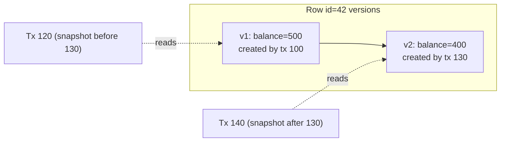

The moment two users can touch the same data at the same time, correctness depends on **concurrency control**. Can two people book the last seat? Can a transfer leave money in neither account? Can a report see half of an update? Transactions and isolation levels are the database's answers — and knowing *exactly* what each level does and doesn't prevent is a frequent senior-level interview probe.

## What a transaction gives you

A **transaction** groups several reads and writes into one logical unit with ACID guarantees:

- **Atomicity** — all-or-nothing. If anything fails, every write in the transaction is rolled back. (Implemented with an undo log or by never exposing uncommitted versions.)
- **Consistency** — the application's invariants hold before and after. This is mostly the *application's* job; the database helps with constraints (foreign keys, unique, check).
- **Isolation** — concurrent transactions don't interfere. How strongly depends on the isolation level — the subject of this lesson.
- **Durability** — once committed, data survives crashes. Implemented with a **write-ahead log (WAL)** flushed to disk (and, in replicated systems, to other nodes) before commit returns.

<Callout type="note">
Atomicity is about **failures** (crash mid-transaction → nothing applied). Isolation is about **concurrency** (two transactions at once → no weird interleavings). People often mix them up in interviews.
</Callout>

## The anomalies

Isolation levels are defined by which anomalies they allow. Learn these with an example each.

### Dirty read

Reading data another transaction has written but **not yet committed**. If that transaction aborts, you acted on data that never existed.

### Dirty write

Overwriting another transaction's **uncommitted** write. Almost every database prevents this (row locks held until commit).

### Non-repeatable read (read skew)

Reading the same row twice in one transaction and getting different values because another transaction committed in between.

```text
T1: SELECT balance FROM acct WHERE id = A   → 500
T2: transfer 100 from A to B; COMMIT
T1: SELECT balance FROM acct WHERE id = B   → 600 (already includes the 100)
T1 sees total = 1,100 instead of 1,000 — a backup or report taken now is wrong.
```

### Lost update

Two transactions read-modify-write the same value; one update silently overwrites the other.

```text
counter = 10
T1: read 10          T2: read 10
T1: write 11         T2: write 11      → final 11, but two increments happened
```

### Write skew

Two transactions read the **same set of rows**, each makes a decision based on what it read, and each writes to a **different** row. Individually valid; together they break an invariant.

```text
Rule: at least one doctor must be on call.  Alice and Bob are both on call.
T1 (Alice): SELECT count(*) WHERE on_call → 2, OK to leave → UPDATE alice SET on_call = false
T2 (Bob):   SELECT count(*) WHERE on_call → 2, OK to leave → UPDATE bob   SET on_call = false
Both commit → nobody is on call.
```

No row was written by both transactions, so row locks don't help. This is the anomaly that catches most engineers out.

### Phantom read

A transaction's query matches a *set* of rows defined by a condition; another transaction inserts a row that would have matched. Write skew often happens via phantoms — e.g., two bookings for the same meeting room and time slot, where the check is "no existing booking overlaps".

## Isolation levels

| Level | Dirty read | Non-repeatable read | Lost update | Write skew / phantoms | Notes |
| --- | --- | --- | --- | --- | --- |
| Read Uncommitted | Possible | Possible | Possible | Possible | Rarely used |
| **Read Committed** | Prevented | Possible | Possible | Possible | **PostgreSQL, Oracle, SQL Server default** |
| **Repeatable Read / Snapshot Isolation** | Prevented | Prevented | Depends on DB (see note) | Possible | **MySQL InnoDB default**; PostgreSQL "Repeatable Read" is snapshot isolation |
| **Serializable** | Prevented | Prevented | Prevented | Prevented | Strongest; costs aborts or locking |

<Callout type="warning" title="Level names lie">
The SQL standard's names don't map cleanly onto real implementations. PostgreSQL's Repeatable Read is snapshot isolation and **detects** lost updates (it aborts one transaction with a serialization error). MySQL InnoDB's Repeatable Read does **not** detect lost updates for plain read-then-write — you need `SELECT … FOR UPDATE`. Oracle's "Serializable" is actually snapshot isolation and allows write skew. Always ask *which anomalies* a level prevents in *this* database.
</Callout>

## How databases implement isolation

### MVCC — multi-version concurrency control

Instead of overwriting a row in place, the database keeps **multiple versions**, each tagged with the transaction ID that created (and later deleted) it. Each transaction reads from a consistent **snapshot**: it sees only versions committed before its snapshot was taken.



- **Readers never block writers, and writers never block readers** — the main reason MVCC dominates (PostgreSQL, MySQL InnoDB, Oracle, SQL Server snapshot mode, CockroachDB).
- Under **Read Committed**, a new snapshot is taken for each statement; under **Snapshot Isolation**, one snapshot for the whole transaction.
- Old versions must be garbage-collected (PostgreSQL's `VACUUM`, InnoDB's purge of undo logs). Long-running transactions prevent cleanup and cause table bloat — a real production issue.

### Two-phase locking (2PL)

The classic way to get serializability: transactions acquire **shared locks** to read and **exclusive locks** to write, and hold all locks until commit. To prevent phantoms, databases also lock **ranges** (predicate or index-range / next-key locks).

- Correct, but readers and writers block each other, throughput drops under contention, and **deadlocks** occur (the database detects cycles and aborts one transaction).
- Used for MySQL InnoDB's Serializable level and SQL Server's lock-based serializable.

### Serializable Snapshot Isolation (SSI)

An optimistic approach (PostgreSQL's Serializable level since 9.1, also CockroachDB). Transactions run on snapshots without blocking; the database tracks read/write dependencies and **aborts** a transaction at commit time if committing it could produce a non-serializable outcome. Great when conflicts are rare; under heavy contention, abort-and-retry rates rise.

### Actual serial execution

Run transactions one at a time on a single thread, with all data in memory and transactions submitted as stored procedures (VoltDB, Redis's single-threaded command execution, Redis Lua scripts). No concurrency anomalies at all — but throughput is limited to one core per partition.

## Practical tools for application code

You won't always run at Serializable. These techniques solve specific anomalies at lower cost:

| Problem | Technique | Example |
| --- | --- | --- |
| Lost update on a counter | **Atomic operation** | `UPDATE posts SET likes = likes + 1 WHERE id = ?` |
| Lost update on read-modify-write | **Pessimistic lock** | `SELECT … FROM accounts WHERE id = ? FOR UPDATE`, then update, commit |
| Lost update, low contention | **Optimistic concurrency control** (version column / compare-and-set) | `UPDATE doc SET body = ?, version = 8 WHERE id = ? AND version = 7` → 0 rows means retry |
| Double booking / uniqueness | **Unique constraint** | Unique index on `(seat_id, show_id)` — the database rejects the second insert |
| Write skew on a condition | **Materialise the conflict** or lock the rows read | Lock both doctors' rows with `FOR UPDATE`; or create a row per time slot and lock it |
| Invariants across many rows | **Serializable isolation** | Let SSI/2PL detect the conflict and retry the aborted transaction |

### Optimistic vs pessimistic concurrency

| | Optimistic (version check / SSI) | Pessimistic (locks) |
| --- | --- | --- |
| Assumption | Conflicts are rare | Conflicts are common |
| Cost when no conflict | Very low | Lock overhead, possible waiting |
| Cost on conflict | Abort and retry the whole operation | Waiting; deadlock risk |
| Good for | Editing documents, profile updates, most web CRUD | Hot rows: inventory of a flash-sale item, seat holds, account balances under heavy load |

<Callout type="interview">
When your design has a contention point — the last seat, the last unit of stock, a wallet balance — **say exactly how you prevent the anomaly**: "I'll use a conditional update `UPDATE inventory SET qty = qty - 1 WHERE sku = ? AND qty > 0` and check the affected row count. It's atomic, needs no explicit lock, and can't oversell." This is far stronger than "I'll use a transaction".
</Callout>

## Transactions in distributed and NoSQL systems

- A transaction **within one database node or shard** is cheap and well understood.
- A transaction **across shards or services** needs coordination — two-phase commit, or a saga with compensations. See [Distributed Transactions](/system-design/hld/distributed-transactions).
- Many NoSQL stores restrict atomicity to a single item or partition (DynamoDB items, Cassandra partitions with lightweight transactions, MongoDB documents) — so you **design the data model so that things that must change together live together**.
- Distributed SQL databases (Spanner, CockroachDB, YugabyteDB) provide serializable transactions across shards using consensus and carefully synchronised clocks, at the cost of extra latency.

## Interview questions

<QA q="Two users click 'Book' on the last seat at the same moment. Walk through how you prevent a double booking.">
Make the database enforce it atomically. Options: (1) a unique constraint on (show_id, seat_id) in a bookings table — the second insert fails; (2) a conditional update on the seat row, `UPDATE seats SET status = 'HELD', holder = ? WHERE id = ? AND status = 'AVAILABLE'`, and check that exactly one row was affected; (3) `SELECT … FOR UPDATE` on the seat row inside a transaction. Options 1 and 2 avoid long-held locks and work well under contention. Application-level "check then insert" without one of these is a race condition.
</QA>

<QA q="What is write skew and why doesn't snapshot isolation prevent it?">
Write skew is when two concurrent transactions read an overlapping set of data, each decides based on what it read, and each writes to a different object, together violating an invariant (e.g., both on-call doctors go off call). Snapshot isolation only detects conflicts when two transactions write the same object; here the writes are to different rows, so both commit. Prevent it with Serializable isolation (SSI or 2PL), by explicitly locking the rows the decision depends on (FOR UPDATE), or by materialising the conflict into a single row that both transactions must update.
</QA>

<QA q="What's MVCC and why do most databases use it?">
Multi-version concurrency control keeps several versions of each row tagged with transaction IDs, and each transaction reads from a consistent snapshot of committed versions. Readers don't block writers and writers don't block readers, which gives high concurrency for mixed read/write workloads and makes consistent long-running reads (backups, reports) possible. The cost is storing old versions and garbage-collecting them; long-running transactions delay cleanup and cause bloat.
</QA>

<QA q="When would you choose optimistic over pessimistic locking?">
Optimistic when conflicts are rare and retrying is cheap — typical web CRUD, document edits, profile updates. You avoid lock overhead and deadlocks and only pay on actual conflict. Pessimistic when the same rows are contended heavily — flash-sale inventory, seat holds, hot account balances — because optimistic retries would mostly fail and waste work, whereas a short lock serialises access efficiently.
</QA>

<Takeaways>

- ACID: atomicity handles failures, isolation handles concurrency, durability comes from the WAL.
- Know the anomalies: dirty reads, non-repeatable reads, lost updates, write skew, phantoms.
- Read Committed is the common default; snapshot isolation adds consistent reads; only Serializable prevents write skew.
- MVCC lets readers and writers proceed without blocking; 2PL and SSI provide serializability by locking or by detecting conflicts.
- In designs, name the exact mechanism at each contention point: atomic update, conditional write, unique constraint, FOR UPDATE, or serializable retry.

</Takeaways>

## Further reading

- Martin Kleppmann, *Designing Data-Intensive Applications* — ch. 7, "Transactions".
- Berenson et al., "A Critique of ANSI SQL Isolation Levels" (SIGMOD 1995) — defines snapshot isolation and the anomalies.
- Ports and Grittner, "Serializable Snapshot Isolation in PostgreSQL" (VLDB 2012).
- [Hermitage](https://github.com/ept/hermitage) — Kleppmann's tests of what each database's isolation levels actually prevent.
- Related: [Distributed Transactions](/system-design/hld/distributed-transactions), [Design a Ticket Booking System](/system-design/hld/design-ticket-booking).
