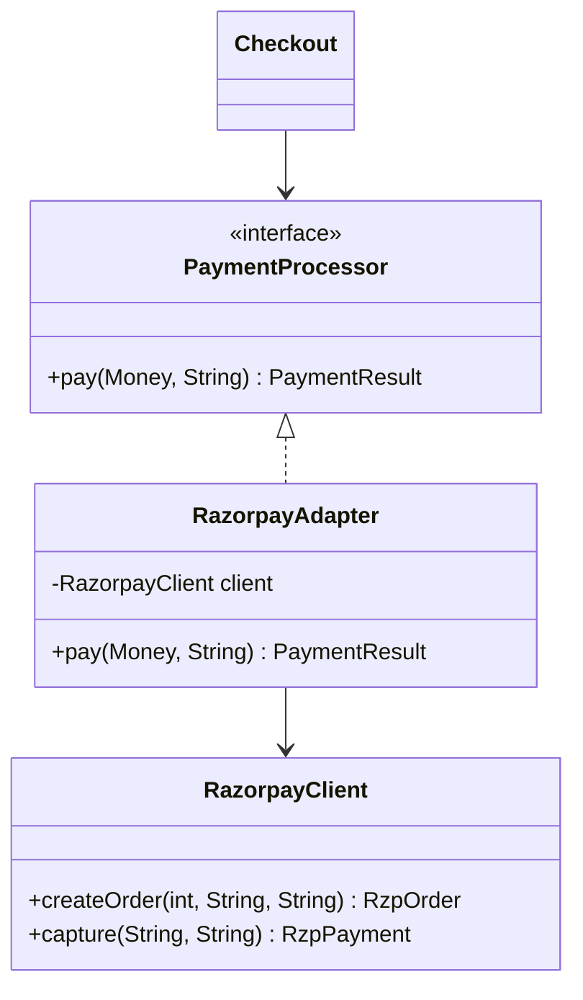

## The idea in plain words

Your code expects one interface. A class you want to use, often from a third-party library, offers a **different** one. An **Adapter** is a small wrapper that translates between them, so neither side has to change.

**Picture it:** a travel plug adapter. Your Indian charger has round pins, the hotel wall in London has square holes. You don't rewire the charger or the wall. You put a small adapter in between.

### The smallest example

```java
interface PaymentGateway { boolean pay(String orderId, long paise); }   // what our code expects

class QuickPaySdk {                                                    // third-party: we can't edit it
    String makePayment(double rupees, String reference) { return "SUCCESS"; }
}

class QuickPayAdapter implements PaymentGateway {
    private final QuickPaySdk sdk = new QuickPaySdk();

    public boolean pay(String orderId, long paise) {
        String status = sdk.makePayment(paise / 100.0, orderId);   // translate units and argument order
        return status.equals("SUCCESS");                            // translate the answer back
    }
}

class Demo {
    public static void main(String[] args) {
        PaymentGateway gateway = new QuickPayAdapter();             // checkout only sees PaymentGateway
        System.out.println(gateway.pay("ORD-7", 49_900));           // true
    }
}
```

If you switch to another provider later, you write one more adapter. Checkout code stays the same.

| Use it when | Skip it when |
| --- | --- |
| You must plug in code whose interface you can't change (SDKs, legacy modules) | You own both sides: just change the interface |

The rest of this lesson shows a realistic integration and how Adapter differs from Facade, Proxy and Decorator.

**The textbook definition:** convert the interface of a class into another interface clients expect, so classes with incompatible interfaces can work together.

Adapter is one of the most practical patterns in real systems: every time you integrate a third-party SDK, a legacy module or an external API, you're writing an adapter — whether you call it that or not.

## The problem

Your checkout depends on your own abstraction:

```java
public interface PaymentProcessor {
    PaymentResult pay(Money amount, String customerId);
}
```

Now you must integrate a vendor SDK you can't modify, with a completely different shape:

```java
// Third-party SDK (can't change)
public class RazorpayClient {
    public RzpOrder createOrder(int amountInPaise, String currency, String receipt) { ... }
    public RzpPayment capture(String orderId, String customerToken) { ... }
}
```

Changing your checkout to call `RazorpayClient` directly would couple your business logic to a vendor (violating dependency inversion), and you'd repeat it for every provider.

## The solution: object adapter

Create a class that **implements your interface** and **wraps** the incompatible object, translating calls.



```java
public final class RazorpayAdapter implements PaymentProcessor {
    private final RazorpayClient client;

    public RazorpayAdapter(RazorpayClient client) { this.client = client; }

    @Override
    public PaymentResult pay(Money amount, String customerId) {
        // 1. Translate inputs into the vendor's model
        RzpOrder order = client.createOrder(
                Math.toIntExact(amount.minorUnits()), amount.currency().getCurrencyCode(),
                "rcpt-" + UUID.randomUUID());
        try {
            // 2. Call the vendor
            RzpPayment payment = client.capture(order.id(), tokenFor(customerId));
            // 3. Translate outputs back into our model
            return payment.isCaptured()
                    ? PaymentResult.success(payment.id())
                    : PaymentResult.failure(payment.errorCode());
        } catch (RzpException e) {
            // 4. Translate vendor exceptions into our domain's exceptions
            throw new PaymentGatewayException("Razorpay capture failed", e);
        }
    }
}
```

An adapter translates four things: **method names/shapes**, **data types and units** (₹ vs paise), **return values**, and **errors**. The rest of the system never sees vendor types.

## Class adapter (via inheritance)

The adapter can also **extend** the adaptee and implement the target interface:

```java
public class LegacyPrinterAdapter extends LegacyPrinter implements Printer {
    @Override public void print(Document d) { printRaw(d.toBytes()); }
}
```

| | Object adapter | Class adapter |
| --- | --- | --- |
| Mechanism | Composition (wraps an instance) | Inheritance (extends the adaptee) |
| Works with subclasses of adaptee | Yes | No — tied to one class |
| Can override adaptee behaviour | No (only wrap) | Yes |
| Java limitation | — | Only if adaptee isn't final and you don't need another superclass |
| Preferred | **Usually** | Rarely |

## Two-way and anti-corruption layers

At larger scale, a set of adapters protecting your domain model from an external system's model is called an **anti-corruption layer** (Domain-Driven Design). It's the same idea applied to a whole subsystem: your code speaks your language; translation happens at the boundary.

## Where you've seen it

- `Arrays.asList(array)` — adapts an array to the `List` interface.
- `InputStreamReader` — adapts a byte `InputStream` to a character `Reader`.
- `Collections.enumeration(collection)` / `Collections.list(enumeration)`.
- Spring MVC's `HandlerAdapter` — lets the dispatcher invoke very different kinds of handlers uniformly.
- SLF4J bindings — adapt a common logging API to Logback, Log4j, JUL.

## When to use

- Integrating a third-party library or legacy class whose interface doesn't match yours — and you don't control it.
- Supporting several providers of the same capability behind one interface (payment gateways, SMS providers, storage backends).
- Making old code usable from new code during a migration.

**Don't** use an adapter when you control both sides — just change the interface. Avoid adapters that silently drop important behaviour (a vendor's partial-success semantics squeezed into a boolean).

## Pros and cons

| Pros | Cons |
| --- | --- |
| Business logic stays independent of vendor APIs (SRP, DIP) | Extra layer and classes |
| New providers added without changing clients (OCP) | Lossy translation if interfaces differ semantically |
| Vendor upgrades are contained in one class | Can hide performance characteristics of the adaptee |

## Comparison with similar patterns

| Pattern | Interface relative to the wrapped object | Purpose |
| --- | --- | --- |
| **Adapter** | **Different** interface | Make incompatible things work together |
| **Decorator** | **Same** (or extended) interface | Add behaviour |
| **Proxy** | **Same** interface | Control access |
| **Facade** | **New, simplified** interface over **many** objects | Simplify a subsystem |
| **Bridge** | Designed up front | Let two hierarchies vary independently |

Adapter is typically applied **after the fact** to make existing things fit; Bridge is designed **up front**. Adapter usually wraps **one** object; Facade wraps a **subsystem**.

## Interview questions

<QA q="What's the difference between Adapter and Facade?">
An Adapter makes one existing interface usable where another interface is expected — it's about compatibility and usually wraps a single object. A Facade defines a new, simpler interface over a whole subsystem of objects to make it easier to use — it's about simplification and doesn't need to match any pre-existing interface.
</QA>

<QA q="How would you design payment integration for three providers so you can switch providers per merchant?">
Define a PaymentProcessor interface in the domain, write one adapter per provider that translates requests, responses, units and errors, and select the adapter per merchant via a factory or registry keyed by provider. The checkout depends only on the interface. Add a contract test suite run against every adapter to guarantee consistent behaviour (for example, idempotency and error mapping).
</QA>

<QA q="Object adapter or class adapter in Java — which and why?">
Object adapter in almost all cases: it uses composition, works with the adaptee and all its subclasses, doesn't require the adaptee to be non-final, and leaves the adapter free to extend something else. A class adapter only makes sense when you need to override some of the adaptee's protected behaviour and the adaptee is designed for extension.
</QA>

<Practice task="Your domain uses SmsSender.send(PhoneNumber to, String text) returning a SendResult. A vendor SDK offers sendMessage(countryCode, number, body) and throws VendorException with numeric error codes. List the adapter's responsibilities.">

Implement `SmsSender` in a `VendorSmsAdapter` that wraps the SDK client. Translate inputs (split `PhoneNumber` into country code and national number), call the SDK, translate the response into `SendResult`, and map `VendorException` codes into **your** error model: an invalid number is a permanent failure; rate limiting or a timeout is a transient failure the caller may retry. Vendor types never leak past the adapter. Add a contract test that every `SmsSender` implementation must pass.

</Practice>

<Takeaways>

- Adapter wraps an incompatible object and exposes the interface your code expects.
- Translate method shapes, data types/units, results and exceptions at the boundary.
- Prefer object adapters (composition) over class adapters (inheritance).
- Adapter changes the interface; Decorator keeps it and adds behaviour; Proxy keeps it and controls access; Facade simplifies many objects.

</Takeaways>

## Further reading

- Gamma et al., *Design Patterns* (1994) — Adapter.
- Eric Evans, *Domain-Driven Design* (2003) — Anti-Corruption Layer.
- Alexander Shvets, *Dive Into Design Patterns* — "Adapter".
