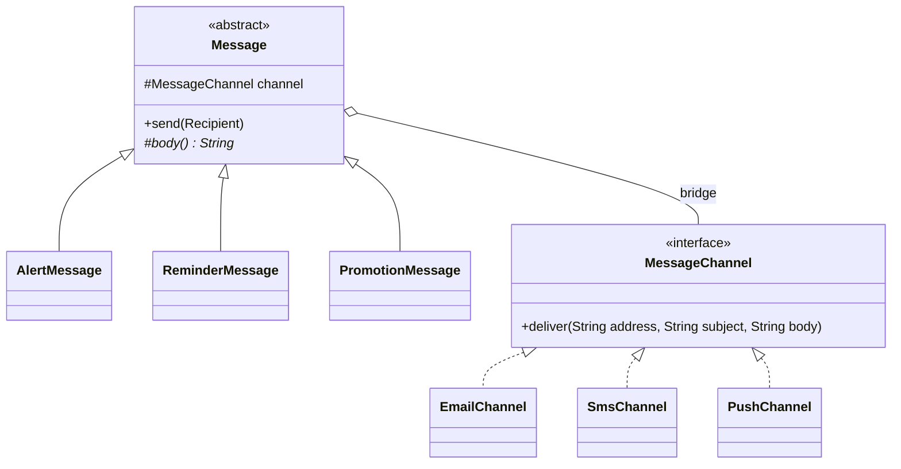

**Intent:** decouple an **abstraction** from its **implementation** so the two can vary independently — by splitting one class hierarchy that grows in two dimensions into two hierarchies connected by composition.

Bridge is the pattern people find most abstract. The key is to look for **two independent dimensions of variation** tangled into one inheritance tree.

## The problem: a hierarchy growing in two directions

You build a messaging feature with message **types** (alert, reminder, promotion) sent through **channels** (email, SMS, push). With inheritance:

```text
Message
├── AlertEmail, AlertSms, AlertPush
├── ReminderEmail, ReminderSms, ReminderPush
└── PromotionEmail, PromotionSms, PromotionPush       3 × 3 = 9 classes
```

Add WhatsApp → three more classes. Add a "receipt" type → four more. Logic for each channel is duplicated across every message type, and logic for each type across every channel.

## The solution

Recognise the two dimensions:

- **Abstraction** — what the client works with: the *kind* of message and its high-level behaviour (formatting, priority, retries).
- **Implementation** — the low-level *platform* doing the work: the delivery channel.

Make the abstraction **hold a reference** to an implementation interface and delegate low-level work to it. That reference is the "bridge".



```java
// Implementation side: low-level primitives
public interface MessageChannel {
    void deliver(String address, String subject, String body);
    String addressOf(Recipient r);
}

public final class SmsChannel implements MessageChannel {
    public void deliver(String phone, String subject, String body) { /* SMS gateway: no subject */ }
    public String addressOf(Recipient r) { return r.phone(); }
}

// Abstraction side: high-level behaviour, written once against the channel interface
public abstract class Message {
    protected final MessageChannel channel;
    protected Message(MessageChannel channel) { this.channel = channel; }

    public final void send(Recipient r) {
        channel.deliver(channel.addressOf(r), subject(), body());
    }

    protected abstract String subject();
    protected abstract String body();
}

public final class AlertMessage extends Message {
    private final String incident;
    public AlertMessage(MessageChannel channel, String incident) { super(channel); this.incident = incident; }
    protected String subject() { return "[ALERT] " + incident; }
    protected String body()    { return "Action required: " + incident; }
}

new AlertMessage(new SmsChannel(gateway), "Card used abroad").send(customer);
new AlertMessage(new PushChannel(fcm), "Card used abroad").send(customer);    // same abstraction, other channel
```

Now types and channels grow **additively**: 3 types + 3 channels = 6 classes, and adding WhatsApp is one class that works with every message type.

## Classic examples

- **Shapes × renderers**: `Circle`, `Square` (abstraction) drawn via `VectorRenderer` or `RasterRenderer` (implementation).
- **Remote controls × devices**: `BasicRemote`, `AdvancedRemote` controlling `Tv`, `Radio` through a `Device` interface.
- **JDBC**: your code uses the `java.sql` API (abstraction) while vendor drivers implement it (implementation) — the `DriverManager` connects them.
- **Logging façades**: SLF4J API (abstraction) over Logback/Log4j bindings (implementations).
- **Cross-platform UIs**: windows/widgets (abstraction) over OS-specific drawing APIs (implementation).

## Bridge vs Strategy vs Adapter vs State

These all use composition and look similar on a class diagram. The difference is intent:

| Pattern | Why the delegated object exists |
| --- | --- |
| **Bridge** | Separate two **dimensions of a design** so both hierarchies can grow independently — decided **up front** |
| **Strategy** | Swap one **algorithm** inside a context, often at runtime |
| **State** | Change behaviour as the object's **internal state** changes; states may switch each other |
| **Adapter** | Make an **existing**, incompatible interface fit — applied **after the fact** |

A pattern names the *problem* it solves, not just a shape of code. Saying "this is Bridge because messages and channels vary independently" communicates more than "it's composition".

## Combinations

- **Abstract Factory + Bridge**: when certain abstractions only work with certain implementations, an abstract factory can create matching pairs and hide that pairing.
- **Builder + Bridge**: a director (abstraction) can drive different builders (implementations).

## Pros and cons

| Pros | Cons |
| --- | --- |
| Avoids combinatorial subclass explosion | Extra indirection; harder to grasp for simple cases |
| Abstraction and implementation evolve independently (OCP) | Requires identifying the right split up front |
| Client sees only the high-level abstraction; platform details hidden | Overkill when there's really only one dimension |

<Callout type="interview">
The moment you notice class names that are a **cross product** — `PdfInvoice`, `HtmlInvoice`, `PdfReceipt`, `HtmlReceipt` — say: "these are two independent dimensions; I'd use Bridge (composition) so document types and output formats vary separately."
</Callout>

## Interview questions

<QA q="How do you recognise that Bridge is the right pattern?">
When a class hierarchy is being extended in two independent directions — for example, message type and delivery channel, or shape and rendering technology — so that you need a subclass for every combination, and logic is duplicated across them. Bridge splits the two dimensions into separate hierarchies and connects them by having the abstraction hold a reference to the implementation interface.
</QA>

<QA q="What's the difference between Bridge and Strategy?">
Structurally they're similar: an object delegates to a reference behind an interface. Strategy's purpose is to swap one algorithm within a context, often at runtime and chosen by the client. Bridge's purpose is architectural: separating an abstraction hierarchy from an implementation hierarchy designed up front so both can be extended independently; the implementation typically provides the low-level primitives the whole abstraction relies on.
</QA>

<Practice task="You have PdfInvoice, HtmlInvoice, PdfReceipt, HtmlReceipt, PdfStatement and HtmlStatement, and Excel output is coming. Redesign it.">

Two independent dimensions — document type and output format — so use Bridge. Abstraction: `Document` (`Invoice`, `Receipt`, `Statement`) describing *what* to render in terms of primitives such as `heading`, `table` and `total`. Implementation: a `Renderer` interface (`PdfRenderer`, `HtmlRenderer`, `ExcelRenderer`) implementing those primitives. Each document holds a renderer. Excel is one new class that works with every document type: 3 + 3 classes instead of 3 × 3.

</Practice>

<Takeaways>

- Bridge splits two independent dimensions of variation into two hierarchies linked by composition.
- The abstraction holds a reference to the implementation interface and delegates low-level work.
- It turns multiplicative class growth into additive growth.
- It's designed up front; Adapter retrofits; Strategy swaps algorithms; State follows lifecycle.

</Takeaways>

## Further reading

- Gamma et al., *Design Patterns* (1994) — Bridge.
- Alexander Shvets, *Dive Into Design Patterns* — "Bridge".
