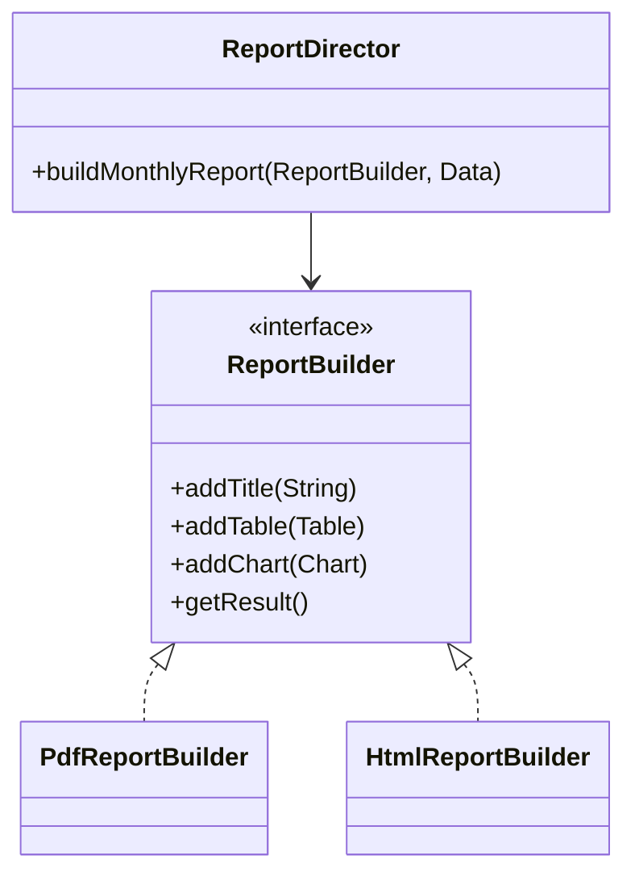

## The idea in plain words

Some objects have a few **required** fields and many **optional** ones. A constructor with nine arguments is hard to read (`new Pizza("L", true, false, null, 2)`, what is `false`?). A **Builder** lets you set only what you need, each by name, and then call `build()`.

**Picture it:** ordering at a sandwich counter. You say "brown bread" first, then "add cheese, add paneer, no onion", then "done". You never say every option in one breath.

### The smallest example

```java
final class Pizza {
    private final String size;
    private final boolean extraCheese;
    private final List<String> toppings;

    private Pizza(Builder b) { size = b.size; extraCheese = b.extraCheese; toppings = List.copyOf(b.toppings); }
    public String toString() { return size + " pizza, extra cheese: " + extraCheese + ", toppings: " + toppings; }

    static class Builder {
        private final String size;                       // required, so it goes in the constructor
        private boolean extraCheese;                     // optional fields get a method each
        private final List<String> toppings = new ArrayList<>();

        Builder(String size) { this.size = size; }
        Builder extraCheese() { extraCheese = true; return this; }    // "return this" allows chaining
        Builder topping(String t) { toppings.add(t); return this; }
        Pizza build() { return new Pizza(this); }
    }
}

class Demo {
    public static void main(String[] args) {
        Pizza p = new Pizza.Builder("Large").extraCheese().topping("Paneer").topping("Corn").build();
        System.out.println(p);   // Large pizza, extra cheese: true, toppings: [Paneer, Corn]
    }
}
```

Notice that `Pizza` has no setters. Once built, it can't change, and every call reads like a sentence.

| Use it when | Skip it when |
| --- | --- |
| Four or more parameters, several of them optional, or rules to check before the object exists | Two or three fields: a constructor or a record is clearer |

The rest of this lesson covers validation in `build()`, the classic GoF version and the pitfalls.

**The textbook definition:** separate the construction of a complex object from its representation, so you can build it step by step — and, in its modern Java form, create **valid, immutable objects with many optional parameters** readably.

## The problem: telescoping constructors

An HTTP request has a URL and method (required) plus headers, query parameters, body, timeout, retry count and authentication (optional). Constructors don't scale:

```java
new HttpRequest(url, "POST", headers, null, body, 5000, 3, null, true);   // what is null? what is true?
```

- **Telescoping constructors** (one per combination) explode in number and are unreadable at the call site.
- **JavaBeans setters** (`new X(); x.setA(); x.setB();`) are readable but leave the object **mutable** and possibly **half-built and invalid** between calls — and you can't make it immutable.

## The solution: a fluent builder

<FullCode title="The full HttpRequest builder (46 lines)" note="required fields, defaults, validation in build()">

```java
public final class HttpRequest {
    private final URI uri;
    private final Method method;
    private final Map<String, String> headers;
    private final byte[] body;
    private final Duration timeout;
    private final int maxRetries;

    private HttpRequest(Builder b) {                  // only the builder can construct
        this.uri = b.uri;
        this.method = b.method;
        this.headers = Map.copyOf(b.headers);        // defensive, unmodifiable copy
        this.body = b.body == null ? null : b.body.clone();
        this.timeout = b.timeout;
        this.maxRetries = b.maxRetries;
    }

    public static Builder newBuilder(URI uri, Method method) { return new Builder(uri, method); }

    public static final class Builder {
        private final URI uri;                         // required → builder constructor
        private final Method method;
        private final Map<String, String> headers = new LinkedHashMap<>();
        private byte[] body;
        private Duration timeout = Duration.ofSeconds(10);   // sensible defaults
        private int maxRetries = 0;

        private Builder(URI uri, Method method) {
            this.uri = Objects.requireNonNull(uri);
            this.method = Objects.requireNonNull(method);
        }

        public Builder header(String name, String value) { headers.put(name, value); return this; }
        public Builder body(byte[] body) { this.body = body; return this; }
        public Builder timeout(Duration t) { this.timeout = t; return this; }
        public Builder maxRetries(int n) { this.maxRetries = n; return this; }

        public HttpRequest build() {
            // Validate cross-field invariants once, before the object exists
            if (method == Method.GET && body != null)
                throw new IllegalStateException("GET requests cannot have a body");
            if (maxRetries < 0) throw new IllegalArgumentException("maxRetries must be >= 0");
            return new HttpRequest(this);
        }
    }
}
```

</FullCode>

```java
HttpRequest req = HttpRequest.newBuilder(URI.create("https://api.example.com/orders"), Method.POST)
        .header("Content-Type", "application/json")
        .body(json)
        .timeout(Duration.ofSeconds(3))
        .maxRetries(2)
        .build();
```

What you get:

- **Readable** call sites — each value is named.
- **Required vs optional** parameters are explicit (required ones go in the builder's constructor).
- **Validation** of cross-field rules in `build()` — an invalid object can never exist.
- **Immutability** of the product.

## The classic GoF form: director + builders

The original GoF Builder addresses a different emphasis: the **same construction process** producing **different representations**.



```java
public final class ReportDirector {
    public void buildMonthlyReport(ReportBuilder b, SalesData data) {
        b.addTitle("Monthly sales — " + data.month());
        b.addTable(data.byRegion());
        b.addChart(data.trend());
    }
}

var pdf = new PdfReportBuilder();
new ReportDirector().buildMonthlyReport(pdf, data);
byte[] file = pdf.getResult();               // same steps, PDF output

var html = new HtmlReportBuilder();
new ReportDirector().buildMonthlyReport(html, data);
String page = html.getResult();              // same steps, HTML output
```

The **director** knows the order of steps; each **builder** knows how to implement steps for one representation. Products don't need a common interface. This is useful for document generation, parsers emitting different ASTs, and building complex [Composite](/system-design/lld/composite-pattern) trees recursively.

## Where you've seen it

- `StringBuilder`, `java.net.http.HttpRequest.newBuilder()`, `Stream.Builder`, `Locale.Builder`.
- Lombok's `@Builder`, Protocol Buffers message builders, OkHttp `Request.Builder`.
- Test data builders (`anOrder().withItems(3).paid().build()`) — very readable tests.

## Variations and pitfalls

- **Records + builder**: records give immutability; add a static nested builder for many optional fields.
- **Step builder** (staged builder): each step returns an interface exposing only the next valid step — compile-time enforcement of required fields and order. Powerful, but verbose; use for public APIs.
- **Don't** use a builder for objects with two or three fields — a constructor or static factory is clearer.
- **Builders are not thread-safe** and should not be shared between threads; build, then share the immutable product.
- Make the product constructor **private** so the builder is the only path (and validation can't be bypassed).

## Pros and cons

| Pros | Cons |
| --- | --- |
| Readable construction with many optional parameters | More code (a nested class per product) |
| Validation before the object exists; immutable products | Duplication between fields of builder and product |
| Same process can produce different representations (GoF form) | Overkill for small objects |

## Related patterns

- **Abstract Factory** returns a product immediately and focuses on *families*; Builder assembles *one complex product* in steps, returning it at the end.
- **Composite**: builders are handy for constructing complex trees.
- **Bridge**: the director can play the abstraction role, builders the implementations.

<Callout type="interview">
In machine-coding rounds, Builder earns its place for request/configuration objects with many optional fields (e.g., a `SearchQuery` with filters, sort, pagination). Show validation inside `build()` — that's what makes it more than a stylistic choice.
</Callout>

## Interview questions

<QA q="Why use a Builder instead of setters?">
Setters leave the object mutable and allow it to exist in an incomplete or invalid state between calls, and they make immutability impossible. A builder accumulates values in a separate mutable object, validates cross-field invariants in build(), and then creates an immutable, fully valid product in one step — while keeping call sites as readable as setters.
</QA>

<QA q="What's the role of the Director in the GoF Builder?">
The director encapsulates the order of construction steps for a particular product configuration, so the same sequence can drive different concrete builders and produce different representations (PDF vs HTML report). It's optional: when clients assemble objects directly, as with fluent builders, there's no director.
</QA>

<QA q="How do you enforce required parameters in a builder?">
Put required parameters in the builder's constructor (or the static newBuilder method) so it can't be created without them; validate them for null. For complex ordering requirements, use a step builder where each method returns an interface exposing only the next allowed step, which the compiler enforces. Final cross-field validation still belongs in build().
</QA>

<Practice task="Design a builder for a SearchQuery: required text; optional filters (category, price range, in-stock), sort (relevance, price ascending or descending) and pagination (page, size up to 100). Which rules belong in build()?">

The builder's constructor (or a static `newBuilder(text)`) takes the required text and rejects blank strings. Fluent methods for each optional part, with sensible defaults (sort by relevance, page 0, size 20). `build()` checks **cross-field** rules — minimum price not above maximum, size between 1 and 100, page not negative — and creates an immutable `SearchQuery` with defensive copies of any collections. Single-field checks can live in the setters; anything involving two fields belongs in `build()`.

</Practice>

<Takeaways>

- Builder solves telescoping constructors and half-built mutable objects.
- Required fields in the builder constructor, optional fields as fluent methods, validation in build(), immutable product.
- The GoF form adds a director to run the same steps against different builders.
- Use it when objects have many optional parts; skip it for small objects.

</Takeaways>

## Further reading

- Joshua Bloch, *Effective Java* (3rd ed.) — Item 2: "Consider a builder when faced with many constructor parameters".
- Gamma et al., *Design Patterns* (1994) — Builder.
- Alexander Shvets, *Dive Into Design Patterns* — "Builder".
