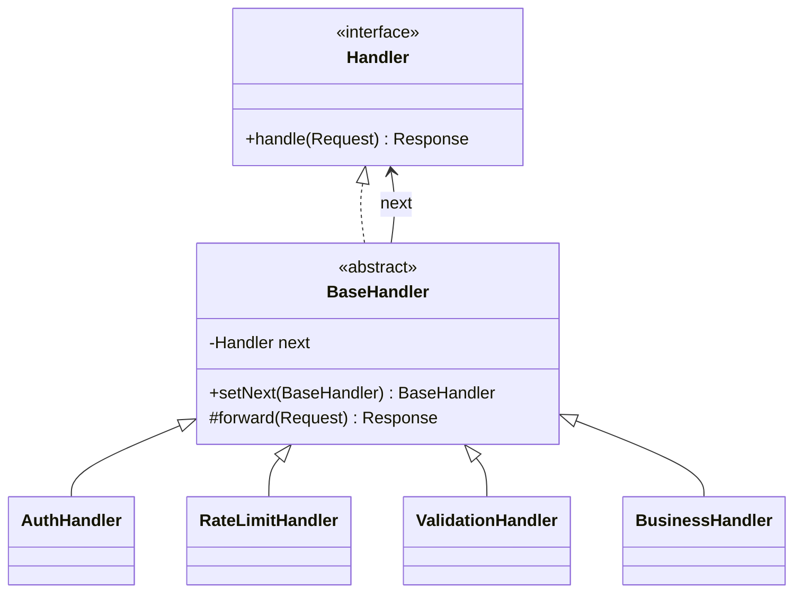

**Intent:** pass a request along a **chain of handlers**. Each handler decides either to process the request, to pass it to the next handler — or both — so the sender doesn't need to know which handler will deal with it.

## The problem

An API request must pass several checks before reaching business logic: authentication, rate limiting, input validation, caching, then the actual handler. If the controller does all of this inline, it grows into a tangle of nested `if`s; reordering checks or reusing them for another endpoint means copying code.

Or consider expense approvals: amounts up to ₹10,000 are approved by a team lead, up to ₹1,00,000 by a manager, above that by a director. Hard-coding the hierarchy into one method makes every policy change an edit to tested code.

## The solution

Turn each step into a **handler object** with a common interface and a reference to the **next** handler. The client sends the request to the first handler; the chain does the rest.



### Variant 1 — middleware pipeline (every handler may act and pass on)

```java
public interface Handler {
    Response handle(Request req);
}

public abstract class BaseHandler implements Handler {
    private Handler next;

    public BaseHandler setNext(BaseHandler next) { this.next = next; return next; }   // fluent chaining

    protected Response forward(Request req) {
        if (next == null) throw new IllegalStateException("End of chain reached without a handler");
        return next.handle(req);
    }
}

public final class AuthHandler extends BaseHandler {
    private final TokenVerifier verifier;
    public AuthHandler(TokenVerifier verifier) { this.verifier = verifier; }

    @Override public Response handle(Request req) {
        if (!verifier.isValid(req.header("Authorization")))
            return Response.status(401);          // short-circuit: stop the chain
        return forward(req);
    }
}

public final class RateLimitHandler extends BaseHandler {
    private final RateLimiter limiter;
    public RateLimitHandler(RateLimiter limiter) { this.limiter = limiter; }

    @Override public Response handle(Request req) {
        if (!limiter.tryAcquire(req.clientId())) return Response.status(429);
        return forward(req);
    }
}

// Wiring — order is explicit and changeable
var auth = new AuthHandler(verifier);
auth.setNext(new RateLimitHandler(limiter))
    .setNext(new ValidationHandler(schema))
    .setNext(new CreateOrderHandler(orderService));

Response r = auth.handle(request);
```

### Variant 2 — "first capable handler wins" (classic GoF)

```java
public abstract class Approver {
    private Approver next;
    public Approver then(Approver next) { this.next = next; return next; }

    public final ApprovalResult approve(Expense e) {
        if (canApprove(e)) return decide(e);
        if (next == null) return ApprovalResult.rejected("No approver for amount " + e.amount());
        return next.approve(e);
    }

    protected abstract boolean canApprove(Expense e);
    protected abstract ApprovalResult decide(Expense e);
}

public final class TeamLead extends Approver {
    protected boolean canApprove(Expense e) { return e.amount().lessThanOrEqual(Money.of(10_000)); }
    protected ApprovalResult decide(Expense e) { return ApprovalResult.approvedBy("team lead"); }
}

var chain = new TeamLead();
chain.then(new Manager()).then(new Director());
chain.approve(expense);
```

## Design decisions

- **What if nobody handles the request?** Decide explicitly: a default terminal handler, an exception, or a "not handled" result.
- **Who builds the chain?** Keep construction in one place (configuration, a builder, a DI container). Chains can be built dynamically per request type.
- **List-based alternative**: instead of linked handlers, iterate over a `List<Handler>` — simpler to configure and inspect, as in many filter frameworks.

```java
for (Validator v : validators) {
    ValidationResult r = v.validate(order);
    if (!r.ok()) return r;                  // stop at first failure
}
```

## Where you've seen it

- **Servlet filters** (`FilterChain.doFilter`) and **Spring Security's filter chain**.
- Spring MVC `HandlerInterceptor`s, OkHttp/Retrofit **interceptors**, Express/Koa middleware.
- `java.util.logging.Logger` passing records to parent loggers.
- Exception handling itself: an exception propagates up the call stack until a handler catches it.
- UI event bubbling: a click propagates from a button to its container to the window — Chain of Responsibility over a [Composite](/system-design/lld/composite-pattern) tree.

## Use in LLD case studies

- **ATM cash dispensing**: ₹2000 → ₹500 → ₹100 note dispensers, each dispensing what it can and passing the remainder. See [Design an ATM](/system-design/lld/lld-atm).
- **Logging framework**: DEBUG → INFO → ERROR handlers, or appenders deciding by level. See [Design a Logging Framework](/system-design/lld/lld-logging-framework).
- **Validation pipelines**, **discount rules**, **support ticket escalation**, **approval workflows**.

## Pros and cons

| Pros | Cons |
| --- | --- |
| Sender decoupled from receivers | No guarantee a request is handled |
| Handlers are single-purpose and reusable (SRP) | Long chains are hard to debug and add latency |
| Add, remove or reorder handlers without changing clients (OCP) | Order dependencies can be subtle (auth must precede rate limit by user) |

## Comparisons

- **CoR vs Decorator**: very similar structure (recursive composition). Decorators always delegate and **must not break the flow** — they extend behaviour while keeping the interface's contract. CoR handlers can **stop** the request at any point and can perform arbitrary, independent operations.
- **CoR, Command, Mediator, Observer** — four ways to connect senders and receivers: CoR passes a request along a dynamic chain until handled; Command links a sender to a receiver via an object; Mediator removes direct links; Observer lets receivers subscribe dynamically.
- **CoR + Command**: handlers can be commands, or the request travelling down the chain can be a command object.

<Callout type="interview">
When asked to design request processing with authentication, validation, rate limiting and logging, describe it as a chain: each concern is a handler, ordering is explicit configuration, and handlers can short-circuit with an error response. That's exactly how servlet filters and Spring Security work.
</Callout>

## Interview questions

<QA q="How is Chain of Responsibility different from Decorator?">
Both link objects that share an interface and pass calls along. A decorator always delegates to the wrapped object, adding behaviour while preserving the contract — it can't decide to swallow the call. A chain handler may handle the request itself and stop propagation, pass it on, or do both; handlers are independent policies rather than layers of one object's behaviour.
</QA>

<QA q="Design an ATM's cash dispenser for ₹2000, ₹500 and ₹100 notes.">
Create a chain of note dispensers in descending denomination. Each computes how many notes of its denomination it can give (limited by the remaining amount and its stock), records them, and passes the remainder to the next dispenser. If the last dispenser leaves a non-zero remainder, the request fails and nothing is dispensed — so compute the plan first and commit only if the whole amount can be served.
</QA>

<Practice task="Support tickets go to an FAQ bot (if it matches a known answer), else a tier-1 agent (billing or account categories), else tier 2 — and VIP customers skip the bot. Design the chain.">

Handlers: `VipRouting` (for VIPs, forwards straight to tier 1), `FaqBotHandler` (answers and stops when confident), `Tier1Handler` (accepts billing and account categories) and `Tier2Handler` (accepts everything — the terminal handler, so no ticket is dropped). Build the chain in one configuration place. Making VIP routing a handler at the front keeps that rule out of the bot. Log which handler took each ticket for debugging.

</Practice>

<Takeaways>

- Chain of Responsibility passes a request through handlers that may process it, forward it, or stop it.
- Two common forms: middleware pipelines (each handler acts and forwards) and first-capable-wins chains.
- Decide what happens if no handler handles the request, and build chains in one place.
- Servlet filters, Spring Security and HTTP interceptors are everyday examples.

</Takeaways>

## Further reading

- Gamma et al., *Design Patterns* (1994) — Chain of Responsibility.
- Spring Security reference — "Architecture: the SecurityFilterChain".
- Alexander Shvets, *Dive Into Design Patterns* — "Chain of Responsibility".
