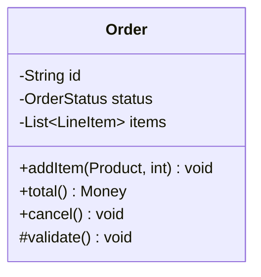
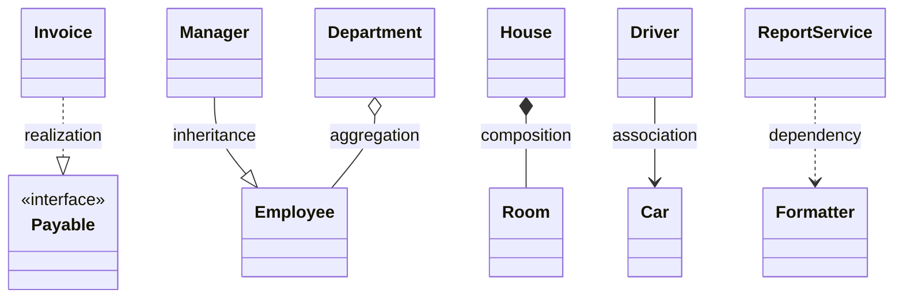
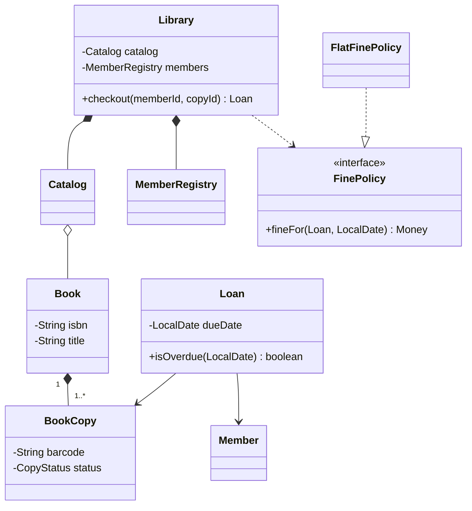
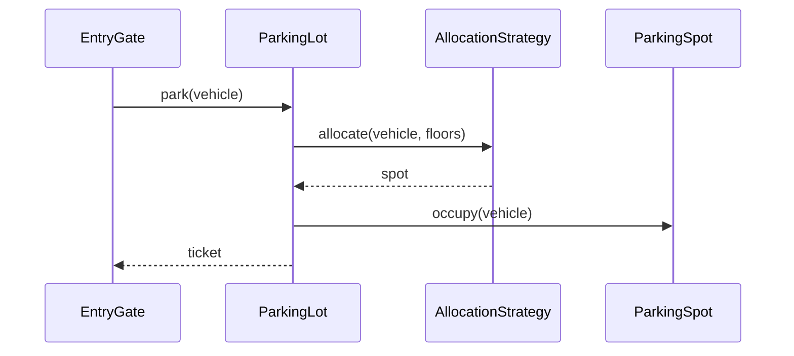

A class diagram is the "architecture diagram" of an LLD interview. You don't need full UML fluency, but you must distinguish the relationship types precisely — interviewers frequently ask "is that aggregation or composition?" — and draw them quickly and correctly.

## The class box



- Three compartments: **name**, **fields**, **methods**.
- Visibility: `+` public, `-` private, `#` protected, `~` package.
- Stereotypes mark special kinds: `<<interface>>`, `<<abstract>>`, `<<enumeration>>`.
- Show only what matters for the discussion — not every getter.

## The six relationships

Ordered from weakest to strongest coupling:

| Relationship | Meaning | Everyday picture | Lifetime | UML notation | Java shape |
| --- | --- | --- | --- | --- | --- |
| **Dependency** | A *uses* B temporarily | A driver uses a toll card to pay once, then puts it away | Unrelated | Dashed arrow `..>` | B is a parameter, local variable or return type |
| **Association** | A *knows about* B (has a reference) | A doctor knows their regular patients | Independent | Solid line/arrow `-->` | A field of type B |
| **Aggregation** | A *has* B as a part, but B can exist on its own | A cricket team has players; players still exist if the team breaks up | Independent | Hollow diamond on A `o--` | Field holding B(s) that are passed in from outside |
| **Composition** | A *owns* B; B can't exist without A | A building has floors; demolish the building and the floors go too | B dies with A | Filled diamond on A `*--` | A creates and fully controls B |
| **Realization** | A *implements* interface B | Every UPI app promises to follow the same UPI rules | — | Dashed line, hollow triangle `..\|>` | `class A implements B` |
| **Inheritance (generalization)** | A *is a* B | A savings account is a kind of bank account | — | Solid line, hollow triangle `--\|>` | `class A extends B` |



### Dependency

```java
class ReportService {
    String render(Report r, Formatter f) {     // uses Formatter only during this call
        return f.format(r);
    }
}
```

### Association

```java
class Driver {
    private Car assignedCar;                   // long-lived reference, independent lifecycles
}
```

Associations can be one-way or bidirectional and carry **multiplicity**: `1`, `0..1`, `*`, `1..*`. Prefer **unidirectional** associations — bidirectional ones must be kept consistent on both sides.

### Aggregation vs composition

The test is **ownership and lifecycle**:

```java
// Aggregation: a Team groups Players, but players exist independently and can move teams
class Team {
    private final List<Player> players = new ArrayList<>();
    void add(Player p) { players.add(p); }     // created elsewhere, passed in
}

// Composition: an Order owns its LineItems; they're meaningless without the order
class Order {
    private final List<LineItem> items = new ArrayList<>();
    void addItem(Product product, int qty) {
        items.add(new LineItem(product, qty)); // created and controlled by Order
    }
}
```

| Question | Aggregation | Composition |
| --- | --- | --- |
| Can the part exist without the whole? | Yes | No |
| Can the part belong to several wholes? | Possibly | No — exactly one owner |
| Who creates the part? | Usually someone else | Usually the whole |
| Deleting the whole deletes the part? | No | Yes |

<Callout type="interview">
Interviewers rarely care about diamond shapes for their own sake. They care that you understand **who owns what and who is responsible for lifecycle** — that drives where creation logic lives, what gets deleted together, and what can be shared.
</Callout>

## Reading a full diagram



Read it as: a library owns its catalog and member registry; a book (the title) has one or more physical copies; a loan links a member to a specific copy; fines are computed by a pluggable policy.

## Sequence diagrams

For dynamic behaviour — "walk me through checkout" — a sequence diagram is clearer than prose:



## Other diagrams you may meet

- **State diagram** — for objects with a lifecycle (vending machine, order, elevator). See [State](/system-design/lld/state-pattern).
- **Use-case diagram** — actors and their goals; useful for scoping, rarely drawn in interviews.
- **Activity diagram** — flowchart of a process.

## Interview questions

<QA q="What's the difference between association, aggregation and composition?">
All three mean one object holds a reference to another. Association is the general "knows about" relationship with independent lifecycles. Aggregation is a whole–part association where parts can exist independently and may be shared (a team and its players). Composition is strong ownership: the part belongs to exactly one whole, is typically created by it, and is destroyed with it (an order and its line items).
</QA>

<QA q="How is dependency different from association?">
Dependency is a transient "uses" relationship: one class uses another only as a method parameter, local variable or return type, without keeping a reference. Association means a lasting structural relationship — a field. Dependencies are weaker coupling; changes to the dependency still may affect the user, but there's no ongoing state link.
</QA>

<QA q="Why prefer unidirectional associations?">
A bidirectional association requires both sides to be updated consistently (adding a player to a team must also set the player's team), which creates more code paths for bugs and couples both classes. Unidirectional associations keep one class ignorant of the other. Add the reverse direction only when queries genuinely need it — and then encapsulate updates in one method that maintains both sides.
</QA>

<Practice task="Classify each relationship and say who should create the part: Order–LineItem, Team–Player, Car–Engine (in a car-rental system), Invoice–PdfRenderer, Student–Course.">

Order–LineItem: **composition** (line items make no sense without the order; `Order.addItem` creates them). Team–Player: **aggregation** (players exist on their own and move between teams; created elsewhere). Car–Engine in a rental system: usually **composition**, or simply an attribute — the business never tracks engines separately; in a garage system it could be aggregation. Invoice–PdfRenderer: **dependency** (the renderer is used during a call, not held). Student–Course: **many-to-many association**, typically through an `Enrolment` class that carries the grade and term.

</Practice>

<Takeaways>

- Six relationships: dependency, association, aggregation, composition, realization, inheritance.
- Aggregation vs composition is about ownership and lifecycle, not diagram shapes.
- Prefer weaker coupling: dependency and association over inheritance; unidirectional over bidirectional.
- Use class diagrams for structure and sequence diagrams for flows; keep them to what matters.

</Takeaways>

## Further reading

- Martin Fowler, *UML Distilled* (3rd ed., 2003) — the pragmatic subset of UML.
- Alexander Shvets, *Dive Into Design Patterns* — "Relations Between Objects".
- [Mermaid class diagram syntax](https://mermaid.js.org/syntax/classDiagram.html) — handy for diagrams in docs and design reviews.
