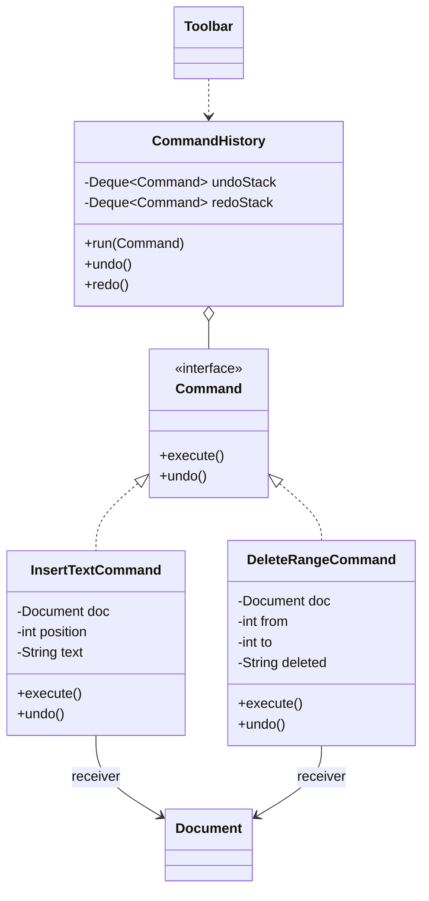

**Intent:** turn a **request into a standalone object** containing everything needed to perform it. That lets you pass requests as arguments, **queue** or **schedule** them, **log** them, and support **undo/redo**.

## The problem

A text editor has buttons, menu items and keyboard shortcuts that all trigger operations like "bold", "paste", "delete line". If each UI element calls the editor directly, the same logic is duplicated across invokers, and features like undo, macro recording or "repeat last action" have nothing to hold on to — an operation is just a method call that vanishes once executed.

## The solution

Wrap each operation in an object with an `execute()` method. The object stores the **receiver** (the thing that does the real work) and the **parameters**. Invokers (buttons, shortcuts, schedulers) only know the `Command` interface.



Roles:

- **Command** — interface with `execute()` (and optionally `undo()`).
- **Concrete command** — binds a receiver and parameters to an action.
- **Receiver** — the domain object that knows how to do the work (`Document`).
- **Invoker** — triggers commands without knowing what they do (button, scheduler, `CommandHistory`).
- **Client** — creates commands and hands them to invokers.

## Undo/redo

```java
public interface Command {
    void execute();
    void undo();
}

public final class InsertTextCommand implements Command {
    private final Document doc;
    private final int position;
    private final String text;

    public InsertTextCommand(Document doc, int position, String text) {
        this.doc = doc; this.position = position; this.text = text;
    }
    public void execute() { doc.insert(position, text); }
    public void undo()    { doc.delete(position, position + text.length()); }
}

public final class DeleteRangeCommand implements Command {
    private final Document doc;
    private final int from, to;
    private String deleted;                         // captured at execution for undo

    public DeleteRangeCommand(Document doc, int from, int to) { this.doc = doc; this.from = from; this.to = to; }
    public void execute() { deleted = doc.text(from, to); doc.delete(from, to); }
    public void undo()    { doc.insert(from, deleted); }
}

public final class CommandHistory {
    private final Deque<Command> undoStack = new ArrayDeque<>();
    private final Deque<Command> redoStack = new ArrayDeque<>();
    private final int limit;

    public CommandHistory(int limit) { this.limit = limit; }

    public void run(Command c) {
        c.execute();
        undoStack.push(c);
        if (undoStack.size() > limit) undoStack.removeLast();   // bounded history
        redoStack.clear();                                      // new action invalidates redo
    }

    public void undo() {
        Command c = undoStack.poll();
        if (c == null) return;
        c.undo();
        redoStack.push(c);
    }

    public void redo() {
        Command c = redoStack.poll();
        if (c == null) return;
        c.execute();
        undoStack.push(c);
    }
}
```

Two strategies for undo:

1. **Inverse operations** (as above) — each command knows how to reverse itself. Compact, but some operations are hard to invert.
2. **Snapshots** — save the receiver's state before executing and restore it on undo, using [Memento](/system-design/lld/memento-pattern). Simple and general, but memory-hungry for large state.

## Other uses

### Queues, scheduling and thread pools

`Runnable` and `Callable` are commands: `executor.submit(task)` decouples *what* runs from *when/where* it runs. Job queues, cron schedulers and retry queues all store command objects.

### Macros (composite commands)

```java
public final class MacroCommand implements Command {
    private final List<Command> steps;
    public MacroCommand(List<Command> steps) { this.steps = List.copyOf(steps); }
    public void execute() { steps.forEach(Command::execute); }
    public void undo() {
        for (int i = steps.size() - 1; i >= 0; i--) steps.get(i).undo();   // reverse order
    }
}
```

### Transactions and audit logs

Persisting commands gives a log of everything that happened ("who did what with which parameters"). Replaying the log can rebuild state — the idea behind [event sourcing](/system-design/hld/event-driven-architecture) and database write-ahead logs.

### Remote requests

Serialise a command, send it over a network, execute it elsewhere — the basis of RPC messages and task queues.

### CQRS commands

In application architecture, a "command" (`PlaceOrderCommand`) is a request object handled by a single handler — a close cousin of this pattern.

## Where you've seen it

- `java.lang.Runnable`, `java.util.concurrent.Callable`.
- Swing `Action` objects; undo managers (`javax.swing.undo.UndoableEdit`).
- Game input systems (rebindable keys map to command objects; recorded commands enable replays).
- Task queues (Celery/Sidekiq jobs), Spring Batch steps.

## Pros and cons

| Pros | Cons |
| --- | --- |
| Decouples invokers from receivers (SRP) | One class per operation — more code |
| New commands without changing invokers (OCP) | Undo logic must be written (and kept correct) for each command |
| Enables undo/redo, queues, scheduling, logging, macros | Can be overkill when you just need a callback |

## Comparisons

- **Command vs Strategy**: both put behaviour in objects. Command turns *an operation with its parameters* into an object to be executed, queued, logged or undone; Strategy describes *different ways of doing the same thing*, swapped inside a context.
- **Command + Memento**: commands perform operations; mementos capture state before execution for undo.
- **Command + Prototype**: copy commands to save them in history.
- **Chain of Responsibility handlers** can be commands; or the request passed down a chain can itself be a command.
- **Visitor** can be seen as a more powerful Command that operates across many classes.

<Callout type="interview">
"Add undo to the editor/drawing app/spreadsheet" is a classic follow-up. Answer: every user action becomes a `Command` with `execute`/`undo`, a history keeps undo and redo stacks, a new action clears redo, history is bounded, and composite actions become macro commands undone in reverse order.
</Callout>

## Interview questions

<QA q="How would you implement undo/redo in a drawing application?">
Represent each user action as a Command with execute and undo. Keep two stacks: executing a new command pushes it onto the undo stack and clears the redo stack; undo pops from the undo stack, calls undo, and pushes onto redo; redo does the reverse. Implement undo either with inverse operations or by snapshotting the affected state (Memento) before execution. Bound the history size, and group multi-step actions into macro commands undone in reverse order.
</QA>

<QA q="How do Runnable and an ExecutorService illustrate the Command pattern?">
A Runnable encapsulates a unit of work as an object with a single execute method (run). The ExecutorService is the invoker: it queues and schedules runnables and executes them on pool threads without knowing what they do. The client that submits the task decides what to do; the executor decides when and where — exactly the decoupling Command provides.
</QA>

<Practice task="Add undo and redo to a spreadsheet where one user action can change many cells (fill down, paste a range). How do you make it undo as one step?">

Each action is a `Command`; multi-cell actions are a `MacroCommand` of per-cell `SetCellCommand`s (each capturing the previous value when it executes), undone in reverse order. The history pushes the macro as one entry, so a single undo reverts the whole fill. For very large ranges, a snapshot (memento) of the affected range can be cheaper than thousands of tiny commands. A new action clears the redo stack, and the history is bounded.

</Practice>

<Takeaways>

- Command wraps a request (receiver + parameters) into an object with execute().
- It decouples who triggers an action from who performs it.
- Enables undo/redo (inverse ops or mementos), queues, scheduling, macros and audit logs.
- Runnable/Callable and task queues are everyday commands.

</Takeaways>

## Further reading

- Gamma et al., *Design Patterns* (1994) — Command.
- Robert Nystrom, *Game Programming Patterns* (2014) — "Command" chapter (free online).
- Alexander Shvets, *Dive Into Design Patterns* — "Command".
