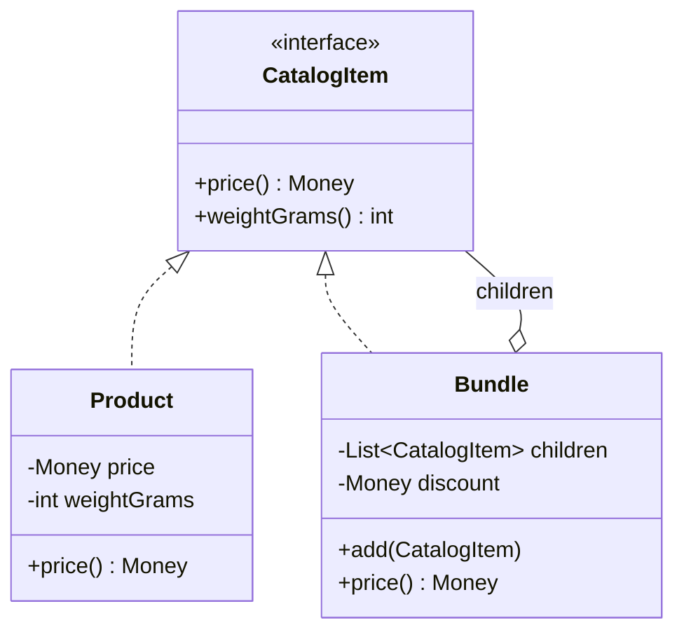

## The idea in plain words

When things **nest inside other things** (folders inside folders, boxes inside boxes), give the single item and the group the **same interface**. Then the code that uses them never has to ask "is this one thing or a group?"

**Picture it:** a parcel. A box can hold products and smaller boxes. To find the total price you ask the big box. It asks everything inside it, and the smaller boxes do the same.

### The smallest example

```java
interface Item { int price(); }

record Product(String name, int price) implements Item { }      // a leaf

class Box implements Item {                                      // a group
    private final List<Item> contents = new ArrayList<>();
    Box add(Item item) { contents.add(item); return this; }
    public int price() { return contents.stream().mapToInt(Item::price).sum(); }   // asks its children
}

class Demo {
    public static void main(String[] args) {
        Box pencilCase = new Box().add(new Product("Pen", 20)).add(new Product("Ink", 30));
        Box parcel = new Box().add(new Product("Notebook", 50)).add(pencilCase);
        System.out.println(parcel.price());   // 100
    }
}
```

There's no `instanceof` anywhere. A box inside a box inside a box still works.

| Use it when | Skip it when |
| --- | --- |
| Your data really is a tree, and you run the same operation on single items and groups | The structure is flat: a list is enough |

The rest of this lesson covers where `add`/`remove` should live, real uses (file systems, UI trees) and pitfalls.

**The textbook definition:** compose objects into **tree structures** to represent part–whole hierarchies, and let clients treat **individual objects and compositions uniformly**.

Use it only when your model is genuinely a tree. When it is, Composite removes a lot of `instanceof` checking.

## The problem

An e-commerce order can contain products, and **bundles** — and bundles can contain products and other bundles (a "home office kit" containing a "desk set" bundle). To compute the total price, naive code must check types at every level:

```java
// ❌ Every operation re-implements the traversal and type checks
Money total(List<Object> items) {
    Money sum = Money.ZERO;
    for (Object item : items) {
        if (item instanceof Product p) sum = sum.plus(p.price());
        else if (item instanceof Bundle b) sum = sum.plus(total(b.items())).minus(b.discount());
    }
    return sum;
}
```

Every new operation (weight, tax, rendering) repeats this, and every new node type changes all of them.

## The solution

Give leaves and containers a **common interface**. Containers implement operations by delegating to their children and combining the results.



```java
public interface CatalogItem {
    Money price();
    int weightGrams();
}

public record Product(String sku, Money price, int weightGrams) implements CatalogItem { }

public final class Bundle implements CatalogItem {
    private final String name;
    private final Money discount;
    private final List<CatalogItem> children = new ArrayList<>();

    public Bundle(String name, Money discount) { this.name = name; this.discount = discount; }

    public Bundle add(CatalogItem item) { children.add(item); return this; }

    @Override public Money price() {
        Money sum = children.stream().map(CatalogItem::price).reduce(Money.ZERO, Money::plus);
        return sum.minus(discount);
    }

    @Override public int weightGrams() {
        return children.stream().mapToInt(CatalogItem::weightGrams).sum();
    }
}
```

```java
CatalogItem kit = new Bundle("Home office kit", Money.of(500))
        .add(new Product("chair", Money.of(8000), 12000))
        .add(new Bundle("Desk set", Money.of(200))
                .add(new Product("lamp", Money.of(1500), 900))
                .add(new Product("organiser", Money.of(700), 400)));

Money total = kit.price();        // recursion handled by the tree itself
```

The client works with `CatalogItem` and never asks "is this a product or a bundle?".

## Design decision: where do child-management methods live?

| Approach | Child methods (`add`, `remove`, `children`) on | Trade-off |
| --- | --- | --- |
| **Transparency** | The common interface | Uniform treatment, but leaves must reject `add` (throw) — an LSP smell |
| **Safety** | Only the composite class | Type-safe, but clients need to know when they have a composite |

Most modern Java code chooses **safety** (as above). Mention the trade-off if asked.

## Real-world uses

- **File systems**: `File` vs `Directory`, size of a directory = sum of its children.
- **UI component trees**: Swing's `Container` extends `Component`; React/DOM trees.
- **Organisation charts**: employees and departments; "total salary of a department".
- **Expression trees / rule engines**: `And(rule1, Or(rule2, rule3))` evaluated recursively.
- **Menus**: menu items and sub-menus.
- **Permission groups**: a group contains users and other groups.

## Pitfalls

- **Cycles**: if a bundle can (accidentally) contain itself, recursion never ends. Prevent cycles on `add` or keep the tree immutable once built.
- **Deep trees** risk stack overflow with naive recursion; use iterative traversal for very deep structures.
- **Overly general interfaces**: forcing operations onto the common interface that make no sense for some nodes.
- **Performance**: repeated recursive computation on large trees; cache aggregates if the tree is read far more than modified.

## Pros and cons

| Pros | Cons |
| --- | --- |
| Clients treat simple and complex elements uniformly | Hard to restrict which component types a composite may contain |
| New element types added without changing clients (OCP) | Common interface can become overly general |
| Recursive operations are natural and concise | Cycle and depth hazards |

## Related patterns

- **Iterator** traverses composite trees; **Visitor** adds operations over a whole tree without changing node classes.
- **Builder** can construct complex composite trees step by step.
- **Chain of Responsibility** pairs with Composite: a request can bubble up from a leaf through its parents (event propagation in UI trees).
- **Decorator** has a similar recursive structure but wraps **one** component and adds behaviour; Composite holds **many** children and aggregates.
- **Flyweight** can share identical leaf nodes to save memory.

## Interview questions

<QA q="How would you model a file system where you can compute the size of any folder?">
Use Composite: a common FileSystemNode interface with size() and name(); File as a leaf returning its own size; Directory as a composite holding child nodes and returning the sum of their sizes. Add children through Directory only (safe design), prevent cycles (no directory can contain an ancestor), and consider caching sizes with invalidation if trees are large and read-heavy.
</QA>

<QA q="Composite vs Decorator — both use recursive composition. What's the difference?">
A decorator wraps exactly one component to add behaviour while keeping its interface; a composite holds any number of children and implements operations by combining their results. Decorators change how one object behaves; composites represent part-whole hierarchies. They can work together — decorating a particular node of a composite tree.
</QA>

<Practice task="Model an organisation chart where any node can report its total salary cost and headcount. Departments contain employees and sub-departments.">

An `OrgUnit` interface with `salaryCost()` and `headcount()`. `Employee` (leaf) returns its own salary and 1. `Department` (composite) holds child `OrgUnit`s and sums theirs. Child management (`add`, `remove`) lives only on `Department` (the safe variant). Guard against cycles when moving departments (walk up parent pointers). For a large organisation that is read far more often than it changes, cache the totals per department and update ancestors on each change.

</Practice>

<Takeaways>

- Composite lets leaves and containers share an interface so trees are processed uniformly.
- Containers delegate to children and combine results — recursion lives in the structure.
- Choose safety (child methods only on composites) over transparency in typed languages.
- Guard against cycles and very deep recursion.

</Takeaways>

## Further reading

- Gamma et al., *Design Patterns* (1994) — Composite.
- Alexander Shvets, *Dive Into Design Patterns* — "Composite".
