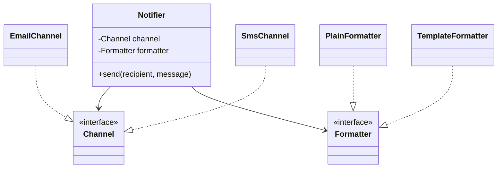

SOLID gets the attention, but a few older, simpler principles do most of the work in day-to-day design — and they're the ideas design patterns are built from. If you understand these, most patterns stop feeling like recipes to memorise and start feeling like obvious consequences.

## Encapsulate what varies

> Identify the aspects of your application that vary and separate them from what stays the same.

Change is inevitable, so **isolate the parts that change** behind a boundary. Then a change hits one module, not the whole codebase — like watertight compartments in a ship.

**At method level** — extract the volatile part:

```java
// Before: shipping rules tangled into the total calculation
Money total(Order o) {
    Money sum = o.subtotal();
    if (o.city().isMetro()) sum = sum.plus(Money.of(40));
    else if (o.weightKg() > 5) sum = sum.plus(Money.of(120));
    else sum = sum.plus(Money.of(80));
    return sum;
}

// After: the varying rule has a name and a home
Money total(Order o) { return o.subtotal().plus(shippingFee(o)); }
Money shippingFee(Order o) { ... }
```

**At class level** — when the rule grows, move it into its own type (`ShippingPolicy`) that the order delegates to. That's the first step toward the Strategy pattern.

## Program to an interface, not an implementation

> Depend on abstractions, not on concrete classes.

```java
List<String> names = new ArrayList<>();          // ✅ the variable's type is the abstraction
ArrayList<String> names = new ArrayList<>();     // ❌ callers now depend on ArrayList specifically
```

At design level: when class A needs B, ask *what does A actually need from B?* Describe that as an interface, and make A depend on it. You can still pass the original class, but you've created a seam where alternatives, decorators and test doubles can be plugged in.

This costs a little upfront complexity, so apply it at **real seams**: external systems, algorithms that vary, and anything you want to test in isolation.

## Favour composition over inheritance

Inheritance is the obvious way to reuse code, but it has sharp edges:

- A subclass **can't shrink** its parent's interface — it inherits everything, wanted or not.
- Subclasses are **coupled to the parent's implementation**; parent changes can break them (fragile base class).
- Inheritance is **fixed at compile time**; you can't swap a parent at runtime.
- Reuse along **several dimensions** causes a combinatorial explosion of subclasses.

### The explosion

A notification system has *channel* (email, SMS, push) and *style* (plain, templated, localised):

```text
Inheritance:  PlainEmail, TemplatedEmail, LocalisedEmail,
              PlainSms, TemplatedSms, LocalisedSms,
              PlainPush, TemplatedPush, LocalisedPush          → 3 × 3 = 9 classes, growing multiplicatively
```

### Composition

```java
interface Channel   { void send(String recipient, String body); }
interface Formatter { String format(Message m); }

final class Notifier {
    private final Channel channel;
    private final Formatter formatter;

    Notifier(Channel channel, Formatter formatter) {
        this.channel = channel;
        this.formatter = formatter;
    }

    void send(String recipient, Message m) {
        channel.send(recipient, formatter.format(m));
    }
}
// 3 channels + 3 formatters = 6 classes, any combination, swappable at runtime
```



Composition gives **has-a** relationships, runtime flexibility and independent evolution along each dimension. It's the structural idea behind Strategy, Bridge, Decorator and State.

**When inheritance is right:** a genuine *is-a* relationship, the subclass is a true behavioural subtype (LSP holds), and you control both classes — or the base class is explicitly designed for extension (a template method).

## High cohesion, low coupling

- **Cohesion** — how strongly the elements of a module belong together. High cohesion: a class's fields and methods all serve one purpose.
- **Coupling** — how much one module depends on another's details. Low coupling: modules interact through small, stable interfaces.

Nearly every principle here is a way to increase cohesion or reduce coupling. When two designs seem equally valid, pick the one with less coupling.

## DRY, KISS, YAGNI

- **DRY — Don't Repeat Yourself.** Every piece of *knowledge* should have one authoritative representation. Note: DRY is about knowledge, not text — two pieces of code that look alike but change for different reasons are not duplication, and merging them creates coupling.
- **KISS — Keep It Simple.** Prefer the simplest design that meets current requirements. Cleverness is a cost.
- **YAGNI — You Aren't Gonna Need It.** Don't build features or abstractions for hypothetical futures. Add the abstraction when the second use case arrives.

<Callout type="interview">
These three are your defence against **over-engineering**, the most common LLD red flag after god classes. "I'm keeping vehicle types as an enum for now — if pricing starts to differ by type, I'll introduce a `PricingStrategy`" shows judgment.
</Callout>

## Law of Demeter (principle of least knowledge)

A method should only talk to its **immediate collaborators**: its own fields, its parameters, objects it creates. Avoid chains that reach through objects:

```java
// ❌ The caller knows the internal structure of Order, Customer and Address
String city = order.getCustomer().getAddress().getCity();

// ✅ Ask the object that has the knowledge
String city = order.shippingCity();
```

Long chains ("train wrecks") couple the caller to every class along the path. Note that fluent builders and stream pipelines (`list.stream().filter(...).map(...)`) are not violations — they operate on the same abstraction.

## Tell, don't ask

Rather than pulling data out of an object to make a decision, tell the object to do the work:

```java
// ❌ Ask: decision logic lives outside the object that owns the data
if (account.getBalance() >= amount) account.setBalance(account.getBalance() - amount);

// ✅ Tell: the account enforces its own rules
account.withdraw(amount);
```

## Separation of concerns and layering

Divide the program into parts that each address one concern. In machine-coding rounds, a simple layering goes a long way:

```text
model/        entities and value objects (Vehicle, Ticket, Money)
repository/   in-memory storage behind interfaces
service/      use-case orchestration (ParkingService)
strategy/     pluggable algorithms (PricingStrategy, AllocationStrategy)
exception/    domain exceptions
Main / Demo   wiring and a runnable scenario
```

## GRASP: assigning responsibilities

Craig Larman's GRASP principles answer "which class should own this method?":

| Principle | Guidance |
| --- | --- |
| **Information Expert** | Give a responsibility to the class that has the information to fulfil it (`Order.total()` — the order has the items) |
| **Creator** | A class that contains or closely uses B should create B (`Order` creates `LineItem`) |
| **Controller** | A non-UI object receives and coordinates system events (`ParkingService.park()`) |
| **Low Coupling / High Cohesion** | Evaluate alternatives by these |
| **Polymorphism** | Handle type-based variation with polymorphic operations, not conditionals |
| **Pure Fabrication** | Invent a class that isn't in the domain (a `Repository`, a `Notifier`) to keep cohesion high |
| **Indirection** | Add an intermediate object to decouple (an interface, a mediator) |
| **Protected Variations** | Wrap points of predicted variation behind stable interfaces |

## Interview questions

<QA q="Why favour composition over inheritance? When is inheritance still the right choice?">
Composition keeps classes loosely coupled, lets you combine behaviours along several independent dimensions without a subclass per combination, and allows behaviour to change at runtime by swapping collaborators. Inheritance couples subclasses to parent implementation details and is fixed at compile time. Inheritance is still right for genuine behavioural subtypes where LSP holds, for frameworks designed for extension (template methods), and when you control both classes and the shared behaviour is stable.
</QA>

<QA q="Isn't DRY sometimes harmful?">
Yes, when applied to code that merely looks similar. DRY is about not duplicating knowledge — a business rule should live in one place. If two pieces of code are similar today but serve different requirements that will evolve separately, merging them couples unrelated concerns and makes both harder to change. Some duplication is cheaper than the wrong abstraction.
</QA>

<QA q="What's wrong with order.getCustomer().getAddress().getCity()?">
It violates the Law of Demeter: the caller depends on the internal structure of three classes, so a change in how customers or addresses are modelled breaks callers everywhere. It also signals that logic is in the wrong place. Provide a method on the object closest to the need, such as order.shippingCity(), or pass the city in directly.
</QA>

<Practice task="A teammate adds an interface, an abstract base class and a factory for a TaxCalculator that has one implementation and no planned variants. Using this lesson's principles, what do you say?">

Point to **YAGNI** and **KISS**: abstraction has a cost (indirection, more files, harder navigation) and this one has no second implementation or testing need yet. A concrete `TaxCalculator` class is enough; if a second tax regime arrives, extracting an interface then is a five-minute refactoring. The exception: if the calculator calls an external service you want to fake in tests, an interface at that seam is justified — that's programming to interfaces at a real seam, not speculation.

</Practice>

<Takeaways>

- Encapsulate what varies so changes stay local.
- Program to interfaces at real seams: external systems, varying algorithms, testing boundaries.
- Favour composition for multi-dimensional variation and runtime flexibility; keep inheritance for true subtypes.
- Aim for high cohesion and low coupling; use DRY, KISS and YAGNI to avoid both duplication and over-engineering.
- Assign responsibilities to the information expert; tell objects what to do instead of asking for their data.

</Takeaways>

## Further reading

- Freeman and Robson, *Head First Design Patterns* (2nd ed., 2020) — the classic introduction to these principles.
- Craig Larman, *Applying UML and Patterns* (3rd ed., 2004) — GRASP.
- Hunt and Thomas, *The Pragmatic Programmer* (20th anniversary ed., 2019) — DRY, orthogonality.
- Alexander Shvets, *Dive Into Design Patterns* — "Design Principles".
- Next: [SOLID Principles](/system-design/lld/solid-principles) if you haven't read it, then [Singleton](/system-design/lld/singleton-pattern).
