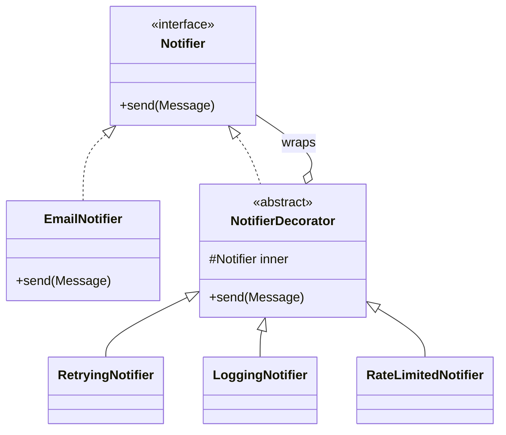

## The idea in plain words

You want to **add extra behaviour** to an object without changing its class. You wrap it in another object that has the **same interface**, does its extra bit, and passes the call through. Wrappers can be stacked in any order.

**Picture it:** a cup of chai. Start with plain chai, then add ginger, then add elaichi. Each addition wraps what was there, adds its own taste and adds to the price.

### The smallest example

```java
interface Chai { int price(); String describe(); }

class PlainChai implements Chai {
    public int price() { return 20; }
    public String describe() { return "Chai"; }
}

class WithGinger implements Chai {
    private final Chai inner;                                  // the object being wrapped
    WithGinger(Chai inner) { this.inner = inner; }
    public int price() { return inner.price() + 5; }           // do the inner work, then add
    public String describe() { return inner.describe() + " + ginger"; }
}

class WithElaichi implements Chai {
    private final Chai inner;
    WithElaichi(Chai inner) { this.inner = inner; }
    public int price() { return inner.price() + 7; }
    public String describe() { return inner.describe() + " + elaichi"; }
}

class Demo {
    public static void main(String[] args) {
        Chai order = new WithElaichi(new WithGinger(new PlainChai()));
        System.out.println(order.describe() + " = ₹" + order.price());   // Chai + ginger + elaichi = ₹32
    }
}
```

With subclasses you would need `GingerChai`, `ElaichiChai`, `GingerElaichiChai`… With decorators, each extra is one small class you combine as needed.

| Use it when | Skip it when |
| --- | --- |
| You need optional extras (logging, retry, caching, discounts) in different combinations | There's one fixed extra: just put it in the class |

The rest of this lesson uses a real notification service and explains why the order of wrapping matters.

**The textbook definition:** attach additional responsibilities to an object **dynamically**, by wrapping it in objects that implement the same interface. Decorators provide a flexible alternative to subclassing for extending behaviour.

## The problem: subclass explosion

A notification service sends messages. Requirements grow: some messages need **retries**, some need **rate limiting**, some need **logging**, some need **encryption** — in any combination.

With inheritance you'd need `RetryingNotifier`, `LoggingRetryingNotifier`, `EncryptedLoggingNotifier`… one subclass per combination: 2^4 = 16 classes for four features, and they can't be changed at runtime.

## The solution

Each extra behaviour becomes a **wrapper** that implements the same interface, holds a reference to another instance of that interface, does its extra work, and **delegates** the core call.



```java
public interface Notifier {
    void send(Message m);
}

public final class EmailNotifier implements Notifier {
    @Override public void send(Message m) { /* talk to SMTP */ }
}

public abstract class NotifierDecorator implements Notifier {
    protected final Notifier inner;
    protected NotifierDecorator(Notifier inner) { this.inner = Objects.requireNonNull(inner); }
    @Override public void send(Message m) { inner.send(m); }   // default: pure delegation
}

public final class LoggingNotifier extends NotifierDecorator {
    private static final Logger log = LoggerFactory.getLogger(LoggingNotifier.class);
    public LoggingNotifier(Notifier inner) { super(inner); }

    @Override public void send(Message m) {
        log.info("Sending {} to {}", m.id(), m.recipient());
        inner.send(m);
        log.info("Sent {}", m.id());
    }
}

public final class RetryingNotifier extends NotifierDecorator {
    private final int maxAttempts;
    public RetryingNotifier(Notifier inner, int maxAttempts) { super(inner); this.maxAttempts = maxAttempts; }

    @Override public void send(Message m) {
        for (int attempt = 1; ; attempt++) {
            try { inner.send(m); return; }
            catch (TransientDeliveryException e) {
                if (attempt == maxAttempts) throw e;
                sleepWithBackoff(attempt);
            }
        }
    }
}
```

Compose at wiring time — in any order, in any combination:

```java
Notifier notifier =
    new LoggingNotifier(
        new RateLimitedNotifier(
            new RetryingNotifier(new EmailNotifier(), 3),
            RateLimiter.perSecond(50)));

notifier.send(message);
```


Four features = four small classes, any of 16+ combinations, configurable at runtime.

## Order matters

Decorators form a stack; the outermost runs first. Consider what each order means:

- `Logging(Retrying(x))` logs **once** per send, regardless of retries.
- `Retrying(Logging(x))` logs **every attempt**.
- `RateLimited(Retrying(x))` counts one permit per logical send; `Retrying(RateLimited(x))` consumes a permit per attempt.

Make the intended order explicit in one wiring place (a factory or configuration), not scattered.

## Where you've seen it

- **Java I/O** — the canonical example:
  ```java
  var in = new DataInputStream(new BufferedInputStream(new FileInputStream(path)));
  ```
  `BufferedInputStream` and `DataInputStream` add buffering and typed reads to any `InputStream`.
- `Collections.unmodifiableList(list)`, `Collections.synchronizedMap(map)` — add read-only or synchronized behaviour to any collection.
- Servlet `HttpServletRequestWrapper`, Spring's `TransactionAwareDataSourceProxy`.
- Middleware chains and HTTP client interceptors are decorator-like.

## When to use

- You need to add behaviour to individual objects **without affecting others** of the same class.
- Features combine in many ways (cross-cutting concerns: logging, caching, retries, metrics, validation, compression, encryption).
- Subclassing is impossible (final class) or would explode combinatorially.

## Pitfalls

- **Identity**: a decorated object is not `==` (or `instanceof` the concrete type of) the original. Code relying on concrete types breaks.
- **Removing a decorator** from the middle of a stack is awkward — rebuild the chain instead.
- **Large interfaces** are painful: every decorator must implement every method (use an abstract base that delegates by default, as above).
- **Debugging** deep stacks can be confusing; keep stacks shallow and named.

## Pros and cons

| Pros | Cons |
| --- | --- |
| Add/remove responsibilities at runtime | Many small objects; stack traces get deeper |
| Combine behaviours freely without subclass explosion | Order-dependent behaviour can be subtle |
| Each decorator has one responsibility (SRP), new ones don't change existing code (OCP) | Hard to remove a specific wrapper from the middle |

## Comparisons

| | Decorator | Proxy | Adapter | Chain of Responsibility | Composite | Strategy |
| --- | --- | --- | --- | --- | --- | --- |
| Interface | Same as wrapped | Same | Different | Same handler interface | Same as children | Different (algorithm interface) |
| Purpose | **Add** behaviour | **Control access** | **Convert** interface | **Route/handle** a request | **Aggregate** children | **Swap internals** |
| Who builds the structure | The **client** composes | Proxy usually manages its subject's lifecycle | Wiring code | Client/config | Client | Context holds one strategy |
| Can stop the flow? | No — always delegates | Yes (e.g., deny access) | — | Yes — any handler can stop | — | — |

A memorable line: **Decorator changes an object's skin; Strategy changes its guts.** Decorator and Composite both use recursive composition, but a decorator has exactly one wrapped component and adds behaviour, while a composite has many children and aggregates their results.

<Callout type="interview">
Decorator is a great answer when an interviewer asks "how would you add caching/logging/retries to this repository or client without touching it?" — wrap it behind the same interface. It's also how you'd explain Spring AOP proxies conceptually.
</Callout>

## Interview questions

<QA q="How is Decorator different from inheritance for adding behaviour?">
Inheritance adds behaviour statically, to all instances of a subclass, and every combination of features needs its own subclass. Decorator adds behaviour to individual objects at runtime by wrapping them, and features compose freely in any order, with each feature a small single-purpose class. Decorators also work with final classes and any implementation of the interface.
</QA>

<QA q="Decorator vs Proxy — they look identical. What's the difference?">
Structurally both wrap an object behind the same interface. The intent differs: a decorator adds responsibilities and is composed by the client, often several deep; a proxy controls access to its subject — lazy creation, access checks, remote calls, caching — and typically manages the subject's lifecycle itself, usually as a single layer the client may not even know exists.
</QA>

<QA q="You've wrapped a repository with a caching decorator. What can go wrong?">
Cache invalidation: writes through other paths (another instance, another service, direct DB updates) leave stale entries, so you need TTLs or invalidation on write. Decorator order matters if combined with transactions or retries (caching a value from a transaction that later rolls back). And the cache must be thread-safe and bounded to avoid memory leaks.
</QA>

<Practice task="Add caching, metrics and retries to a ProductRepository without changing it. In which order do you wrap them, and why?">

A sensible stack: `Metrics(Caching(Retrying(JdbcProductRepository)))`. Metrics outermost, so it measures what callers experience (including cache hits). Caching next, so a hit skips retries and the database. Retrying innermost, so only real database calls are retried — retrying around the cache would be pointless. Each decorator implements `ProductRepository` and wraps the next, composed in one wiring place. Mention invalidation on writes, and that the cache must be thread-safe and bounded.

</Practice>

<Takeaways>

- Decorators implement the same interface as the object they wrap and delegate to it, adding behaviour before or after.
- They replace combinatorial subclassing with composable, runtime wrappers.
- Wrapping order defines behaviour — wire it explicitly in one place.
- Java I/O streams and Collections wrappers are textbook examples.

</Takeaways>

## Further reading

- Gamma et al., *Design Patterns* (1994) — Decorator.
- Freeman and Robson, *Head First Design Patterns* (2nd ed.) — the Starbuzz Coffee and Java I/O chapters.
- Alexander Shvets, *Dive Into Design Patterns* — "Decorator".
