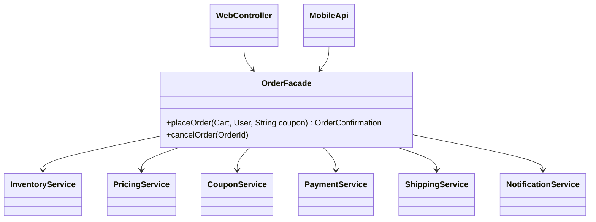

**Intent:** provide a **simplified, unified interface** to a set of interfaces in a subsystem, making the subsystem easier to use.

## The problem

Placing an order touches many components: inventory reservation, pricing, coupon validation, payment, shipment creation and notification. A controller that orchestrates all of them directly knows every class, every call order and every failure mode:

```java
// ❌ Every caller (web controller, mobile API, admin tool) repeats this choreography
inventory.reserve(cart.items());
Money price = pricing.calculate(cart, user.tier());
price = coupons.apply(couponCode, price);
PaymentResult r = payments.charge(user.paymentMethod(), price);
if (!r.ok()) { inventory.release(cart.items()); throw ...; }
Shipment s = shipping.create(order, user.address());
notifications.orderPlaced(user, order, s);
```

Clients are tightly coupled to the subsystem's internals; any change ripples into all of them.

## The solution

A **facade** offers a small set of high-level operations and does the orchestration internally.



```java
public final class OrderFacade {
    private final InventoryService inventory;
    private final PricingService pricing;
    private final CouponService coupons;
    private final PaymentService payments;
    private final ShippingService shipping;
    private final NotificationService notifications;

    public OrderFacade(InventoryService inventory, PricingService pricing, CouponService coupons,
                       PaymentService payments, ShippingService shipping, NotificationService notifications) {
        this.inventory = inventory; this.pricing = pricing; this.coupons = coupons;
        this.payments = payments; this.shipping = shipping; this.notifications = notifications;
    }

    public OrderConfirmation placeOrder(Cart cart, User user, String couponCode) {
        Reservation reservation = inventory.reserve(cart.items());
        try {
            Money total = coupons.apply(couponCode, pricing.calculate(cart, user.tier()));
            PaymentReceipt receipt = payments.charge(user.defaultPaymentMethod(), total);
            Shipment shipment = shipping.create(cart, user.address());
            reservation.commit();
            notifications.orderPlaced(user, shipment);
            return new OrderConfirmation(receipt.id(), shipment.trackingId(), total);
        } catch (RuntimeException e) {
            reservation.release();           // compensate on any failure
            throw e;
        }
    }
}
```

Controllers now call `orderFacade.placeOrder(cart, user, coupon)`.

Key properties:

- The facade **doesn't add new capabilities** — it combines existing ones.
- The subsystem **doesn't know** the facade exists; its classes remain directly usable for advanced cases.
- You can have **several facades** for different client needs (a `CheckoutFacade` and an `AdminOrderFacade`).

## Where you've seen it

- `javax.faces.context.FacesContext`, `java.net.URL.openStream()` (hides connection setup, protocol handlers and streams).
- Spring's `JdbcTemplate` — a facade over JDBC's connection, statement, result-set and exception handling.
- SLF4J's `Logger` — a facade over logging implementations (it's literally the "Simple Logging *Facade* for Java").
- Service-layer classes in most applications are facades over repositories and domain objects.
- At architecture level, an **API gateway** or **backend-for-frontend** is a facade over many services.

## Pitfalls

- **God facade**: if the facade grows to dozens of unrelated methods, it becomes the very coupling magnet it was meant to remove. Split it by use case or client.
- **Leaky facade**: returning subsystem types (e.g., a vendor's `RzpPayment`) re-exposes the internals. Return your own simple types.
- **Business logic creep**: a facade should orchestrate, not own complex domain rules — those belong in the domain objects.

## Pros and cons

| Pros | Cons |
| --- | --- |
| Clients isolated from subsystem complexity and changes | Risk of becoming a god object |
| One place for orchestration and compensation logic | Another layer to maintain |
| Clear entry points per use case | Can hide useful subsystem features if clients can't bypass it |

## Comparisons

- **Facade vs Adapter**: Adapter makes an *existing* interface fit an *expected* one, usually wrapping one object. Facade defines a *new, simpler* interface over *many* objects.
- **Facade vs Mediator**: both organise collaboration between many classes. A facade is a one-way front door — subsystem objects don't know about it and may still talk to each other. A [mediator](/system-design/lld/mediator-pattern) sits *between* components, which communicate only through it.
- **Facade vs Abstract Factory**: if you only need to hide *how subsystem objects are created*, an abstract factory can do that instead.
- A single facade instance is usually enough, so facades are often single (ideally injected) instances.

<Callout type="interview">
In machine-coding rounds your top-level service class (`ParkingService`, `BookingService`) is effectively a facade: it exposes the use cases (`park`, `book`) and orchestrates repositories, strategies and validators underneath. Saying so — and keeping it thin — shows you understand the pattern's role.
</Callout>

## Facade over a third-party SDK

One of the most valuable facades wraps a vendor SDK you do not control. The SDK's awkward API, its error codes and its types stay inside one class; the rest of your code uses a small interface with your own types. Switching vendors, or testing without the network, then touches one class.

```java
// ---- A clumsy third-party SDK we don't control (simplified)
public final class AcmePayClient {
    public String createOrder(long amountPaise, String currency) { return "ord_" + amountPaise; }
    public Map<String, String> capture(String orderId, String cardToken) {
        if (cardToken.startsWith("bad")) return Map.of("status", "FAILED", "error_code", "CARD_DECLINED");
        return Map.of("status", "CAPTURED", "payment_id", "pay_" + orderId);
    }
}

// ---- Our own types: the rest of the codebase never sees the SDK
public record Money(long minorUnits, String currency) { }

public sealed interface PaymentResult {
    record Paid(String paymentId) implements PaymentResult { }
    record Declined(String reason) implements PaymentResult { }
}

public interface Payments {                               // what callers depend on (easy to fake in tests)
    PaymentResult charge(Money amount, String cardToken);
}

// ---- The facade: one simple call that hides the SDK's two-step flow and its stringly-typed results
public final class AcmePaymentsFacade implements Payments {
    private final AcmePayClient client;

    public AcmePaymentsFacade(AcmePayClient client) { this.client = client; }

    @Override public PaymentResult charge(Money amount, String cardToken) {
        String orderId = client.createOrder(amount.minorUnits(), amount.currency());
        Map<String, String> response = client.capture(orderId, cardToken);
        return "CAPTURED".equals(response.get("status"))
                ? new PaymentResult.Paid(response.get("payment_id"))
                : new PaymentResult.Declined(response.getOrDefault("error_code", "UNKNOWN"));
    }
}

public final class FacadeDemo {
    public static void main(String[] args) {
        Payments payments = new AcmePaymentsFacade(new AcmePayClient());
        System.out.println(payments.charge(new Money(49_900, "INR"), "tok_visa"));
        System.out.println(payments.charge(new Money(49_900, "INR"), "bad_tok"));

        // In a test, callers use a fake instead of the SDK
        Payments alwaysDeclines = (amount, token) -> new PaymentResult.Declined("TEST");
        System.out.println(alwaysDeclines.charge(new Money(100, "INR"), "x"));
    }
}
```

Output:

```text
Paid[paymentId=pay_ord_49900]
Declined[reason=CARD_DECLINED]
Declined[reason=TEST]
```

In domain-driven design this is called an **anti-corruption layer**: it stops another system's model from leaking into yours. It is also where Facade and [Adapter](/system-design/lld/adapter-pattern) meet: the class is a facade (one simple call hiding a two-step flow) that also adapts the SDK to your `Payments` interface.

## Testing with facades

- Depend on an **interface** (`Payments`) rather than the concrete facade, so callers can be tested with a one-line fake, as in the example.
- Test the **facade itself** with fake subsystem objects: check the order of calls and that failures trigger the right compensation (releasing inventory when payment fails).
- Keep the facade free of business rules; then its tests stay short, and the rules are tested where they live.

## What interviewers probe

When your design has a facade (often the top-level service in a machine-coding round), expect questions about **failure handling** (what is compensated if step 4 of 6 fails?), **idempotency** (what if the client retries `placeOrder` after a timeout?) and **transaction boundaries** (which steps must succeed or fail together?). A good answer keeps the facade thin but explicit about these three.

## Interview questions

<QA q="What's the difference between a Facade and a Mediator?">
A facade provides a simplified interface to a subsystem for outside clients; the subsystem's classes don't know the facade exists and can still interact directly. A mediator coordinates communication among a set of peer components that know only the mediator and no longer call each other directly. Facade simplifies access from outside; mediator decouples interactions inside.
</QA>

<QA q="How do you stop a facade from becoming a god class?">
Scope each facade to a cohesive set of use cases or a single client type, keep it to orchestration (calling subsystem services in order, handling compensation), push business rules into domain objects and services, and return simple domain types rather than subsystem objects. When it grows, split by use case — for example, CheckoutFacade and ReturnsFacade.
</QA>

<QA q="Should a facade be an interface or a concrete class?">
Callers should depend on an interface when the facade hides something you may want to replace or fake — a third-party SDK, a remote service, an expensive subsystem. That makes callers easy to test and lets you swap implementations. For an internal orchestration facade with a single implementation, a concrete class with injected dependencies is fine; you can extract an interface later if a second implementation or heavy testing needs appear.
</QA>

<Practice task="CheckoutFacade.placeOrder has grown to 400 lines with fraud checks, loyalty points and gift-wrapping logic. What's wrong, and how do you fix it without losing the simple entry point?">

The facade has become a god object: it owns business rules instead of orchestrating. Move each rule into its own domain service (`FraudCheck`, `LoyaltyService`, `GiftWrapService`), or into the domain objects that own the data, and keep the facade to sequencing calls and compensating on failure. Optional follow-ups can react to an `OrderPlaced` event instead (Observer). Callers still call one `placeOrder` method.

</Practice>

<Practice task="Your app stores files on one cloud provider today and may move to another next year. The provider's SDK is used directly in 30 places. Design the change.">

Introduce your own `FileStore` interface with the operations the app really needs: `put(key, bytes, contentType)`, `get(key)`, `delete(key)`, `signedUrl(key, ttl)`. Use your own types and exceptions (`FileNotFound`, `StorageUnavailable`).

Implement it as a facade over today's SDK (`ProviderAFileStore`), hiding multipart uploads, retries, client configuration and the SDK's exception types. Replace the 30 call sites one at a time to use `FileStore`; nothing else should import the SDK (enforce it with an architecture test or a package rule).

Moving providers later means writing `ProviderBFileStore` and switching the wiring, plus a data migration. Tests use an in-memory `FileStore`.

</Practice>

<Takeaways>

- A facade is a simple front door to a complex subsystem: few high-level methods, orchestration inside.
- It doesn't add functionality and doesn't prevent direct subsystem access.
- Keep facades thin and use-case focused; return your own types.
- Service layers, JdbcTemplate, SLF4J and API gateways are facades.
- Wrap third-party SDKs in a facade with your own interface and types (an anti-corruption layer); it makes testing and switching vendors cheap.

</Takeaways>

## Further reading

- Gamma et al., *Design Patterns* (1994) — Facade.
- Alexander Shvets, *Dive Into Design Patterns* — "Facade".
