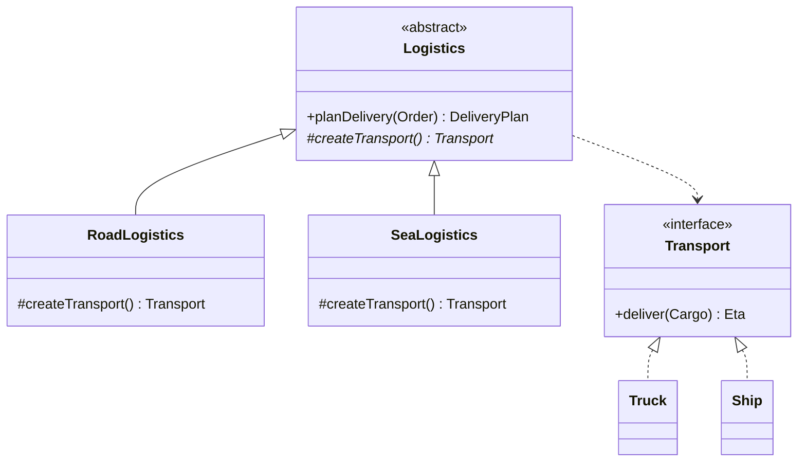
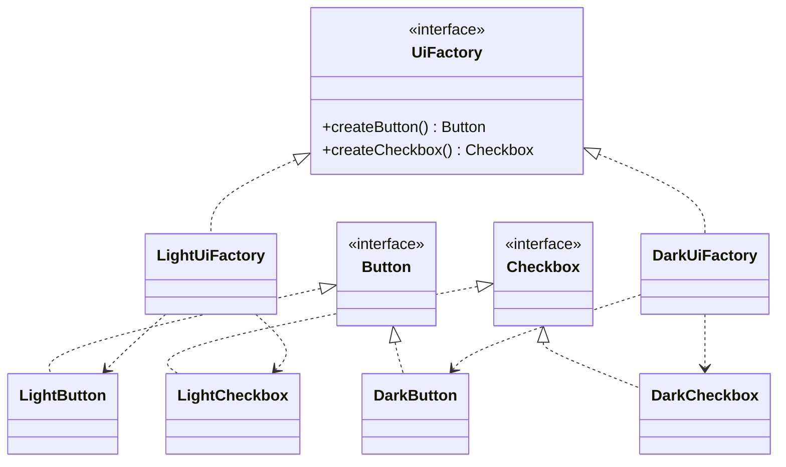

## The idea in plain words

A **factory** is one place in your code whose job is to create objects. The rest of the code asks the factory for "a notifier for SMS" and gets one back, without knowing or caring which class was used.

**Picture it:** at a tea stall you say "one masala chai". You don't boil the milk yourself or pick the pan. If the stall changes its recipe tomorrow, you still order the same way.

### The smallest example

```java
interface Notifier { void send(String to, String msg); }

class EmailNotifier implements Notifier {
    public void send(String to, String msg) { System.out.println("Email to " + to + ": " + msg); }
}
class SmsNotifier implements Notifier {
    public void send(String to, String msg) { System.out.println("SMS to " + to + ": " + msg); }
}

class NotifierFactory {
    static Notifier create(String channel) {              // the only place that says "new"
        return switch (channel) {
            case "email" -> new EmailNotifier();
            case "sms"   -> new SmsNotifier();
            default -> throw new IllegalArgumentException("Unknown channel: " + channel);
        };
    }
}

class Demo {
    public static void main(String[] args) {
        NotifierFactory.create("sms").send("98450 12345", "Your OTP is 4821");
    }
}
```

Adding WhatsApp means one new class and one new line in the factory. No caller changes.

That example is a **Simple Factory**. Two more "factory" patterns build on the same idea:

- **Factory Method:** the "create" step is a method that **subclasses override**. A `Dialog` calls `createButton()`; a `WindowsDialog` returns a Windows button.
- **Abstract Factory:** one object that creates a **matching set** of things. A `DarkTheme` factory makes a dark button, a dark checkbox and a dark menu, so you never mix themes by accident.

| Use a factory when | Skip it when |
| --- | --- |
| Which class to create depends on input or configuration, or creating is more than one line | There's only one class and a plain `new` reads fine |

Here is how the three compare, and when interviewers expect each one.

Three related ideas share the word "factory". Interviewers expect you to distinguish them:

| | Simple Factory | Factory Method (GoF) | Abstract Factory (GoF) |
| --- | --- | --- | --- |
| What it is | A method/class that creates objects based on input | A method subclasses **override** to decide what to create | An object that creates **families** of related objects |
| Mechanism | Conditional logic in one place | Inheritance | Composition |
| Varies | The concrete product, by parameter | The product, by subclass | A whole set of products, consistently |
| Example | `NotificationFactory.create("SMS")` | `Dialog.createButton()` overridden by `WindowsDialog` | `UiFactory` producing matching button + checkbox + menu |

## Why factories exist

`new ConcreteClass()` hard-wires a dependency on a concrete type. If the type depends on configuration, input or platform, scattering `new` across the code spreads that decision everywhere:

```java
// ❌ Creation logic duplicated wherever a notifier is needed
Notifier n;
if (pref.equals("EMAIL")) n = new EmailNotifier(smtp);
else if (pref.equals("SMS")) n = new SmsNotifier(twilio);
else n = new PushNotifier(fcm);
```

Factories **centralise creation** and let the rest of the code depend only on the abstraction (`Notifier`).

## Simple Factory (not a GoF pattern, but the one you'll use most)

```java
public final class NotifierFactory {
    private final SmtpClient smtp;
    private final SmsGateway sms;
    private final PushClient push;

    public NotifierFactory(SmtpClient smtp, SmsGateway sms, PushClient push) {
        this.smtp = smtp; this.sms = sms; this.push = push;
    }

    public Notifier forChannel(Channel channel) {
        return switch (channel) {
            case EMAIL -> new EmailNotifier(smtp);
            case SMS   -> new SmsNotifier(sms);
            case PUSH  -> new PushNotifier(push);
        };
    }
}
```

One `switch` in **one** place is acceptable — that's the factory's job. The problem in the "before" code was the same decision duplicated everywhere.

**Registry variant** (avoids editing the switch for every new type):

```java
public final class NotifierRegistry {
    private final Map<Channel, Supplier<Notifier>> creators = new EnumMap<>(Channel.class);

    public void register(Channel c, Supplier<Notifier> creator) { creators.put(c, creator); }

    public Notifier create(Channel c) {
        var creator = creators.get(c);
        if (creator == null) throw new IllegalArgumentException("No notifier for " + c);
        return creator.get();
    }
}
```

## Factory Method

**The textbook definition:** define an interface for creating an object, but let **subclasses** decide which class to instantiate.

### The problem

A logistics app started with road transport. A `LogisticsService` plans deliveries and creates `Truck`s inside its planning logic. Now sea freight arrives: the planning algorithm is identical, only the vehicle differs. Copy-pasting the service per transport type duplicates the algorithm.

### The solution

Move the `new Truck()` call into an overridable **factory method**. The base class's algorithm calls it; subclasses decide what it returns.



```java
public abstract class Logistics {
    // The business logic is written once, against the Transport abstraction
    public DeliveryPlan planDelivery(Order order) {
        Transport transport = createTransport();          // factory method
        Eta eta = transport.deliver(order.cargo());
        return new DeliveryPlan(order.id(), eta);
    }

    protected abstract Transport createTransport();
}

public class RoadLogistics extends Logistics {
    @Override protected Transport createTransport() { return new Truck(); }
}

public class SeaLogistics extends Logistics {
    @Override protected Transport createTransport() { return new Ship(); }
}
```

Key point: the factory method is usually **not the main purpose** of the creator class — `Logistics` exists to plan deliveries; creation is one step of that work. Factory Method is a specialisation of [Template Method](/system-design/lld/template-method-pattern).

### Where you've seen it

- `Collection.iterator()` — each collection subclass returns its own iterator type.
- `java.util.AbstractList.listIterator()`, and framework hooks such as Spring's `FactoryBean.getObject()`.
- (Not to be confused with **static** factory methods such as `Calendar.getInstance()` or `NumberFormat.getInstance()` — see below.)

### Static factory methods (Effective Java Item 1)

Distinct from GoF Factory Method but worth knowing: `Optional.of`, `List.of`, `Integer.valueOf`, `LocalDate.of`. Advantages over constructors: **names** (`BigInteger.probablePrime`), can **return cached instances** (`Integer.valueOf` caches -128..127), can **return subtypes** (`EnumSet.of` returns `RegularEnumSet` or `JumboEnumSet`).

## Abstract Factory

**Intent:** provide an interface for creating **families of related objects** without specifying their concrete classes.

### The problem

A UI toolkit renders on Light and Dark themes. Each theme has its own `Button`, `Checkbox` and `TextField`. Mixing a dark button with a light checkbox must be impossible. Client code shouldn't contain theme checks.

### The solution



```java
public interface UiFactory {
    Button createButton(String label);
    Checkbox createCheckbox(String label);
}

public final class DarkUiFactory implements UiFactory {
    public Button createButton(String label)     { return new DarkButton(label); }
    public Checkbox createCheckbox(String label) { return new DarkCheckbox(label); }
}

public final class SettingsScreen {
    private final UiFactory ui;
    public SettingsScreen(UiFactory ui) { this.ui = ui; }      // chosen once, at startup

    public void render() {
        ui.createCheckbox("Notifications").render();
        ui.createButton("Save").render();                     // always the same family
    }
}
```

The application picks the concrete factory **once** (from config or environment) and passes it around. Every product created through it is guaranteed to match.

### Real-world examples

- **Cross-database access**: a `DataSourceFactory` creating matching `Connection`, `Dialect` and `IdGenerator` for MySQL vs PostgreSQL.
- **Payment providers**: a provider factory producing a matching `PaymentClient`, `RefundClient` and `WebhookVerifier` for Stripe vs Razorpay.
- **JDK**: `javax.xml.parsers.DocumentBuilderFactory`, `TransformerFactory`.

### Trade-off

Adding a **new family** (a High-Contrast theme) is easy — one new factory plus its products. Adding a **new product type** (a `Slider`) is hard — the `UiFactory` interface and every factory must change.

## Choosing between them

| Situation | Use |
| --- | --- |
| Pick one implementation from input/config, in one place | Simple factory (often with a registry) |
| A base class's algorithm needs an object whose type subclasses decide | Factory Method |
| Several related objects must be created consistently as a set | Abstract Factory |
| Many optional parameters for one complex object | [Builder](/system-design/lld/builder-pattern) |
| Copying a configured object is cheaper than building it | [Prototype](/system-design/lld/prototype-pattern) |

Designs often **start** with Factory Method (simple, subclass-driven) and **evolve** toward Abstract Factory, Prototype or Builder as flexibility needs grow. Abstract Factories are frequently implemented with a set of factory methods, and are often single instances.

## Pros and cons

| Pros | Cons |
| --- | --- |
| Client code depends on abstractions, not concrete classes (DIP) | More classes and indirection |
| Creation logic in one place (SRP) | Abstract Factory makes adding new product *types* expensive |
| New products/families added without changing clients (OCP) | Factory Method forces subclassing just to change a product |

<Callout type="interview">
In machine coding, a simple factory or registry mapping an enum or string to an implementation is the most common, pragmatic use. Name it honestly — "a simple factory" — and mention Factory Method/Abstract Factory only if the structure genuinely matches.
</Callout>

## Interview questions

<QA q="What's the difference between Factory Method and Abstract Factory?">
Factory Method uses inheritance: a creator class defines an abstract creation method used by its own algorithm, and subclasses override it to choose the product — it creates one product. Abstract Factory uses composition: a separate factory object with several creation methods produces a family of related products that must be used together, and the client receives the whole factory. Abstract Factories are often implemented using factory methods.
</QA>

<QA q="Isn't a switch statement in a factory a violation of the Open/Closed Principle?">
Strictly, adding a new type means editing the switch. But it's confined to one well-known place whose only job is mapping input to implementations, instead of being duplicated across the codebase — a pragmatic, widely accepted trade-off. If types are added frequently or by plugins, replace the switch with a registry where implementations register themselves, which makes the factory itself closed for modification.
</QA>

<QA q="Why might you prefer a static factory method over a public constructor?">
Static factories have descriptive names, can return cached or pooled instances instead of always allocating, can return any subtype of the declared return type (hiding implementation classes), and can choose the subtype based on parameters. Downsides: classes without public or protected constructors can't be subclassed, and static factories are less discoverable than constructors in documentation.
</QA>

<Practice task="An app supports Stripe and Razorpay; each needs a matching payment client, refund client and webhook verifier, and a merchant must never mix them. Which factory pattern fits, and what does adding PayPal cost?">

**Abstract Factory**: a `PaymentProviderFactory` interface with `paymentClient()`, `refundClient()` and `webhookVerifier()`, implemented by `StripeFactory` and `RazorpayFactory`. The merchant's factory is chosen once (from a registry keyed by provider) and passed to checkout, so the three objects always match. Adding PayPal is one new factory plus its three products — no client changes. Adding a new product type (a `PayoutClient`) is the expensive direction: every factory changes.

</Practice>

<Takeaways>

- Factories centralise creation so clients depend on abstractions.
- Simple factory: one method maps input to an implementation; use a registry to avoid growing switches.
- Factory Method: subclasses override a creation step inside a base-class algorithm.
- Abstract Factory: one object creates a consistent family of products; easy to add families, hard to add product types.

</Takeaways>

## Further reading

- Gamma et al., *Design Patterns* (1994) — Factory Method, Abstract Factory.
- Joshua Bloch, *Effective Java* (3rd ed.) — Item 1: "Consider static factory methods instead of constructors".
- Alexander Shvets, *Dive Into Design Patterns* — "Factory Method" and "Abstract Factory".
