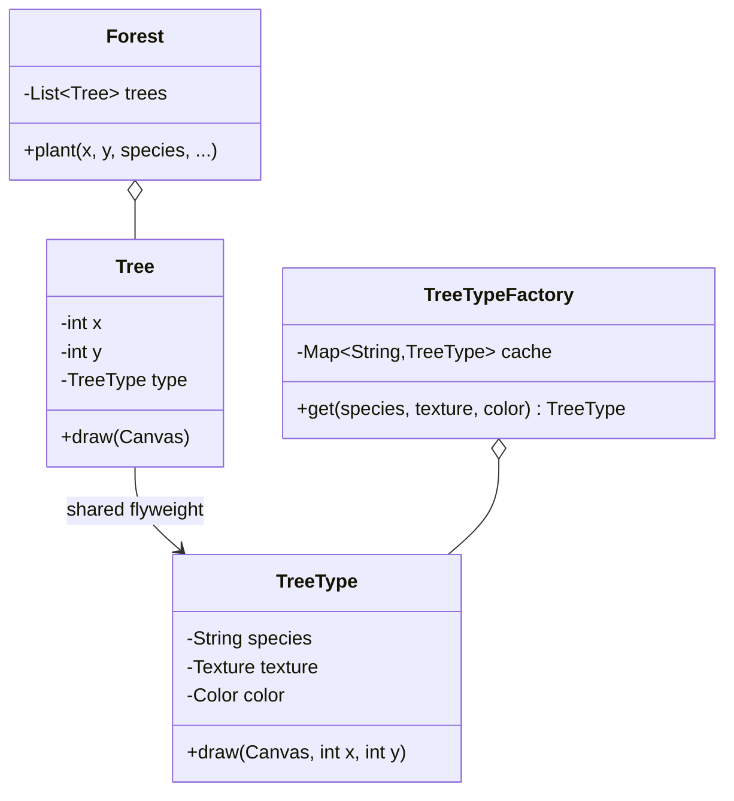

**Intent:** support **large numbers of fine-grained objects** efficiently by **sharing** the parts of their state that are common, instead of storing a copy in every object.

Flyweight is a **memory optimisation**. Reach for it only when you've measured (or can estimate) that object count is the problem.

## The problem

A map renders 2 million trees. Each tree object stores:

```text
x, y coordinates            16 bytes   (unique per tree)
species name                ~40 bytes  (one of ~20 species)
texture bitmap reference    →  but the bitmap itself is ~200 KB if copied per tree!
colour, leaf shape, model   ~100 bytes (same for every tree of a species)
```

If each tree holds its own copy of species data, memory explodes — even though only ~20 distinct species exist.

## The solution: split intrinsic and extrinsic state

- **Intrinsic state** — data that's the same for many objects and **doesn't change**: species, texture, model. Store it **once** in a shared, **immutable** flyweight.
- **Extrinsic state** — data unique to each instance: coordinates. Keep it **outside** the flyweight (in the context object or passed in at call time).



```java
// Flyweight: immutable intrinsic state, shared by thousands of trees
public final class TreeType {
    private final String species;
    private final Texture texture;
    private final Color color;

    TreeType(String species, Texture texture, Color color) {
        this.species = species; this.texture = texture; this.color = color;
    }

    public void draw(Canvas canvas, int x, int y) {          // extrinsic state passed in
        canvas.drawImage(texture, x, y, color);
    }
}

// Factory guarantees one instance per unique intrinsic state
public final class TreeTypeFactory {
    private final Map<String, TreeType> cache = new ConcurrentHashMap<>();

    public TreeType get(String species, Texture texture, Color color) {
        String key = species + "|" + texture.id() + "|" + color.getRGB();
        return cache.computeIfAbsent(key, k -> new TreeType(species, texture, color));
    }
}

// Context: small per-instance object holding extrinsic state + reference to the flyweight
public record Tree(int x, int y, TreeType type) {
    public void draw(Canvas c) { type.draw(c, x, y); }
}
```

Memory now: 2M × (two ints + one reference ≈ 24–32 bytes) + 20 shared `TreeType`s — instead of 2M full copies.

## Rules for a correct flyweight

1. Flyweights must be **immutable** — they're shared; one client mutating one would affect every user.
2. Clients **must not create flyweights with `new`**; always go through the factory so sharing actually happens.
3. Extrinsic state lives in the context object or is passed to methods.
4. The factory's cache must be **thread-safe** if used concurrently (`ConcurrentHashMap.computeIfAbsent`).

## Where you've seen it

- **`Integer.valueOf(int)`** caches values -128 to 127 — `Integer.valueOf(100) == Integer.valueOf(100)` is `true`, but for 1000 it's `false` (a classic Java trick question). Same for `Long`, `Short`, `Byte`, `Character` and `Boolean.valueOf`.
- **String interning** — the string pool shares identical string literals; `String.intern()` explicitly.
- **Enum constants** are shared singletons per value.
- Text editors storing glyph/font formatting once per style rather than per character; game engines sharing meshes and textures across instances.

## Trade-offs

| Pros | Cons |
| --- | --- |
| Huge memory savings with many similar objects | Trades memory for CPU: extrinsic state may be recomputed or passed around |
| Fewer allocations, less GC pressure | Code is more complex; state split across objects |
| Shared objects are immutable → thread-safe | Only worth it when object counts are very large |

## Related patterns

- **Flyweight vs Singleton**: a flyweight factory may hold *many* instances (one per distinct intrinsic state), and flyweights must be immutable; a singleton is exactly one instance and may be mutable.
- **Composite**: shared leaf nodes in a large tree can be flyweights.
- **Facade** is about one object representing a subsystem; Flyweight is about making many small objects cheap.

## How much does it actually save?

Do the arithmetic before reaching for the pattern. On a 64-bit HotSpot JVM with compressed references (the default for heaps under 32 GB), every object has a 12-byte header, a reference takes 4 bytes, and objects are padded to a multiple of 8 bytes.

```text
Without sharing: each Tree holds x, y and its own TreeData (species, colour, model…)
  Tree:      12 header + 8 (two ints) + 4 (ref) = 24 B
  TreeData:  12 header + ~5 refs and fields ≈ 40 B, plus its own strings ≈ 60 B
  ≈ 120 B per tree × 2M trees ≈ 240 MB

With a flyweight: each Tree holds x, y and a reference to one of 20 shared TreeTypes
  Tree: 24 B × 2M ≈ 48 MB, plus 20 TreeTypes (negligible)
```

A 5× saving, and the real win is larger when the shared part holds big data such as textures or meshes. If each object only has a few bytes of shareable state, the extra indirection is not worth it.

## A runnable example: styled text

A text editor where every character can have a style is the classic interview version. Each distinct style becomes one immutable, shared object; characters keep only the character and a reference to their style.

```java
// Flyweight: one immutable Style per distinct combination, shared by every character that uses it
public record Style(String font, int size, int rgb, boolean bold) { }

public final class StyleFactory {
    private final Map<Style, Style> cache = new ConcurrentHashMap<>();

    public Style get(String font, int size, int rgb, boolean bold) {
        Style candidate = new Style(font, size, rgb, bold);   // records give equals/hashCode for free
        return cache.computeIfAbsent(candidate, k -> k);       // first one in becomes the shared instance
    }

    public int distinctStyles() { return cache.size(); }
}

// Context: per-character extrinsic state (the character itself) + a reference to the shared style
public record StyledChar(char ch, Style style) { }

public final class Document {
    private final List<StyledChar> chars = new ArrayList<>();
    private final StyleFactory styles;

    public Document(StyleFactory styles) { this.styles = styles; }

    public void type(String text, String font, int size, int rgb, boolean bold) {
        Style s = styles.get(font, size, rgb, bold);
        for (char c : text.toCharArray()) chars.add(new StyledChar(c, s));
    }

    public int length() { return chars.size(); }
}

public final class FlyweightDemo {
    public static void main(String[] args) {
        StyleFactory styles = new StyleFactory();
        Document doc = new Document(styles);
        for (int i = 0; i < 10_000; i++) {
            doc.type("Hello, ", "Inter", 12, 0x000000, false);
            doc.type("world", "Inter", 12, 0x000000, true);
            doc.type("!\n", "Inter", 12, 0xFF0000, true);
        }
        System.out.println(doc.length() + " characters, " + styles.distinctStyles() + " style objects");
        System.out.println(styles.get("Inter", 12, 0, false) == styles.get("Inter", 12, 0, false));   // same instance
    }
}
```

Output: `140000 characters, 3 style objects` and `true`. Records give value-based `equals` and `hashCode`, which makes the record itself a convenient cache key. Real editors go one step further and store **style runs** (style X from position 10 to 57) instead of one reference per character.

## Common mistakes

- **Mutable flyweights.** If any client can change a shared object, every other user sees the change. Make flyweights immutable (final fields, records, no setters).
- **Bypassing the factory.** Creating flyweights with `new` silently creates duplicates; keep the constructor package-private or private.
- **Keying the cache on the wrong fields.** Leaving a field out of the key returns a flyweight with the wrong state; including extrinsic data in the key defeats sharing.
- **A cache that never forgets.** A factory that keeps every flyweight it ever made is a memory leak if the set of distinct states keeps growing. Bound it, or clear entries that are no longer used.
- **Confusing it with an object pool.** See the interview question below.

<Callout type="interview">
In LLD rounds Flyweight shows up as **chess** (one shared object per piece type and colour; the board stores positions), **text editors and spreadsheets** (shared formats), **maps and games** (shared sprites, textures and tile types) and the `Integer` cache trick question. Mention it when the interviewer asks how the design behaves with millions of objects.
</Callout>

## Interview questions

<QA q="Why does Integer.valueOf(127) == Integer.valueOf(127) return true, but Integer.valueOf(128) == Integer.valueOf(128) return false?">
Integer.valueOf uses a flyweight cache for values from -128 to 127 (the upper bound is configurable with a JVM flag), returning the same shared instance for those values. Outside that range it allocates new objects, so == compares two different references. Always compare boxed numbers with equals, not ==.
</QA>

<QA q="What is intrinsic vs extrinsic state?">
Intrinsic state is the part of an object's data that's shared and context-independent — it can be stored once in an immutable flyweight (a tree species' texture, a character's font). Extrinsic state is context-specific and varies per instance (a tree's position, a character's location in the document); it's kept outside the flyweight and supplied by the client when needed.
</QA>

<QA q="How is a flyweight different from an object pool?">
A flyweight is shared by many clients at the same time, so it must be immutable; nobody owns it and nothing is returned. An object pool lends out expensive, usually mutable objects (database connections, threads, buffers) to one client at a time; the client must return the object, and the pool resets it before lending it again. Flyweight saves memory by sharing identical state; pooling saves the cost of creating and destroying objects.
</QA>

<Practice task="A text editor stores a style object (font, size, colour, bold) per character, and a 10 MB document uses 2 GB. Apply Flyweight.">

Split the state: the style is **intrinsic** (shared, immutable) and each character's code and position are **extrinsic**. A `StyleFactory` returns one shared immutable `Style` per distinct combination (cached in a map), and each character stores only its code and a reference to its style — or, better, store styles as runs (ranges of characters sharing a style). Documents use a handful of styles, so memory drops from one style object per character to a few dozen.

</Practice>

<Practice task="Design the pieces for a chess server that hosts 100,000 games at once. Where does Flyweight fit, and what state stays per game?">

Intrinsic state (shared): a piece's type and colour, its symbol and its movement rules. There are only 12 combinations, so create 12 immutable `Piece` flyweights through a factory (an `enum` of piece kinds works perfectly in Java).

Extrinsic state (per game): where each piece stands, whether it has moved (for castling and pawn double steps), captured pieces and the move history. The board is an 8 × 8 array of references to the shared pieces, plus that per-game state.

Memory per game is then the board array and the history, not 32 piece objects with duplicated rules. Movement rules live once in the shared pieces and are given the board as a parameter.

</Practice>

<Takeaways>

- Flyweight shares immutable intrinsic state among many objects; extrinsic state stays per instance.
- A factory with a cache ensures one flyweight per distinct intrinsic state.
- It's a memory optimisation — use when object counts are huge.
- Java's Integer cache and string interning are flyweights.
- Do the memory arithmetic first; avoid mutable flyweights, bypassed factories and caches that never forget.

</Takeaways>

## Further reading

- Gamma et al., *Design Patterns* (1994) — Flyweight.
- Java Language Specification §5.1.7 (boxing conversion caching).
- Alexander Shvets, *Dive Into Design Patterns* — "Flyweight".
