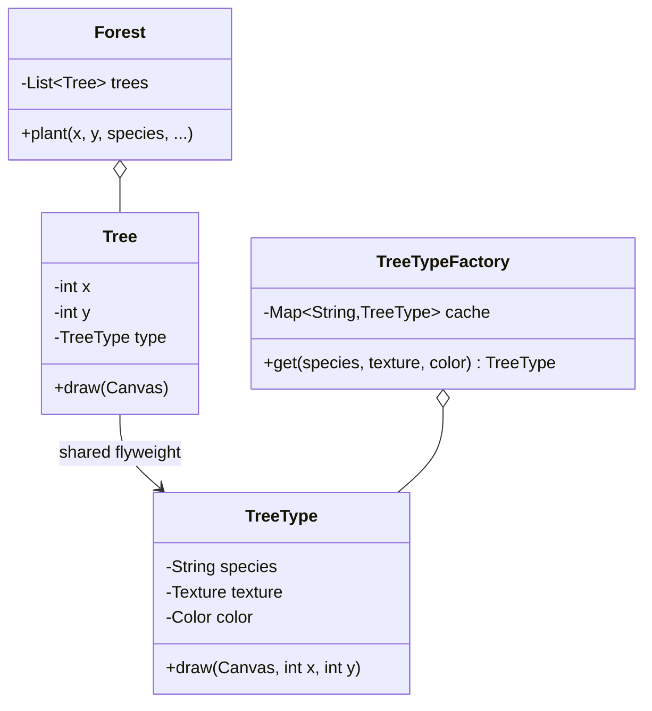

**Intent:** support **large numbers of fine-grained objects** efficiently by **sharing** the parts of their state that are common, instead of storing a copy in every object.

Flyweight is a **memory optimisation**. Reach for it only when you've measured (or can estimate) that object count is the problem.

## The problem

A map renders 2 million trees. Each tree object stores:

```text
x, y coordinates            16 bytes   (unique per tree)
species name                ~40 bytes  (one of ~20 species)
texture bitmap reference    →  but the bitmap itself is ~200 KB if copied per tree!
colour, leaf shape, model   ~100 bytes (same for every tree of a species)
```

If each tree holds its own copy of species data, memory explodes — even though only ~20 distinct species exist.

## The solution: split intrinsic and extrinsic state

- **Intrinsic state** — data that's the same for many objects and **doesn't change**: species, texture, model. Store it **once** in a shared, **immutable** flyweight.
- **Extrinsic state** — data unique to each instance: coordinates. Keep it **outside** the flyweight (in the context object or passed in at call time).



```java
// Flyweight: immutable intrinsic state, shared by thousands of trees
public final class TreeType {
    private final String species;
    private final Texture texture;
    private final Color color;

    TreeType(String species, Texture texture, Color color) {
        this.species = species; this.texture = texture; this.color = color;
    }

    public void draw(Canvas canvas, int x, int y) {          // extrinsic state passed in
        canvas.drawImage(texture, x, y, color);
    }
}

// Factory guarantees one instance per unique intrinsic state
public final class TreeTypeFactory {
    private final Map<String, TreeType> cache = new ConcurrentHashMap<>();

    public TreeType get(String species, Texture texture, Color color) {
        String key = species + "|" + texture.id() + "|" + color.getRGB();
        return cache.computeIfAbsent(key, k -> new TreeType(species, texture, color));
    }
}

// Context: small per-instance object holding extrinsic state + reference to the flyweight
public record Tree(int x, int y, TreeType type) {
    public void draw(Canvas c) { type.draw(c, x, y); }
}
```

Memory now: 2M × (two ints + one reference ≈ 24–32 bytes) + 20 shared `TreeType`s — instead of 2M full copies.

## Rules for a correct flyweight

1. Flyweights must be **immutable** — they're shared; one client mutating one would affect every user.
2. Clients **must not create flyweights with `new`**; always go through the factory so sharing actually happens.
3. Extrinsic state lives in the context object or is passed to methods.
4. The factory's cache must be **thread-safe** if used concurrently (`ConcurrentHashMap.computeIfAbsent`).

## Where you've seen it

- **`Integer.valueOf(int)`** caches values -128 to 127 — `Integer.valueOf(100) == Integer.valueOf(100)` is `true`, but for 1000 it's `false` (a classic Java trick question). Same for `Long`, `Short`, `Byte`, `Character` and `Boolean.valueOf`.
- **String interning** — the string pool shares identical string literals; `String.intern()` explicitly.
- **Enum constants** are shared singletons per value.
- Text editors storing glyph/font formatting once per style rather than per character; game engines sharing meshes and textures across instances.

## Trade-offs

| Pros | Cons |
| --- | --- |
| Huge memory savings with many similar objects | Trades memory for CPU: extrinsic state may be recomputed or passed around |
| Fewer allocations, less GC pressure | Code is more complex; state split across objects |
| Shared objects are immutable → thread-safe | Only worth it when object counts are very large |

## Related patterns

- **Flyweight vs Singleton**: a flyweight factory may hold *many* instances (one per distinct intrinsic state), and flyweights must be immutable; a singleton is exactly one instance and may be mutable.
- **Composite**: shared leaf nodes in a large tree can be flyweights.
- **Facade** is about one object representing a subsystem; Flyweight is about making many small objects cheap.

## Interview questions

<QA q="Why does Integer.valueOf(127) == Integer.valueOf(127) return true, but Integer.valueOf(128) == Integer.valueOf(128) return false?">
Integer.valueOf uses a flyweight cache for values from -128 to 127 (the upper bound is configurable with a JVM flag), returning the same shared instance for those values. Outside that range it allocates new objects, so == compares two different references. Always compare boxed numbers with equals, not ==.
</QA>

<QA q="What is intrinsic vs extrinsic state?">
Intrinsic state is the part of an object's data that's shared and context-independent — it can be stored once in an immutable flyweight (a tree species' texture, a character's font). Extrinsic state is context-specific and varies per instance (a tree's position, a character's location in the document); it's kept outside the flyweight and supplied by the client when needed.
</QA>

<Practice task="A text editor stores a style object (font, size, colour, bold) per character, and a 10 MB document uses 2 GB. Apply Flyweight.">

Split the state: the style is **intrinsic** (shared, immutable) and each character's code and position are **extrinsic**. A `StyleFactory` returns one shared immutable `Style` per distinct combination (cached in a map), and each character stores only its code and a reference to its style — or, better, store styles as runs (ranges of characters sharing a style). Documents use a handful of styles, so memory drops from one style object per character to a few dozen.

</Practice>

<Takeaways>

- Flyweight shares immutable intrinsic state among many objects; extrinsic state stays per instance.
- A factory with a cache ensures one flyweight per distinct intrinsic state.
- It's a memory optimisation — use when object counts are huge.
- Java's Integer cache and string interning are flyweights.

</Takeaways>

## Further reading

- Gamma et al., *Design Patterns* (1994) — Flyweight.
- Java Language Specification §5.1.7 (boxing conversion caching).
- Alexander Shvets, *Dive Into Design Patterns* — "Flyweight".
