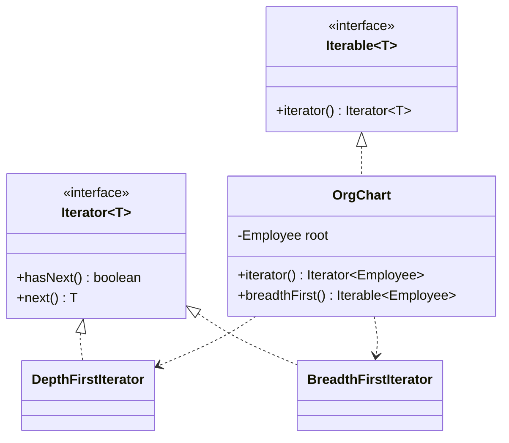

**Intent:** provide a way to **access the elements of a collection sequentially** without exposing its underlying representation (list, tree, graph, paginated API…).

Java built this pattern into the language — `Iterable`, `Iterator` and the enhanced `for` loop — so the interview interest lies in **implementing** custom iterators correctly and understanding traversal semantics.

## The problem

Collections differ internally: arrays, linked lists, trees, graphs, or data that arrives page by page from an API. Clients want to "go through every element" without knowing which. If the collection exposes its internals (`getNodes()`, `getRoot()`), every client re-implements traversal, and changing the internal structure breaks them all. And one collection may need several traversals (depth-first, breadth-first, filtered).

## The solution

Extract traversal into a separate **iterator** object that tracks its own position. The collection provides iterators; clients use the common interface.



```java
public final class OrgChart implements Iterable<Employee> {
    private final Employee root;
    public OrgChart(Employee root) { this.root = root; }

    @Override public Iterator<Employee> iterator() { return new DepthFirstIterator(root); }   // default order

    public Iterable<Employee> breadthFirst() { return () -> new BreadthFirstIterator(root); }

    private static final class DepthFirstIterator implements Iterator<Employee> {
        private final Deque<Employee> stack = new ArrayDeque<>();
        DepthFirstIterator(Employee root) { if (root != null) stack.push(root); }

        @Override public boolean hasNext() { return !stack.isEmpty(); }

        @Override public Employee next() {
            if (!hasNext()) throw new NoSuchElementException();
            Employee e = stack.pop();
            List<Employee> reports = e.directReports();
            for (int i = reports.size() - 1; i >= 0; i--) stack.push(reports.get(i));   // keep natural order
            return e;
        }
    }

    private static final class BreadthFirstIterator implements Iterator<Employee> {
        private final Deque<Employee> queue = new ArrayDeque<>();
        BreadthFirstIterator(Employee root) { if (root != null) queue.add(root); }
        @Override public boolean hasNext() { return !queue.isEmpty(); }
        @Override public Employee next() {
            if (!hasNext()) throw new NoSuchElementException();
            Employee e = queue.poll();
            queue.addAll(e.directReports());
            return e;
        }
    }
}

for (Employee e : orgChart) { ... }                 // depth-first via enhanced for
for (Employee e : orgChart.breadthFirst()) { ... }  // another traversal, same client code
```

Each iterator holds **its own traversal state**, so several traversals can run independently over the same collection.

## Correctness rules for Java iterators

- `next()` must throw **`NoSuchElementException`** when exhausted — not return `null`.
- `hasNext()` must be **idempotent** — calling it twice doesn't skip elements.
- `remove()` is optional; the default throws `UnsupportedOperationException`.
- Decide on **concurrent modification** behaviour:
  - **Fail-fast** iterators (`ArrayList`, `HashMap`) track a modification count and throw `ConcurrentModificationException` if the collection changes structurally during iteration (except through the iterator's own `remove`). It's best-effort, not a guarantee.
  - **Fail-safe / weakly consistent** iterators (`CopyOnWriteArrayList`, `ConcurrentHashMap`) iterate over a snapshot or tolerate concurrent changes without throwing.

```java
for (String s : list) if (s.isEmpty()) list.remove(s);        // ❌ ConcurrentModificationException
list.removeIf(String::isEmpty);                                // ✅
for (Iterator<String> it = list.iterator(); it.hasNext(); )    // ✅ remove through the iterator
    if (it.next().isEmpty()) it.remove();
```

## Lazy iteration over large or remote data

Iterators shine when data shouldn't be loaded all at once — for example, a paginated API:

```java
public final class PagedIterator<T> implements Iterator<T> {
    private final Function<String, Page<T>> fetch;    // cursor -> page
    private Iterator<T> current = Collections.emptyIterator();
    private String nextCursor = "";                   // "" = first page, null = no more pages

    public PagedIterator(Function<String, Page<T>> fetch) { this.fetch = fetch; }

    @Override public boolean hasNext() {
        while (!current.hasNext() && nextCursor != null) {
            Page<T> page = fetch.apply(nextCursor);
            current = page.items().iterator();
            nextCursor = page.nextCursor();
        }
        return current.hasNext();
    }

    @Override public T next() {
        if (!hasNext()) throw new NoSuchElementException();
        return current.next();
    }
}
```

Callers just loop; pages are fetched on demand. Java `Stream`s and database cursors (`ResultSet`) apply the same idea.

## Internal vs external iterators

- **External** — the client drives (`hasNext`/`next`) — flexible: stop early, interleave two iterators.
- **Internal** — the collection drives and calls your function (`list.forEach(...)`, streams) — concise, and the collection can optimise or parallelise.

## Pros and cons

| Pros | Cons |
| --- | --- |
| Clients independent of collection internals (SRP) | Overkill for simple lists — just use the JDK |
| Multiple traversals, in parallel, each with its own state | Custom iterators must get edge cases right |
| Lazy traversal of huge or remote data | Can be less efficient than direct access for some structures |

## Related patterns

- Traverse **Composite** trees with iterators.
- **Factory Method** lets collection subclasses return appropriate iterator types (`Collection.iterator()`).
- **Memento** can capture an iterator's position to resume later.
- **Visitor** + Iterator: iterate a heterogeneous structure and apply an operation to each element.

## Combining iterators

Many interview questions ask you to build an iterator out of other iterators. Two useful building blocks:

```java
// Round-robin ("zigzag") iterator: take one element from each source in turn, skipping exhausted ones
public final class RoundRobinIterator<T> implements Iterator<T> {
    private final Deque<Iterator<T>> queue = new ArrayDeque<>();

    public RoundRobinIterator(List<? extends Iterator<T>> sources) {
        for (Iterator<T> it : sources) if (it.hasNext()) queue.add(it);
    }

    @Override public boolean hasNext() { return !queue.isEmpty(); }

    @Override public T next() {
        if (queue.isEmpty()) throw new NoSuchElementException();
        Iterator<T> it = queue.poll();
        T value = it.next();
        if (it.hasNext()) queue.add(it);       // back of the line only if it has more
        return value;
    }
}

// Filtering iterator with one element of lookahead, so hasNext() stays idempotent
public final class FilterIterator<T> implements Iterator<T> {
    private final Iterator<T> source;
    private final Predicate<? super T> keep;
    private T lookahead;
    private boolean ready;

    public FilterIterator(Iterator<T> source, Predicate<? super T> keep) { this.source = source; this.keep = keep; }

    @Override public boolean hasNext() {
        while (!ready && source.hasNext()) {
            T candidate = source.next();
            if (keep.test(candidate)) { lookahead = candidate; ready = true; }
        }
        return ready;
    }

    @Override public T next() {
        if (!hasNext()) throw new NoSuchElementException();
        ready = false;
        T value = lookahead;
        lookahead = null;
        return value;
    }
}

public final class IteratorDemo {
    public static void main(String[] args) {
        Iterator<Integer> rr = new RoundRobinIterator<>(List.of(
                List.of(1, 2, 3).iterator(), List.<Integer>of().iterator(), List.of(10, 20).iterator(), List.of(100).iterator()));
        StringBuilder sb = new StringBuilder();
        while (rr.hasNext()) sb.append(rr.next()).append(' ');
        System.out.println(sb.toString().trim());                  // 1 10 100 2 20 3

        Iterator<Integer> evens = new FilterIterator<>(List.of(1, 2, 3, 4, 5, 6).iterator(), n -> n % 2 == 0);
        System.out.println(evens.hasNext() + " " + evens.hasNext() + " " + evens.next());   // true true 2
        while (evens.hasNext()) System.out.print(evens.next() + " ");                        // 4 6
        System.out.println();
    }
}
```

Output: `1 10 100 2 20 3`, then `true true 2`, then `4 6`. Two details matter in both classes: `next()` throws `NoSuchElementException` when there is nothing left, and the filtering iterator does its work in `hasNext()` and remembers the element it found, so calling `hasNext()` twice never skips anything.

## Iterator problems in coding rounds

These come up often, and each is a small variation on the techniques above. You can solve them with tests here:

- [Peeking Iterator](/solve/peeking-iterator) — one element of lookahead, like the filter iterator.
- [Flatten Nested List Iterator](/solve/flatten-nested-list-iterator) — a stack of iterators, advancing in `hasNext()`.
- [Binary Search Tree Iterator](/solve/binary-search-tree-iterator) — a stack holding one root-to-leaf path, O(height) memory.

## From iterators to streams

Java 8 added `Spliterator` ("splittable iterator"), which can split its remaining elements in two so a parallel stream can process the halves on different threads. Any `Iterable` can become a stream with `StreamSupport.stream(iterable.spliterator(), false)`. For your own collections, implementing `Iterable` is usually enough; write a custom `Spliterator` only when you need efficient parallel processing.

<Callout type="interview">
In LLD rounds the Iterator pattern appears when a design has to walk something without exposing it: a **file system** (iterate a directory tree depth-first or breadth-first), **paginated APIs and database cursors**, a **playlist** with shuffle and repeat modes (one iterator per mode), or **social graphs** ("friends of friends" lazily). Interviewers check that you keep traversal state in the iterator, not in the collection.
</Callout>

## Interview questions

<QA q="What's the difference between fail-fast and fail-safe iterators?">
Fail-fast iterators (ArrayList, HashMap) check a modification counter and throw ConcurrentModificationException if the underlying collection is structurally modified during iteration by anything other than the iterator itself — a best-effort bug detector. Fail-safe or weakly consistent iterators (CopyOnWriteArrayList, ConcurrentHashMap) don't throw: they iterate over a snapshot or reflect some concurrent changes, trading strict consistency for safety under concurrency.
</QA>

<QA q="Implement an iterator that flattens a list of lists.">
Keep an iterator over the outer list and a current inner iterator. In hasNext, while the current inner iterator is exhausted and the outer has more lists, advance to the next inner list's iterator; then return whether the current inner iterator has a next element. next calls hasNext, throws NoSuchElementException if false, and otherwise returns the inner iterator's next. This handles empty inner lists and keeps hasNext idempotent.
</QA>

<QA q="Why must hasNext() be idempotent, and how does a filtering iterator achieve it?">
Callers often call hasNext() several times (in loop conditions, assertions, logging) before calling next(); if hasNext() consumed an element each time, elements would be skipped. A filtering iterator therefore searches ahead only until it finds the next matching element, stores it in a lookahead field and sets a flag. Further hasNext() calls see the flag and return true without reading more; next() returns the stored element and clears the flag.
</QA>

<Practice task="Describe an iterator that yields a binary search tree's elements in sorted order using O(height) memory.">

Keep a stack. On construction, push the root and then keep pushing left children until you reach null. `hasNext()` is "the stack isn't empty". `next()` pops a node (the next smallest), pushes its right child and then all of that child's left descendants, and returns the popped value; it throws `NoSuchElementException` when the stack is empty. The stack never holds more than one root-to-leaf path, so memory is O(height); every node is pushed and popped once, so a full traversal is O(n).

</Practice>

<Practice task="A music app has a playlist with three modes: in order, shuffle (each song once per cycle), and repeat-one. Design the iteration so the playlist class stays simple and modes can switch mid-playback.">

The `Playlist` owns the song list and exposes `iterator(mode, startIndex)`. Each mode is its own `Iterator<Song>`:
- `InOrderIterator` walks indices forward (wrapping if repeat-all is on).
- `ShuffleIterator` builds a shuffled list of indices once per cycle (Fisher–Yates) and walks it, so every song plays once before any repeats.
- `RepeatOneIterator` returns the same song forever.

The player holds the current iterator and the current song. Switching modes creates a new iterator starting from the current song, so playback continues smoothly. The playlist never stores traversal state, so several listeners (or devices) can iterate the same playlist independently.

</Practice>

<Takeaways>

- Iterator separates traversal from the collection; each iterator keeps its own position.
- Java's Iterable/Iterator are the pattern; implement next() to throw NoSuchElementException and keep hasNext() idempotent.
- Know fail-fast vs weakly consistent iteration.
- Use iterators for lazy traversal of large, tree-shaped or paginated data.
- Build complex traversals by composing iterators (round robin, filtering, flattening), keeping lookahead in the iterator.

</Takeaways>

## Further reading

- Gamma et al., *Design Patterns* (1994) — Iterator.
- Java SE API — `java.util.Iterator`, `ConcurrentModificationException`.
- Alexander Shvets, *Dive Into Design Patterns* — "Iterator".
