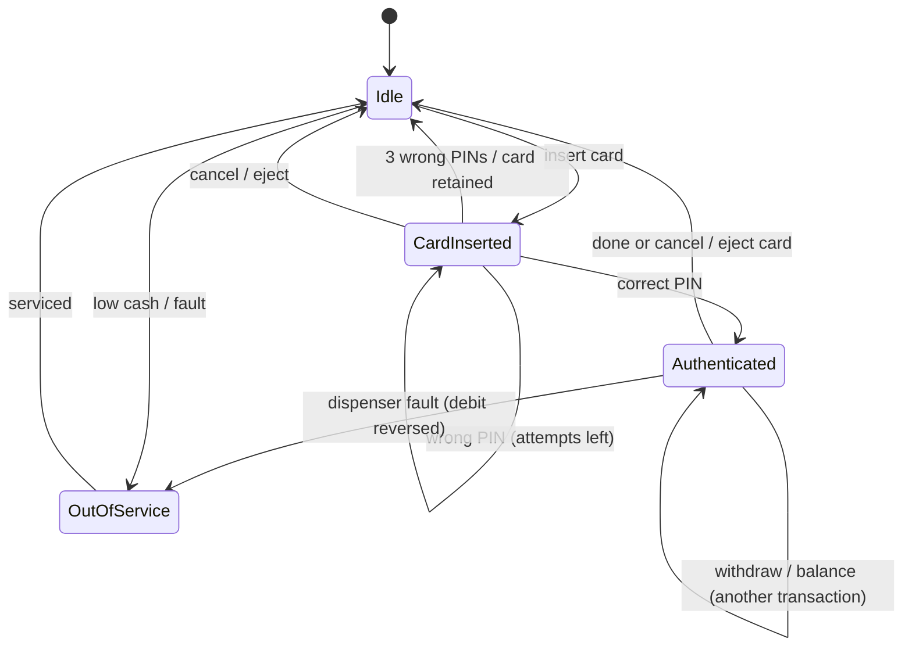
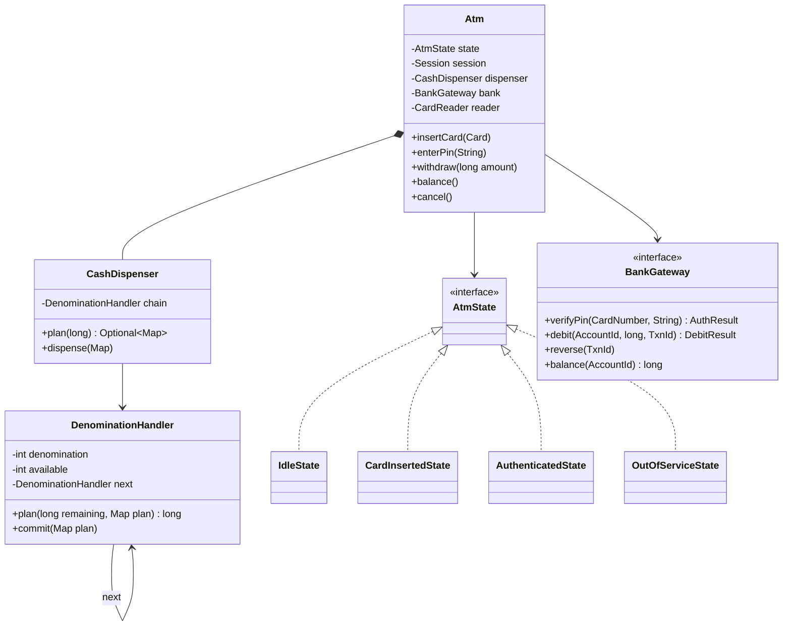

<Related ids={['state-pattern', 'chain-of-responsibility-pattern', 'facade-pattern', 'adapter-pattern', 'concurrency-for-lld']} />

The ATM combines two classic patterns cleanly: a **state machine** for the session (card → PIN → transaction → eject) and a **chain of responsibility** for dispensing cash in denominations. It also tests how you handle failures that involve money and hardware.

## What the interviewer expects

The full design in this lesson is longer than anything you'd write in one round. It's there so you understand the edge cases and can answer follow-up questions. In the round itself, aim for this:

<InterviewScope minutes="45–60" lines="60" write={["States: Idle, CardInserted, Authenticated", "Three wrong PINs retain the card", "Withdraw: check notes, then debit, then dispense"]} say={["Why the order of withdraw steps keeps money safe", "Note dispensing as a Chain of Responsibility (₹500 → ₹200 → ₹100)", "What happens if the bank times out"]} skip={["Deposits, mini-statements and PIN change", "Encryption and hardware details"]} />

### The interview-sized version

A State machine for the session and a cash box that never debits the account for notes it can’t give. It's about **60 lines**, and it compiles and runs.

```java
interface Bank {                                         // the real bank is behind an interface
    boolean checkPin(String card, String pin);
    void debit(String card, int amount);                 // throws if the account can't pay
}

class CashBox {
    private final TreeMap<Integer, Integer> notes = new TreeMap<>(Comparator.reverseOrder());   // ₹500 before ₹100

    CashBox(Map<Integer, Integer> notes) { this.notes.putAll(notes); }

    Map<Integer, Integer> plan(int amount) {             // which notes to give; changes nothing
        Map<Integer, Integer> plan = new LinkedHashMap<>();
        for (var e : notes.entrySet()) {
            int count = Math.min(amount / e.getKey(), e.getValue());
            if (count > 0) { plan.put(e.getKey(), count); amount -= count * e.getKey(); }
        }
        if (amount != 0) throw new IllegalStateException("Can't make this amount with the notes available");
        return plan;
    }

    void remove(Map<Integer, Integer> plan) { plan.forEach((note, count) -> notes.merge(note, -count, Integer::sum)); }
}

interface AtmState {
    default void insertCard(Atm atm, String card)          { throw new IllegalStateException("Not allowed now"); }
    default void enterPin(Atm atm, String pin)             { throw new IllegalStateException("Insert a card first"); }
    default Map<Integer, Integer> withdraw(Atm atm, int a) { throw new IllegalStateException("Enter your PIN first"); }
    default void eject(Atm atm) { atm.card = null; atm.state = new Idle(); }
}

class Idle implements AtmState {
    public void insertCard(Atm atm, String card) { atm.card = card; atm.state = new CardInserted(); }
    public void eject(Atm atm) { throw new IllegalStateException("No card"); }
}

class CardInserted implements AtmState {
    private int wrongTries;
    public void enterPin(Atm atm, String pin) {
        if (atm.bank.checkPin(atm.card, pin)) { atm.state = new Authenticated(); return; }
        if (++wrongTries == 3) { atm.card = null; atm.state = new Idle(); throw new IllegalStateException("Card retained"); }
        throw new IllegalArgumentException("Wrong PIN");
    }
}

class Authenticated implements AtmState {
    public Map<Integer, Integer> withdraw(Atm atm, int amount) {
        Map<Integer, Integer> notes = atm.cash.plan(amount);   // 1. check we can give the notes
        atm.bank.debit(atm.card, amount);                      // 2. only then take the money
        atm.cash.remove(notes);                                // 3. dispense
        return notes;
    }
}

class Atm {                                              // the context: forwards each action to its state
    AtmState state = new Idle();
    String card;
    final Bank bank;
    final CashBox cash;

    Atm(Bank bank, CashBox cash) { this.bank = bank; this.cash = cash; }
    synchronized void insertCard(String card) { state.insertCard(this, card); }
    synchronized void enterPin(String pin) { state.enterPin(this, pin); }
    synchronized Map<Integer, Integer> withdraw(int amount) { return state.withdraw(this, amount); }
    synchronized void eject() { state.eject(this); }
}
```

<Callout type="tip" title="How to use the rest of this lesson">
Practise writing the short version above, in your own words, until you can do it in about 30 minutes. Then read the full design below for the edge cases and follow-up answers. Interviewers often ask about those, but they rarely ask you to type them all.
</Callout>

## 1. Requirements

- Insert card → enter PIN (3 attempts, then card retained) → choose transaction → complete → eject card.
- Transactions: balance enquiry, cash withdrawal, deposit (extension), PIN change (extension).
- Withdrawal: amount must be a multiple of ₹100, within the account balance, the daily limit, and the cash available in the machine in the available denominations (₹2000, ₹500, ₹100).
- The ATM talks to the **bank** over a network to authenticate and debit.
- Failures: insufficient funds, network errors, dispensing failures — **never debit without dispensing**.

## 2. Session states



## 3. Class design



## 4. Cash dispensing with Chain of Responsibility

Each handler takes as many notes of its denomination as it can, then passes the remainder down. Crucially, we **plan first** and only **commit** if the whole amount can be served.

```java
public final class DenominationHandler {
    private final int denomination;
    private int available;
    private final DenominationHandler next;

    public DenominationHandler(int denomination, int available, DenominationHandler next) {
        this.denomination = denomination; this.available = available; this.next = next;
    }

    /** Fills the plan; returns the remaining amount that couldn't be served (0 = success). */
    long plan(long remaining, Map<Integer, Integer> plan) {
        int notes = (int) Math.min(remaining / denomination, available);
        if (notes > 0) plan.put(denomination, notes);
        long left = remaining - (long) notes * denomination;
        return (left == 0 || next == null) ? left : next.plan(left, plan);
    }

    void commit(Map<Integer, Integer> plan) {
        available -= plan.getOrDefault(denomination, 0);
        if (next != null) next.commit(plan);
    }
}

public final class CashDispenser {
    private final DenominationHandler chain;          // 2000 → 500 → 100
    private final CashHardware hardware;

    public synchronized Optional<Map<Integer, Integer>> plan(long amount) {
        Map<Integer, Integer> plan = new LinkedHashMap<>();
        return chain.plan(amount, plan) == 0 ? Optional.of(plan) : Optional.empty();
    }

    public synchronized void dispense(Map<Integer, Integer> plan) {
        hardware.dispense(plan);                      // may throw DispenseFailedException
        chain.commit(plan);
    }
}
```

<Callout type="note">
Greedy note selection can fail when taking a large note leaves an un-servable remainder. With ₹500 and ₹200 notes, ₹600 greedily takes one ₹500 and is stuck with ₹100 — yet three ₹200 notes would work. When each denomination divides the next larger one (100 divides 500, 500 divides 2000), greedy with availability limits finds a combination whenever one exists. With other mixes, or when ₹100 notes run out, a robust dispenser backtracks (try one fewer large note) or uses a small bounded search. The chain is configured with one handler instance per denomination, so adding ₹200 notes is configuration, not code.
</Callout>

## 5. Withdrawal flow — money safety first

```java
final class AuthenticatedState implements AtmState {
    @Override public void withdraw(Atm atm, long amount) {
        if (amount <= 0 || amount % 100 != 0) throw new InvalidAmountException("Multiples of ₹100 only");
        if (amount > atm.session().dailyLimitRemaining()) throw new LimitExceededException();

        Map<Integer, Integer> notes = atm.dispenser().plan(amount)
                .orElseThrow(() -> new CashUnavailableException(amount));      // check machine cash first

        TxnId txn = TxnId.newId();
        DebitResult debit;
        try {
            debit = atm.bank().debit(atm.session().account(), amount, txn);   // idempotent by txn id
        } catch (BankTimeoutException timeout) {
            atm.bank().reverse(txn);                                           // unknown outcome: never dispense
            throw new TransactionUncertainException();
        }
        if (!debit.success()) throw new TransactionDeclinedException(debit.reason());

        try {
            atm.dispenser().dispense(notes);
        } catch (DispenseFailedException e) {
            atm.bank().reverse(txn);                                           // compensate: never debit without cash
            atm.transitionTo(atm.outOfService());
            throw e;
        }
        atm.session().recordWithdrawal(amount);
    }
}
```

Points interviewers look for:

- **Plan before debit**: don't debit for an amount the machine can't dispense.
- **Idempotent debit** with a transaction ID — network retries must not double-debit.
- **Compensation**: if dispensing fails after a successful debit, reverse the debit (and log everything for reconciliation). Real ATMs also reconcile with the bank at end of day.
- **Unknown outcome**: if the debit call times out, the ATM doesn't know whether money left the account. Never dispense; send a reversal for that transaction ID (reversals are idempotent and a no-op if the debit never landed), or query the bank by ID first.
- **Journal**: real ATMs also write every step (planned, debited, dispensed, reversed) to a local journal so that end-of-day reconciliation can catch, say, a reversal that never reached the bank.

## 6. PIN handling

```java
final class CardInsertedState implements AtmState {
    @Override public void enterPin(Atm atm, String pin) {
        AuthResult r = atm.bank().verifyPin(atm.session().card(), pin);       // PIN is verified by the bank, never stored
        if (r.success()) { atm.session().authenticate(r.account()); atm.transitionTo(atm.authenticated()); return; }
        if (atm.session().incrementFailedAttempts() >= 3) {
            atm.reader().retainCard();
            atm.endSession();
            throw new CardRetainedException();
        }
        throw new InvalidPinException(3 - atm.session().failedAttempts());
    }
}
```

## 7. Patterns used

| Pattern | Where |
| --- | --- |
| **State** | Session states (Idle, CardInserted, Authenticated, OutOfService) |
| **Chain of Responsibility** | Denomination handlers |
| **Adapter** | `BankGateway` over the bank's network protocol (ISO 8583 in reality) |
| **Facade** | `Atm` public API over reader, dispenser, bank, printer |
| **Command** (extension) | Transactions as objects (withdraw, deposit, transfer) with audit records |

## Interview questions

<QA q="How do you make sure a customer is never debited without receiving cash?">
Check the machine can dispense the amount before contacting the bank, debit with a unique transaction ID so retries are idempotent, then dispense. If dispensing fails, issue a reversal for that transaction ID and take the ATM out of service. Record every step in a local journal so end-of-day reconciliation with the bank can catch anything a failure left inconsistent — for example, a reversal that didn't reach the bank.
</QA>

<QA q="Why use Chain of Responsibility for the cash dispenser?">
Each denomination handler has a single job — dispense what it can of its note and pass the remainder on — and the chain order encodes the preference for larger notes. Adding or removing a denomination, or changing the order, is a configuration change rather than a code change in a monolithic dispensing method. Planning through the chain before committing keeps the operation all-or-nothing.
</QA>

<Practice task="Add cash deposits: the customer inserts notes, the machine counts them, and the account is credited. What's the failure you must design for?">

A `DepositState` after authentication: the hardware counts notes and returns a breakdown; the customer confirms; the ATM credits the bank with an idempotent transaction id. The failure is the reverse of withdrawal: notes are physically in the machine but the credit call fails or times out. Never return "failed" and keep the cash silently — record the deposit in the local journal as pending, retry the credit with the same transaction id, and reconcile at end of day. Rejected notes (fake or damaged) are returned before confirmation.

</Practice>

<Practice task="The daily withdrawal limit must hold across all ATMs, not just within one session. Where must it be enforced?">

At the bank, not in the ATM. The ATM's session limit is only a convenience; the authoritative check is part of the debit call — the bank's account service checks and records today's total atomically with the debit. A per-ATM check could be bypassed by walking to the next machine. The ATM simply surfaces the bank's "limit exceeded" decline.

</Practice>

<Takeaways>

- Model the session as a state machine; invalid operations are rejected per state.
- Dispense via a chain of denomination handlers: plan first, commit only if the full amount works.
- Money safety: plan → idempotent debit → dispense → reverse on failure → reconcile.
- PINs are verified by the bank; lock out after repeated failures.

</Takeaways>

## Further reading

- [State](/system-design/lld/state-pattern), [Chain of Responsibility](/system-design/lld/chain-of-responsibility-pattern).
- HLD context on idempotency and reconciliation: [Design a Payment System](/system-design/hld/design-payment-system).
