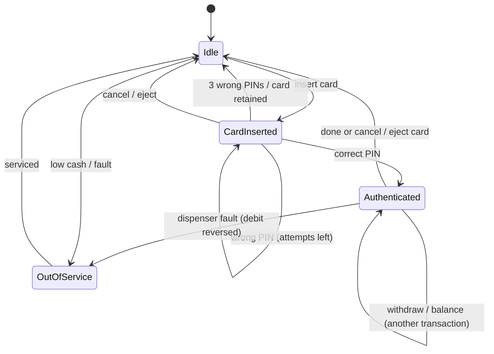
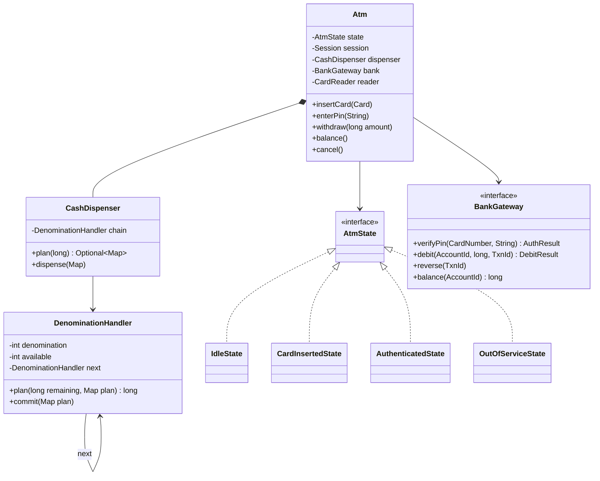

<Related ids={['state-pattern', 'chain-of-responsibility-pattern', 'facade-pattern', 'adapter-pattern', 'concurrency-for-lld']} />

An ATM looks like a vending machine for cash, and the design starts the same way: buttons that mean different things depending on where you are in the process (you can't withdraw before entering a PIN). But the ATM adds something more serious: **real money and real hardware that can fail**. The interviewer's real question is: "If anything goes wrong at any moment, does the customer ever lose money?"

Two patterns carry the design: a **state machine** for the session (card → PIN → transaction → eject), and a **Chain of Responsibility** for working out which notes to hand out.

We'll use the same six steps as every case study: requirements, entities, class design, code, a worked example, and follow-ups. (The [parking lot](/system-design/lld/lld-parking-lot) lesson explains the plan in detail.)

## Step 1: Pin down the requirements

<Dialogue>
<Turn who="you">What does a session look like?</Turn>
<Turn who="them">Insert card, enter PIN, do one or more transactions, take the card.</Turn>
<Turn who="you">What happens with wrong PINs?</Turn>
<Turn who="them">Three wrong tries and the machine keeps the card.</Turn>
<Turn who="you">Which transactions?</Turn>
<Turn who="them">Withdrawal and balance enquiry. Deposits maybe later.</Turn>
<Turn who="you">What notes does the machine hold?</Turn>
<Turn who="them">₹2000, ₹500 and ₹100. Withdrawals must be multiples of ₹100.</Turn>
<Turn who="you">Who checks the PIN and the balance: the ATM or the bank?</Turn>
<Turn who="them">The bank, over the network.</Turn>
<Turn who="you">What if the bank or the cash dispenser fails partway?</Turn>
<Turn who="them">That's the important part. A customer must never be charged for cash they didn't get.</Turn>
</Dialogue>

**The ATM must:**

1. Run a session: insert card, enter PIN, transactions, eject.
2. Keep the card after 3 wrong PINs.
3. Let the user check their balance and withdraw cash in multiples of ₹100.
4. Only allow a withdrawal the machine can actually pay out with the notes it has.
5. Ask the bank to check the PIN and take the money.
6. **Never** take money from the account without handing out the cash.

**Out of scope for now:** deposits, PIN change, encryption, hardware details.

## Step 2: Find the core entities

| Noun | Make it… | Why |
| --- | --- | --- |
| ATM | a class | The front door. Holds the current state. |
| Session state (Idle, CardInserted, Authenticated, OutOfService) | one class per state | Each button behaves differently in each state. |
| Bank | an interface `BankGateway` | A remote system. An interface lets us fake it and swap protocols (an Adapter). |
| Cash dispenser | a class | Plans which notes to give and hands them out. |
| Note handler (one per denomination) | a class, chained | "Take what you can in ₹2000s, pass the rest on to ₹500s..." |
| Transaction id | a value | Lets the bank recognise a retried request. |

## Step 3: Design each class

**The session states** follow the same idea as the [vending machine](/system-design/lld/lld-vending-machine): a state interface with one method per button, each defaulting to "not allowed now", and each state overriding only what it permits.



**`CashDispenser`**: works out which notes make up an amount, **without** handing anything out yet (`plan`), and later hands out a planned set (`dispense`). Separating the two is essential, as you'll see.

**`BankGateway`**: `verifyPin`, `debit` (take money), `reverse` (put it back) and `balance`.

Now the most important design decision: **the order of steps in a withdrawal.**

<Approach verdict="bad" title="Debit, then work out the notes">

The bank takes ₹600, then the machine discovers it only has ₹500 notes and can't make ₹600. The customer has been charged and gets nothing. Now you need to undo the debit, and hope that works.

</Approach>

<Approach verdict="bad" title="Hand out the cash, then debit">

The cash comes out, then the bank says "insufficient funds" or the network drops. The bank has given away money it can't recover.

</Approach>

<Approach verdict="great" title="Plan, then debit, then dispense, and reverse on failure">

1. **Plan** the notes first. If the machine can't make the amount, stop. Nothing has happened yet.
2. **Debit** the account, with a unique transaction id.
3. **Dispense** the planned notes.
4. If dispensing fails, **reverse** the debit with the same transaction id, and take the ATM out of service.

At every point, either nothing has happened, or the customer has their cash, or the debit is being undone.

</Approach>



## Step 4: Write the code

<InterviewScope minutes="45–60" lines="60" write={["States: Idle, CardInserted, Authenticated", "Three wrong PINs retain the card", "Withdraw: check notes, then debit, then dispense"]} say={["Why the order of withdraw steps keeps money safe", "Note dispensing as a Chain of Responsibility (₹500 → ₹200 → ₹100)", "What happens if the bank times out"]} skip={["Deposits, mini-statements and PIN change", "Encryption and hardware details"]} />

### The interview-sized version

A state machine for the session and a cash box that never debits the account for notes it can't give. It's about **60 lines**, and it compiles and runs.

```java
interface Bank {                                         // the real bank is behind an interface
    boolean checkPin(String card, String pin);
    void debit(String card, int amount);                 // throws if the account can't pay
}

class CashBox {
    private final TreeMap<Integer, Integer> notes = new TreeMap<>(Comparator.reverseOrder());   // ₹500 before ₹100

    CashBox(Map<Integer, Integer> notes) { this.notes.putAll(notes); }

    Map<Integer, Integer> plan(int amount) {             // which notes to give; changes nothing
        Map<Integer, Integer> plan = new LinkedHashMap<>();
        for (var e : notes.entrySet()) {
            int count = Math.min(amount / e.getKey(), e.getValue());
            if (count > 0) { plan.put(e.getKey(), count); amount -= count * e.getKey(); }
        }
        if (amount != 0) throw new IllegalStateException("Can't make this amount with the notes available");
        return plan;
    }

    void remove(Map<Integer, Integer> plan) { plan.forEach((note, count) -> notes.merge(note, -count, Integer::sum)); }
}

interface AtmState {
    default void insertCard(Atm atm, String card)          { throw new IllegalStateException("Not allowed now"); }
    default void enterPin(Atm atm, String pin)             { throw new IllegalStateException("Insert a card first"); }
    default Map<Integer, Integer> withdraw(Atm atm, int a) { throw new IllegalStateException("Enter your PIN first"); }
    default void eject(Atm atm) { atm.card = null; atm.state = new Idle(); }
}

class Idle implements AtmState {
    public void insertCard(Atm atm, String card) { atm.card = card; atm.state = new CardInserted(); }
    public void eject(Atm atm) { throw new IllegalStateException("No card"); }
}

class CardInserted implements AtmState {
    private int wrongTries;
    public void enterPin(Atm atm, String pin) {
        if (atm.bank.checkPin(atm.card, pin)) { atm.state = new Authenticated(); return; }
        if (++wrongTries == 3) { atm.card = null; atm.state = new Idle(); throw new IllegalStateException("Card retained"); }
        throw new IllegalArgumentException("Wrong PIN");
    }
}

class Authenticated implements AtmState {
    public Map<Integer, Integer> withdraw(Atm atm, int amount) {
        Map<Integer, Integer> notes = atm.cash.plan(amount);   // 1. check we can give the notes
        atm.bank.debit(atm.card, amount);                      // 2. only then take the money
        atm.cash.remove(notes);                                // 3. dispense
        return notes;
    }
}

class Atm {                                              // the context: forwards each action to its state
    AtmState state = new Idle();
    String card;
    final Bank bank;
    final CashBox cash;

    Atm(Bank bank, CashBox cash) { this.bank = bank; this.cash = cash; }
    synchronized void insertCard(String card) { state.insertCard(this, card); }
    synchronized void enterPin(String pin) { state.enterPin(this, pin); }
    synchronized Map<Integer, Integer> withdraw(int amount) { return state.withdraw(this, amount); }
    synchronized void eject() { state.eject(this); }
}
```

**Reading it top to bottom:**

1. **`Bank`** is an interface: the ATM never checks PINs or balances itself.
2. **`CashBox.plan`** goes through notes from largest to smallest (the `TreeMap` is sorted in reverse), taking as many of each as it can without exceeding what the machine holds. If anything is left over, it throws. **It changes nothing**: it only plans. `remove` actually takes the notes out.
3. **`AtmState`** has a default for every button that throws. `eject` by default clears the card and returns to `Idle`.
4. **`CardInserted.enterPin`** asks the bank. On the third wrong PIN, the card is kept and the session ends.
5. **`Authenticated.withdraw`** is the three-step order: plan the notes, then debit, then remove the notes. If planning throws, the bank is never called. If the debit throws (insufficient funds), no notes move.
6. **`Atm`** forwards each button to the current state; `synchronized` means one action at a time.

<Callout type="tip" title="How to practise this">
Say the withdrawal order out loud and explain what goes wrong with each other order. Then write the states. The order is the answer the interviewer wants most.
</Callout>

### Growing it into the full design

#### Working out the notes: Chain of Responsibility

Each **handler** looks after one denomination. It takes as many of its notes as it can, then passes what's left to the next handler. The chain is ₹2000 → ₹500 → ₹100. As before, the chain **plans** first, and only **commits** (removes notes) once the whole amount is covered.

```java
public final class DenominationHandler {
    private final int denomination;
    private int available;
    private final DenominationHandler next;

    public DenominationHandler(int denomination, int available, DenominationHandler next) {
        this.denomination = denomination; this.available = available; this.next = next;
    }

    /** Fills the plan; returns the remaining amount that couldn't be served (0 = success). */
    long plan(long remaining, Map<Integer, Integer> plan) {
        int notes = (int) Math.min(remaining / denomination, available);
        if (notes > 0) plan.put(denomination, notes);
        long left = remaining - (long) notes * denomination;
        return (left == 0 || next == null) ? left : next.plan(left, plan);
    }

    void commit(Map<Integer, Integer> plan) {
        available -= plan.getOrDefault(denomination, 0);
        if (next != null) next.commit(plan);
    }
}

public final class CashDispenser {
    private final DenominationHandler chain;          // 2000 → 500 → 100
    private final CashHardware hardware;

    public synchronized Optional<Map<Integer, Integer>> plan(long amount) {
        Map<Integer, Integer> plan = new LinkedHashMap<>();
        return chain.plan(amount, plan) == 0 ? Optional.of(plan) : Optional.empty();
    }

    public synchronized void dispense(Map<Integer, Integer> plan) {
        hardware.dispense(plan);                      // may throw DispenseFailedException
        chain.commit(plan);
    }
}
```

Why a chain rather than one method with a loop? Each handler has one job, and the chain's order sets the preference for larger notes. Adding ₹200 notes means adding a handler in the configuration, not editing a method.

<Callout type="note">
Taking the largest note first can fail. With ₹500 and ₹200 notes, ₹600 takes one ₹500 and is stuck with ₹100, yet three ₹200 notes would work. When each note divides the next larger one (100 divides 500, 500 divides 2000), this never happens as long as there are enough notes. With other mixes, or when ₹100 notes run out, a robust dispenser backs off (tries one fewer large note) or does a small search.
</Callout>

#### The full withdrawal: money safety first

In plain steps:

1. Check the amount is a multiple of ₹100 and within today's limit.
2. **Plan** the notes. If the machine can't make it, stop now.
3. **Debit** the account with a new transaction id. The id makes the call **idempotent**: if the network retries it, the bank recognises the id and doesn't debit twice.
4. If the debit call **times out**, we don't know whether the money left the account. Never dispense. Send a reversal for that id (a reversal for a debit that never happened does nothing).
5. If the bank declines, stop.
6. **Dispense.** If the hardware fails, reverse the debit and put the ATM out of service.

```java
final class AuthenticatedState implements AtmState {
    @Override public void withdraw(Atm atm, long amount) {
        if (amount <= 0 || amount % 100 != 0) throw new InvalidAmountException("Multiples of ₹100 only");
        if (amount > atm.session().dailyLimitRemaining()) throw new LimitExceededException();

        Map<Integer, Integer> notes = atm.dispenser().plan(amount)
                .orElseThrow(() -> new CashUnavailableException(amount));      // check machine cash first

        TxnId txn = TxnId.newId();
        DebitResult debit;
        try {
            debit = atm.bank().debit(atm.session().account(), amount, txn);   // idempotent by txn id
        } catch (BankTimeoutException timeout) {
            atm.bank().reverse(txn);                                           // unknown outcome: never dispense
            throw new TransactionUncertainException();
        }
        if (!debit.success()) throw new TransactionDeclinedException(debit.reason());

        try {
            atm.dispenser().dispense(notes);
        } catch (DispenseFailedException e) {
            atm.bank().reverse(txn);                                           // compensate: never debit without cash
            atm.transitionTo(atm.outOfService());
            throw e;
        }
        atm.session().recordWithdrawal(amount);
    }
}
```

Real ATMs also write every step (planned, debited, dispensed, reversed) to a local **journal**. At the end of the day, the journal is compared with the bank's records, catching anything a failure left inconsistent, such as a reversal that never reached the bank.

#### PIN handling

The PIN goes to the bank to check. The ATM never stores it. Each wrong attempt is counted on the session; at three, the card is kept.

```java
final class CardInsertedState implements AtmState {
    @Override public void enterPin(Atm atm, String pin) {
        AuthResult r = atm.bank().verifyPin(atm.session().card(), pin);       // PIN is verified by the bank, never stored
        if (r.success()) { atm.session().authenticate(r.account()); atm.transitionTo(atm.authenticated()); return; }
        if (atm.session().incrementFailedAttempts() >= 3) {
            atm.reader().retainCard();
            atm.endSession();
            throw new CardRetainedException();
        }
        throw new InvalidPinException(3 - atm.session().failedAttempts());
    }
}
```

## Step 5: Trace two withdrawals

The ATM holds two ₹2000 notes, three ₹500 notes and ten ₹100 notes.

**Asha withdraws ₹2,700.**

1. Plan: one ₹2000 (₹700 left), one ₹500 (₹200 left), two ₹100. Fully covered.
2. Debit ₹2,700 with transaction id T1. The bank approves.
3. Dispense. The notes are removed from the counts. Done.

**Ben withdraws ₹1,000, and the dispenser jams.**

1. Plan: ₹2000 is too big, so two ₹500 notes. Covered.
2. Debit ₹1,000 with id T2. The bank approves.
3. Dispense: the hardware throws "jammed".
4. The ATM sends `reverse(T2)`, so Ben's ₹1,000 goes back, and the ATM switches to **OutOfService**.
5. If the reverse call itself fails, the journal still records "T2 debited, not dispensed", and the end-of-day check fixes it.

## Step 6: Handle follow-up questions

**"Add cash deposits."** A deposit state: the machine counts the notes, the customer confirms, and the ATM credits the account with an idempotent transaction id. The risky case is the opposite of a withdrawal: the notes are inside the machine but the credit call fails. Never quietly keep the cash: record the deposit in the journal as pending, retry with the same id, and reconcile at the end of the day.

**"The daily limit must hold across all ATMs."** Then it must be checked **at the bank**, as part of the debit. A limit kept by one ATM could be dodged by walking to the next machine.

**"Add ₹200 notes."** One more handler in the chain, configured, not coded.

**"Print a receipt."** A printer behind an interface, called after a successful dispense. If the printer fails, the withdrawal still stands.

## Common mistakes

- **Debiting before checking the machine can pay out.**
- **Retrying a debit without a transaction id**, risking a double charge.
- **Dispensing after a timeout** when you don't know if the debit happened.
- **No reversal path** when the dispenser fails.
- **The ATM checking PINs or balances itself** instead of asking the bank.
- **A long `if`/`else` on a session status** instead of state classes.

## Patterns used

| Pattern | Where |
| --- | --- |
| **State** | Session states (Idle, CardInserted, Authenticated, OutOfService) |
| **Chain of Responsibility** | Denomination handlers |
| **Adapter** | `BankGateway` over the bank's network protocol (ISO 8583 in reality) |
| **Facade** | The `Atm`'s public methods over the card reader, dispenser, bank and printer |
| **Command** (follow-up) | Transactions as objects (withdraw, deposit, transfer) with audit records |

## Interview questions

<QA q="How do you make sure a customer is never debited without receiving cash?">
Check the machine can pay out the amount before contacting the bank, debit with a unique transaction id so retries are idempotent, then dispense. If dispensing fails, reverse that transaction id and take the ATM out of service. Record every step in a local journal so the end-of-day check with the bank can catch anything a failure left inconsistent, such as a reversal that didn't reach the bank.
</QA>

<QA q="Why use Chain of Responsibility for the cash dispenser?">
Each denomination handler has one job (give what it can of its note and pass the rest on), and the chain's order sets the preference for larger notes. Adding or removing a denomination, or changing the order, is a configuration change rather than an edit to one big dispensing method. Planning through the chain before committing keeps the operation all or nothing.
</QA>

<Practice task="Add cash deposits: the customer inserts notes, the machine counts them, and the account is credited. What's the failure you must design for?">

A `DepositState` after authentication: the hardware counts notes and returns a breakdown; the customer confirms; the ATM credits the bank with an idempotent transaction id. The failure is the reverse of a withdrawal: notes are physically in the machine but the credit call fails or times out. Never report "failed" and silently keep the cash. Record the deposit in the local journal as pending, retry the credit with the same transaction id, and reconcile at the end of the day. Rejected notes (fake or damaged) are returned before confirmation.

</Practice>

<Practice task="The daily withdrawal limit must hold across all ATMs, not just within one session. Where must it be enforced?">

At the bank, not in the ATM. The ATM's session limit is only a convenience; the real check is part of the debit call, where the bank's account service checks and records today's total in the same atomic step as the debit. A check inside one ATM could be dodged by walking to the next machine. The ATM simply shows the bank's "limit exceeded" message.

</Practice>

<Takeaways>

- Model the session as a state machine; each state rejects buttons that make no sense.
- Work out the notes with a chain of denomination handlers: plan first, commit only if the whole amount works.
- Keep money safe with the order: plan → debit with a transaction id → dispense → reverse on failure → reconcile.
- The bank checks PINs, balances and daily limits, never the ATM.

</Takeaways>

## Further reading

- [State](/system-design/lld/state-pattern), [Chain of Responsibility](/system-design/lld/chain-of-responsibility-pattern).
- HLD context on idempotency and reconciliation: [Design a Payment System](/system-design/hld/design-payment-system).
