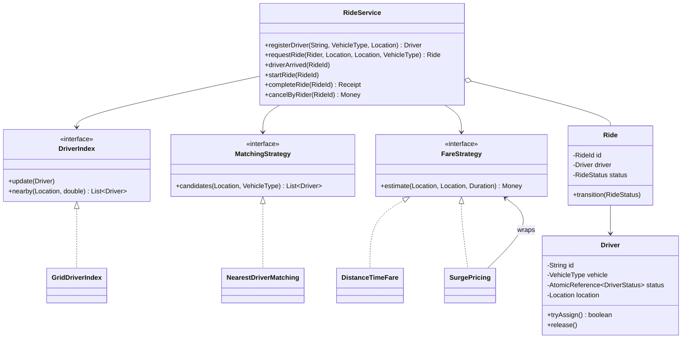
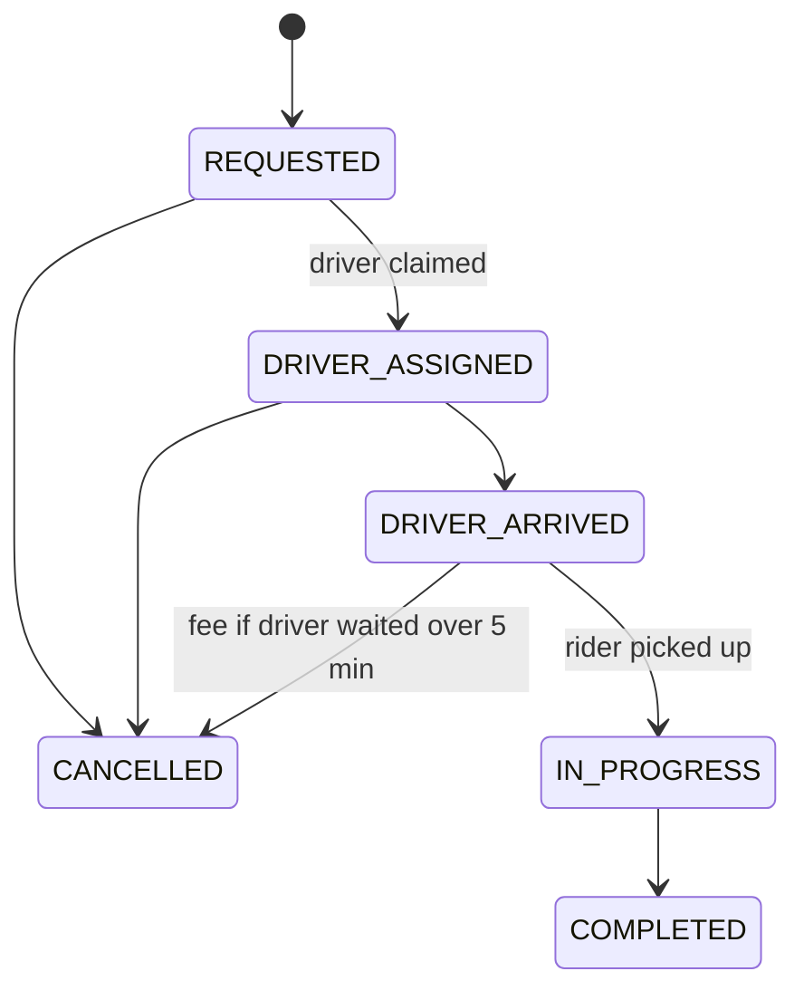

<Related ids={['strategy-pattern', 'state-pattern', 'decorator-pattern', 'concurrency-for-lld']} />

"Design Uber" (or Ola) as an **LLD** round is about the objects inside the matching service: riders, drivers and rides, a fast way to find nearby drivers, a ride's life from request to drop-off, and the fare. And there's one race every interviewer asks about: **two riders matched to the same driver at the same moment**.

(The distributed version, with millions of location updates and the map split across servers, is the HLD case study [Design a Ride-Sharing Service](/system-design/hld/design-ride-hailing).)

We'll use the same six steps as every case study: requirements, entities, class design, code, a worked example, and follow-ups. (The [parking lot](/system-design/lld/lld-parking-lot) lesson explains the plan in detail.)

## Step 1: Pin down the requirements

<Dialogue>
<Turn who="you">Who uses the system? Riders and drivers?</Turn>
<Turn who="them">Yes. Drivers go online and send their location; riders request rides.</Turn>
<Turn who="you">How do we pick a driver?</Turn>
<Turn who="them">The nearest available driver with the right vehicle type, within 5 km.</Turn>
<Turn who="you">What stages does a ride go through?</Turn>
<Turn who="them">Requested, driver assigned, driver arrived, in progress, completed. Riders can cancel before the trip starts.</Turn>
<Turn who="you">How is the fare calculated?</Turn>
<Turn who="them">A base fare, plus per kilometre and per minute. When demand is high, there's a surge multiplier, with a cap.</Turn>
<Turn who="you">Many riders requesting at once, I assume?</Turn>
<Turn who="them">Yes. And a driver must never get two rides.</Turn>
<Turn who="you">Payments, ratings, real road routes?</Turn>
<Turn who="them">Out of scope.</Turn>
</Dialogue>

**The system must:**

1. Let drivers go online, update their location and go offline.
2. Match a ride request to the nearest available driver of the right type within 5 km.
3. Move a ride through its stages, and allow cancellation before the trip starts.
4. Calculate the fare from distance and time, with a capped surge multiplier.
5. **Never** assign one driver to two rides, even with many requests at once.

**Out of scope for now:** payments, ratings, road routing and real ETAs.

## Step 2: Find the core entities

| Noun | Make it… | Why |
| --- | --- | --- |
| Rider | a record (or just an id) | We only need to know who asked. |
| Driver | a class | Location and status (available, on a trip) change constantly. |
| Location | a record `Location(x, y)` | Two numbers and a distance method. |
| Ride | a class | Rider, driver, pickup, drop, and a status that moves through stages. |
| Ride status | an enum, plus rules for which changes are allowed | The ride's life cycle. |
| Finding nearby drivers | an interface `DriverIndex` | A simple grid now; something smarter later. |
| Choosing a driver | an interface `MatchingStrategy` | Nearest first now; maybe rating-weighted later. |
| Fare | an interface `FareStrategy` | Base fare, surge, discounts, all combinable. |
| Ride service | a class | The front door. |

Notice the three interfaces. They answer three different questions that change for different reasons: **where are the drivers?**, **which one should go?** and **how much does it cost?** Keeping them separate keeps the service small.

## Step 3: Design each class

**`Driver`**: knows its id, vehicle type, location and status. The important method is `tryAssign()`: "make me busy, but only if I'm currently available". It must succeed for **exactly one** caller.

**`Ride`**: knows its rider, driver, pickup, drop and status. Its `transition(next)` method refuses any change that isn't allowed (you can't complete a ride that hasn't started).

**`DriverIndex`**: knows where drivers are. It can update a driver's position and return drivers within a radius.

**`MatchingStrategy`**: given a pickup point and vehicle type, returns available drivers **in order of preference**. It returns a list, not a single driver, and the next section explains why.

**`FareStrategy`**: given the pickup, drop and duration, returns the fare.

**`RideService`**: `requestRide`, `startRide`, `completeRide`, `cancel`.

Now the race. Two riders request at the same instant, and driver D1 is nearest to both.

<Approach verdict="bad" title="Pick the nearest driver, then assign">

```java
Driver d = nearestAvailable(pickup);   // both requests get D1
d.status = ON_TRIP;                    // both assign D1
```

A check-then-act race: both requests see D1 as available before either marks it busy.

</Approach>

<Approach verdict="good" title="One lock around all matching">

Correct, but a rider in Mumbai now waits for a rider in Delhi. Matching is the hottest path in the system.

</Approach>

<Approach verdict="great" title="Candidates plus an atomic claim">

The strategy returns a **ranked list of candidates**. The service tries to **claim** each one with an atomic compare-and-set: "change this driver from AVAILABLE to ON_TRIP, but only if it's still AVAILABLE". Only one request can win D1; the loser simply moves to the next candidate. No global lock, and requests in different areas never wait for each other.

</Approach>



## Step 4: Write the code

<InterviewScope minutes="45–60" lines="70" write={["Rider, Driver and Ride, with ride states", "A `MatchingStrategy` (nearest first) and a `FareStrategy`", "An atomic claim so a driver gets only one ride"]} say={["A grid index to find nearby drivers fast", "Surge pricing as a decorator over the fare", "Driver accept/reject and timeouts"]} skip={["Maps, routes and real ETAs", "Payments and ratings"]} />

### The interview-sized version

Nearest-driver matching, a ride state machine and a compare-and-set that prevents double assignment. It's about **70 lines**, and it compiles and runs.

```java
record Location(double x, double y) {
    double distanceTo(Location o) { return Math.hypot(x - o.x, y - o.y); }   // km, on a flat map
}

enum DriverStatus { AVAILABLE, ON_TRIP }
enum RideStatus { ASSIGNED, STARTED, COMPLETED, CANCELLED }

class Driver {
    final String id;
    volatile Location location;
    final AtomicReference<DriverStatus> status = new AtomicReference<>(DriverStatus.AVAILABLE);
    Driver(String id, Location location) { this.id = id; this.location = location; }
}

class Ride {
    final String rider;
    final Driver driver;
    final Location pickup, drop;
    RideStatus status = RideStatus.ASSIGNED;

    Ride(String rider, Driver driver, Location pickup, Location drop) { this.rider = rider; this.driver = driver; this.pickup = pickup; this.drop = drop; }

    synchronized void start()    { moveTo(RideStatus.STARTED, RideStatus.ASSIGNED); }
    synchronized void complete() { moveTo(RideStatus.COMPLETED, RideStatus.STARTED); }
    synchronized void cancel()   { moveTo(RideStatus.CANCELLED, RideStatus.ASSIGNED); driver.status.set(DriverStatus.AVAILABLE); }

    private void moveTo(RideStatus next, RideStatus required) {
        if (status != required) throw new IllegalStateException("Can't go from " + status + " to " + next);
        status = next;
    }
}

interface MatchingStrategy { List<Driver> rank(Collection<Driver> drivers, Location pickup); }

class NearestFirst implements MatchingStrategy {
    public List<Driver> rank(Collection<Driver> drivers, Location pickup) {
        return drivers.stream()
                .filter(d -> d.status.get() == DriverStatus.AVAILABLE)
                .sorted(Comparator.comparingDouble(d -> d.location.distanceTo(pickup)))
                .toList();
    }
}

interface FareStrategy { int fare(double km); }

record PerKmFare(int base, int perKm) implements FareStrategy {
    public int fare(double km) { return base + (int) Math.ceil(km) * perKm; }
}

class RideService {
    private final Map<String, Driver> drivers = new ConcurrentHashMap<>();
    private final MatchingStrategy matching;
    private final FareStrategy fares;

    RideService(MatchingStrategy matching, FareStrategy fares) { this.matching = matching; this.fares = fares; }
    void addDriver(Driver d) { drivers.put(d.id, d); }

    Ride request(String rider, Location pickup, Location drop) {
        for (Driver d : matching.rank(drivers.values(), pickup))
            if (d.status.compareAndSet(DriverStatus.AVAILABLE, DriverStatus.ON_TRIP))   // atomic claim: one ride per driver
                return new Ride(rider, d, pickup, drop);
        throw new IllegalStateException("No driver available");
    }

    int complete(Ride ride) {
        ride.complete();
        ride.driver.status.set(DriverStatus.AVAILABLE);
        return fares.fare(ride.pickup.distanceTo(ride.drop));
    }
}
```

**Reading it top to bottom:**

1. **`Driver.status`** is an `AtomicReference`. That's what makes the atomic claim possible.
2. **`Ride`** allows only `ASSIGNED → STARTED → COMPLETED`, or `ASSIGNED → CANCELLED`. `moveTo` throws on anything else. Cancelling also frees the driver.
3. **`NearestFirst`** filters to available drivers and sorts by distance. It returns the whole list.
4. **`RideService.request`** walks that list and calls `compareAndSet(AVAILABLE, ON_TRIP)` on each driver. The first one that succeeds is ours. If another request claimed the driver a moment earlier, the call returns `false` and we try the next one.
5. **`complete`** finishes the ride, frees the driver and returns the fare.

<Callout type="tip" title="How to practise this">
The one line to understand deeply is `d.status.compareAndSet(AVAILABLE, ON_TRIP)`. Explain out loud what happens when two threads call it on the same driver at the same moment. Then write the rest around it.
</Callout>

### Growing it into the full design

#### Finding nearby drivers: a grid

Checking every driver in the city for every request is slow. Instead, divide the map into a **grid of 1 km squares**. Each driver lives in one square. To find drivers within 2 km, look only in the squares around the pickup point, then check the exact distance for the drivers there.

In `update`, most location pings keep a driver in the same square, so nothing needs to move. Only when a driver crosses into a new square do we remove them from the old one and add them to the new one.

```java
public final class GridDriverIndex implements DriverIndex {
    private record Cell(long cx, long cy) { }
    private final double cellKm;
    private final ConcurrentHashMap<Cell, Set<Driver>> cells = new ConcurrentHashMap<>();
    private final ConcurrentHashMap<Driver, Cell> cellOf = new ConcurrentHashMap<>();

    private Cell cell(Location l) { return new Cell((long) Math.floor(l.x() / cellKm), (long) Math.floor(l.y() / cellKm)); }

    public void update(Driver d) {                                  // called on every location ping
        Cell now = cell(d.location());
        Cell before = cellOf.put(d, now);
        if (now.equals(before)) return;                             // most pings stay in the same cell
        if (before != null) cells.getOrDefault(before, Set.of()).remove(d);
        cells.computeIfAbsent(now, c -> ConcurrentHashMap.newKeySet()).add(d);
    }

    public List<Driver> nearby(Location at, double radiusKm) {
        Cell c = cell(at);
        long r = (long) Math.ceil(radiusKm / cellKm);
        List<Driver> out = new ArrayList<>();
        for (long dx = -r; dx <= r; dx++)
            for (long dy = -r; dy <= r; dy++)
                for (Driver d : cells.getOrDefault(new Cell(c.cx() + dx, c.cy() + dy), Set.of()))
                    if (d.location().distanceTo(at) <= radiusKm) out.add(d);   // exact check inside the cells
        return out;
    }
}
```

Real systems use the same idea with geohashes, Google's S2 cells or Uber's H3 hexagons. Square size is a trade-off: too big and each query checks many drivers; too small and each query touches many squares.

#### Matching returns candidates

```java
public final class NearestDriverMatching implements MatchingStrategy {
    public List<Driver> candidates(Location pickup, VehicleType type) {
        return index.nearby(pickup, radiusKm).stream()
                .filter(d -> d.vehicle() == type && d.status() == DriverStatus.AVAILABLE)
                .sorted(Comparator.comparingDouble(d -> d.location().distanceTo(pickup)))
                .toList();                                          // preference order, not a reservation
    }
}
```

#### The atomic claim

`tryAssign` is the compare-and-set from the short version, wrapped in a method with a clear name. `requestRide` tries candidates in order until one claim succeeds.

```java
public final class Driver {
    private final AtomicReference<DriverStatus> status = new AtomicReference<>(DriverStatus.AVAILABLE);

    /** Only one ride can move a driver from AVAILABLE to ON_TRIP. */
    public boolean tryAssign() { return status.compareAndSet(DriverStatus.AVAILABLE, DriverStatus.ON_TRIP); }
    public void release()      { status.set(DriverStatus.AVAILABLE); }
}

public Ride requestRide(Rider rider, Location pickup, Location drop, VehicleType type) {
    Ride ride = new Ride(new RideId(ids.incrementAndGet()), rider, pickup, drop);
    for (Driver d : matching.candidates(pickup, type)) {
        if (d.tryAssign()) {                       // lost the race for this driver? try the next one
            ride.assign(d);
            rides.put(ride.id(), ride);
            return ride;
        }
    }
    throw new NoDriverAvailableException();
}
```

The reference solution fires 200 requests at 60 drivers at the same time and checks that every driver ends up with exactly one ride.

<Callout type="note" title="Real dispatch offers, then waits">
Real apps **offer** the trip to a driver and wait a few seconds for them to accept. Model that with a third driver status, `OFFERED`: compare-and-set from `AVAILABLE` to `OFFERED`, then to `ON_TRIP` on accept, or back to `AVAILABLE` on decline or timeout, and move on to the next candidate. It's the same atomic-claim idea.
</Callout>

#### The ride's life cycle



The behaviour in each state is small, so an enum plus a table of allowed changes is enough. No need for a class per state here:

```java
private static final Map<RideStatus, Set<RideStatus>> ALLOWED = Map.of(
        REQUESTED,       EnumSet.of(DRIVER_ASSIGNED, CANCELLED),
        DRIVER_ASSIGNED, EnumSet.of(DRIVER_ARRIVED, CANCELLED),
        DRIVER_ARRIVED,  EnumSet.of(IN_PROGRESS, CANCELLED),
        IN_PROGRESS,     EnumSet.of(COMPLETED),
        COMPLETED,       EnumSet.noneOf(RideStatus.class),
        CANCELLED,       EnumSet.noneOf(RideStatus.class));

synchronized void transition(RideStatus next) {
    if (!ALLOWED.get(status).contains(next)) throw new IllegalStateTransitionException(status, next);
    status = next;
}
```

Every way out of a ride that holds a driver (completed or cancelled) **must free the driver**. The most common bug in this problem is a driver stuck as `ON_TRIP` forever after a cancellation.

#### Fares: Strategy plus Decorator

`DistanceTimeFare` is the base: base fare + per km + per minute. `SurgePricing` **wraps** any fare strategy and multiplies its result by the demand-to-supply ratio in the pickup area, between 1× and a cap.

```java
public final class DistanceTimeFare implements FareStrategy {
    public Money estimate(Location from, Location to, Duration duration) {
        return base.plus(perKm.times(from.distanceTo(to))).plus(perMinute.times(duration.toMinutes()));
    }
}

/** Multiplies any fare by demand/supply in the pickup cell, between 1× and a cap. */
public final class SurgePricing implements FareStrategy {
    public Money estimate(Location from, Location to, Duration duration) {
        double multiplier = Math.min(cap, Math.max(1.0, index.demandSupplyRatio(from)));
        return inner.estimate(from, to, duration).times(multiplier);
    }
}
```

Because surge wraps the base fare, discounts, tolls and airport fees can be more wrappers. City-specific base fares are just different settings.

## Step 5: Trace two riders racing

Drivers D1 (500 m from the pickup) and D2 (1.2 km), both available.

1. Asha and Ben request rides from the same corner at the same moment.
2. Both get the candidate list **[D1, D2]**.
3. Both call `D1.tryAssign()`. The compare-and-set succeeds for Asha's request and fails for Ben's: D1 is no longer AVAILABLE.
4. Ben's request moves on and claims D2.
5. Asha cancels before pickup. Her ride goes to CANCELLED, and D1 is set back to AVAILABLE, ready for the next request.

## Step 6: Handle follow-up questions

**"Let the driver accept or decline within 10 seconds."** Add `OFFERED`. Accept and timeout both use compare-and-set from `OFFERED`, so if they race, exactly one wins. After a decline or timeout, offer to the next candidate and skip drivers who already declined.

**"Prefer highly rated drivers."** A new matching strategy that sorts by a weighted score (distance, rating, acceptance rate). Nothing else changes.

**"Ride pooling."** A ride holds several riders; matching checks how far each new rider would push the route out of the way for those already on board.

**"Scheduled rides."** A job scheduler starts matching a few minutes before the pickup time (see [Job Scheduler](/system-design/lld/lld-job-scheduler)).

**"100,000 drivers pinging every 3 seconds."** That's about 33,000 updates a second. Skip tiny movements, only touch the grid when a driver changes square, and beyond one machine split the index by region. That's where this turns into the HLD problem.

## Common mistakes

- **Picking a driver and then assigning it** without an atomic claim.
- **A global lock around matching.**
- **Forgetting to free the driver** when a ride is cancelled.
- **Scanning every driver** for every request.
- **Putting surge inside the base fare calculation**, so changing surge means touching per-km logic.

## Patterns used

| Pattern | Where |
| --- | --- |
| **Strategy** | `MatchingStrategy`, `FareStrategy`, `DriverIndex` implementations |
| **Decorator** | `SurgePricing` (and discounts) around a base fare |
| **State** (table form) | The `Ride` life cycle |
| **Facade** | `RideService` |
| **Observer** (follow-up) | Push ride updates to the rider and driver apps |

## Interview questions

<QA q="Two riders request at the same time and both see the same nearest driver. How do you avoid double assignment?">
Matching produces a ranked list of candidates, and the claim is atomic: each driver's status is an atomic reference, and a request gets a driver only if a compare-and-set from AVAILABLE to ON_TRIP succeeds. The losing request moves to its next candidate. No global lock is needed, and different areas never wait for each other. With many servers, the same idea becomes a conditional write on the driver's record or a short lease in Redis.
</QA>

<QA q="How do you find drivers near a rider efficiently?">
Use a spatial index. A grid (or geohash, S2 or H3 cells) maps each driver to a cell; a radius query looks only at the cells the circle overlaps and then checks exact distances. Location pings usually stay in the same cell, so updates are cheap. Quadtrees adapt better to uneven density, at the cost of more complex updates.
</QA>

<QA q="Where does surge pricing live in your design?">
As a decorator around the base fare strategy. It computes a multiplier from demand and supply in the pickup area, keeps it between 1 and a cap, and multiplies the inner fare. Base fares, surge, discounts and fees stay separate classes that combine, so changing the surge formula never touches the per-km logic.
</QA>

<Practice task="Add the offer-and-accept flow: a driver has 10 seconds to accept before the trip goes to the next candidate. What new state and what concurrency hazard appear?">

Add `OFFERED` to the driver status (compare-and-set `AVAILABLE → OFFERED`) and a pending offer on the ride. Schedule a timeout task. Accepting is a compare-and-set `OFFERED → ON_TRIP` **and** a check that the offer is still current; the timeout is a compare-and-set `OFFERED → AVAILABLE`. The hazard is accept and timeout racing: whichever compare-and-set wins decides, and the loser does nothing. After a timeout or decline, offer the ride to the next candidate, skipping drivers who already declined it.

</Practice>

<Practice task="Drivers send a location update every 3 seconds; 100,000 drivers are online. What in GridDriverIndex.update would you worry about, and how would you reduce the cost?">

Each update is a map write and, when the cell changes, a remove and an add on concurrent sets. That's fine for about 33,000 updates a second on one machine, but it creates a lot of short-lived objects. Reduce the work by skipping updates that move less than a threshold, only touching the cell maps when the cell actually changes (already done), and storing positions compactly. Beyond one machine, split the index by region, which is where the LLD turns into the HLD problem.

</Practice>

<Takeaways>

- Keep three questions apart: where the drivers are (index), which one goes (matching) and the price (fare).
- Matching returns candidates; claiming a driver is an atomic compare-and-set, falling back to the next candidate.
- Spell out the ride's life cycle and free the driver on every way out.
- Surge, discounts and fees are decorators around a base fare.

</Takeaways>

## Further reading

- HLD view: [Design a Ride-Sharing Service](/system-design/hld/design-ride-hailing) and [Geospatial Indexing](/system-design/hld/geospatial-indexing).
- Uber Engineering, "H3: Uber's Hexagonal Hierarchical Spatial Index" (2018).
