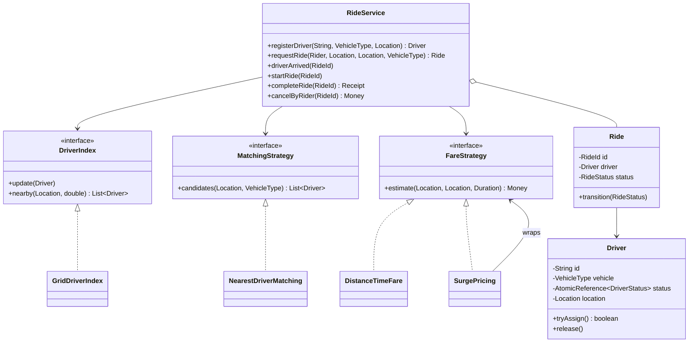
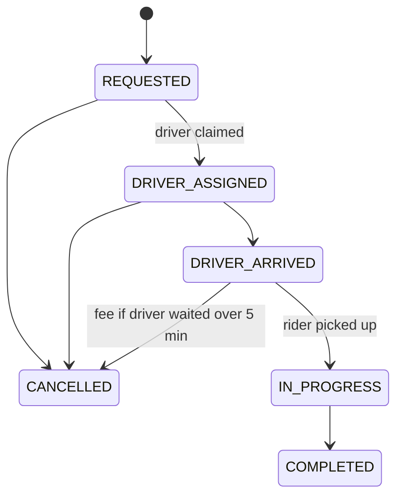

<Related ids={['strategy-pattern', 'state-pattern', 'decorator-pattern', 'concurrency-for-lld']} />

"Design Uber/Ola" as an **LLD** round is about the objects inside the matching service: riders, drivers, rides, a way to find nearby drivers fast, a ride lifecycle, fares — and the race every interviewer asks about: **two riders matched to the same driver at the same moment**. (The distributed version — location ingestion at scale, geo-sharding — is the HLD case study [Design a Ride-Sharing Service](/system-design/hld/design-ride-hailing).)

## 1. Requirements

| Question | Assumption |
| --- | --- |
| Actors | Riders request rides; drivers go online, update location, accept trips |
| Matching | Nearest available driver of the requested vehicle type within a radius (5 km) |
| Lifecycle | Requested → driver assigned → driver arrived → in progress → completed; cancellation before the trip starts |
| Fare | Base + per km + per minute; surge multiplier when demand exceeds supply, capped |
| Cancellation | Free unless the driver has been waiting at pickup longer than 5 minutes |
| Concurrency | Many riders request at once; a driver must never get two rides |
| Out of scope | Payments, ratings, ETA from road graphs (extensions) |

## 2. Class design



Three variation points, three interfaces: **how to find drivers** (index), **which driver to pick** (matching), **how much to charge** (fare). The service is a thin facade.

## 3. Finding nearby drivers: a grid index

Scanning every driver per request is O(drivers). A **grid** divides the map into fixed-size cells (1 km here); each driver lives in one cell, and a radius query only looks at the cells the circle overlaps.

```java
public final class GridDriverIndex implements DriverIndex {
    private record Cell(long cx, long cy) { }
    private final double cellKm;
    private final ConcurrentHashMap<Cell, Set<Driver>> cells = new ConcurrentHashMap<>();
    private final ConcurrentHashMap<Driver, Cell> cellOf = new ConcurrentHashMap<>();

    private Cell cell(Location l) { return new Cell((long) Math.floor(l.x() / cellKm), (long) Math.floor(l.y() / cellKm)); }

    public void update(Driver d) {                                  // called on every location ping
        Cell now = cell(d.location());
        Cell before = cellOf.put(d, now);
        if (now.equals(before)) return;                             // most pings stay in the same cell
        if (before != null) cells.getOrDefault(before, Set.of()).remove(d);
        cells.computeIfAbsent(now, c -> ConcurrentHashMap.newKeySet()).add(d);
    }

    public List<Driver> nearby(Location at, double radiusKm) {
        Cell c = cell(at);
        long r = (long) Math.ceil(radiusKm / cellKm);
        List<Driver> out = new ArrayList<>();
        for (long dx = -r; dx <= r; dx++)
            for (long dy = -r; dy <= r; dy++)
                for (Driver d : cells.getOrDefault(new Cell(c.cx() + dx, c.cy() + dy), Set.of()))
                    if (d.location().distanceTo(at) <= radiusKm) out.add(d);   // exact check inside the cells
        return out;
    }
}
```

Production systems use the same idea with geohashes, Google S2 cells or Uber's H3 hexagons; behind the `DriverIndex` interface, a quadtree or an R-tree would also fit. Cell size is a trade-off: too large and each query scans many drivers; too small and a query touches many cells.

## 4. Matching — and the double-assignment race

```java
public final class NearestDriverMatching implements MatchingStrategy {
    public List<Driver> candidates(Location pickup, VehicleType type) {
        return index.nearby(pickup, radiusKm).stream()
                .filter(d -> d.vehicle() == type && d.status() == DriverStatus.AVAILABLE)
                .sorted(Comparator.comparingDouble(d -> d.location().distanceTo(pickup)))
                .toList();                                          // preference order, not a reservation
    }
}
```

The strategy returns **candidates**, not a driver. Between "D1 looks available" and "assign D1", another request can take D1 — a check-then-act race. So the claim itself must be atomic:

```java
public final class Driver {
    private final AtomicReference<DriverStatus> status = new AtomicReference<>(DriverStatus.AVAILABLE);

    /** Only one ride can move a driver from AVAILABLE to ON_TRIP. */
    public boolean tryAssign() { return status.compareAndSet(DriverStatus.AVAILABLE, DriverStatus.ON_TRIP); }
    public void release()      { status.set(DriverStatus.AVAILABLE); }
}

public Ride requestRide(Rider rider, Location pickup, Location drop, VehicleType type) {
    Ride ride = new Ride(new RideId(ids.incrementAndGet()), rider, pickup, drop);
    for (Driver d : matching.candidates(pickup, type)) {
        if (d.tryAssign()) {                       // lost the race for this driver? try the next one
            ride.assign(d);
            rides.put(ride.id(), ride);
            return ride;
        }
    }
    throw new NoDriverAvailableException();
}
```

No global lock: requests in different areas never contend, and two requests for the same driver resolve with one compare-and-set. The reference solution fires 200 concurrent requests at 60 drivers and checks every driver is assigned exactly once.

<Callout type="note" title="Real dispatch offers, then waits">
Real systems **offer** the trip to a driver and wait a few seconds for acceptance. Model that as a third driver status, `OFFERED`: CAS from `AVAILABLE` to `OFFERED`, then to `ON_TRIP` on accept, or back to `AVAILABLE` on decline or timeout (a scheduled task) — and move to the next candidate. The atomic claim is the same idea.
</Callout>

## 5. Ride lifecycle



An enum plus a transition table is enough here — the behaviour per state is small:

```java
private static final Map<RideStatus, Set<RideStatus>> ALLOWED = Map.of(
        REQUESTED,       EnumSet.of(DRIVER_ASSIGNED, CANCELLED),
        DRIVER_ASSIGNED, EnumSet.of(DRIVER_ARRIVED, CANCELLED),
        DRIVER_ARRIVED,  EnumSet.of(IN_PROGRESS, CANCELLED),
        IN_PROGRESS,     EnumSet.of(COMPLETED),
        COMPLETED,       EnumSet.noneOf(RideStatus.class),
        CANCELLED,       EnumSet.noneOf(RideStatus.class));

synchronized void transition(RideStatus next) {
    if (!ALLOWED.get(status).contains(next)) throw new IllegalStateTransitionException(status, next);
    status = next;
}
```

Every exit from a driver-holding state (completed, cancelled) must **release the driver** — the most common bug in this problem is a driver stuck `ON_TRIP` after a cancellation.

## 6. Fares: Strategy + Decorator

```java
public final class DistanceTimeFare implements FareStrategy {
    public Money estimate(Location from, Location to, Duration duration) {
        return base.plus(perKm.times(from.distanceTo(to))).plus(perMinute.times(duration.toMinutes()));
    }
}

/** Multiplies any fare by demand/supply in the pickup cell, between 1× and a cap. */
public final class SurgePricing implements FareStrategy {
    public Money estimate(Location from, Location to, Duration duration) {
        double multiplier = Math.min(cap, Math.max(1.0, index.demandSupplyRatio(from)));
        return inner.estimate(from, to, duration).times(multiplier);
    }
}
```

Surge wraps the base fare, so promotions (`FlatDiscount`), tolls or airport fees are further decorators — and city-specific base fares are just different `DistanceTimeFare` configurations.

## 7. Patterns used

| Pattern | Where |
| --- | --- |
| **Strategy** | `MatchingStrategy`, `FareStrategy`, `DriverIndex` implementations |
| **Decorator** | `SurgePricing` (and discounts) around a base fare |
| **State** (table form) | `Ride` lifecycle |
| **Facade** | `RideService` |
| **Observer** (extension) | Push ride updates to rider and driver apps |

## 8. Extensions

- **Ratings**: record on completion; matching can prefer higher-rated drivers by sorting on a weighted score (distance, rating, acceptance rate).
- **Ride pooling**: a ride holds several riders; matching checks detour limits for the riders already on board.
- **Scheduled rides**: a job scheduler triggers matching shortly before pickup (see [Job Scheduler](/system-design/lld/lld-job-scheduler)).
- **ETA**: replace straight-line distance with a routing service behind an interface.

## Interview questions

<QA q="Two riders request at the same time and both see the same nearest driver. How do you avoid double assignment?">
Treat matching as producing a ranked list of candidates and make the claim atomic: each driver's status is an atomic reference, and a request assigns a driver only if a compare-and-set from AVAILABLE to ON_TRIP succeeds. The losing request moves to its next candidate. No global lock is needed, and different areas never contend. In a distributed system the same idea becomes a conditional write on the driver's record or a short lease in Redis.
</QA>

<QA q="How do you find drivers near a rider efficiently?">
Use a spatial index. A uniform grid (or geohash, S2 or H3 cells) maps each driver to a cell; a radius query scans only the cells overlapping the circle and then checks exact distances. Location pings usually stay in the same cell, so updates are cheap. Quadtrees adapt better to uneven density, at the cost of more complex updates.
</QA>

<QA q="Where does surge pricing live in your design?">
As a decorator around the base fare strategy. It computes a multiplier from demand and supply in the pickup cell, clamps it between 1 and a cap, and multiplies the inner fare. Base fares, surge, discounts and fees stay separate classes that compose, so changing the surge formula never touches the per-km logic.
</QA>

<Practice task="Add the offer-and-accept flow: a driver has 10 seconds to accept before the trip goes to the next candidate. What new state and what concurrency hazard appear?">

Add `OFFERED` to the driver status (CAS `AVAILABLE → OFFERED`) and a pending offer on the ride. Schedule a timeout task. Accept is a CAS `OFFERED → ON_TRIP` **and** a check that the offer is still current; the timeout is a CAS `OFFERED → AVAILABLE`. The hazard is accept and timeout racing — whichever CAS wins decides, and the loser does nothing. After a timeout or decline, offer to the next candidate (skip drivers who already declined this ride).

</Practice>

<Practice task="Drivers send a location update every 3 seconds; 100,000 drivers are online. What in GridDriverIndex.update would you worry about, and how would you reduce the cost?">

Each update is a map write plus, when the cell changes, a remove and an add on concurrent sets — fine for ~33,000 updates per second on one machine, but allocation-heavy. Reduce work by skipping updates that move less than a threshold, only touching the cell maps when the cell actually changes (already done), and storing positions in a primitive-friendly structure. Beyond one machine, shard the index by region — which is where the LLD turns into the HLD problem.

</Practice>

<Takeaways>

- Separate finding drivers (spatial index), choosing one (matching strategy) and pricing (fare strategy).
- Matching returns candidates; claiming a driver is an atomic compare-and-set, with fallback to the next candidate.
- Model the ride lifecycle explicitly and release the driver on every exit path.
- Surge, discounts and fees are decorators around a base fare.

</Takeaways>

## Further reading

- HLD view: [Design a Ride-Sharing Service](/system-design/hld/design-ride-hailing) and [Geospatial Indexing](/system-design/hld/geospatial-indexing).
- Uber Engineering, "H3: Uber's Hexagonal Hierarchical Spatial Index" (2018).
