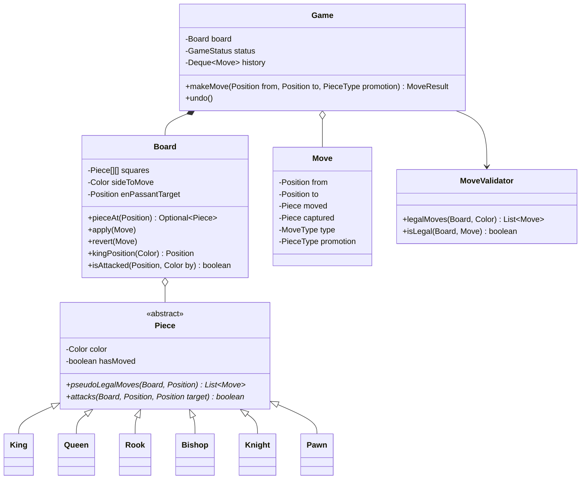

<Related ids={['strategy-pattern', 'command-pattern', 'memento-pattern', 'state-pattern', 'factory-patterns', 'oop-fundamentals']} />

Chess has more rules than any other common LLD question, and that's exactly why it's asked. Nobody expects you to code castling and en passant in 45 minutes. The interviewer wants to see a design where **every rule has an obvious home**: pieces know how they move, the board knows what's where, and something else decides whether a move is actually legal.

We'll use the same six steps as every case study: requirements, entities, class design, code, a worked example, and follow-ups. (The [parking lot](/system-design/lld/lld-parking-lot) lesson explains the plan in detail.)

## Step 1: Pin down the requirements

<Dialogue>
<Turn who="you">Standard chess: 8×8 board, two players, normal piece moves?</Turn>
<Turn who="them">Yes.</Turn>
<Turn who="you">Should I stop a player making a move that leaves their own king in check?</Turn>
<Turn who="them">Yes, that's part of the rules.</Turn>
<Turn who="you">Do you want checkmate and stalemate detection?</Turn>
<Turn who="them">Yes, at least in the design.</Turn>
<Turn who="you">What about the special moves: castling, en passant, promotion?</Turn>
<Turn who="them">Show me where they'd go. Code them if there's time.</Turn>
<Turn who="you">Clocks, undo, a computer opponent?</Turn>
<Turn who="them">Not now. Maybe undo as a follow-up.</Turn>
</Dialogue>

**The game must:**

1. Use an 8×8 board with the standard pieces for white and black.
2. Let players alternate moves, and reject moves that break a piece's movement rules.
3. Handle captures; never capture your own piece.
4. Reject any move that leaves your own king in check.
5. Detect check, checkmate and stalemate.
6. Have a clear place for castling, en passant and promotion.

**Out of scope for now:** clocks, undo, notation, bots.

## Step 2: Find the core entities

| Noun | Make it… | Why |
| --- | --- | --- |
| Piece (king, queen, rook, bishop, knight, pawn) | an **abstract class** with one subclass per piece | Each piece **moves differently**. Different behaviour is exactly what subclasses are for. |
| Colour | an enum | White or black. |
| Square / position | a record `Position(file, rank)` | Two numbers. |
| Board | a class | What's on each square, whose turn it is. |
| Move | a record (or class) | From, to, which piece moved, what was captured, what kind of move. Storing moves as objects makes "try a move, then undo it" possible. |
| Move validator | a class | Decides if a move is **legal**, which needs the whole board (check, pins). |
| Game | a class | The front door: make a move, report the status. |

<Callout type="note" title="Why subclasses here, but enums in the parking lot?">
In the parking lot, a car and a bike differed only in **data** (the spot size they need), so an enum was right. Here, a knight and a rook differ in **behaviour**: they move in completely different ways. That's when inheritance earns its place.
</Callout>

## Step 3: Design each class

The most important decision is **who decides whether a move is legal**. Consider the options:

<Approach verdict="bad" title="One giant isValidMove in Game">

A single method with a `switch` on piece type, then special cases for check, castling and en passant all mixed in. It works, but it's 200 lines and every rule change touches it.

</Approach>

<Approach verdict="good" title="Each piece validates its own moves fully">

`Knight.canMove(...)`, `Rook.canMove(...)`. Much tidier. But "doesn't leave your king in check" depends on **every other piece on the board**. A rook shouldn't need to know about the enemy bishop pinning it.

</Approach>

<Approach verdict="great" title="Split the job in two">

1. **Each piece** says where it could go **by its own movement rules**, ignoring check. Chess programmers call these *pseudo-legal* moves.
2. **A `MoveValidator`** then filters them: try each move on the board, see whether your king is attacked, and undo it. Only safe moves are *legal*.

Pieces stay simple and know nothing about check; the validator handles everything that depends on the whole board.

</Approach>

So the responsibilities are:

| Class | Its job |
| --- | --- |
| `Piece` subclasses | How this piece moves geometrically ("pseudo-legal" moves), ignoring check |
| `Board` | What's on each square, whose turn it is and the en-passant square; applying and reverting moves; whether a square is attacked |
| `MoveValidator` | Full legality: pseudo-legal **and** doesn't leave your own king in check; special moves |
| `Game` | The public API: accept a requested move, keep the history, report check, checkmate or stalemate |



## Step 4: Write the code

<InterviewScope minutes="45–60" lines="70" write={["A `Piece` base class where each piece checks its own move shape", "A `Board` with a \"path is clear\" check for sliding pieces", "A `Game` that enforces turns and captures"]} say={["Check: \"after this move, is my king attacked?\"", "Pawn rules, then castling, en passant and promotion", "Undo by storing moves (Command)"]} skip={["Checkmate and stalemate detection, unless asked", "Clocks, notation (PGN) and an engine"]} />

### The interview-sized version

Pieces, board and turns. Interviewers want to see how you split move rules between pieces and the board. It's about **70 lines**, and it compiles and runs.

```java
enum Color { WHITE, BLACK }

record Pos(int row, int col) {
    boolean onBoard() { return row >= 0 && row < 8 && col >= 0 && col < 8; }
}

abstract class Piece {                            // each piece knows the shape of its own moves
    final Color color;
    Piece(Color color) { this.color = color; }
    abstract boolean canMove(Board board, Pos from, Pos to);
}

class Rook extends Piece {
    Rook(Color c) { super(c); }
    boolean canMove(Board b, Pos from, Pos to) {
        return (from.row() == to.row() || from.col() == to.col()) && b.pathClear(from, to);
    }
}

class Bishop extends Piece {
    Bishop(Color c) { super(c); }
    boolean canMove(Board b, Pos from, Pos to) {
        return Math.abs(from.row() - to.row()) == Math.abs(from.col() - to.col()) && b.pathClear(from, to);
    }
}

class Knight extends Piece {                      // jumps, so no path check
    Knight(Color c) { super(c); }
    boolean canMove(Board b, Pos from, Pos to) {
        return Math.abs(from.row() - to.row()) * Math.abs(from.col() - to.col()) == 2;
    }
}

class King extends Piece {
    King(Color c) { super(c); }
    boolean canMove(Board b, Pos from, Pos to) {
        return Math.max(Math.abs(from.row() - to.row()), Math.abs(from.col() - to.col())) == 1;
    }
}

class Board {
    private final Piece[][] grid = new Piece[8][8];
    Piece at(Pos p) { return grid[p.row()][p.col()]; }
    void put(Pos p, Piece piece) { grid[p.row()][p.col()] = piece; }

    boolean pathClear(Pos from, Pos to) {         // every square strictly between from and to is empty
        int dr = Integer.signum(to.row() - from.row()), dc = Integer.signum(to.col() - from.col());
        for (Pos p = new Pos(from.row() + dr, from.col() + dc); !p.equals(to); p = new Pos(p.row() + dr, p.col() + dc))
            if (at(p) != null) return false;
        return true;
    }
}

class Game {
    private final Board board;
    private Color turn = Color.WHITE;
    Game(Board board) { this.board = board; }

    Piece move(Pos from, Pos to) {                // returns the captured piece, or null
        if (!from.onBoard() || !to.onBoard() || from.equals(to)) throw new IllegalArgumentException("Bad squares");
        Piece piece = board.at(from);
        if (piece == null || piece.color != turn) throw new IllegalArgumentException("No " + turn + " piece there");
        Piece target = board.at(to);
        if (target != null && target.color == turn) throw new IllegalArgumentException("Your own piece is there");
        if (!piece.canMove(board, from, to)) throw new IllegalArgumentException("Illegal move");
        board.put(to, piece);
        board.put(from, null);
        turn = turn == Color.WHITE ? Color.BLACK : Color.WHITE;
        return target;
    }
}
```

**Reading it top to bottom:**

1. **`Piece`** is abstract with one method, `canMove`. Each subclass answers "is this the right **shape** of move for me?"
2. **`Rook`**: same row or same column, **and** nothing in the way. **`Bishop`**: the row change equals the column change (a diagonal), and nothing in the way.
3. **`Knight`**: a neat trick. A knight moves 1 and 2 (or 2 and 1), so the product of the row change and column change is always exactly 2. Knights jump, so there's no path check.
4. **`King`**: one square in any direction, so the larger of the two changes is 1.
5. **`Board.pathClear`** walks one step at a time from `from` towards `to` (`signum` gives −1, 0 or +1 for each direction) and fails if any square in between is occupied. Rook, bishop and queen all share it.
6. **`Game.move`** checks things in a sensible order: real squares, your own piece, not capturing your own piece, the piece's movement rule. Only then does it move the piece and switch turns. It returns the captured piece, if any.

The short version doesn't check for check. Say so, and explain the "try it and see if the king is attacked" idea from Step 3. That's usually enough.

<Callout type="tip" title="How to practise this">
Write the Piece hierarchy and `pathClear` first. Then add `Game.move`. If you finish early, add a `Queen` (rook or bishop shape) and a simple `Pawn`.
</Callout>

### Growing it into the full design

#### Core types

The full version uses the standard chess coordinates (file a–h and rank 1–8 as 0–7), a `Move` record that remembers what was captured, and a status enum.

```java
public enum Color { WHITE, BLACK; public Color opposite() { return this == WHITE ? BLACK : WHITE; } }
public enum PieceType { KING, QUEEN, ROOK, BISHOP, KNIGHT, PAWN }
public enum MoveType { NORMAL, CAPTURE, DOUBLE_PAWN_PUSH, CASTLE_KINGSIDE, CASTLE_QUEENSIDE, EN_PASSANT, PROMOTION }

public enum GameStatus {
    ACTIVE, CHECK, WHITE_WON, BLACK_WON, STALEMATE;
    public boolean isOver() { return this == WHITE_WON || this == BLACK_WON || this == STALEMATE; }
}

public record Move(Position from, Position to, Piece moved, Piece captured, MoveType type, PieceType promotion) { }

public record Position(int file, int rank) {                 // file a–h = 0–7, rank 1–8 = 0–7
    public boolean isValid() { return file >= 0 && file < 8 && rank >= 0 && rank < 8; }
    public Position offset(int df, int dr) { return new Position(file + df, rank + dr); }
}
```

#### Sliding pieces share one algorithm

Rook, bishop and queen all move the same way: slide in a direction until you hit the edge or a piece. The only difference is **which directions**. So the sliding is written once in `SlidingPiece`, and each piece just lists its directions:

1. For each direction, step one square at a time.
2. Empty square: that's a possible move; keep going.
3. Enemy piece: that's a possible capture; stop.
4. Own piece: stop without adding it.

<FullCode title="Show the full code: Sliding pieces share logic (51 lines)">

```java
public abstract class Piece {
    private final Color color;
    private boolean hasMoved;
    protected Piece(Color color) { this.color = color; }

    public abstract PieceType type();
    public abstract List<Move> pseudoLegalMoves(Board board, Position from);

    /** Default: a piece attacks a square if it has a pseudo-legal move there. Pawns override. */
    public boolean attacks(Board board, Position from, Position target) {
        return pseudoLegalMoves(board, from).stream().anyMatch(m -> m.to().equals(target));
    }

    public Color color() { return color; }
    public boolean hasMoved() { return hasMoved; }
    void setMoved(boolean moved) { this.hasMoved = moved; }
}

public abstract class SlidingPiece extends Piece {
    protected SlidingPiece(Color c) { super(c); }
    protected abstract int[][] directions();

    @Override public List<Move> pseudoLegalMoves(Board board, Position from) {
        List<Move> moves = new ArrayList<>();
        for (int[] d : directions()) {
            for (Position p = from.offset(d[0], d[1]); p.isValid(); p = p.offset(d[0], d[1])) {
                Optional<Piece> occupant = board.pieceAt(p);
                if (occupant.isEmpty()) { moves.add(Move.normal(from, p, this)); continue; }
                if (occupant.get().color() != color()) moves.add(Move.capture(from, p, this, occupant.get()));
                break;                                       // blocked either way
            }
        }
        return moves;
    }
}

public final class Rook extends SlidingPiece {
    private static final int[][] DIRS = {{1, 0}, {-1, 0}, {0, 1}, {0, -1}};
    public Rook(Color c) { super(c); }
    protected int[][] directions() { return DIRS; }
    public PieceType type() { return PieceType.ROOK; }
}

public final class Bishop extends SlidingPiece {
    private static final int[][] DIRS = {{1, 1}, {1, -1}, {-1, 1}, {-1, -1}};
    public Bishop(Color c) { super(c); }
    protected int[][] directions() { return DIRS; }
    public PieceType type() { return PieceType.BISHOP; }
}

public final class Queen extends SlidingPiece { /* union of rook and bishop directions */ }
```

</FullCode>

Knight and king use fixed jumps (a shared `StepPiece` base). The **pawn** is the odd one out: its direction depends on its colour, it can step two squares from its starting rank, it captures diagonally, and it promotes on the last rank.

One pawn detail matters for check detection. A pawn **moves** forward but **attacks** diagonally, so its `attacks` method must only return the two diagonal squares:

```java
@Override public boolean attacks(Board board, Position from, Position target) {
    return target.rank() == from.rank() + forward() && Math.abs(target.file() - from.file()) == 1;
}
```

Sliding pieces override `attacks` too. Walking each direction until you hit the target or a blocker is much cheaper than generating every move, and attack checks run a lot.

#### Legality: never leave your king in check

This is the "split the job in two" idea from Step 3 in code. For every candidate move: **make it, test it, unmake it**.

```java
public final class MoveValidator {
    public List<Move> legalMoves(Board board, Color side) {
        List<Move> legal = new ArrayList<>();
        for (Position from : board.positionsOf(side)) {
            Piece piece = board.pieceAt(from).orElseThrow();
            List<Move> candidates = new ArrayList<>(piece.pseudoLegalMoves(board, from));
            candidates.addAll(specialMoves(board, from, piece));   // castling, en passant
            for (Move m : candidates) if (isLegal(board, m, side)) legal.add(m);
        }
        return legal;
    }

    boolean isLegal(Board board, Move m, Color side) {
        board.apply(m);                                      // make the move…
        boolean kingSafe = !board.isAttacked(board.kingPosition(side), side.opposite());
        board.revert(m);                                     // …then undo it
        return kingSafe;
    }
}
```

This one technique handles every tricky case at once: a piece pinned to its king, a king trying to walk into check, and a move that uncovers an attack.

It only works if a move can be **undone exactly**: put the captured piece back, restore whether the king and rooks had moved, restore the en-passant square. That's why `Move` is an object that records what it changed. It's the **Command** pattern: an action stored as an object that can be applied and reverted.

#### Game status after each move

After a move, look at the player whose turn it now is:

- Are they in check? Do they have any legal move?
- Legal moves exist → the game goes on (`CHECK` or `ACTIVE`).
- No legal moves and **in check** → **checkmate**. The other player wins.
- No legal moves and **not in check** → **stalemate**. A draw.

```java
public MoveResult makeMove(Position from, Position to, PieceType promotion) {
    if (status.isOver()) throw new IllegalStateException("Game over: " + status);
    PieceType promoteTo = promotion == null ? PieceType.QUEEN : promotion;      // default to a queen
    Move move = validator.legalMoves(board, board.sideToMove()).stream()
            .filter(m -> m.from().equals(from) && m.to().equals(to)
                      && (m.promotion() == null || m.promotion() == promoteTo))
            .findFirst()
            .orElseThrow(() -> new IllegalMoveException(from, to));

    board.apply(move);                                       // also flips the side to move
    history.push(move);
    status = computeStatus();
    return new MoveResult(move, status);
}

private GameStatus computeStatus() {
    Color turn = board.sideToMove();
    boolean inCheck = board.isAttacked(board.kingPosition(turn), turn.opposite());
    boolean hasMoves = !validator.legalMoves(board, turn).isEmpty();
    if (hasMoves) return inCheck ? GameStatus.CHECK : GameStatus.ACTIVE;
    if (!inCheck) return GameStatus.STALEMATE;
    return turn == Color.WHITE ? GameStatus.BLACK_WON : GameStatus.WHITE_WON;
}
```

Other draws (the same position three times, fifty moves with no capture or pawn move, not enough pieces to checkmate) are follow-ups: track a history of positions and a move counter.

#### Where the special moves go

- **Castling** depends on the king, the rook, the squares between them and whether any of those squares are attacked. That's too much for `King` alone, so the validator generates it as a special move, and `Board.apply` moves both pieces.
- **En passant** is only possible right after an enemy pawn steps two squares. `Board.apply` remembers the skipped square after every double step and clears it after any other move. The validator then just asks "does my pawn attack that square?"
- **Promotion**: when a pawn reaches the last rank, a small factory, `PieceFactory.create(type, color)`, makes the new piece.

#### Undo

Because every move can be reverted exactly, `undo()` is just: pop the last move from the history, `board.revert(move)`, and recompute the status. The alternative is to save a full copy of the board before each move (the **Memento** pattern). It's simpler to write but uses more memory.

#### Testing a move generator: perft

Chess has many corner cases, such as castling through an attacked square or an en passant that exposes your own king. The standard way to test a move generator is **perft**: from a known position, count every possible sequence of moves to a given depth and compare with published totals.

```java
static long perft(MoveValidator v, Board b, int depth) {
    List<Move> moves = v.legalMoves(b, b.sideToMove());
    if (depth == 1) return moves.size();
    long nodes = 0;
    for (Move m : moves) { b.apply(m); nodes += perft(v, b, depth - 1); b.revert(m); }
    return nodes;
}
// Start position: 20, 400, 8,902, 197,281 for depths 1–4
```

The reference solution for this lesson passes perft on the starting position and four well-known tricky positions. Mentioning perft in an interview shows you know how to **prove** a rules engine is right, not just write one.

## Step 5: Trace a move

White plays bishop from c1 to g5, and that bishop is pinned: moving it would expose the white king to a black rook.

1. `Game.makeMove(c1, g5)` asks the validator for all of white's legal moves.
2. The bishop's `pseudoLegalMoves` includes g5: it's on a diagonal and the path is clear.
3. The validator **applies** the move, then asks the board "is the white king attacked by black?" The black rook now has a clear line: yes.
4. It **reverts** the move. Bishop to g5 is not legal.
5. No legal move matches c1 → g5, so `makeMove` throws "illegal move". The board is exactly as it was, and it's still white's turn.

## Step 6: Handle follow-up questions

**"Add undo."** Pop the last move from the history and revert it, then recompute the status. Moves already store what they captured.

**"Add threefold repetition."** Keep a count of how often each position has occurred. Use a hash of the position (a Zobrist hash, updated cheaply in `apply` and `revert`) rather than building strings.

**"Add chess clocks."** A `ChessClock` class keeps each player's remaining time, with an injected `Clock`. `Game.makeMove` stops the mover's clock (adding any increment) and starts the opponent's.

**"Add a computer opponent."** A `Player` with a `MoveStrategy`, as in tic-tac-toe. A minimax search uses the same `apply`/`revert` to explore moves.

## Common mistakes

- **Putting check detection inside each piece**, so a rook needs to know about every enemy piece.
- **Forgetting that pawns attack differently from how they move.** Check detection then thinks a pawn attacks the square in front of it.
- **Writing castling inside `King`** when it depends on rooks, empty squares and attacks.
- **Copying the whole board to test each move** instead of making and unmaking it. It works, but it's slow and you'll be asked about it.
- **Trying to code every rule** and running out of time. Code the structure; explain the special moves.

## Patterns used

| Pattern | Where |
| --- | --- |
| **Polymorphism / Template Method** | `Piece.pseudoLegalMoves`; `SlidingPiece` supplies the algorithm, subclasses the directions |
| **Command** | `Move` with apply/revert, used for legality testing and undo |
| **Memento** (alternative) | Board snapshots for undo |
| **Factory** | Creating pieces for setup and promotion |
| **Strategy** | Player types (human, engine), time controls |
| **State** | Game status |
| **Observer** | UI and spectators listening for moves |

## Interview questions

<QA q="How do you check that a move doesn't leave the king in check?">
Generate the piece's pseudo-legal moves, then for each one apply it to the board, check whether the moving side's king is attacked by any enemy piece, and revert it. Only moves that leave the king safe are legal. This make-test-unmake approach handles pins, discovered checks and king moves the same way, and relies on moves being reversible objects that record what they captured.
</QA>

<QA q="Where does the logic for castling belong?">
Not in King alone, because it depends on the rook, the squares between them, attacks on those squares and whether either piece has moved. Generate castling in the validator's special-move step, represent it as its own move type, and let Board.apply move both king and rook. Pieces stay responsible for their ordinary movement only.
</QA>

<QA q="How do you tell checkmate from stalemate?">
After a move, check whether the side to move is in check and whether it has any legal moves. No legal moves while in check is checkmate (the other side wins); no legal moves while not in check is stalemate (a draw). Any legal move means the game goes on, in check or not.
</QA>

<Practice task="Add the threefold-repetition draw rule. What do you need to track, and how do you compare positions cheaply?">

A position is the board, side to move, castling rights and en-passant square, which is exactly what FEN encodes. Keep a map from position key to how many times it has occurred, incremented after every move and decremented on undo. Use a Zobrist hash (XOR of random 64-bit numbers per piece-square and per flag, updated in `apply`/`revert`) instead of building strings. When a count reaches 3, the game is drawn (strictly, a player may claim it; it's automatic at five).

</Practice>

<Practice task="Add chess clocks: 5 minutes per player plus a 3-second increment per move; running out of time loses (unless the opponent can't possibly checkmate). Where does time live?">

A `ChessClock` holds each colour's remaining time and the instant the current turn started, with an injected `Clock`. `Game.makeMove` asks the clock to stop the mover's time (subtract the elapsed time, add the increment) and start the opponent's; if the mover's time is already negative, the move is rejected and the game ends on time. A scheduled check (or a check on each request) handles a player who simply doesn't move. The "can't possibly checkmate" exception depends only on the board, so it lives with the other draw rules.

</Practice>

<Takeaways>

- Pieces say where they can go; the board stores the state; the validator decides what's legal; the game handles turns and status.
- Use subclasses for pieces because they differ in behaviour. Share sliding logic through a list of directions.
- Legal means pseudo-legal **and** the king isn't attacked afterwards: make, test, unmake.
- Moves as reversible objects give you legality checks, history and undo with the same code.
- Pawns move forward but attack diagonally.

</Takeaways>

## Further reading

- [Chess Programming Wiki](https://www.chessprogramming.org): move generation, legality, special rules.
- FIDE Laws of Chess (castling, en passant, promotion and draws).
