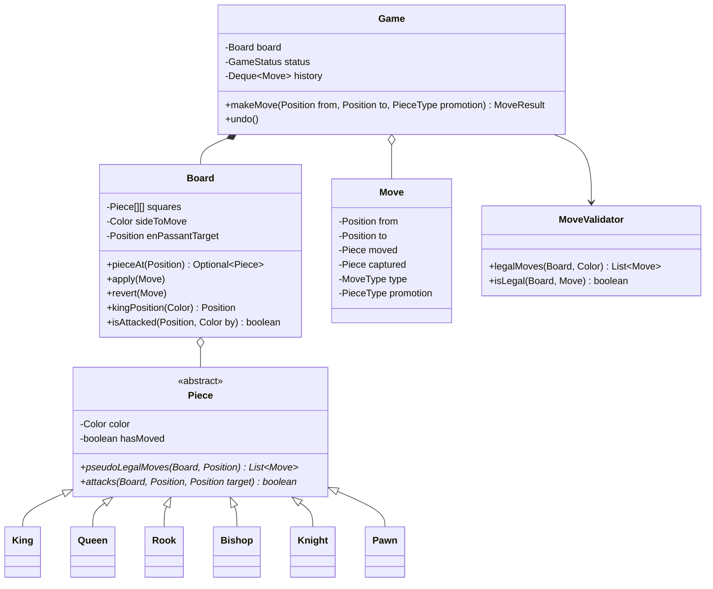

<Related ids={['strategy-pattern', 'command-pattern', 'memento-pattern', 'state-pattern', 'factory-patterns', 'oop-fundamentals']} />

Chess is the richest classic LLD problem: a polymorphic piece hierarchy, move validation with many special cases, check/checkmate detection, and undo — all of which reward clean responsibility assignment. You won't implement every rule in an interview; you need a design where every rule has an obvious home.

## 1. Requirements

- 8×8 board; two players (white, black) alternate moves.
- Standard piece movement for king, queen, rook, bishop, knight, pawn.
- Captures; a move may not leave your own king in check.
- Detect **check**, **checkmate** and **stalemate**.
- Special moves: **castling**, **en passant**, **pawn promotion** (discuss; implement if time).
- Game result: white wins, black wins, draw (stalemate, resignation, agreement).
- Extensions: undo, move history in algebraic notation, clocks, bots.

## 2. Class design



### Responsibility split

| Class | Knows |
| --- | --- |
| `Piece` subclasses | How this piece moves geometrically ("pseudo-legal" moves), ignoring check |
| `Board` | What's on each square, whose turn it is and the en-passant square; applies and reverts moves; whether a square is attacked |
| `MoveValidator` | Full legality: pseudo-legal **and** doesn't leave own king in check; special rules |
| `Game` | The public API: validating requested moves, status (check/mate/stalemate), history, undo |

This separation is the heart of a good chess design: pieces don't need to know about check, and the game doesn't need to know how a knight moves.

## 3. Implementation

### Core types

```java
public enum Color { WHITE, BLACK; public Color opposite() { return this == WHITE ? BLACK : WHITE; } }
public enum PieceType { KING, QUEEN, ROOK, BISHOP, KNIGHT, PAWN }
public enum MoveType { NORMAL, CAPTURE, DOUBLE_PAWN_PUSH, CASTLE_KINGSIDE, CASTLE_QUEENSIDE, EN_PASSANT, PROMOTION }

public enum GameStatus {
    ACTIVE, CHECK, WHITE_WON, BLACK_WON, STALEMATE;
    public boolean isOver() { return this == WHITE_WON || this == BLACK_WON || this == STALEMATE; }
}

public record Move(Position from, Position to, Piece moved, Piece captured, MoveType type, PieceType promotion) { }

public record Position(int file, int rank) {                 // file a–h = 0–7, rank 1–8 = 0–7
    public boolean isValid() { return file >= 0 && file < 8 && rank >= 0 && rank < 8; }
    public Position offset(int df, int dr) { return new Position(file + df, rank + dr); }
}
```

### Sliding pieces share logic

Rook, bishop and queen differ only in **directions**; express that once:

```java
public abstract class Piece {
    private final Color color;
    private boolean hasMoved;
    protected Piece(Color color) { this.color = color; }

    public abstract PieceType type();
    public abstract List<Move> pseudoLegalMoves(Board board, Position from);

    /** Default: a piece attacks a square if it has a pseudo-legal move there. Pawns override. */
    public boolean attacks(Board board, Position from, Position target) {
        return pseudoLegalMoves(board, from).stream().anyMatch(m -> m.to().equals(target));
    }

    public Color color() { return color; }
    public boolean hasMoved() { return hasMoved; }
    void setMoved(boolean moved) { this.hasMoved = moved; }
}

public abstract class SlidingPiece extends Piece {
    protected SlidingPiece(Color c) { super(c); }
    protected abstract int[][] directions();

    @Override public List<Move> pseudoLegalMoves(Board board, Position from) {
        List<Move> moves = new ArrayList<>();
        for (int[] d : directions()) {
            for (Position p = from.offset(d[0], d[1]); p.isValid(); p = p.offset(d[0], d[1])) {
                Optional<Piece> occupant = board.pieceAt(p);
                if (occupant.isEmpty()) { moves.add(Move.normal(from, p, this)); continue; }
                if (occupant.get().color() != color()) moves.add(Move.capture(from, p, this, occupant.get()));
                break;                                       // blocked either way
            }
        }
        return moves;
    }
}

public final class Rook extends SlidingPiece {
    private static final int[][] DIRS = {{1, 0}, {-1, 0}, {0, 1}, {0, -1}};
    public Rook(Color c) { super(c); }
    protected int[][] directions() { return DIRS; }
    public PieceType type() { return PieceType.ROOK; }
}

public final class Bishop extends SlidingPiece {
    private static final int[][] DIRS = {{1, 1}, {1, -1}, {-1, 1}, {-1, -1}};
    public Bishop(Color c) { super(c); }
    protected int[][] directions() { return DIRS; }
    public PieceType type() { return PieceType.BISHOP; }
}

public final class Queen extends SlidingPiece { /* union of rook and bishop directions */ }
```

Knight and king use fixed offsets (a shared `StepPiece` base class); the pawn is the special one (direction depends on colour, double step from the start rank, diagonal captures, promotion on the last rank). Its `attacks` must return only the **diagonal** squares, because pawns don't capture forward:

```java
@Override public boolean attacks(Board board, Position from, Position target) {
    return target.rank() == from.rank() + forward() && Math.abs(target.file() - from.file()) == 1;
}
```

Sliding pieces override `attacks` too — walking each ray until it hits the target or a blocker is far cheaper than generating every move, and `isAttacked` runs for every candidate move.

### Legality: never leave your king in check

```java
public final class MoveValidator {
    public List<Move> legalMoves(Board board, Color side) {
        List<Move> legal = new ArrayList<>();
        for (Position from : board.positionsOf(side)) {
            Piece piece = board.pieceAt(from).orElseThrow();
            List<Move> candidates = new ArrayList<>(piece.pseudoLegalMoves(board, from));
            candidates.addAll(specialMoves(board, from, piece));   // castling, en passant
            for (Move m : candidates) if (isLegal(board, m, side)) legal.add(m);
        }
        return legal;
    }

    boolean isLegal(Board board, Move m, Color side) {
        board.apply(m);                                      // make the move…
        boolean kingSafe = !board.isAttacked(board.kingPosition(side), side.opposite());
        board.revert(m);                                     // …then undo it
        return kingSafe;
    }
}
```

"Make, test, unmake" is the standard technique — and it requires that a move can be reverted exactly: the captured piece (stored in `Move`), plus the previous `hasMoved` flags and en-passant square (the board pushes a small undo record in `apply` and pops it in `revert`). That's the **Command** pattern: a move is an object that can be applied and reverted.

### Game status after each move

```java
public MoveResult makeMove(Position from, Position to, PieceType promotion) {
    if (status.isOver()) throw new IllegalStateException("Game over: " + status);
    PieceType promoteTo = promotion == null ? PieceType.QUEEN : promotion;      // default to a queen
    Move move = validator.legalMoves(board, board.sideToMove()).stream()
            .filter(m -> m.from().equals(from) && m.to().equals(to)
                      && (m.promotion() == null || m.promotion() == promoteTo))
            .findFirst()
            .orElseThrow(() -> new IllegalMoveException(from, to));

    board.apply(move);                                       // also flips the side to move
    history.push(move);
    status = computeStatus();
    return new MoveResult(move, status);
}

private GameStatus computeStatus() {
    Color turn = board.sideToMove();
    boolean inCheck = board.isAttacked(board.kingPosition(turn), turn.opposite());
    boolean hasMoves = !validator.legalMoves(board, turn).isEmpty();
    if (hasMoves) return inCheck ? GameStatus.CHECK : GameStatus.ACTIVE;
    if (!inCheck) return GameStatus.STALEMATE;
    return turn == Color.WHITE ? GameStatus.BLACK_WON : GameStatus.WHITE_WON;
}
```

- **Checkmate** = in check and no legal moves. **Stalemate** = not in check and no legal moves.
- Other draws (threefold repetition, fifty-move rule, insufficient material) are extensions — track a position hash history and a half-move clock.

### Special moves (where to put them)

- **Castling**: king and rook haven't moved; squares between are empty; the king is not in check, doesn't pass through, and doesn't land on an attacked square. Generated in `specialMoves`, applied by `Board` moving both pieces.
- **En passant**: only immediately after an opponent pawn's double step. `Board.apply` records the skipped square (`enPassantTarget`) after every double push and clears it after any other move, so the validator just checks whether a pawn attacks that square. (This is the same field FEN — the standard position notation — stores.)
- **Promotion**: a pawn reaching the last rank becomes the chosen piece — create it via a small **factory** (`PieceFactory.create(type, color)`).

## 4. Undo

Because each move can be reverted exactly, `undo()` pops the last move from the history and calls `board.revert(move)`, which restores captured pieces, flags, the en-passant square and the side to move; then the status is recomputed. Alternatively store a **memento** (board snapshot) per move — simpler but more memory.

## 5. How to know your move generator is right: perft

Chess rules have many corner cases (castling through check, en passant that exposes your own king, under-promotion with capture). The standard way to test a move generator is **perft**: from a known position, count every legal move sequence to depth N and compare with published totals.

```java
static long perft(MoveValidator v, Board b, int depth) {
    List<Move> moves = v.legalMoves(b, b.sideToMove());
    if (depth == 1) return moves.size();
    long nodes = 0;
    for (Move m : moves) { b.apply(m); nodes += perft(v, b, depth - 1); b.revert(m); }
    return nodes;
}
// Start position: 20, 400, 8,902, 197,281 for depths 1–4
```

The reference solution for this lesson passes perft on the start position and four standard tricky positions (including "Kiwipete", which exercises castling, en passant and promotions together). Mentioning perft in an interview signals you know how to *verify* a rules engine, not just write one.

## 6. Patterns used

| Pattern | Where |
| --- | --- |
| **Polymorphism / Template Method** | `Piece.pseudoLegalMoves`; `SlidingPiece` supplies the algorithm, subclasses the directions |
| **Command** | `Move` with apply/revert — legality testing and undo |
| **Memento** (alternative) | Board snapshots for undo |
| **Factory** | Creating pieces for setup and promotion |
| **Strategy** | Player types (human, engine), time controls |
| **State** | Game status |
| **Observer** | UI/spectators listening to move events |

## Interview questions

<QA q="How do you check that a move doesn't leave the king in check?">
Generate the piece's pseudo-legal moves, then for each candidate apply it to the board, test whether the moving side's king square is attacked by any opposing piece, and revert it. Only moves that leave the king safe are legal. This make-test-unmake approach handles pins, discovered checks and king moves uniformly, and relies on moves being reversible commands that record captured pieces and flags.
</QA>

<QA q="Where does the logic for castling belong?">
Not in King alone, because it depends on the rook, the squares between them, attacks on those squares and move history. Generate castling in the move validator's special-move step (using the board and the pieces' hasMoved flags), represent it as a distinct move type, and let Board.apply move both king and rook. Pieces stay responsible for ordinary geometry only.
</QA>

<QA q="How do you tell checkmate from stalemate?">
After a move, compute whether the side to move is in check and whether it has any legal moves. No legal moves while in check is checkmate (the other side wins); no legal moves while not in check is stalemate (a draw). Any legal move means the game continues, in check or not.
</QA>

<Practice task="Add the threefold-repetition draw rule. What do you need to track, and how do you compare positions cheaply?">

A position is the board, side to move, castling rights and en-passant square — exactly what FEN encodes. Keep a map from position key to occurrence count, incremented after every move and decremented on undo. Use a Zobrist hash (XOR of random 64-bit numbers per piece-square and per flag, updated incrementally in `apply`/`revert`) instead of building strings. When a count reaches 3, the game is drawn (strictly, a player may claim it; automatic draw at fivefold).

</Practice>

<Practice task="Add chess clocks: 5 minutes per player plus a 3-second increment per move; running out of time loses (unless the opponent can't possibly checkmate). Where does time live?">

A `ChessClock` component holding remaining time per colour and the instant the current turn started, with an injected `Clock`. `Game.makeMove` asks the clock to stop the mover's time (subtract elapsed, add increment) and start the opponent's; if the mover's remaining time is negative, the move is rejected and the game ends on time. A scheduled check (or a check on each request) handles a player who simply doesn't move. The insufficient-material exception is a function of the board, so it belongs with the other draw rules.

</Practice>

<Takeaways>

- Split responsibilities: pieces generate geometric moves, the board stores state, the validator enforces legality, the game manages turns and status.
- Share sliding-piece logic via directions; pawns are special (attacks ≠ moves).
- Legal = pseudo-legal and king not attacked afterwards — make, test, unmake.
- Moves as reversible commands enable legality checks, history and undo.

</Takeaways>

## Further reading

- [Chess Programming Wiki](https://www.chessprogramming.org) — move generation, legality, special rules.
- FIDE Laws of Chess (articles on castling, en passant, promotion and draws).
