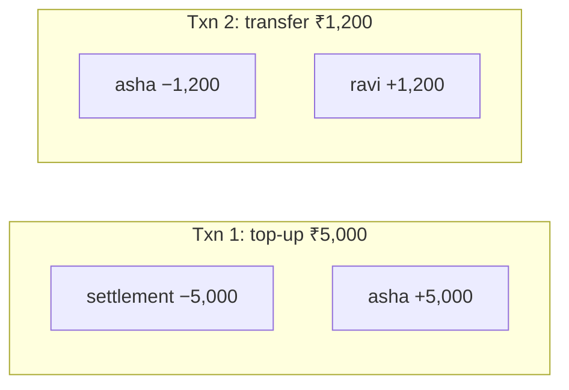
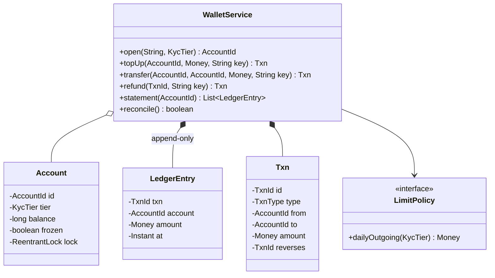

<Related ids={['concurrency-for-lld', 'lld-splitwise', 'lld-atm', 'strategy-pattern', 'lld-schema-design']} />

A digital wallet (Paytm, PhonePe, Amazon Pay balance) is the LLD problem where **correctness is money**. The interviewer is looking for four things: transfers that are **atomic** and **deadlock-free**, requests that are **idempotent** (a retried tap must not pay twice), a **ledger** from which every balance can be proven, and limits and refunds handled without ever editing history.

## 1. Requirements

| Question | Assumption |
| --- | --- |
| Operations | Open wallet, top up from bank, peer-to-peer transfer, refund, statement |
| Money | Integer paise; balances never negative |
| Idempotency | Every money movement carries a client-generated key; retries return the original result |
| Limits | Daily outgoing limit by KYC tier (minimum KYC: ₹10,000; full KYC: ₹1,00,000) |
| Frozen wallets | Can receive, can't send |
| Audit | Full statement per wallet; balances must be reconcilable with the ledger |
| Concurrency | Thousands of concurrent transfers, including A→B and B→A at once |

## 2. The core idea: double-entry ledger

Every transaction writes **two ledger entries that sum to zero**: −₹500 for the sender, +₹500 for the receiver. Money entering from a bank comes from an external **settlement account** (which goes negative), so even top-ups balance.



This gives two invariants you can check at any time:

1. Each wallet's balance = the sum of its ledger entries.
2. The sum of all entries in the system = 0.

The balance field is a **cache** of the ledger for fast reads; the ledger is the source of truth. Entries are **append-only** — a refund is a new transaction, never an edit.

## 3. Class design



## 4. Transfers: lock two accounts without deadlocking

A transfer must check the balance and move money between two accounts **atomically**. Locking both is necessary — and locking them in argument order deadlocks when A pays B while B pays A. Always lock in a **global order** (by account id):

```java
private Txn move(TxnType type, AccountId fromId, AccountId toId, Money amount, TxnId reverses, boolean enforceLimits) {
    Account from = account(fromId), to = account(toId);
    Account first = from.id.compareTo(to.id) < 0 ? from : to;          // global lock order → no deadlock
    Account second = first == from ? to : from;
    first.lock.lock();
    try {
        second.lock.lock();
        try {
            if (enforceLimits) {
                if (from.frozen()) throw new AccountFrozenException(from.id);
                if (from.balance() < amount.paise()) throw new InsufficientFundsException();
                from.recordOutgoing(LocalDate.ofInstant(clock.instant(), ZoneOffset.UTC), amount.paise(),
                                    limits.dailyOutgoing(from.tier).paise());
            }
            from.apply(-amount.paise());
            to.apply(amount.paise());
            Instant now = clock.instant();
            Txn t = new Txn(new TxnId(ids.incrementAndGet()), type, fromId, toId, amount, reverses, now);
            ledger.add(new LedgerEntry(t.id(), fromId, amount.negate(), now));   // double entry:
            ledger.add(new LedgerEntry(t.id(), toId, amount, now));              // the legs sum to zero
            txns.put(t.id(), t);
            return t;
        } finally { second.lock.unlock(); }
    } finally { first.lock.unlock(); }
}
```

Every check (frozen, balance, daily limit) happens **inside** the locks, so nothing can change between the check and the debit. Transfers between unrelated wallets never contend. The reference solution runs 32,000 random transfers from 16 threads across 10 wallets — in both directions — and checks that it finishes (no deadlock), that the total is unchanged, that no balance is negative and that the ledger reconciles.

## 5. Idempotency: a retried tap must not pay twice

Mobile networks drop responses. The client generates an **idempotency key** per payment attempt and resends it on retry. The first request with a key does the work; any later request with the same key gets the same result — even if it arrives **while the first is still running**:

```java
private record Attempt(Request request, CompletableFuture<Txn> result) { }
private final ConcurrentHashMap<String, Attempt> attempts = new ConcurrentHashMap<>();

private Txn idempotent(String key, Request req, Supplier<Txn> action) {
    var mine = new Attempt(req, new CompletableFuture<>());
    Attempt existing = attempts.putIfAbsent(key, mine);                   // atomic: exactly one winner
    if (existing != null) {
        if (!existing.request().equals(req)) throw new IdempotencyConflictException(key);
        try { return existing.result().join(); }                           // wait for, or replay, the first result
        catch (CompletionException e) { throw (RuntimeException) e.getCause(); }
    }
    try {
        Txn t = action.get();
        mine.result().complete(t);
        return t;
    } catch (RuntimeException e) {
        attempts.remove(key, mine);                                        // failures can be retried with the same key
        mine.result().completeExceptionally(e);
        throw e;
    }
}
```

Three details interviewers probe:

- **Same key, different request** (a different amount) is a client bug — reject it rather than silently returning the old result.
- **Concurrent duplicates** wait on the first attempt's future instead of both executing.
- **Failed attempts** are removed so the client can retry with the same key after, say, an insufficient-funds error is fixed by a top-up. (Some APIs instead remember failures too; either is fine if stated.)

In a database the same idea is a unique constraint on the idempotency key in the transactions table, inserted in the same database transaction as the ledger entries.

## 6. Limits, freezing and refunds

- **Daily limits** are tracked per account per day (reset when the day changes) and checked under the account lock. The limit amounts come from a `LimitPolicy` strategy keyed by KYC tier, so regulatory changes are configuration.
- **Frozen** accounts fail the sender check but can still receive (a common regulatory requirement).
- **Refunds** create a new `REFUND` transaction in the opposite direction that **references** the original. A guard (`putIfAbsent` on "refunded by") prevents refunding twice; the original transaction is never modified.

```java
public Txn refund(TxnId original, String key) {
    Txn o = txns.get(original);
    return idempotent(key, new Request(TxnType.REFUND, o.to(), o.from(), o.amount()), () -> {
        if (refundedBy.putIfAbsent(original, PENDING) != null) throw new IllegalStateException("already refunded");
        try {
            Txn r = move(TxnType.REFUND, o.to(), o.from(), o.amount(), original, false);
            refundedBy.put(original, r.id());
            return r;
        } catch (RuntimeException e) { refundedBy.remove(original); throw e; }
    });
}
```

## 7. Reconciliation

```java
public boolean reconcile() {
    Map<AccountId, Long> sums = new HashMap<>();
    long total = 0;
    for (LedgerEntry e : ledger) { sums.merge(e.account(), e.amount().paise(), Long::sum); total += e.amount().paise(); }
    for (Account a : accounts.values()) if (sums.getOrDefault(a.id, 0L) != balance(a.id).paise()) return false;
    return total == 0;
}
```

Real systems run this continuously (and against bank statements for the settlement account). Being able to say "every balance is provable from an append-only ledger, and the ledger always sums to zero" is the strongest signal in this interview.

## 8. Patterns and principles used

| Idea | Where |
| --- | --- |
| **Double-entry bookkeeping** | Two legs per transaction, summing to zero |
| **Event log / append-only** | Ledger entries are never updated; refunds are compensating transactions |
| **Ordered locking** | Deadlock-free two-account transfers |
| **Idempotency keys** | Safe client retries |
| **Strategy** | `LimitPolicy` by KYC tier |
| **Facade** | `WalletService` |

## 9. Extensions

- **Withdraw to bank**: a transfer to the settlement account plus an asynchronous payout; mark the transaction `PENDING` until the bank confirms, and reverse on failure.
- **Persistence**: ledger and balances in one relational database transaction, with `SELECT ... FOR UPDATE` on both accounts in id order (see [Schema Design for LLD](/system-design/lld/lld-schema-design)).
- **Hot accounts** (a merchant receiving thousands of payments per second): split the merchant into sub-accounts or apply credits asynchronously from a queue, because one lock per account serialises everything.
- **Multi-currency**: balances per currency; conversion as a transaction between currency accounts at a recorded rate.

## Interview questions

<QA q="How do you avoid deadlock when two users pay each other at the same time?">
Both transfers need both account locks. If each thread locks the sender first, A→B holds A and waits for B while B→A holds B and waits for A. Acquire locks in a global order instead — for example by account id — so both threads lock the same account first; one waits, then proceeds. Alternatives: tryLock with timeout and retry, or a single-writer queue per account.
</QA>

<QA q="The user taps Pay, the network times out, and the app retries. How do you avoid charging twice?">
The client generates an idempotency key for the payment and sends it on every retry. The server records the key atomically with the request; the first request executes, later ones with the same key return the stored result (or wait for the in-flight one). Reusing a key with a different amount is rejected. In a database, a unique constraint on the key inside the same transaction as the ledger insert enforces this.
</QA>

<QA q="Why keep a ledger if you already store balances?">
Balances alone can't explain themselves: if one is wrong, you can't tell why or fix it safely. An append-only, double-entry ledger records every movement, lets you rebuild any balance, produces statements, and gives invariants you can check continuously — each balance equals the sum of its entries, and all entries sum to zero. The balance column is a cache for fast reads, updated in the same transaction as the ledger.
</QA>

<Practice task="Add scheduled payments: 'pay ravi ₹500 on the 1st of every month'. What happens if the wallet doesn't have enough money that day?">

Store a mandate (from, to, amount, schedule) and let a scheduler create a transfer on each due date with a deterministic idempotency key such as `mandate-42-2026-11`, so a scheduler retry or restart can never pay twice for the same month. On insufficient funds, record a failed attempt, notify the user, and retry a limited number of times (for example daily for 3 days) before marking that month's payment failed. The transfer path itself doesn't change.

</Practice>

<Practice task="A merchant receives 5,000 payments per second and its account lock becomes the bottleneck. Redesign just that part.">

Split the merchant's balance into N sub-accounts (shards) and credit a random or hashed shard per payment, so locks spread out; the merchant's balance is the sum of the shards, and payouts lock shards in order. Or credit asynchronously: debit the payer synchronously, append a "pending credit" event, and have a single consumer apply credits to the merchant in batches. Both keep the ledger double-entry; the second trades instant visibility for throughput.

</Practice>

<Takeaways>

- Every movement is a double-entry transaction; the append-only ledger is the source of truth and always sums to zero.
- Lock both accounts in a global order for atomic, deadlock-free transfers; check limits and balances inside the locks.
- Make every money movement idempotent with client keys; reject reuse with a different payload.
- Refunds and corrections are new compensating transactions — never edit history.
- Reconcile continuously: balance = sum of entries.

</Takeaways>

## Further reading

- Martin Fowler, *Analysis Patterns* (1996) — Account and Transaction patterns.
- Stripe Engineering, "Designing robust and predictable APIs with idempotency" (2017).
- HLD view: [Design a Payment System](/system-design/hld/design-payment-system).
