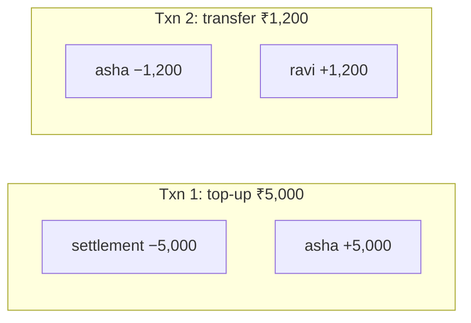
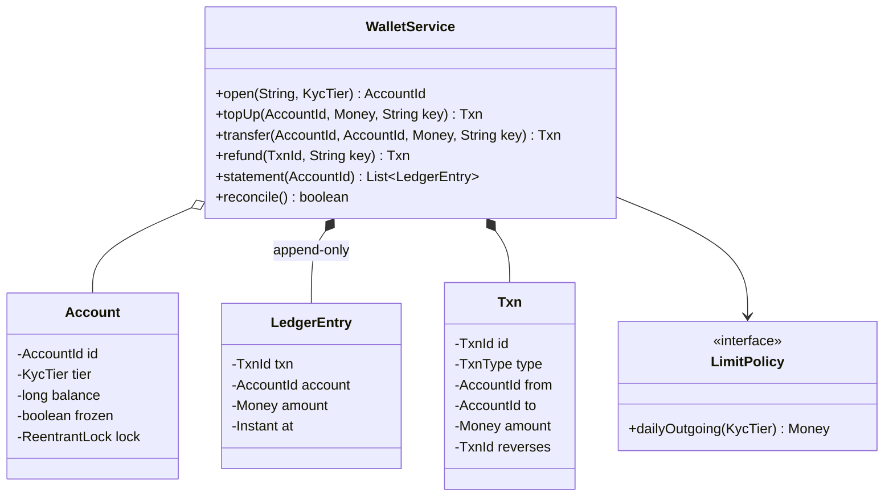

<Related ids={['concurrency-for-lld', 'lld-splitwise', 'lld-atm', 'strategy-pattern', 'lld-schema-design']} />

A digital wallet (Paytm, PhonePe, an Amazon Pay balance) holds money and lets you pay other people. It's the LLD problem where **a bug means losing someone's money**. The interviewer looks for four things:

- **Transfers that are atomic and never deadlock**: money leaves one wallet and arrives in the other, or neither happens.
- **Idempotency**: if the app retries a "Pay" tap, the user isn't charged twice.
- **A ledger**: a permanent record from which every balance can be proven.
- **Limits and refunds** handled without ever editing the past.

We'll use the same six steps as every case study: requirements, entities, class design, code, a worked example, and follow-ups. (The [parking lot](/system-design/lld/lld-parking-lot) lesson explains the plan in detail.)

## Step 1: Pin down the requirements

<Dialogue>
<Turn who="you">What can users do?</Turn>
<Turn who="them">Open a wallet, add money from a bank, pay another user, get refunds, and see a statement.</Turn>
<Turn who="you">Can a balance ever go negative?</Turn>
<Turn who="them">Never.</Turn>
<Turn who="you">If the app's request times out and it retries, should the user be charged twice?</Turn>
<Turn who="them">Absolutely not.</Turn>
<Turn who="you">Any limits?</Turn>
<Turn who="them">A daily sending limit based on how verified the user is (their KYC level): ₹10,000 or ₹1,00,000.</Turn>
<Turn who="you">Can a wallet be frozen?</Turn>
<Turn who="them">Yes. A frozen wallet can receive but not send.</Turn>
<Turn who="you">How important is the audit trail?</Turn>
<Turn who="them">Very. We must be able to explain every rupee.</Turn>
</Dialogue>

**The wallet must:**

1. Open wallets, add money, transfer between users, refund, and show a statement.
2. Store money as integer paise; never let a balance go negative.
3. Make every transfer all or nothing, and safe when many happen at once (including A→B and B→A together).
4. Never repeat a payment because a request was retried.
5. Enforce daily sending limits by KYC level; block sending from frozen wallets.
6. Keep a permanent record that explains every balance.

**Out of scope for now:** bank and UPI integration, other currencies.

## Step 2: Find the core entities

| Noun | Make it… | Why |
| --- | --- | --- |
| Wallet (account) | a class | Balance, KYC level, frozen flag, and a lock. |
| Transaction | a record | One money movement: type, from, to, amount, time. |
| Ledger entry | a record | One side of a transaction: "this account changed by this amount". |
| Idempotency key | a string from the client | Identifies one payment attempt across retries. |
| Limit rule | an interface `LimitPolicy` | Limits change with regulation; keep them configurable. |
| Wallet service | a class | The front door: top up, transfer, refund, statement. |

The most important idea is **how balances are recorded**:

<Approach verdict="bad" title="Just update a balance field">

`asha.balance -= 500; ravi.balance += 500;` It works, until a balance is wrong. Then you can't tell **why**, there's no statement to show the user, and no way to prove the numbers are right.

</Approach>

<Approach verdict="great" title="A double-entry ledger">

Every transaction writes **two entries that add up to zero**: −₹500 for the sender, +₹500 for the receiver. Entries are only ever **added**, never changed. Money coming in from a bank comes from a special **settlement account** (which goes negative), so even top-ups balance.

The ledger is the truth; the balance field is just a fast **cache** of it. Two rules can be checked at any time:

1. Each wallet's balance = the sum of its ledger entries.
2. The sum of **all** entries in the system = 0.

This is double-entry bookkeeping, the way accountants have kept books for 500 years.

</Approach>



## Step 3: Design each class

**`Account`**: knows its id, KYC level, balance, frozen flag and how much it has sent today. It has its own lock.

**`WalletService`**: `topUp`, `transfer`, `refund`, `statement` and `reconcile`. Every money movement goes through **one private method** that locks both accounts, checks the rules, changes both balances and writes both ledger entries.

Now the concurrency problem. A transfer must lock **both** accounts, so nothing changes between checking the balance and moving the money.

<Approach verdict="bad" title="Lock the sender, then the receiver">

Asha pays Ravi while Ravi pays Asha. Thread 1 locks Asha and waits for Ravi. Thread 2 locks Ravi and waits for Asha. Both wait forever: a **deadlock**.

</Approach>

<Approach verdict="good" title="One global lock">

No deadlock, but every transfer in the whole system now waits in one line.

</Approach>

<Approach verdict="great" title="Lock both accounts in a fixed order">

Always lock the account with the **smaller id first**, whoever is paying whom. Both threads now try to lock Asha first; one gets it, the other waits, and the first finishes with both. No deadlock, and transfers between unrelated wallets never wait for each other.

</Approach>

And the retry problem: the user taps Pay, the network drops the response, and the app sends the request again.

<Approach verdict="great" title="Idempotency keys">

The app generates a unique **key** for each payment attempt and sends the same key on every retry. The server remembers keys it has processed. The first request with a key does the work; any later request with that key gets **the same result** back, without paying again.

</Approach>



## Step 4: Write the code

<InterviewScope minutes="45–60" lines="50" write={["Accounts and a ledger: every transfer writes a debit and a credit", "Transfers that lock both accounts in a fixed order", "Idempotency: a retried request never pays twice"]} say={["Why a ledger beats just changing balances", "Limits by KYC level, freezing and refunds", "Daily reconciliation"]} skip={["Bank and UPI integration", "Currencies"]} />

### The interview-sized version

Double-entry records, deadlock-free locking and idempotent transfers: the three things this problem tests. It's about **50 lines**, and it compiles and runs.

```java
class Account {
    final String id;
    long balance;                                        // in paise; changed only while holding this account's lock
    Account(String id) { this.id = id; }
}

record Entry(String txnId, String accountId, long amount) { }   // + credit, − debit; every transfer writes two

class Wallet {
    private final Map<String, Account> accounts = new ConcurrentHashMap<>();
    private final List<Entry> ledger = new CopyOnWriteArrayList<>();
    private final Map<String, String> finished = new ConcurrentHashMap<>();   // request id -> txn id
    private int nextTxn = 1;

    void open(String id) { accounts.putIfAbsent(id, new Account(id)); }

    void addMoney(String id, long amount) {
        Account a = account(id);
        synchronized (a) { a.balance += amount; ledger.add(new Entry("topup", id, amount)); }
    }

    String transfer(String from, String to, long amount, String requestId) {
        if (amount <= 0 || from.equals(to)) throw new IllegalArgumentException("Bad transfer");
        Account a = account(from), b = account(to);
        Account first = from.compareTo(to) < 0 ? a : b;  // always lock in id order, so A→B and B→A can't deadlock
        Account second = first == a ? b : a;
        synchronized (first) {
            synchronized (second) {
                String done = finished.get(requestId);
                if (done != null) return done;           // a retried tap: return the first result, don't pay again
                if (a.balance < amount) throw new IllegalStateException("Insufficient funds");
                String txn = "T" + nextTxnId();
                a.balance -= amount;
                b.balance += amount;
                ledger.add(new Entry(txn, from, -amount));
                ledger.add(new Entry(txn, to, amount));
                finished.put(requestId, txn);
                return txn;
            }
        }
    }

    long balance(String id) { Account a = account(id); synchronized (a) { return a.balance; } }
    List<Entry> statement(String id) { return ledger.stream().filter(e -> e.accountId().equals(id)).toList(); }

    private synchronized int nextTxnId() { return nextTxn++; }

    private Account account(String id) {
        Account a = accounts.get(id);
        if (a == null) throw new IllegalArgumentException("No account " + id);
        return a;
    }
}
```

**Reading it top to bottom:**

1. **`Entry`** is one side of a transaction: positive for money in, negative for money out.
2. **`transfer`** rejects nonsense first (zero or negative amounts, paying yourself).
3. It picks **`first`** and **`second`** by comparing ids, so the locks are always taken in the same order, whatever the direction of the payment.
4. Inside both locks: if this `requestId` already finished, return the original transaction id. No second payment.
5. Check the balance, then change both balances and write **two** ledger entries with the same transaction id. Then record the request id as finished.
6. Everything that can go wrong is checked **inside** the locks, so nothing can change between the check and the money moving.

<Callout type="tip" title="How to practise this">
Explain the deadlock out loud first: two threads, two accounts, opposite directions. Then show how sorting by id fixes it. Then write `transfer`.
</Callout>

### Growing it into the full design

#### The core transfer

`move` is the one place money moves. In plain steps:

1. Pick the lock order by account id, and take both locks.
2. If limits apply: refuse if the sender is frozen, has too little money, or would exceed today's limit.
3. Change both balances.
4. Create the transaction and write its two ledger entries, which sum to zero.

```java
private Txn move(TxnType type, AccountId fromId, AccountId toId, Money amount, TxnId reverses, boolean enforceLimits) {
    Account from = account(fromId), to = account(toId);
    Account first = from.id.compareTo(to.id) < 0 ? from : to;          // global lock order → no deadlock
    Account second = first == from ? to : from;
    first.lock.lock();
    try {
        second.lock.lock();
        try {
            if (enforceLimits) {
                if (from.frozen()) throw new AccountFrozenException(from.id);
                if (from.balance() < amount.paise()) throw new InsufficientFundsException();
                from.recordOutgoing(LocalDate.ofInstant(clock.instant(), ZoneOffset.UTC), amount.paise(),
                                    limits.dailyOutgoing(from.tier).paise());
            }
            from.apply(-amount.paise());
            to.apply(amount.paise());
            Instant now = clock.instant();
            Txn t = new Txn(new TxnId(ids.incrementAndGet()), type, fromId, toId, amount, reverses, now);
            ledger.add(new LedgerEntry(t.id(), fromId, amount.negate(), now));   // double entry:
            ledger.add(new LedgerEntry(t.id(), toId, amount, now));              // the legs sum to zero
            txns.put(t.id(), t);
            return t;
        } finally { second.lock.unlock(); }
    } finally { first.lock.unlock(); }
}
```

The reference solution runs 32,000 random transfers from 16 threads across 10 wallets, in both directions, and checks that it never deadlocks, the total money is unchanged, no balance goes negative and the ledger matches every balance.

#### Idempotency, including retries that arrive at the same time

The short version handles a retry that arrives **after** the first request finishes. But what if the retry arrives **while** the first is still running? The full version stores a `CompletableFuture` per key:

1. `putIfAbsent(key, mine)`: exactly one request wins.
2. If someone else already has the key, check it's the **same request** (same amount, same accounts). If not, that's a client bug: reject it.
3. Otherwise, **wait for the first request's result** and return it.
4. If we won, do the work and complete the future. If the work fails (say, insufficient funds), remove the key so the client can retry after topping up.

```java
private record Attempt(Request request, CompletableFuture<Txn> result) { }
private final ConcurrentHashMap<String, Attempt> attempts = new ConcurrentHashMap<>();

private Txn idempotent(String key, Request req, Supplier<Txn> action) {
    var mine = new Attempt(req, new CompletableFuture<>());
    Attempt existing = attempts.putIfAbsent(key, mine);                   // atomic: exactly one winner
    if (existing != null) {
        if (!existing.request().equals(req)) throw new IdempotencyConflictException(key);
        try { return existing.result().join(); }                           // wait for, or replay, the first result
        catch (CompletionException e) { throw (RuntimeException) e.getCause(); }
    }
    try {
        Txn t = action.get();
        mine.result().complete(t);
        return t;
    } catch (RuntimeException e) {
        attempts.remove(key, mine);                                        // failures can be retried with the same key
        mine.result().completeExceptionally(e);
        throw e;
    }
}
```

In a database, the same idea is a unique constraint on the idempotency key, inserted in the same database transaction as the ledger entries.

#### Limits, freezing and refunds

- **Daily limits** are tracked per account per day, checked under the account lock. The amounts come from a `LimitPolicy` by KYC level, so changes are configuration.
- **Frozen** wallets fail the sender check, but can still receive.
- **Refunds** never edit the original transaction. They create a **new** `REFUND` transaction in the opposite direction that points back to the original. A guard stops the same transaction being refunded twice.

```java
public Txn refund(TxnId original, String key) {
    Txn o = txns.get(original);
    return idempotent(key, new Request(TxnType.REFUND, o.to(), o.from(), o.amount()), () -> {
        if (refundedBy.putIfAbsent(original, PENDING) != null) throw new IllegalStateException("already refunded");
        try {
            Txn r = move(TxnType.REFUND, o.to(), o.from(), o.amount(), original, false);
            refundedBy.put(original, r.id());
            return r;
        } catch (RuntimeException e) { refundedBy.remove(original); throw e; }
    });
}
```

#### Reconciliation: proving the numbers

Add up every ledger entry per account and compare with each balance; check that everything sums to zero.

```java
public boolean reconcile() {
    Map<AccountId, Long> sums = new HashMap<>();
    long total = 0;
    for (LedgerEntry e : ledger) { sums.merge(e.account(), e.amount().paise(), Long::sum); total += e.amount().paise(); }
    for (Account a : accounts.values()) if (sums.getOrDefault(a.id, 0L) != balance(a.id).paise()) return false;
    return total == 0;
}
```

Real systems run this all the time, and also compare the settlement account with bank statements. Being able to say "every balance can be proven from an append-only ledger that always sums to zero" is the strongest thing you can say in this interview.

## Step 5: Trace a payment and a retry

1. Asha tops up ₹5,000. Ledger: settlement −5,000, Asha +5,000. Asha's balance: 5,000.
2. Asha pays Ravi ₹1,200 with key `k1`. Locks are taken in id order; balance 5,000 ≥ 1,200; limits OK. Ledger: Asha −1,200, Ravi +1,200 (transaction T2). Balances: Asha 3,800, Ravi 1,200.
3. The response is lost. The app retries with key `k1`. The key is already done, so T2 comes back. **No second payment.**
4. At the same moment, Asha pays Ravi ₹200 and Ravi pays Asha ₹200. Both transfers lock Asha first (smaller id), so one waits briefly. No deadlock, and both balances end where they were.
5. T2 is refunded. A new transaction moves ₹1,200 from Ravi back to Asha and points to T2. T2 itself is untouched. Trying to refund T2 again: "already refunded".
6. `reconcile()`: each balance equals the sum of its entries, and all entries sum to 0. ✓

## Step 6: Handle follow-up questions

**"Monthly scheduled payments."** Store a mandate and let a scheduler create a transfer each month with a predictable key like `mandate-42-2026-11`, so a restart can never pay twice for one month. If there's not enough money, retry for a few days, then mark that month failed.

**"A merchant gets 5,000 payments a second, and its lock is a bottleneck."** Split the merchant's balance into several sub-accounts and credit one at random, so the locks spread out. Or credit it asynchronously from a queue in batches.

**"Withdraw to a bank."** A transfer to the settlement account, marked `PENDING` until the bank confirms, and reversed if the payout fails.

**"Store it in a database."** Ledger and balances in one database transaction, with `SELECT ... FOR UPDATE` on both accounts in id order. See [Schema Design for LLD](/system-design/lld/lld-schema-design).

## Common mistakes

- **Only storing balances**, with no ledger to explain them.
- **Locking sender then receiver**, which deadlocks on opposite payments.
- **Checking the balance outside the lock.**
- **No idempotency key**, so retries pay twice.
- **Editing or deleting a transaction to refund it**, instead of adding a new one.
- **Using `double` for money.**

## Patterns and principles used

| Idea | Where |
| --- | --- |
| **Double-entry bookkeeping** | Two entries per transaction, summing to zero |
| **Append-only log** | Ledger entries are never changed; refunds are new transactions |
| **Ordered locking** | Deadlock-free transfers between two accounts |
| **Idempotency keys** | Safe client retries |
| **Strategy** | `LimitPolicy` by KYC level |
| **Facade** | `WalletService` |

## Interview questions

<QA q="How do you avoid deadlock when two users pay each other at the same time?">
Both transfers need both account locks. If each thread locks its sender first, A→B holds A and waits for B while B→A holds B and waits for A. Take locks in a fixed global order instead (for example by account id) so both threads lock the same account first; one waits, then goes ahead. Alternatives: tryLock with a timeout and retry, or a single queue and thread per account.
</QA>

<QA q="The user taps Pay, the network times out, and the app retries. How do you avoid charging twice?">
The app generates an idempotency key for the payment and sends it on every retry. The server records the key atomically with the request; the first request does the work, later ones with the same key get the stored result (or wait for the one still running). Reusing a key with a different amount is rejected. In a database, a unique constraint on the key in the same transaction as the ledger insert enforces this.
</QA>

<QA q="Why keep a ledger if you already store balances?">
A balance alone can't explain itself: if it's wrong, you can't tell why or fix it safely. An append-only, double-entry ledger records every movement, lets you rebuild any balance, produces statements, and gives rules you can check continuously: each balance equals the sum of its entries, and all entries sum to zero. The balance column is a cache for fast reads, updated in the same transaction as the ledger.
</QA>

<Practice task="Add scheduled payments: 'pay ravi ₹500 on the 1st of every month'. What happens if the wallet doesn't have enough money that day?">

Store a mandate (from, to, amount, schedule) and let a scheduler create a transfer on each due date with a predictable idempotency key such as `mandate-42-2026-11`, so a scheduler retry or restart can never pay twice for the same month. If there isn't enough money, record a failed attempt, notify the user, and retry a few times (for example daily for 3 days) before marking that month's payment failed. The transfer code itself doesn't change.

</Practice>

<Practice task="A merchant receives 5,000 payments per second and its account lock becomes the bottleneck. Redesign just that part.">

Split the merchant's balance into N sub-accounts and credit a random or hashed one per payment, so the locks spread out; the merchant's balance is the sum of the sub-accounts, and payouts lock them in order. Or credit asynchronously: debit the payer straight away, add a "pending credit" event to a queue, and have a single consumer apply credits to the merchant in batches. Both keep the ledger double-entry; the second trades instant visibility for throughput.

</Practice>

<Takeaways>

- Every money movement is a double-entry transaction; the append-only ledger is the truth and always sums to zero.
- Lock both accounts in a fixed order (by id), and check balance, limits and freezing inside the locks.
- Make every money movement idempotent with a client key; reject a reused key with different details.
- Refunds and corrections are new transactions. Never edit history.
- Reconcile continuously: each balance equals the sum of its entries.

</Takeaways>

## Further reading

- Martin Fowler, *Analysis Patterns* (1996): Account and Transaction patterns.
- Stripe Engineering, "Designing robust and predictable APIs with idempotency" (2017).
- HLD view: [Design a Payment System](/system-design/hld/design-payment-system).
