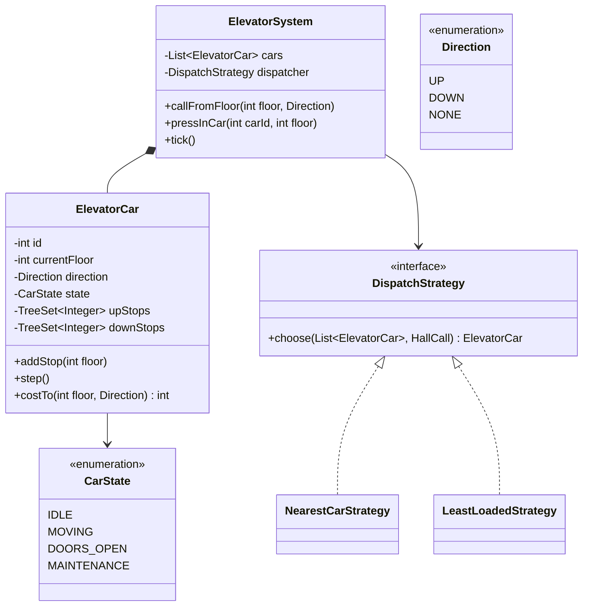

<Related ids={['state-pattern', 'strategy-pattern', 'observer-pattern', 'command-pattern', 'concurrency-for-lld']} />

The elevator problem tests whether you can separate **what the hardware does** (a car moving between floors) from **how requests are scheduled** — and whether you can reason about a simple real-time system with concurrency.

## What the interviewer expects

The full design in this lesson is longer than anything you'd write in one round. It's there so you understand the edge cases and can answer follow-up questions. In the round itself, aim for this:

<InterviewScope minutes="45–60" lines="50" write={["An `Elevator` that keeps a sorted set of stops and moves one floor per step", "A `DispatchStrategy` that picks which car answers a call", "A controller with hall calls and in-car buttons"]} say={["The LOOK algorithm: keep going while there are stops ahead", "Better dispatch rules (direction-aware, zoning)", "How a real system runs each car on its own thread"]} skip={["Door timers, weight limits and alarms", "Fire mode and VIP mode", "Energy optimisation"]} />

### The interview-sized version

Cars that serve stops in a sensible order, and a strategy that picks the nearest idle car. It's about **50 lines**, and it compiles and runs.

```java
enum Direction { UP, DOWN, IDLE }

class Elevator {
    final int id;
    int floor = 0;
    Direction direction = Direction.IDLE;
    private final TreeSet<Integer> stops = new TreeSet<>();      // sorted, so "next stop above me" is cheap

    Elevator(int id) { this.id = id; }

    void addStop(int f) {
        if (f == floor && direction == Direction.IDLE) return;   // already here: just open the doors
        stops.add(f);
        if (direction == Direction.IDLE) direction = f > floor ? Direction.UP : Direction.DOWN;
    }

    /** Move one floor. Keep going the same way while there are stops ahead, then turn (the LOOK algorithm). */
    void step() {
        if (stops.isEmpty()) { direction = Direction.IDLE; return; }
        if (direction == Direction.UP && stops.ceiling(floor) == null) direction = Direction.DOWN;
        if (direction == Direction.DOWN && stops.floor(floor) == null) direction = Direction.UP;
        floor += direction == Direction.UP ? 1 : -1;
        stops.remove(floor);                                     // arrived at a stop: doors open
        if (stops.isEmpty()) direction = Direction.IDLE;
    }

    int stopsLeft() { return stops.size(); }
}

interface DispatchStrategy { Elevator pick(List<Elevator> cars, int floor); }

class NearestIdleFirst implements DispatchStrategy {
    public Elevator pick(List<Elevator> cars, int floor) {
        return cars.stream()
                .min(Comparator.comparing((Elevator c) -> c.direction != Direction.IDLE)   // idle cars first
                        .thenComparingInt(c -> Math.abs(c.floor - floor)))                 // then the closest
                .orElseThrow();
    }
}

class ElevatorSystem {
    private final List<Elevator> cars;
    private final DispatchStrategy strategy;

    ElevatorSystem(List<Elevator> cars, DispatchStrategy strategy) { this.cars = cars; this.strategy = strategy; }

    synchronized Elevator callFromHall(int floor) {              // someone presses the button on a floor
        Elevator car = strategy.pick(cars, floor);
        car.addStop(floor);
        return car;
    }
    synchronized void pressInCar(int carId, int floor) { cars.get(carId).addStop(floor); }
    synchronized void tick() { cars.forEach(Elevator::step); }   // one time step for every car
}
```

<Callout type="tip" title="How to use the rest of this lesson">
Practise writing the short version above, in your own words, until you can do it in about 30 minutes. Then read the full design below for the edge cases and follow-up answers. Interviewers often ask about those, but they rarely ask you to type them all.
</Callout>

## 1. Requirements

| Question | Assumption |
| --- | --- |
| Building | N floors, M elevator cars |
| Requests | **Hall calls** (floor + direction, from the corridor) and **car calls** (destination floor, from inside a car) |
| Scheduling | Assign each hall call to the "best" car; each car serves its stops efficiently |
| Car behaviour | Moves one floor per tick; opens doors at stops; idle when no work |
| Capacity | Max load per car; overload blocks door closing |
| Special modes | Maintenance, emergency/fire mode (extensions) |
| Out of scope | Real motor control, floor sensors — simulated by a `tick()` |

## 2. Key concepts

- **Hall call vs car call**: a hall call says "someone at floor 7 wants to go **up**" — the dispatcher picks a car. A car call says "this car should stop at floor 12" — it belongs to that car.
- **Direction and stops**: a car keeps going in its current direction while it has stops ahead, then reverses — the **LOOK** algorithm (a refinement of SCAN, the "elevator algorithm").

## 3. Class design



## 4. Implementation

### Requests

```java
public enum Direction { UP, DOWN, NONE }
public record HallCall(int floor, Direction direction) { }
```

### The car: LOOK scheduling for its own stops

<FullCode title="Show the full code: The car: LOOK scheduling for its own stops (66 lines)">

```java
public final class ElevatorCar {
    private final int id;
    private final int minFloor, maxFloor;
    private int currentFloor;
    private Direction direction = Direction.NONE;
    private CarState state = CarState.IDLE;
    private final TreeSet<Integer> upStops = new TreeSet<>();
    private final TreeSet<Integer> downStops = new TreeSet<>();
    private int doorTicksRemaining;

    public ElevatorCar(int id, int minFloor, int maxFloor, int startFloor) {
        this.id = id; this.minFloor = minFloor; this.maxFloor = maxFloor; this.currentFloor = startFloor;
    }

    public synchronized void addStop(int floor) {
        if (floor < minFloor || floor > maxFloor) throw new IllegalArgumentException("No floor " + floor);
        if (state == CarState.MAINTENANCE) throw new IllegalStateException("Car " + id + " in maintenance");
        if (floor == currentFloor && state != CarState.MOVING) { openDoors(); return; }
        if (floor > currentFloor) upStops.add(floor);
        else if (floor < currentFloor) downStops.add(floor);
        else (direction == Direction.UP ? downStops : upStops).add(floor);   // passing it now: serve on the return sweep
        if (direction == Direction.NONE) direction = floor > currentFloor ? Direction.UP : Direction.DOWN;
    }

    /** One simulation tick: open/close doors or move one floor. */
    public synchronized void step() {
        switch (state) {
            case MAINTENANCE -> { return; }
            case DOORS_OPEN -> {
                if (--doorTicksRemaining <= 0) state = hasStops() ? CarState.MOVING : CarState.IDLE;
                return;
            }
            default -> { }
        }
        if (!hasStops()) { direction = Direction.NONE; state = CarState.IDLE; return; }

        // LOOK: reverse only when there are no more stops in the current direction
        if (direction == Direction.UP && upStops.isEmpty()) direction = Direction.DOWN;
        else if (direction == Direction.DOWN && downStops.isEmpty()) direction = Direction.UP;

        currentFloor += (direction == Direction.UP) ? 1 : -1;
        state = CarState.MOVING;

        TreeSet<Integer> stops = direction == Direction.UP ? upStops : downStops;
        if (stops.remove(currentFloor)) openDoors();
    }

    private void openDoors() { state = CarState.DOORS_OPEN; doorTicksRemaining = 2; }

    private boolean hasStops() { return !upStops.isEmpty() || !downStops.isEmpty(); }

    /** Rough cost for the dispatcher: distance, penalised if the car must reverse first. */
    public synchronized int costTo(int floor, Direction callDir) {
        if (state == CarState.MAINTENANCE) return Integer.MAX_VALUE;
        int distance = Math.abs(currentFloor - floor);
        boolean onTheWay =
                direction == Direction.NONE
             || (direction == Direction.UP   && floor >= currentFloor && callDir != Direction.DOWN)
             || (direction == Direction.DOWN && floor <= currentFloor && callDir != Direction.UP);
        int pendingStops = upStops.size() + downStops.size();
        return onTheWay ? distance + pendingStops : distance + 2 * (maxFloor - minFloor) + pendingStops;
    }

    public int id() { return id; }
    public synchronized int currentFloor() { return currentFloor; }
}
```

</FullCode>

Using two `TreeSet`s gives O(log n) insertion and natural ordering of stops; the LOOK rule is three lines.

The invariant that makes this correct: **every floor in `upStops` is above the car, and every floor in `downStops` is below it**, so a sweep always reaches its stops. The one case that can break it is a button pressed for the floor the car is *passing* while moving. A naive `floor > currentFloor ? upStops : downStops` puts that floor into `downStops` even when the car is moving down — now a "down" stop sits *above* the car, the car never turns back for it, and it keeps descending. Putting it in the set for the opposite direction serves it on the return sweep.

<Callout type="note" title="Hall-call direction">
This version stops at a hall call whenever it passes the floor, even if the passenger wants the other direction. Real controllers keep hall calls tagged with their direction and only stop when travelling that way (or at the turnaround point). It's a good extension to mention: store `HallCall`s in per-direction sets and check the tag in `step()`.
</Callout>

### Dispatch strategy (which car answers a hall call)

```java
public interface DispatchStrategy {
    ElevatorCar choose(List<ElevatorCar> cars, HallCall call);
}

public final class NearestSuitableCar implements DispatchStrategy {
    @Override public ElevatorCar choose(List<ElevatorCar> cars, HallCall call) {
        ElevatorCar best = null;
        int bestCost = Integer.MAX_VALUE;                 // cars in maintenance report MAX_VALUE and never win
        for (ElevatorCar c : cars) {
            int cost = c.costTo(call.floor(), call.direction());   // read each cost once: it can change concurrently
            if (cost < bestCost) { best = c; bestCost = cost; }
        }
        if (best == null) throw new NoElevatorAvailableException(call);
        return best;
    }
}
```

Other strategies to mention: **zoning** (cars serve floor ranges at peak), **least-loaded**, **destination dispatch** (passengers enter their destination in the lobby; the system groups people going to nearby floors).

### The system

```java
public final class ElevatorSystem {
    private final List<ElevatorCar> cars;
    private final DispatchStrategy dispatcher;

    public ElevatorSystem(List<ElevatorCar> cars, DispatchStrategy dispatcher) {
        this.cars = List.copyOf(cars); this.dispatcher = dispatcher;
    }

    public ElevatorCar callFromFloor(int floor, Direction dir) {
        ElevatorCar car = dispatcher.choose(cars, new HallCall(floor, dir));
        car.addStop(floor);
        return car;                                   // e.g., light up "car 2 arriving"
    }

    public void pressInCar(int carId, int floor) { car(carId).addStop(floor); }

    public void tick() { cars.forEach(ElevatorCar::step); }      // driven by a scheduler or a test

    private ElevatorCar car(int id) {
        return cars.stream().filter(c -> c.id() == id).findFirst()
                   .orElseThrow(() -> new IllegalArgumentException("No car " + id));
    }
}

// Real-time simulation
ScheduledExecutorService clock = Executors.newSingleThreadScheduledExecutor();
clock.scheduleAtFixedRate(system::tick, 0, 1, TimeUnit.SECONDS);
```

## 5. Concurrency

- Hall calls and car calls arrive from many threads (buttons) while the tick thread moves cars.
- Each car's state is guarded by its own monitor (`synchronized` methods), so adding a stop and stepping can't interleave mid-update.
- The dispatcher reads costs from several cars without a global lock — the chosen car may be slightly suboptimal if things change mid-decision, which is acceptable (it's a heuristic). If strict consistency matters, lock the dispatcher decision and the `addStop` together.
- Alternative design: each car runs its own thread consuming a `BlockingQueue` of commands — an actor-style design with no shared mutable state.

## 6. Patterns used

| Pattern | Where |
| --- | --- |
| **Strategy** | `DispatchStrategy` (nearest, zoned, least-loaded) |
| **State** | `CarState` (enum here; full State classes if behaviour per state grows — e.g., maintenance, fire mode) |
| **Observer** | Floor displays and car panels subscribe to car position/door events |
| **Command** | Button presses as request objects queued to cars (actor variant) |
| **Facade** | `ElevatorSystem` |

## 7. Extensions

- **Capacity/overload**: track load; refuse to close doors when overloaded; skip hall calls when full.
- **Fire mode**: all cars go to the ground floor and ignore hall calls — a mode that overrides dispatching.
- **Peak-time strategy switching**: morning up-peak → zoning; swap strategies by time of day.
- **Maintenance**: a car in maintenance has infinite cost and rejects stops.

## Interview questions

<QA q="How does an elevator decide the order of stops?">
Using the LOOK algorithm: keep moving in the current direction while there are stops ahead in that direction, stopping at each; when none remain, reverse if there are stops in the other direction, otherwise go idle. Keeping up-stops and down-stops in sorted sets makes the next stop easy to find. This avoids starvation and the back-and-forth of nearest-first scheduling.
</QA>

<QA q="How do you choose which elevator answers a hall call?">
Compute a cost for each car — distance to the floor, whether the call is on its current path in the same direction, and how many stops it already has — and pick the cheapest, skipping cars in maintenance or full. Put this behind a DispatchStrategy so alternatives like zoning for peak hours or destination dispatch can be swapped in.
</QA>

<QA q="What concurrency issues exist in an elevator system?">
Button presses arrive concurrently with the controller moving cars, so a car's stop sets and state must be updated atomically relative to its movement — guard each car's state with a lock, or give each car a single-threaded command queue. Dispatch decisions read several cars' states and may race with their movement; tolerate slightly stale decisions or lock the decision with the assignment.
</QA>

<Practice task="Make hall calls direction-aware: a car going up should not stop at floor 10 for someone who pressed DOWN there (unless it's the turnaround point). What do you store and check?">

Store hall calls separately from car calls, tagged with direction: `upHallCalls` and `downHallCalls` (sorted sets), plus `carCalls`. When moving up, stop at a floor if it's a car call or an UP hall call. When there are no more stops above in the up direction, the highest pending DOWN hall call becomes the turnaround stop. Mirror for moving down. The dispatcher's cost function already penalises cars travelling the wrong way for the call.

</Practice>

<Practice task="Add fire mode: on alarm, every car goes to the ground floor, opens its doors and ignores all calls until reset. Where does it live?">

A building-level mode switch in `ElevatorSystem` that (1) clears every car's pending stops, (2) gives each car a single stop at the ground floor, and (3) puts cars into a `FIRE_RECALL` state that rejects new calls. In the dispatcher, cars in that state report infinite cost. With full State classes per car, `FireRecallState` overrides `addStop` to reject and `step` to head to ground and hold doors open — the existing states don't change.

</Practice>

<Takeaways>

- Separate hall calls (dispatcher chooses a car) from car calls (belong to one car).
- Each car runs LOOK over sorted up/down stop sets; the system dispatches hall calls via a strategy.
- Model car modes (idle, moving, doors open, maintenance) explicitly.
- Guard each car's state; a tick-driven simulation keeps the design testable.

</Takeaways>

## Further reading

- [Strategy](/system-design/lld/strategy-pattern), [State](/system-design/lld/state-pattern), [Concurrency for LLD](/system-design/lld/concurrency-for-lld).
- Disk-scheduling algorithms SCAN and LOOK (any operating systems textbook, e.g., Silberschatz et al., *Operating System Concepts*).
